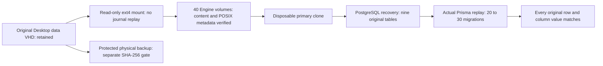
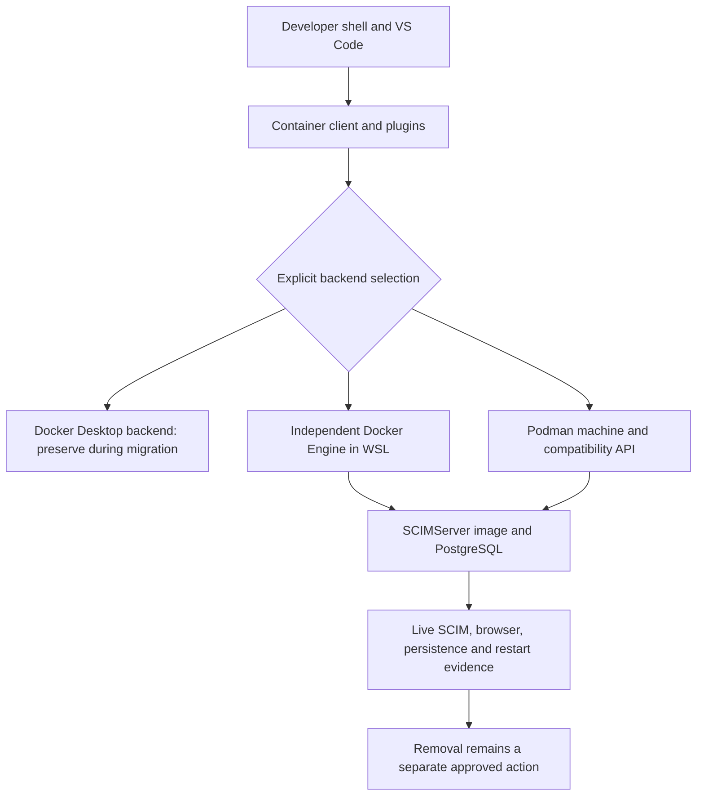
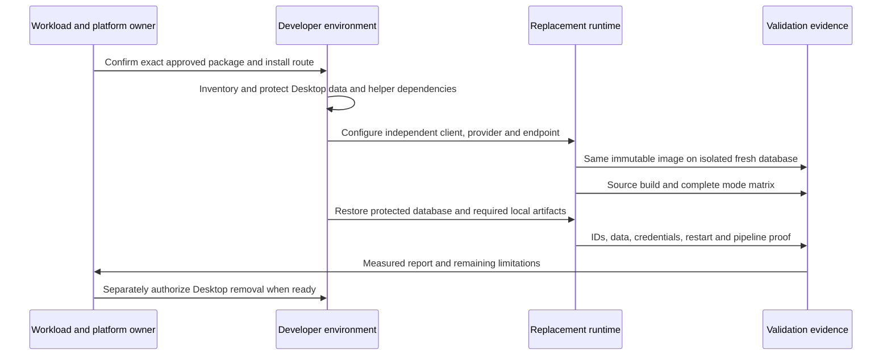
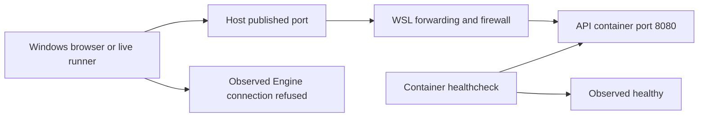
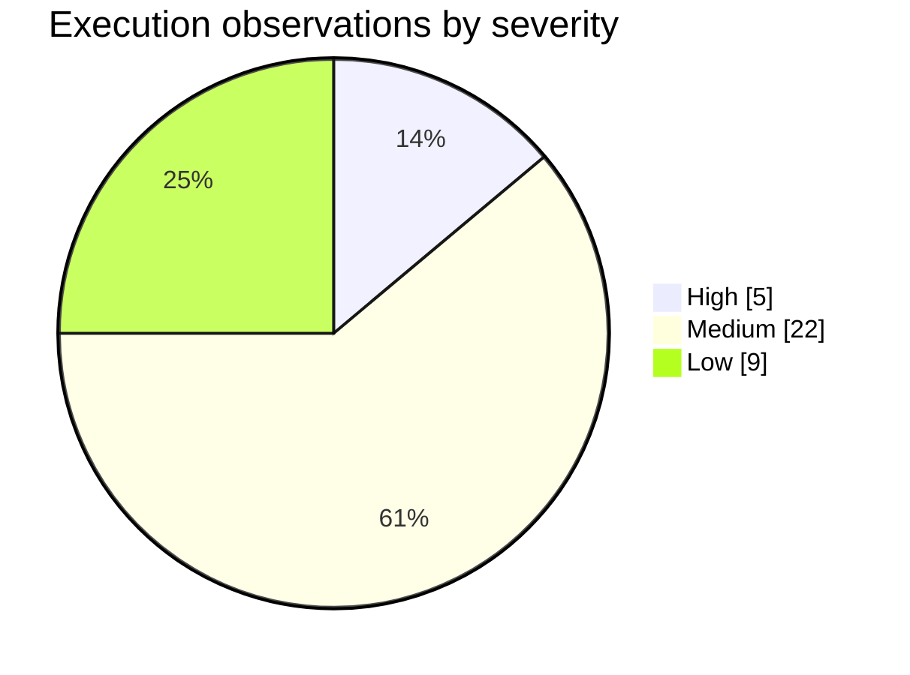
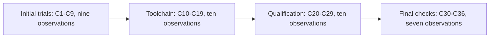

# Container runtime migration assessment

> **Historical qualification boundary: November 18.** This report preserves
> that day's measured trials, operating runbook and execution ledger.
> [Current removal readiness](CONTAINER_RUNTIME_REMOVAL_READINESS.md) is the
> authoritative dashboard for subsequent corrections, GUI setup and release/dev
> gates. Statements below about unchanged application code or open C29/C31/C32
> defects describe this earlier boundary, not the November 19 working tree.

**Last verified:** 2026-11-18
**Status:** Local Engine/WSL route implemented and qualified within the stated scope; Desktop retained
**Source baseline:** `3bee7a3c22992af9a08fde8e36fc398fc37b2b48`
**Application image tested:** SCIMServer 0.55.67, digest
`sha256:302c85387b6ebd352ae88d9648578d22071dddb69c41d60982afb7dbacb5fe93`

## Executive summary

SCIMServer requires Linux containers, not Docker Desktop specifically.
Its established automation does, however, require more than the ability to
start one OCI image: it uses Docker Compose, Buildx digest inspection,
PostgreSQL helper containers, bind mounts, and immutable-image deployment
checks.

**Implementation choice:** independent Docker Engine in Ubuntu WSL, with a
separately installed native Windows Docker client and plugins, connected over
key-only loopback SSH. This retains the existing Windows PowerShell, Compose
and Buildx workflows without a command-rewriting shim or unauthenticated
daemon TCP listener. Podman remains a viable alternative with additional
build/format adaptations, not the selected default for this project.

The initial approval hold was conservative: generated guidance did not
establish a native verified package-specific prohibition. Work resumed under
the supplied notice's explicit approval of the two runtime families. This
does not claim blanket organizational approval of every package or extension.

Both released-image stacks now pass actual Windows HTTP health access.
Engine passed all **1,841 live assertions**, then built the shipping root
Dockerfile without cache through the independent Windows client and SSH.
Native Windows Compose subsequently started that exact local image with
explicit Linux bind paths and isolated logs. Podman passed the new browser
SCIM/inventory/reload roundtrip. Its native source build succeeded, but
Buildx failed at rootless BuildKit startup and the default OCI native build
discarded the image healthcheck. A subsequent native `--format docker` build
retained it and passed all **1,841 live assertions** through Windows, with
isolated logs. Those are material integration differences,
not evidence that Podman cannot run SCIMServer.

Application code, product version and cloud estates remain unchanged.
Compose now accepts optional remote bind roots/log directories, and four
pipeline entry points enforce independent provenance when a session explicitly
activates it. Unactivated public workflows retain their previous behavior;
remote ACR builds and daemon-free pre-push modes remain daemon-free.
Docker Desktop and its original storage have not been removed. The complete
local backend matrix, Engine browser suite, drained backup/restore and real
debug source-reload checks have now passed. This is local runtime
qualification, not a cloud deployment, performance benchmark or permission
to remove Desktop.

### Consolidated measured evidence

| Surface | Result | Boundary |
|---|---|---|
| Engine release image and exact source-built image | Each live run reports 1,841 passes, zero failures. | Separate runs; not a performance comparison. |
| Podman Docker-format source image | 1,841 reported live passes, zero failures. | Native build required; existing rootless Buildx route failed. |
| Engine browser | 353 passed; zero failures, skips or flakes. | All 13 canonical pixel cases enabled; no baseline updates. |
| API units, in-memory and Prisma | Each: 216 suites, 6,254 tests passed. | Existing six-mode runner, independent Engine PostgreSQL. |
| API E2E, in-memory | 120 suites/2,570 tests passed; two suites/42 tests skipped. | Backend-specific skips retained, not counted as coverage. |
| API E2E, Prisma | 122 suites/2,612 tests passed. | Complete persistent-backend lane. |
| Web unit and coverage runs | Each: 125 files/1,662 tests passed. | Statements 83.06%, branches 75.86%, functions 75.53%, lines 85.74%. |
| New runtime contracts | 54 passed, plus existing deployment evidence contracts. | Provenance, rollback, real Compose model, pipeline boundaries and startup faults. |
| Tenant-copy helpers | Two preflight and six snapshot-runner controls passed. | Includes 2,000 rows, concurrent-write snapshot stability, cancellation and serialization. |
| Actual application backup/restore | Passed complete table/schema equality, unchanged source, original public IDs/membership and actual restored OAuth use. | Binary-safe dump transfer; durable final request verified; persistent browser stream drained before stop. |
| Original Desktop volume carry | All 40 volumes, 53,345 regular files and 3,443,816,867 logical file bytes copied and matched. | SHA-256 content plus names, types, ownership, permissions, nanosecond mtime and symlink targets; inode/ctime intentionally excluded. |
| Protected physical preservation | Original 70,928,826,368-byte data VHD and 100,663,296-byte main VHD each match their protected backup SHA-256. | Original data disk detached before cold verification; two configuration files also match. All ten backup paths pass user/SYSTEM-only ACL checks. Earlier unverified candidate retained separately. |
| Original primary cluster recovery | PostgreSQL 17 clone recovered; nine public tables fingerprinted. | Sealed raw Engine copy and original disk never started writable. |
| Original schema replay | Actual Prisma advanced a disposable clone from 20 to 30 migrations. | All original row/column values in nine tables matched, including DEKs, settings, allowlist and original migration rows. |
| Docker-free standalone, in-memory | Package built; 1,841 reported live passes. | New browser outcome test failed on an existing inventory dependency-wiring defect, C31. |
| Docker-free standalone, Prisma | 1,841 reported live passes and browser roundtrip passed. | Used an explicit repository migration stage. Packaged `-RunMigrations` is broken independently of the runtime, C32. |
| Debugger/source reload | Actual API inspector, source-edit restart and schema-backed inventory passed. | Host-side Compose watch required; bootstrap restart is minute-scale. |
| Cold runtime persistence | Checked-in startup reopened Engine after stopping only the two task-owned distributions; all 40 carried volume fingerprints still match. | No workload unexpectedly autostarted. This is a distribution cold-start test, not a Windows reboot. |

The existing live runner includes four retired-API placeholders in its
1,841 reported passes. It is not 1,841 independently exercised HTTP cases.
Jest E2E output also contains forced-exit/open-handle warnings; process exit
zero is not proof that those existing teardown leaks are fixed.

### Data preservation flow



The diagram distinguishes three independent claims: raw copy equality,
database recoverability and schema-upgrade preservation. Starting an
application successfully proves none of the other two. Five PostgreSQL 16
volumes remain version-16 data; they were copied, not silently upgraded or
started under PostgreSQL 17. There are 33 version-17 volumes and two empty
non-cluster directories. GNU tar requested ACL/xattr/sparse preservation;
the independent verifier checks the POSIX/content fields listed above, not
every ACL/xattr value. Two negative controls proved that changed file
contents and a writable source are specifically rejected.

## 1. What changes, and what must not change

Docker Desktop combines several separately replaceable components.
Keeping the `docker` command name does not prove that Desktop has been
replaced: the executable, Compose provider, credential helper and actual
server can each still belong to Desktop.



The diagram separates a replacement client/backend from the application and
from the later removal decision. An unchanged Dockerfile is compatible with a
meaningful Desktop migration.

### Invariants

- Preserve existing endpoint IDs, resources, credentials, encryption
  configuration, PostgreSQL extensions and migration history.
- Do not reuse shared databases or fixed-name containers for validation.
- Do not connect a default client to an unintended backend.
- Do not substitute a mutable tag for the admitted release digest.
- Do not expose an unauthenticated daemon TCP listener.
- Keep corporate package transport settings separate from lockfile provenance.
- Keep customer-production promotion explicitly authorized and separate.
- Preserve historical evidence instead of rewriting old reports as though
  they ran on the replacement.

## 2. Project requirements and affected surfaces

| Surface | Observed dependency | Migration consequence |
|---|---|---|
| [Root Dockerfile](../Dockerfile) | Four-stage Node 24 Alpine build; non-root runtime; Prisma migration startup; healthcheck | Build this shipping file, not just a historical sibling. |
| [Base Compose](../docker-compose.yml) | PostgreSQL 17, health dependency, named data volume, extension-init mount, log bind mount, configurable ports/names | Prove fresh startup, real Windows paths, permissions, persistence and isolation. |
| [CI-image override](../docker-compose.ci-image.yml) | Exact image can be supplied through `SCIM_CI_IMAGE`; `--no-build` avoids local rebuilding | Use the same digest on both trial backends before comparing source builds. |
| [Debug Compose](../docker-compose.debug.yml) | Source bind mount, dependency volume, development process and inspector port | Qualify separately. Production-image startup does not prove hot reload or debugger attachment. |
| [Full validation](../scripts/full-validation-pipeline.ps1) | Local process and Compose modes; isolated project, ports and cleanup | Preserve exact ownership and environment behavior. |
| [Dev pipeline](../scripts/dev-deployment-pipeline.ps1) | Docker prerequisite, owned PostgreSQL, Buildx, artifact pull/inspection, cloud handoff | Replace the Desktop-specific failure instruction only alongside a working independent-client route and tests. |
| [Promotion](../scripts/promote-to-prod.ps1) | `docker buildx imagetools inspect` before immutable promotion | Compatibility requires the actual Buildx workflow, not an alias test. |
| [Pre-push](../scripts/pre-push-checks.ps1) | Source-context audit and optional full image build/scan | Preserve distinct static, build and container claims. |
| [Backend matrix](../scripts/test-all-modes.ps1) | InMemory and Prisma unit/HTTP modes | Container-engine changes must not narrow persistence coverage. |
| [Tenant-copy preflight](../scripts/test-tenant-copy-preflight.ps1) and [snapshot tests](../scripts/test-tenant-copy-snapshot.ps1) | Piped shell input, isolated helper containers and PostgreSQL tools | Test stdin, exit codes, network isolation and database-copy semantics. |
| [Restore tooling](../scripts/restore-from-old-prod.ps1) | Containerized PostgreSQL commands and mounts | Validate Windows/Linux path handling and binary-safe data transport. |
| [ACR publication](../scripts/publish-acr.ps1) | Local Docker client or explicitly selected remote build | Qualify authentication without copying Desktop's credential store. |
| [Shipping workflow](../.github/workflows/publish-ghcr.yml) | Hosted Docker build and immutable artifact publication | A Windows developer-tool migration does not itself justify changing hosted CI engines. |
| [Standalone build](../scripts/build-standalone.ps1) | Explicitly Docker-free packaging | Preserve this independent deployment mode; it is not evidence that Compose works. |

Five tracked Dockerfiles and three Compose files exist. The shipping root
Dockerfile remains the authoritative source-build target. Historical
Dockerfiles should be classified, not silently deleted or promoted to active
status.

Developer-level dependencies also include registry authentication, VS Code
Container Tools/Dev Containers, and any MCP gateway launched through
`docker mcp gateway run`. Those are not automatically migrated by choosing a
new container server.

## 3. Alternative comparison

The table expresses architectural fit and cost, not benchmark results.

| Criterion | Docker Engine in WSL | Podman on Windows/WSL |
|---|---|---|
| Existing `docker` CLI/API assumptions | Closest match, provided the client actually targets the independent engine | Compatibility API needs qualification against the exact clients and plugins |
| Compose | Native Docker Compose path; independent installation still required | `podman compose` delegates to an external provider |
| Buildx and digest gates | Existing Docker workflow can be retained | Must prove Buildx/image-manifest operations and any builder integration used |
| Windows usability | Requires an explicit Windows-to-WSL workflow, or a Linux-first toolchain | Native Windows CLI and machine management are useful |
| Rootless operation | Available, but a separate configuration with prerequisites | Trial machine reported rootless operation |
| Security boundary | Rootful socket access is highly privileged; rootless is an option | Rootless helps reduce privilege; API access still permits arbitrary operations as its user |
| Persistent database behavior | Conventional Docker named volumes | Separate Podman storage and user mappings; restore and ownership need proof |
| File I/O | Cross-filesystem builds and bind mounts need measurement | Also uses a Linux VM; Windows paths and absent bind sources need testing |
| Networking | WSL forwarding, VPN and firewall behavior remain relevant | WSL and Podman forwarding introduce their own compatibility considerations |
| GUI | No Desktop-equivalent GUI is inherent in Engine | Optional Podman Desktop; do not assume GUI/package approval |
| Maintenance | Linux distribution, Engine, Compose, Buildx and host integration need an owner | Podman client, machine OS, Compose provider and optional GUI need an owner |
| CI/cloud portability | Minimal change to existing hosted Docker and OCI artifact flow | OCI images remain portable, but local tooling compatibility is a separate claim |
| Long-term cost | No Desktop dependency, but ongoing integration/patching effort | No required Desktop subscription, but compatibility/provider maintenance effort |

### Why Engine is selected

The load-bearing dependency is the automation contract, not the Desktop GUI.
An independent Engine retains more of that contract without replacing the
builder, compatibility API and provider at once. The cost is real: Windows
shell integration and networking must be deliberately supported.

Podman is not rejected. It started the real application and database in a
rootless trial and offers convenient Windows machine management. If the
approved Engine route cannot provide a reliable Windows workflow, and Podman
passes the full pipeline matrix with independent clients, the final decision
can legitimately favor Podman.

Do not introduce a generic multi-engine abstraction merely because two
alternatives exist. First select and qualify one supported default. Add a
second engine seam only when two maintained implementations are an actual
requirement.

## 4. Initial measurements and limitations

The first table is retained as historical startup-only evidence. It predates
the resumed trials below and must not be used as the current qualification
status.

| Check | Engine trial | Podman trial | What it proves |
|---|---|---|---|
| Independent Linux backend | Ubuntu 24.04; Docker 29.1.3 | WSL machine; Podman 5.8.10 | These versions were installed and responded during the trial. |
| Independent Compose | Ubuntu Compose 2.40.3 | Standalone Windows Compose 2.40.3, explicit provider | Provider independence was checked after finding a hidden Desktop dependency. |
| Released image pull | Exact digest pulled | Same exact digest pulled | Both stores obtained the referenced release image. |
| Fresh PostgreSQL and API startup | Compose `up --wait` exited 0; both healthy | Same, after missing log directory was created | Fresh startup and healthchecks passed at that point. |
| Windows `127.0.0.1` access | Port 18080 connection refused | Not tested before pause | Engine host access is unresolved; Podman has no host-access result. |
| Live SCIM suite | Not run | Not run | No wire-contract acceptance claim. |
| Browser suite | Not run | Not run | No UI/layout acceptance claim. |
| Local source build | Not run | Not run | No Dockerfile/build-cache comparison. |
| Existing-data restoration | Not run | Not run | No data-migration qualification. |
| Stop/preservation | Owned containers stopped; trial distribution stopped | Owned containers and machine stopped | Trial data was retained. |

The Engine API container reported exit code 1 when stopped. That exit code
and the earlier loopback failure require investigation after authorization.
The available evidence does not establish a causal connection between them.

Requested resource limits on the Podman machine must not be reported as
enforced limits: its information response exposed 16 CPUs and roughly
31.3 GiB total memory despite initialization requesting 4 CPUs and 4 GiB.
WSL resource policy requires its own inspection and acceptance.

No latency, throughput, memory-efficiency or stability ranking was measured.
Single-run startup success is not a long-term reliability benchmark.

## 5. Current upstream discourse, checked 2026-11-18

Primary documentation and issue state are more useful here than generic
"Podman versus Docker" benchmark articles.

1. [Podman's Compose manual](https://docs.podman.io/en/latest/markdown/podman-compose.1.html)
   explicitly documents external provider execution and provider precedence.
   The trial reproduced this concern: its first provider was Desktop's
   executable. A working `podman compose version` was therefore insufficient
   evidence of independence.
2. [Podman's machine manual](https://docs.podman.io/en/latest/markdown/podman-machine.1.html)
   documents Windows' WSL default and the required virtualized Linux backend.
   "Daemonless" does not mean that Windows needs no VM or API-forwarding
   processes.
3. [Podman Compose issue 1500](https://github.com/containers/podman-compose/issues/1500)
   and [Podman issue 26505](https://github.com/podman-container-tools/podman/issues/26505)
   were open when checked. They concern healthcheck API/`start_interval`
   semantics. The reported reproducer uses older versions and a different
   provider from this trial. The current base Compose does not set
   `start_interval`; these issues motivate outcome-level tests, not a claim
   that this SCIMServer stack failed for that reason.
4. [Podman issue 29778](https://github.com/podman-container-tools/podman/issues/29778)
   was open and concerns Windows mirrored-networking port binding.
   [Issue 27643](https://github.com/podman-container-tools/podman/issues/27643)
   discusses changing the Windows networking approach. These are risk
   indicators, not diagnosed causes of this machine's behavior.
5. [WSL issue 10494](https://github.com/microsoft/WSL/issues/10494)
   is closed. It describes an older Docker/mirrored-networking problem.
   A closed historical report must not be presented as a current confirmed
   defect in the installed WSL version.
6. [Microsoft's WSL networking guidance](https://learn.microsoft.com/en-us/windows/wsl/networking)
   describes NAT, mirrored networking, localhost and firewall considerations.
   The failed host probe needs a per-hop diagnosis, not a blanket firewall
   exception or an unauthenticated API listener.
7. [Microsoft's filesystem guidance](https://learn.microsoft.com/en-us/windows/wsl/filesystems)
   recommends keeping Linux-heavy work in the Linux filesystem for speed.
   Existing Windows worktrees must not be relocated without approval; compare
   the real authorized layout before proposing a different one.
8. [Docker rootless documentation](https://docs.docker.com/engine/security/rootless/)
   and [socket protection guidance](https://docs.docker.com/engine/security/protect-access/)
   show that rootless Engine and SSH-based access are supported options.
   Neither was qualified here. Do not equate rootless containers with a
   completely unprivileged management API.
9. [Podman API documentation](https://docs.podman.io/en/latest/markdown/podman-system-service.1.html)
   describes the compatibility layer and warns about API access.
   Compatibility does not imply identical semantics for every plugin.
10. [Upstream Podman releases](https://github.com/podman-container-tools/podman/releases)
    listed 6.2.0 while the Windows catalog trial installed 5.8.10.
    Record and patch the actual selected channel; do not attribute untested
    new-release features to the installed package.

## 6. Required migration sequence



### Phase A: policy, provenance and preservation

1. Confirm the exact package/source/distribution and support owner.
2. Inventory Desktop containers, images, volumes, bind mounts, contexts,
   credentials and extensions during an authorized access window.
3. Make protected backups; identify unique local images and databases.
4. Prove restoration into an isolated replacement. A copied disk or exported
   image alone is not a tested database backup.

### Phase B: independent developer experience

1. Establish an explicit server identity/endpoint preflight.
2. Install clients, Compose and Buildx independently of Desktop.
3. Use a separate credential configuration. Do not copy
   `credsStore: desktop` into the replacement.
4. Choose and test one shell boundary. Native Windows clients with a supported
   authenticated transport and a Linux-first workflow have different path,
   environment, stdin and tooling costs.
5. Preserve exit codes, working directories, environment variables, spaces in
   paths and binary streams. A PowerShell `docker=podman` alias or a naive WSL
   wrapper is not sufficient.
6. Qualify VS Code and any MCP gateway separately. Keep approved direct
   first-party tools available instead of assuming Desktop's gateway survives.

### Phase C: behavioral and persistence acceptance

| Mode or flow | Required assertion beyond process startup |
|---|---|
| Windows-host local InMemory | Correct HTTP payloads, response key allowlists, live suite and browser outcomes |
| Windows-host local API with replacement PostgreSQL | Windows-to-WSL database reachability and complete Prisma HTTP suite |
| Replacement Compose with admitted image | Fresh migrations/extensions, live suite, browser suite and no orphan endpoints |
| Replacement Compose source build | No-cache build with approved npm transport; identical lockfile bytes |
| Debug Compose | Source change reaches process; debugger attaches; dependencies are isolated |
| Persistent restart/recreation | Same endpoint/resource IDs, membership IDs, credentials and settings survive |
| Backup/restore | Source/target content and schema equality; credential usability; original source unchanged |
| Tenant-copy helper tests | Transaction/snapshot guarantees, isolated storage/network and exact-ID cleanup |
| Buildx/artifact flow | Correct manifest digest, source binding and architecture; no mutable-tag fallback |
| Registry login/pull | Intended account and registry; no Desktop helper; no secret output |
| Offline and reboot | Clear failure diagnostics; independent restart without Desktop; recovery instructions |
| Dev/canary deployment | Existing full gate walk on exact admitted image, only after deployment authorization |
| Customer production | Separate approval; not required merely to change a developer's container runtime |

### Phase D: project wiring

- Add a discriminating failing test before implementing the selected endpoint
  and client preflight.
- Update the Desktop-specific dev-pipeline instruction and its contract test.
- Wire the selected route into full validation, pre-push full mode,
  PostgreSQL helper flows, publication and promotion prerequisites.
- Retain hosted CI's existing builder unless a separate requirement justifies
  changing it.
- Update [README](../README.md), [deployment guide](../DEPLOYMENT.md),
  [Docker guide](DOCKER_GUIDE_AND_TEST_REPORT.md),
  [local build guidance](LOCAL_DOCKER_BUILD.md),
  [infrastructure reference](DEPLOYMENT_INFRASTRUCTURE_AND_FORM_FACTORS.md),
  session context, relevant skills and executable tests together.
- Keep historical Docker Desktop measurements explicitly historical.
- Do not bump the product version or publish a runtime release for this
  preliminary assessment and standalone tooling preparation.

### Implemented independent session and pipeline route

[Independent-runtime preflight](../scripts/independent-container-runtime.ps1)
defines `Assert-IndependentContainerRuntime`. It checks the selected
Docker-compatible application, executable links, credential-helper
references, actual endpoint, Linux server identity, and Compose/Buildx
executable paths and version commands. It rejects Desktop dependencies,
unavailable evidence and TCP daemon transport rather than silently selecting
another context. It neither starts nor stops a runtime.

```powershell
. .\scripts\independent-container-runtime.ps1
Assert-IndependentContainerRuntime
```

Run this in a PowerShell 7 shell with an independently installed
Docker-compatible client and its plugins. This is not a native `podman`
command adapter and does not qualify a Windows-to-WSL bridge. A
Podman-compatible fixture passing the tests does not establish that the real
Podman client supplies Docker client/plugin metadata.

[Offline contracts](../scripts/test/independent-container-runtime.contract.ps1)
cover 34 cases, including all the rejection categories above, context versus
host override precedence, malformed configuration without credential-value
disclosure, and explicit Compose/Buildx failures. Rejection cases assert the
specific failure reason, not just that some exception occurred.

```powershell
pwsh -NoProfile -File .\scripts\test\independent-container-runtime.contract.ps1
```

The missing-helper contract was observed RED before implementation. All 34
contracts subsequently passed. A separate check against the actual current
Windows shell rejected the preserved Desktop executable before daemon access.
That original check is rejection evidence only. Subsequent actual Engine/SSH
and Podman-compatible sessions both passed the preflight with independent
Windows clients and plugins.

`Enable-IndependentContainerRuntime` now selects a client directory, isolated
configuration, endpoint and optional Linux bind roots for the current process
and its children. It clears an inherited `DOCKER_CONTEXT` override, validates
the actual selection and restores every previous setting on rejection,
including the distinction between absent and empty environment variables.
It does not change the saved default Docker context or machine/user PATH.

An accepted session sets `SCIM_REQUIRE_INDEPENDENT_CONTAINER_RUNTIME=1`.
Dev deployment, full validation before Compose cleanup, Full-mode pre-push
before build, and local ACR publication before cloud side effects now enforce
the preflight when that flag is present. Existing non-activated workflows
remain compatible. Remote ACR builds and Fast/Validate pre-push modes do not
acquire a daemon dependency. Manifest-only promotion keeps its existing
remote Buildx operation rather than requiring a local daemon.

Three activation/rollback cases, seven real Compose model cases, seven
pipeline-boundary contracts and three startup cases supplement the 34
provenance cases: **54 new contracts** in total. The existing
deployment evidence contracts also pass. These are separate claims from the
live and browser results.

### Operator workflow for the installed Windows route

The local trial installation uses Ubuntu 24.04 WSL, Ubuntu-signed Engine
29.1.3, independent Windows Docker client 29.9.3, Compose 2.40.3 and
Buildx 0.30.1. It is not a wrapper around Desktop. The Windows client archive
was obtained from the vendor HTTPS endpoint and locally hashed, but its
executable is not Authenticode-signed. An observed hash is not an independent
publisher signature. Compose, Buildx and the independent Windows credential
helper were checked against their vendor release checksums.

1. Keep the existing Desktop installation and original data untouched.
2. Keep the independently provisioned `scimruntime` SSH account, authorized
   key, Windows alias `scimserver-engine-wsl-trial` and pinned known-host file.
   The standard SSH service/socket are masked. The alias uses port 22222,
   batch mode, one explicit identity and strict host-key checking.
3. In a dedicated terminal at the checkout, start the foreground transport:

   ```powershell
   pwsh -NoProfile -File .\scripts\start-container-engine-wsl.ps1 `
     -Distribution Ubuntu-24.04
   ```

4. Leave that terminal open. In a second PowerShell 7 terminal at the checkout,
   select the installed independent client, its isolated configuration and
   backend-visible bind roots:

   ```powershell
   $root = (Get-Location).Path
   $linuxRoot = (
     wsl --distribution Ubuntu-24.04 --user root --exec wslpath -a -u $root
   ).Trim()
   $tools = Join-Path $env:LOCALAPPDATA 'SCIMServer\container-tools'
   $logs = Join-Path $root 'test-results\container-engine-logs'
   New-Item -ItemType Directory -Path $logs -Force | Out-Null
   . .\scripts\independent-container-runtime.ps1
   Enable-IndependentContainerRuntime `
     -ClientPath "$tools\docker-cli-29.9.3\docker\docker.exe" `
     -ConfigDirectory "$env:LOCALAPPDATA\SCIMServer\docker-engine-trial" `
     -Endpoint 'ssh://scimserver-engine-wsl-trial' `
     -BindSourceRoot $linuxRoot `
     -LogDirectory "$linuxRoot/test-results/container-engine-logs"
   docker version
   docker compose version
   docker buildx version
   ```

5. Run the existing project commands from that activated terminal. For a local
   source build, continue passing the approved npm transport through
   `NPM_REGISTRY`; host npm configuration is not inherited by a build.
   Use distinct project/container names and loopback ports for extra stacks.
   The carried original volumes are preservation copies, not disposable test
   data. Choose an explicit new working project, or clone a selected preserved
   volume before recovery. Do not run `down --volumes` against a carried
   project's name, and do not use blanket volume prune. Preservation labels
   identify these volumes but do not make Docker enforce immutability.
6. Stop only the workloads belonging to the selected project before closing
   its foreground transport terminal. Do not use blanket prune or WSL shutdown.
   Reopening a normal terminal does not inherit this session activation and
   does not silently select a replacement backend.

The SSH route carries the existing Unix-socket API without an unauthenticated
daemon TCP listener. Membership of the Linux `docker` group is root-equivalent
inside this distro and can affect accessible host mounts. It is not a
rootless security boundary or general Windows administrator authority.
Protect the SSH private key and do not forward this loopback service.

The checked-in startup script was also run on a separate owned port, 22223,
and its actual Engine response was verified using the already-pinned host
key, without password or host-key bypass. The canonical alias remains 22222.

**Debug mode:** Compose 2.32 or newer is required for host-side watch restart
and the explicit port-list override. The debugger and API publish only selected loopback ports by
default; the production 8080 mapping is not inherited. Set
`DEBUG_API_HOST_PORT` and `DEBUG_INSPECTOR_HOST_PORT` for parallel stacks.
The debug container receives `NPM_CONFIG_REGISTRY` from `NPM_REGISTRY`, checks
its actual port 3000 and attaches the inspector only to the API process,
not every npm/bootstrap child. Bootstrap generates the Linux Prisma client in
an isolated volume and applies migrations before starting the API.

An actual Windows edit did not trigger Linux Node watch through the WSL bind.
Use `docker compose -f docker-compose.yml -f docker-compose.debug.yml watch`
from the activated Windows terminal. The host-side watch restarts the
container and ignores generated clients. A real edit changed the API
inspector session and reset process uptime, followed by healthy API and
database inventory responses. The source probe was removed and the original
file hash restored. Restart repeats dependency bootstrap and is minute-scale,
not a claim of fast hot reload. Native Windows Node with Engine-hosted
PostgreSQL is the preferred fast inner loop; Linux-native source is another
option when Linux file watching is important.

**VS Code:** the native first-party integrated browser already reached the
independent Engine application without the Docker MCP gateway, displaying
18 owned users in four measured, bounded columns. Repository Playwright
provides the repeatable browser route. Existing optional Docker MCP
configuration is retained as a legacy artifact, not claimed to be migrated.
For extension tools that inherit shell environment, the official remote-host
guidance requires closing all VS Code instances before launching `code .`
from an activated terminal. That was not done to this shared working window;
do not assume its extension host inherited a later terminal's settings.

## 7. Historical worked example: why health is not qualification

The trial supplied an immutable image, distinct Compose project/container
names, loopback-only ports and a fresh project-scoped PostgreSQL volume.
Compose waited for PostgreSQL and API healthchecks and exited successfully.

The application healthcheck runs *inside* the API container against
`127.0.0.1:8080`. A subsequent Windows request to the Engine trial's published
port was refused. These observations are consistent: an internal healthcheck
does not exercise the host publishing path.



Subsequent retained application logs showed startup migration error P1001
after PostgreSQL was unavailable. Starting the owned database before the API
and keeping the WSL session alive resolved the reproduced access failure;
Windows health, full live requests, source-built Compose and browser traffic
subsequently worked. This does not establish a firewall or Podman-conflict
root cause for the initial observation. Keep the original result historical.

## 8. Execution issues and prevention

| ID | Type / severity | Observation and mechanism | Resolution and earliest prevention |
|---|---|---|---|
| C1 | Process / Medium | Additional package-approval qualification was retrieved after trial installation. The notification identified families but did not establish exact package approval. | Paused further runtime work. Confirm package/source before future installs. No rollback/deletion was attempted. |
| C2 | Tooling / Medium | `podman compose` initially selected the Docker Desktop provider through discovery. This could create false independence evidence. | Explicit independent provider selected and version checked. Future preflight must assert the provider executable's provenance, not only its version. |
| C3 | Orchestration / Low | A provider-use command overlapped the provider download and returned a Windows file-sharing error. | Retried only after verified download completion. Installation is a prerequisite, not an independent parallel action. |
| C4 | Filesystem / Medium | Podman rejected the absent `logs` bind source. The directory existed after the parallel Engine startup; the Podman retry succeeded. | Startup workaround only, not a permanent source fix. Add an explicit writable-bind preflight or deliberately selected named-volume contract during implementation. |
| C5 | Startup/lifecycle / Medium | Initial internal health did not establish later Windows reachability. Retained logs include migration P1001 after PostgreSQL unavailability. | Ordered database-before-API restart and an active WSL lifetime produced successful Windows health and complete live traffic. No firewall or cross-runtime conflict was demonstrated. Earliest gate: actual host HTTP, where caught. |
| C6 | Lifecycle / Medium | Initial Engine API exit code 1 was not successful shutdown evidence. Logs showed startup database failure rather than a demonstrated shutdown-handler defect. | Preserved the original failure and separated it from later lifecycle qualification. Earliest gate: actual stop/exit inspection, not Compose health. |
| C7 | Evidence access / Low | Native page-body retrieval was unavailable through the authorized tool. Later supported list/drive metadata calls verified the guidance file identity and revision, but did not return its body. | Kept generated source-attributed wording distinct from native policy text. Metadata verification is not content verification; no alternate identity or authentication was attempted. |
| C8 | Documentation tooling / Low | The fresh worktree lacked the dependencies required by the Mermaid renderer. | Restored the existing locked root/web dependencies only after the missing-tool failure. Both lockfile SHA-256 values remained unchanged; all five new diagrams then rendered in both themes. |
| C9 | Viewer environment / Low | The Markdown doctor found competing built-in and marketplace Mermaid renderers. | Left editor extensions unchanged and generated standalone HTML. After dependency restoration, the gate and built-in renderer both reported Mermaid 11.17.0; version drift was not confirmed. |
| C10 | Tooling / Low | The Buildx checksum parser initially missed the standard binary-mode `*filename` marker. Execution was blocked before verification. | Accepted the optional marker and verified the downloaded binary against the vendor checksum before executing it. Earliest detection: checksum parsing, where caught. |
| C11 | Shell semantics / Medium | The session rollback contract found that calling the .NET environment setter with PowerShell `$null` produced a present empty variable rather than restoring an absent variable. | Switched to the PowerShell environment provider. All three activation/rollback contracts pass, including exact absent-value restoration. Earliest detection: the offline rollback contract, where caught. |
| C12 | Host/backend path boundary / Medium | Native Windows Compose rendered Windows bind paths for the remote Linux Engine. The explicit remote-bind contract failed before edits. | Added optional backend-source and log-directory variables while retaining local defaults. Three real Compose-rendering contracts pass. Native Windows Compose then started the exact source-built image through SSH with its log bind inspected as the intended Linux path. |
| C13 | Runtime compatibility / Medium | Docker Buildx against rootless Podman selected a BuildKit container whose startup failed with cgroup permission denial. | Preserved the failed trial and did not add privileged access or weaken isolation. The same shipping Dockerfile built without cache through Engine/WSL and pinned SSH. Native Podman/Buildah is a different workflow, not evidence that the existing Buildx build works. Earliest detection: the real source-build gate, where caught. |
| C14 | Test prerequisites / Medium | Both first full live runs passed 1,836 assertions and failed five fixture-backed sections because the fresh worktree lacked API TypeScript dependencies. These were harness import failures, not server assertions. | Restored the existing locked API dependencies, generated Prisma with an explicit isolated database configuration, and built the API. Engine's complete rerun passed 1,841/1,841 with clean endpoint reconciliation. No lockfile changed. Earliest possible detection: fixture compilation before the live matrix; actually caught by live child-process imports. |
| C15 | Tool configuration / Low | Prisma generation initially failed because its configuration requires `DATABASE_URL`, even when generating rather than querying. | Supplied only the owned local trial database configuration. Generation and API TypeScript build passed. Earliest detection: the generation prerequisite, where caught. |
| C16 | Test selector / Low | A Windows-backslash Playwright file argument was interpreted as a regular expression and matched no tests. | Selected the unique spec basename rather than a filesystem path. The browser test then executed. Earliest detection: test discovery, where caught. |
| C17 | Test correctness / Medium | The new browser test incorrectly equated a public SCIM resource ID with the database-inventory row ID. Its outcome assertion failed while the screenshot showed the correct user and four-column table. | Matched inventory by endpoint and unique userName, used its actual row ID for the browser locator, and independently checked GET by the original public SCIM ID. The corrected Podman browser test passed. Inspected the failure screenshot; no visual baseline was regenerated. Earliest detection: the new browser outcome assertion, where caught. |
| C18 | Image-format compatibility / Medium | Native Podman default OCI output omitted the Dockerfile healthcheck. A later check also initially used Docker's metadata nesting against native Podman output. | Rebuilt with `--format docker` and verified native top-level `Healthcheck.Test` on the exact image before starting it. Its full live run passed 1,841 assertions. Read the actual CLI response contract; build success alone does not establish image-health fidelity. Earliest detection: the build warning, then image inspection before admission. |
| C19 | Test harness / Medium | Startup fault injection changed `$script:` state in the caller, but the invoked script resolved a different script scope. | Shared state-object properties replaced cross-script scalar assumptions; all three daemon/transport startup contracts pass. Inject faults through state the invoked scope actually shares. |
| C20 | Test environment / Medium | The first full browser run used the default server OAuth secret instead of the Compose fixture secret and skipped 13 canonical pixel cases by local-target policy. | Supplied `E2E_OAUTH_CLIENT_SECRET` explicitly and enabled `E2E_VISUAL_BASELINES=1`, with `--update-snapshots=none`. Both original screenshots were inspected. The 13 pixel comparisons and both failed cases then passed together, without baseline regeneration. |
| C21 | Transport evidence / Medium | The first browser run also had one numeric-readback socket hangup. No persistent application defect or server restart was established. | The exact numeric case passed unchanged in the 15-case focused rerun. Keep the transport failure in the record and require the complete corrected run; do not add a blanket retry or claim an unproved root cause. |
| C22 | Debug composition / Medium | Real model rendering exposed inherited production ports, a fixed debug name, the production health port, npm without the corporate transport, and an inspector option inherited by bootstrap children. | RED contract preceded the Compose fix. Five model cases now pass: isolated names/ports, actual health endpoint, explicit registry and inspector owned by the API entry point. Production-image health does not qualify debug mode. |
| C23 | Debug readiness / High | The debug API answered health 200 while database inventory failed with 500 and PostgreSQL had no public tables. Process liveness did not prove schema readiness. | Added `prisma migrate deploy` before API startup, after an explicit RED contract. Actual inventory then returned 200. Caught by the real debug inventory request; the earliest suitable gate is a schema-backed request, not the healthcheck. |
| C24 | Generated artifacts / Medium | Generating a Linux Prisma client under the Windows source bind could alter host-generated code and trigger watch loops. | Isolated generated output in an anonymous container volume and ignored it in host watch. The real model contract verifies both surfaces. Caught during debug setup; model rendering is the earlier prevention gate. |
| C25 | Filesystem events / High | Editing Windows source did not restart Node's Linux watcher through the remote WSL bind. A running inspector would have falsely suggested a working developer loop. | Added host-side Compose watch after a failing contract. An actual source edit produced a different API inspector session and lower uptime, then a successful database-backed request. Caught by the real edit/reload trial, which is also the earliest outcome gate. Minute-scale bootstrap latency remains a documented limitation. |
| C26 | Obsolete pipeline entry / Medium | Full validation referenced the removed `ts-node-dev` runner and used the wrong local health route. | A RED boundary contract preceded selection of the already-built `node dist/main.js` artifact and `/scim/health`. The packaged compiled entry point subsequently served all 1,841 live assertions. Caught at pipeline inspection/contract; this does not claim that cloud stages ran. |
| C27 | Test correctness / Medium | The first backup trial's fixture omitted attributes required by the actual endpoint schema. | Supplied schema-valid fixture fields and moved owned-resource cleanup into `finally`, with verified 404 absence. The completed restore trial passed. Caught by the first real fixture POST; schema-aware fixture validation is the earliest gate. |
| C28 | Lifecycle assertion / Medium | The backup harness initially assumed successful shutdown must return exit 0. Nest shutdown hooks deliberately re-emit the termination signal. | Inspected the actual framework shutdown implementation. The gate now admits expected 0/143 only with no OOM/error, then independently verifies durable final request logging and table equality. It still rejects SIGKILL 137. Caught at stop inspection; a signal-aware lifecycle contract is the earliest gate. |
| C29 | Persistent clients / High | An open, task-owned Logs event stream prevented bounded shutdown and produced SIGKILL 137. | Drained that browser stream, then repeated the entire backup/restore trial successfully, including durable final request, all-table/schema equality, unchanged source, original IDs/membership and actual restored OAuth credential use. This qualifies drained shutdown only. Live-SSE shutdown remains a pre-existing follow-up for the SCIMServer maintainer by 2026-11-25; no unrelated application lifecycle refactor was made. |
| C30 | Preservation / Medium | Windows hashing of the original Desktop data VHD failed with a sharing lock although Desktop's distribution was stopped. The disk was still attached to WSL. | Identified the original clean filesystem by device metadata and mounted only that disk `ro,noload`, without journal replay or starting Desktop. All 40 original volume directories were copied and independently content/metadata hashed. Physical VHD verification is a separate gate; a matching copy length is not hash evidence. |
| C31 | Existing backend wiring / High | The packaged in-memory server passed 1,841 live assertions, but the new browser outcome spec exposed an empty cross-endpoint inventory after successful SCIM creation. The screenshot showed a false empty state. | Preserved the failed test and screenshot without changing a baseline. `DatabaseService` needs an optional `EndpointService` to enumerate endpoints, while `DatabaseModule` imports only `PrismaModule`; absent service returns an empty list. This pre-existing application wiring defect is outside the runtime port. Owner: SCIMServer maintainer, target 2026-11-25. Native in-memory browser inventory is explicitly not qualified; the recommended persistent developer mode uses PostgreSQL. |
| C32 | Existing standalone tooling / High | Packaged `-RunMigrations` reported the missing Prisma 7 datasource config, then continued toward startup. The generated package does not carry the source config that CLI migration requires. | Retained the failed log. Applied migrations as an explicit checked source-controlled CLI stage against the isolated Engine database, then launched the package without claiming its migration switch worked. That persistent native server passed all 1,841 reported live checks and the browser roundtrip. Package-config inclusion and fail-closed launcher behavior are a separate tooling fix for the SCIMServer maintainer by 2026-11-25. |
| C33 | Compiler tooling / Low | TypeScript 6 rejected a direct changed-file check with TS5112 because a project config was present. | Added explicit `--ignoreConfig` to the narrowly scoped CLI check, retaining strict types and explicit resolution options. The spec then compiled and all eleven affected PowerShell files parsed. The failure was caught at the static gate, not bypassed by transpilation. |
| C34 | Physical backup / Medium | The earlier attached-state VHD candidate had the same file length/time but did not match the detached source's whole-file hash. | Retained the old candidate, made a fresh cold copy after exact detach and verified source/backup SHA-256 equality for both disks. The old candidate is explicitly unverified, not relabeled successful. Exact byte-level mismatch attribution was not attempted; mutable VHD container state makes a non-cold copy insufficient. The hash gate caught what length/time comparison could not. |
| C35 | Export verification / Low | Two final HTML probes expected invented capitalization/path text rather than the actual report inventory. Diagram checks passed; these were verifier assumptions, not missing exported content. | Replaced the guessed strings with a verified source heading and independently required every one of the 40 original volume names from the CSV. Both HTML files then passed with nine static SVGs and no raw Mermaid block. Prevention: derive content assertions from actual source records, not assumed prose. Detected and corrected in the export gate, the earliest applicable gate. |
| C36 | Report portability / Medium | The existing HTML exporter retained Markdown-relative links after moving output into another directory. Thirty-six links would not resolve from that output location, despite correct diagrams and valid original Markdown links. | Final report postprocessing resolves 38 local links, including index links, against their actual source locations and writes absolute local file URLs before copying the private HTML. Every target must exist. No unrelated general exporter change was made. Prevention: validate links from the delivered artifact location, not only its Markdown source. Caught at final artifact verification; the earliest gate is export-time link resolution. |

### Execution-issue dashboard

These are 36 observations, including harness/environment friction and
pre-existing defects, not 36 new application regressions.





The charts summarize the ledger rather than hiding first failures behind the
final pass. The important escapes were health versus database readiness,
watcher presence versus actual source reload, and API green versus a false
empty browser inventory. Existing outcome-first rules now have concrete
runtime/browse/preservation assertions. C29, C31 and C32 remain separately
owned follow-ups with dates.

**Detection-stage escape:** C1 should have been caught before installation;
C2 was caught by provider-path inspection before claiming independence;
C3 should have been prevented by serializing install/use;
C4 was caught at container creation; C5 at the first host request;
C6 at shutdown. These observations refer to the initial trials, before the
subsequent full live and browser qualification.
C8 was caught by the documentation render gate before publication; C9 by the
viewer doctor. The HTML export avoids the viewer conflict without claiming to
repair the editor environment.

**Test/gate self-improvement:** applied to this acceptance plan by making
provider provenance, per-hop host access and actual resource limits explicit
checks. The standalone provenance guard now has 34 passing offline contracts,
specific rejection-reason assertions, and actual Desktop-client rejection
evidence. Session rollback, actual Compose rendering and pipeline-boundary
contracts now guard the implementation. No cloud deployment is claimed.

**Design/architecture disposition: accepted.** The added helper has one
cohesive session-selection/provenance boundary and no dependencies on
application or cloud code. Foreground WSL startup is a separate small script.
Neither introduces a multi-engine framework nor silently changes public
pipeline defaults. Provider strategies would add speculative complexity:
both admitted API routes use the same Docker-compatible client contract.

## 9. Completion scope and remaining operational gates

The selected local project route is implemented, persistent and qualified by
the evidence matrix above. Engine/WSL and the Windows command boundary are
decisions, not open questions. Protected physical backups, all 40 raw volume
copies, actual application restore, original-cluster recovery/schema replay
and distribution cold-start persistence have independent proofs.

The following are deliberately not claimed complete:

| Gate | State and next action |
|---|---|
| Desktop policy removal | Not authorized or performed. The user must separately choose removal or the approved exception process before the notification deadline. Retaining Desktop does not satisfy an uninstall policy. |
| Package maintenance | Runtime-family approval comes from the supplied notice; exact native guidance body remains unavailable. Maintainer owns version/checksum review and updates. Do not treat generated wording as native policy. |
| Existing product/tooling defects | C29 live-SSE teardown, C31 in-memory inventory and C32 packaged migration switch remain separately owned, due 2026-11-25. They are not caused by the new runtime and are not hidden by the passing persistent route. |
| Windows host reboot | Not performed on the shared machine. Actual distribution stop/start passed; foreground transport must be reopened after reboot. |
| Private registry / cloud | No registry login/push, Azure deployment or production promotion. Applicable local preflight boundaries are tested, but cloud authorization and exact-tip deployment CI require their normal separately authorized execution. No certificate login was attempted. |
| Editor/MCP | Native browser and repository Playwright work without Docker MCP. Existing optional Docker MCP registration is retained and not qualified; independently migrate or disable it before eventual Desktop removal. Other editor windows were not restarted or assumed to inherit activation. |
| Performance and soak | Functional evidence is strong; concurrent single-session timings are not p95/p99, long-term stability or efficiency comparisons. Debug bootstrap latency is explicitly documented. |

Use the activated shell and an explicit working Compose project. Original
global PATH/context and unrelated processes were deliberately left alone.
No application code, product version, lockfile, customer data or cloud estate
was changed. This is a local tooling change awaiting normal review, not a
released image or production-readiness declaration.

### Documentation validation and provenance

- All 54 new contracts and existing deployment evidence contracts pass.
  The new browser spec passes strict TypeScript 6 compilation using explicit
  `--ignoreConfig`; all eleven affected PowerShell files parse.
- Coupled freshness audit passes all 27 manifest documents. Infrastructure
  audit passes source/doc coupling, freshness and all 13 known elements,
  without cloud calls.
- `git diff --check` passes. No product dependency or lockfile change is
  intended. An LF/CRLF-only snapshot status entry has no Git content diff;
  no Playwright image baseline was regenerated.
- Diagram rendering and standalone HTML are validated separately from
  Markdown grammar. The existing viewer conflict is retained, not repaired
  by changing another shared editor window.
- Final document checks cover fifteen changed/new Markdown documents, two
  literal JSON fences and 38 local links in the reports/debug guide. They
  pass, as do added-character rules and unchanged manifests/lockfiles/entry.

**RCA provenance/completeness:** the full-runtime reconciliation snapshot scanned all
4,328 available events at `2026-11-19T02:34:24Z` (November 18 local time),
including 576 tool completions, with a failure-signal pass and visible
diagnosis/narration-phrase pass. Tool starts were joined to completions;
218 successful read/search completions were excluded from execution-failure
counts. Their already-classified detailed log evidence remains mapped to
the ledger. The visible narration pass added no new candidates. All 54
execution-signal candidates were reviewed, including early events omitted
from bounded tail output. Signal frequencies are not defect counts.

Verified-and-dismissed non-issues include absent-tool/upstream probes,
retrieved cgroup metadata, intended TDD REDs and corruption controls,
reconciliation echoes, the first standalone health request racing startup,
an initially wrong matrix-log directory probe and an apparent quiet Prisma
lane that was still progressing. E2E forced-exit warnings remain disclosed,
not dismissed as proof of clean teardown. The initial 1,094-event receipt
is historical and is superseded by this full-runtime scan. Later
documentation/export checks and the completion transcript scan have their
own final validation receipts.
