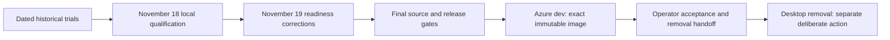
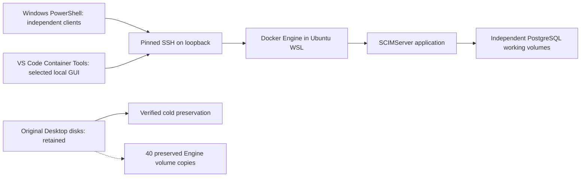
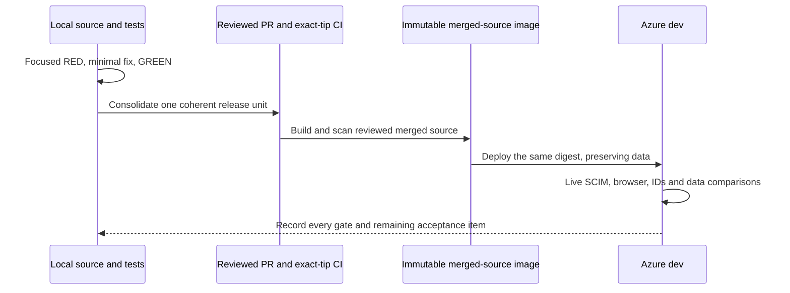
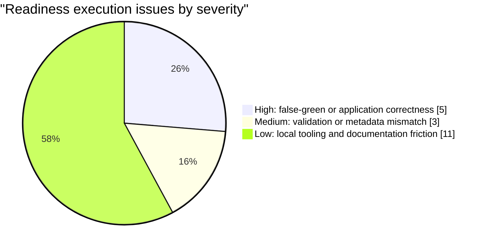
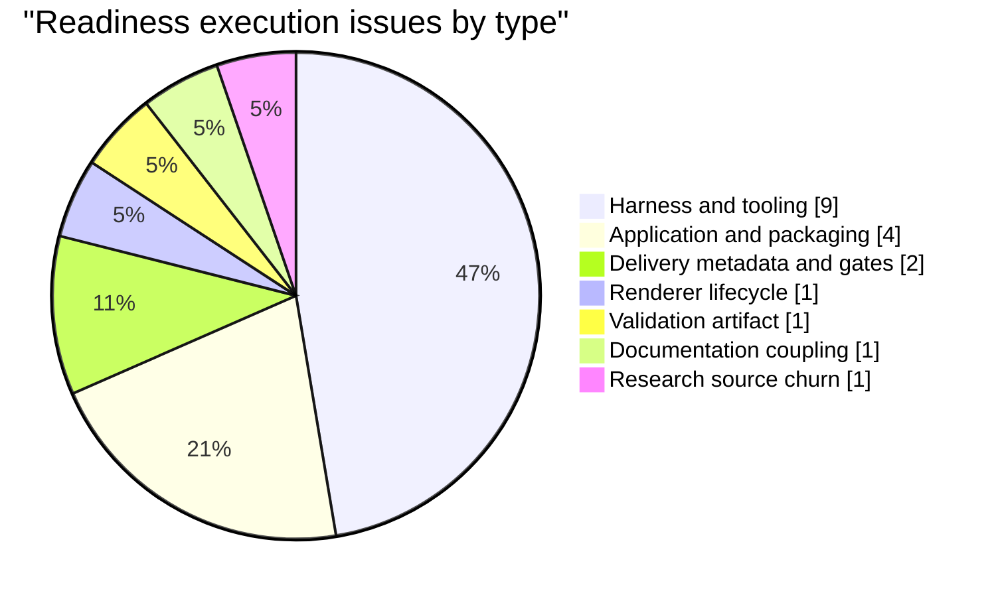
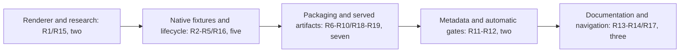

# Docker Desktop removal readiness

**Last verified:** 2026-11-19
**Status:** In progress. Local corrections are tested; consolidated release and Azure dev gates remain open.
**Product baseline:** 0.55.67
**Deadline from the supplied notice:** December 2, 2026

## Executive summary

The selected replacement remains independent Docker Engine in Ubuntu WSL,
with independent Windows Docker, Compose and Buildx clients over pinned,
key-only loopback SSH. Docker Desktop is not required by that route.
Docker Desktop removal is still deliberately not performed.

Markdown is the canonical documentation format. The earlier assessment
already existed as Markdown, both in this repository and in the private
report folder. HTML was an additional, pre-rendered viewing option because
the editor had competing Mermaid renderers. It was not intended to replace
Markdown. Presenting the HTML first and mixing initial closing receipts with
later results made the final state unnecessarily difficult to understand.
This document separates dated evidence, current corrections and open gates.

The marketplace Mermaid renderer and its already-uninstalled residual
directory are now removed. `npm run docs:mermaid:doctor` passes with one
built-in renderer, Mermaid 11.17.0, matching the gate. An already-open preview
can still require closing and reopening; no claim is made that every other
editor window has refreshed.

## 1. One authoritative status model

| Evidence boundary | Date | Meaning |
|---|---|---|
| Initial closing addendum | Earlier November 18 trial | Historical receipt, not the current readiness decision. |
| Completed local runtime qualification | November 18 | Engine and Podman functional runs, browser matrix, preservation and cold-start evidence. |
| Readiness corrections below | November 19 | New source changes, tested locally but not yet released or deployed. |
| Consolidated pipeline and Azure dev | Pending | Must validate the final source/image, not borrow an older green run. |
| Desktop uninstall / Intune consent | Not performed | Requires a deliberate final handoff after readiness acceptance. |
| Customer production | Not authorized | Dev permission is not production permission. |



The sequence shows why a historical FAIL or NOT RUN remains useful evidence
without overruling a later test. Equally, a November 18 pass does not prove a
November 19 application correction or a new Azure deployment.

## 2. Current acceptance dashboard

| Requirement | State | Evidence / next action |
|---|---|---|
| Independent Engine and Windows clients | PASS, previous qualification | Real SSH Engine response rechecked November 19; no Desktop executable used. |
| Mermaid environment | PASS, November 19 | Doctor reports exactly one built-in renderer and no blockers. |
| Original data preservation | PASS, November 18 | Both cold VHD copies/configuration hashes; all 40 volume fingerprints; isolated primary recovery and 20-to-30 migration replay. |
| Complete Engine browser suite | PASS, November 18 source | 353 passed; zero failures/skips/flakes; 13 pixel comparisons, no baseline replacement. Final-source browser proof still required. |
| API/backend/web matrix | PASS, November 18 source | Units 6,254 each backend; E2E 2,612 Prisma / 2,570 in-memory, 42 backend skips; web 1,662. Not fresh final-source counts. |
| Native in-memory inventory | CORRECTED, local source | Actual-module and HTTP regressions reproduced zero rows before the fix. EndpointModule import restores endpoint enumeration. |
| Active log-stream shutdown | CORRECTED, local source | Real open HTTP stream blocked the three-second deadline before the fix; lifecycle cleanup now closes it without client-first disconnect. |
| Actual container active-stream shutdown | PASS, consolidation source 45885140 | A genuinely connected SSE client ends without client-first disconnect when Docker sends SIGTERM. Stop completes in 1,035 ms with exit 0 and no OOM kill; the final correlated request has one durable database log row. Restart preserves the original user ID/value. Owned endpoint deletion/status/absence and exact full-container-ID cleanup pass. This is a local nonshipping image, not Azure dev evidence. |
| Neighboring native unit coverage | PASS, November 19 | Four suites, 103 tests including inventory wiring and stream cleanup. |
| Focused native HTTP coverage | PASS, November 19 | Two suites, three tests: user/group inventory and active-stream application close. |
| API compilation | PASS, November 19 | `npm run build`. |
| Changed API lint | PASS, November 19 | Zero errors; one warning on an unchanged pre-existing assertion. No unrelated lint cleanup. |
| Packaged migration/configuration | PASS, focused November 19 qualification | Four launchers select the packaged Prisma 7 configuration and stop on migration failure. The actual Prisma package applies all 30 migrations to a fresh owned Engine database, starts successfully, passes 1,845 live checks and the user/group browser roundtrip. Failure-path contracts have 54 assertions. |
| Clean standalone installation | PASS, November 19 consolidation | Actual builder installs 660 API and 256 production packages, builds the current web application and produces a 445.9 MB package. Both source lockfile hashes remain unchanged. The clean package applies all 30 migrations to a new uniquely labelled tmpfs Engine database on an assigned loopback port, passes 1,845 reported live checks and the owned user/group browser roundtrip. The package still identifies the 0.55.67 pre-version-bump source; this is clean-install proof, not a published 0.55.68 artifact. |
| Current packaged browser | PASS, Prisma and in-memory | Each mode passes the user/group inventory, reload, actual displayed row values and original SCIM-ID readback regression. This is not a new complete 353-case run. |
| Graphical management | BLOCKED pending executable-override requalification | The real Container Tools tree reached Engine and View Logs worked, but its terminal task selected the Docker Desktop docker.EXE despite the configured PATH. The parent is correcting the machine-local official containerCommand/composeCommand settings and requalifying actual commands, reload and reconnect. Earlier tree/log success is not Desktop-independence acceptance. |
| Image metadata and retention | CORRECTED, local source | Ten metadata/caller checks pass after reproducing the dispatch-publisher omission and absent automatic contract execution. Five independent Engine image records need no pruning. Publishing the corrected workflow is still pending. |
| Automatic offline runtime gate | PASS, November 19 | The common runner executes all seven suites, 118 assertions plus the standalone suite summary; exit 0. Pre-push, dev Stage 1.14 and Windows/Node 24 CI call it; CI image publication depends on that job. Hosted CI execution itself remains pending. |
| Normal startup/reconnect workflow | OPEN | Prove fresh-session CLI and GUI selection without global Desktop dependencies. |
| Documentation | PASS, focused November 19 | Freshness/coupling: all 27 docs; infrastructure: all 13 elements covered; 55 literal JSON blocks parse; links/style pass. New report diagrams render in strict light/dark Chromium. |
| Final ordered pipeline | OPEN | Must record each applicable gate and consolidate changed-source evidence. |
| Azure dev | OPEN | Existing registry-selected service-principal session verified; no certificate sign-in initiated. Deploy only at the proper reviewed-source gate. |

The November 19 raw native in-memory and both packaged-backend runs each report 1,845
passes and zero failures, including four added inventory-envelope/row checks.
These counts still include four retired-API placeholders; they are not 1,845
independently exercised HTTP cases.
Functional timings were measured under different workloads and are not a
comparative performance benchmark. Existing Jest forced-exit warnings are
not represented as clean-process proof.

## 3. Selected architecture and operating boundaries



The GUI and terminal must address the same Engine and return the same image
and container IDs. A running GUI is not itself proof of correct selection.
Preserved original volumes are not working databases: clone one before
writable recovery. Never use blanket volume prune or `down --volumes`
against carried projects.

The current startup bridge is foreground and process-scoped. It must remain
open while the Windows SSH route is in use. Persistent startup and any change
to other windows' defaults are separate behavior changes, not implied by
installing the independent client.

See the [existing activation/startup runbook](CONTAINER_RUNTIME_MIGRATION_ASSESSMENT.md#operator-workflow-for-the-installed-windows-route).

## 4. Graphical management comparison

| Option | Engine/WSL SSH route | Podman route | Decision |
|---|---|---|---|
| Microsoft VS Code Container Tools | Documented Docker CLI/SSH support; inspect image JSON, labels, tags, containers, logs, volumes and registries | Native Podman client supported; qualify the selected connection | Primary candidate: already installed; avoids adding a privileged web service. |
| Podman Desktop | Released Docker provider skips SSH/TCP contexts; Unix sockets and named pipes are different supported transports | Strong fit for its independent rootless Podman machine | Best native Podman GUI candidate, not the primary Docker-over-SSH GUI. |
| Portainer Community Edition | Connect inside WSL through the Docker socket, not the Windows Docker context | Rootless Podman not officially supported | Standalone dashboard fallback; adds daemon-level socket privileges and authentication/TLS obligations. |
| Dockge | Primarily Compose-stack management with socket access | Podman listed; rootless equivalence not proven | Not the best fit for image-label and publication inspection. |

All four have no-cost open-source editions/licenses; this is not a claim
that an internal corporate approval body has independently approved every GUI.
VS Code Container Tools is already installed on this device. A GUI does not
migrate image stores between Docker and rootless Podman.

Sources checked November 19, 2026:

- [Microsoft: connect Container Explorer over SSH](https://code.visualstudio.com/docs/containers/ssh).
- [Microsoft: Container Tools overview](https://code.visualstudio.com/docs/containers/overview).
- [Podman Desktop remote connections](https://podman-desktop.io/docs/podman/podman-remote).
- [Podman Desktop released Docker context implementation](https://github.com/podman-desktop/podman-desktop/blob/v1.30.7/extensions/docker/packages/extension/src/docker-context-handler.ts).
- [Portainer Docker connection methods](https://docs.portainer.io/admin/environments/add/docker).
- [Portainer Podman support boundary](https://docs.portainer.io/start/install-ce/server/podman/linux).
- [Dockge scope and deployment](https://github.com/louislam/dockge).

### GUI acceptance, not just installation

The dedicated local workspace is
`%LOCALAPPDATA%\SCIMServer\SCIMServer-Independent-Engine.code-workspace`.
It was opened in a new VS Code window. Its `containers.environment` and
terminal environment name the independent Windows Docker client directory,
the independent Docker configuration, and `ssh://scimserver-engine-wsl-trial`.
`DOCKER_CONTEXT` is cleared so a context cannot override that endpoint.
Its Azure configuration directory is resolved from the active estate registry,
not copied from an old tenant. No global setting or original checkout setting
was changed. This generated machine-specific file is intentionally not committed.

**Actual acceptance finding:** environment PATH is insufficient. The installed
Container Tools 2.5.3 rendered the independent Engine tree and fetched real
logs, but its generated View Logs task invoked the executable under Docker
Desktop. Uninstalling Desktop would break that action. Container Tools 2.5.3
requires BOTH `containers.containerCommand` and `containers.composeCommand`
to contain only the full independent `docker.exe` path. Do not put additional
quotes, `--config`, `--host`, or a `compose` suffix inside either setting.
The flags were treated as part of the executable and produced ENOENT; the
Compose suffix triggered the extension's unsupported Compose V1 error.
Keep `DOCKER_HOST`, `DOCKER_CONFIG`, empty `DOCKER_CONTEXT` and PATH in BOTH
`containers.environment` and `terminal.integrated.env.windows`.

The shared runtime helper now exports `Get-IndependentContainerToolsSettings`.
First activate the existing qualified client/profile/host with
`Enable-IndependentContainerRuntime`, supplying the same approved daemon-side
`BindSourceRoot` and `LogDirectory` used for Compose. Then generate the settings
below. The generator reruns the shared runtime/plugin/credential preflight,
pins both bare command paths and carries the activated Compose mount variables
to both environments. It neither starts the bridge nor changes global settings.

```powershell
. .\scripts\independent-container-runtime.ps1
Enable-IndependentContainerRuntime @qualifiedRuntimeParameters | Out-Null
$settings = Get-IndependentContainerToolsSettings
$workspacePath = Join-Path $env:LOCALAPPDATA 'SCIMServer\SCIMServer-Independent-Engine.code-workspace'
$workspace = Get-Content -LiteralPath $workspacePath -Raw |
  ConvertFrom-Json -AsHashtable
if (-not $workspace.Contains('settings')) {
  $workspace.settings = @{}
}
foreach ($entry in $settings.GetEnumerator()) {
  $workspace.settings[$entry.Key] = $entry.Value
}
$workspace | ConvertTo-Json -Depth 20 |
  Set-Content -LiteralPath $workspacePath -Encoding utf8
```

`qualifiedRuntimeParameters` is the previously verified activation hashtable,
not an alternative preflight. Preserve the existing workspace folders, startup
task and registry-resolved Azure profile. Do not copy this machine-specific
workspace into the repository.

Actual GUI Start and View Logs now pass with a fresh owned fixture. The captured
terminal command names the independent LocalAppData executable and exact full
fixture ID `dc47d605d27c17336df539a4cdbe30c592931b77a15c6517a8c74cd61f98c1ba`;
see `test-results/ui-screenshots/container-tools-independent-command.txt` and
`container-tools-terminal-command-proof.*`. These are real GUI command proofs,
not CLI substitutes. Remaining parent-owned reload/Compose/volume/cleanup
acceptance is still open until its final receipts are reconciled.

In that window use **Terminal > Run Task > SCIMServer: start independent
Engine bridge**, then open the **Containers** view. The task runs the existing
foreground startup helper in a dedicated terminal, permits only one instance,
and does not install an autostart/system-wide service. Keep that terminal open
while using the SSH route. Actual task/Explorer acceptance remains pending.

The owned `scim-readiness-pg` comparison container was stopped cleanly after
qualification; its volume is retained. Start only that owned test container
when a running-target GUI check is needed, compare its image ID with the
terminal, then use **Inspect** to examine actual image/configuration JSON.
The next checklist is not marked passed merely because settings/tasks exist.

1. Select the independent endpoint and compare Engine, image and container IDs
   with the terminal.
2. Inspect an image's actual `Config.Labels`, tags, architecture and digest.
3. Inspect a container's configured image, actual health state and recent logs.
   Inspect the generated terminal command too: its executable must name the
   independent client, with profile/host supplied by the qualified environments,
   never a Desktop installation or arguments embedded in the command setting.
4. Confirm volume names without opening preserved originals writable.
5. Inspect a published registry reference separately. A Buildx `--push` image
   is not necessarily loaded into the local image store.
6. Reconnect after a normal runtime restart without requiring Desktop.
   Reload the editor and repeat an actual terminal-backed action to prove the
   executable override persists; a healthy Explorer tree alone is insufficient.

## 5. Image retention and publication

Retain the newest five distinct image versions per repository/type by default,
not five aliases for the same image. Also retain images used by retained
containers, the current verified release/rollback image and any explicitly
needed database-major recovery image. Record each exception and remove only
explicitly identified image IDs. Never treat a volume as an image-cleanup target.

Before consolidation, the independent Engine had five image records in total: the source
SCIMServer image, a carried release image, Node 24 and two PostgreSQL records.
Consolidation adds a nonshipping `scimserver-exit:local-45885140` validation
image with explicit source/version labels. This does not create an over-five
version family requiring deletion. The full cold
Desktop disk backup is a deliberate recovery artifact, not an active image
cache. Selectively changing it would invalidate the preservation receipt.

Image tags, image configuration labels and manifest/index annotations are
different metadata. The GUI must show what is really present, not infer
publication from a tag name. Existing metadata-action publishing paths and
the separate dispatch publisher need to agree.

The carried release image has real `org.opencontainers.image.*` labels,
including its source, revision, created time and version. The original local
source-built trial image has **no configuration labels**. A local tag does
not repair that absence and does not prove GHCR publication.
The dispatch publisher now reuses the same pinned `docker/metadata-action`
as the other two build workflows and passes its labels to Buildx. It also
passes the explicit application image tag into the existing Dockerfile
build argument. Semantic-version and full-source-SHA tags, the expected-SHA
guard and optional `latest` behavior remain unchanged. Actual corrected
registry-label/digest readback remains a post-publication gate.

### Worked example: reading the existing release correctly

| What the independent Engine actually reports | Interpretation |
|---|---|
| Carried SCIMServer image ID `302c85387b6e`, no local tag | It was carried by immutable digest, not loaded with a semantic-version alias. |
| OCI revision `b87412b0ad5edac47bf19aaca92bb233c12304ed` | Compare this with the reviewed source identity, not with a friendly container name. |
| OCI version `master` | This older branch-build label is not the application's package version, 0.55.67. |
| Source trial `scimserver-exit:engine`, ID `e5b02bc608cd`, labels absent | Its local tag proves neither OCI label injection nor GHCR publication. |
| Owned database `scim-readiness-pg`, container `dac00ef36978`, image `58b1ad1807d8` | This is a safe live GUI-comparison target, not one of the preserved original databases. |

Use the Containers tree to select the database, inspect its configured image,
then select that image in Images and inspect its actual labels. Use the
Registry view or Buildx digest inspection separately for publication. The IDs
above are dated local observations, not IDs future machines should hardcode.

No old image was deleted: no active independent repository exceeds five
distinct versions. The verified cold Desktop snapshots intentionally still
contain their old image caches. Keeping those complete snapshots until
removal acceptance is the recovery exception, not a recommendation to copy
every old image into the new active runtime.

## 6. Azure dev and final release sequence



Use the established deployment pipeline and estate registry. Do not copy an
old tenant/FQDN from a historical report. Existing Azure authorization has
been checked against the active registry-selected dev tenant, but that is
not deployment evidence. Do not bypass the shipping-ref check to deploy
unreviewed dirty source. No customer production promotion is authorized.

## 7. Execution issues and root-cause ledger

| ID | Type / severity | Symptom and root cause | Fix, verification and earliest prevention |
|---|---|---|---|
| R1 | Renderer lifecycle / Low | CLI uninstall left the obsolete extension directory on disk; the doctor still detected its preview scripts. | Verified the exact already-uninstalled directory, removed only it, then doctor passed. Gate: doctor after removal, not uninstall exit status alone. |
| R2 | Module wiring / High | Native in-memory inventory returned zero rows because DatabaseModule did not import the module exporting EndpointService; optional injection silently returned an empty endpoint list. | Import EndpointModule. Two actual-module unit regressions and two real HTTP user/group cases pass after observed zero-row RED. Earliest gate: real-module integration, not manually supplied service mocks. |
| R3 | Application lifecycle / High | Active SSE responses were cleaned only on client disconnect, so server close waited indefinitely. | Track each stream cleanup; close subscriptions, timer and response before HTTP server close; reject new streams during shutdown. Unit and real open-stream HTTP RED/GREEN pass. Earliest gate: shutdown with an active client. |
| R4 | Unit harness / Low | Importing the real EndpointModule exposed its ConfigService requirement, absent from the isolated test. | Add the standard global ConfigModule with environment-file loading disabled; four nearby suites/103 tests pass. No production workaround. Earliest gate: module fixture dependency parity. |
| R5 | HTTP harness / Low | The new shutdown spec called listen twice because createTestApp already binds an ephemeral server. | Reuse that owned listener; genuine three-second shutdown RED then GREEN. Earliest gate: inspect shared test bootstrap before adding a second listener. |
| R6 | Packaged runtime / High | The standalone migration launchers omitted Prisma 7 configuration and could start the application after a failed migration. | Package and explicitly select prisma.config.ts; invoke the packaged CLI and check native exit status in all four launchers. Negative real-Prisma tests stop at P1001 before startup; 54 contract assertions pass. Positive owned-PostgreSQL replay applies 30 migrations, then 1,845 live checks and browser readback pass. Earliest gate: packaged success and failure paths, not repository CLI success. |
| R7 | Windows native failure handling / High | The initial batch correction used if errorlevel 1, which tests for a positive threshold, not every nonzero native failure. A negative Windows exit code bypassed it and could start the application after failed migrations. | Compare native exit status with zero instead; normalize signed/unsigned spelling in assertions without weakening the nonzero requirement. Real launcher fixtures cover positive and negative failure codes, startup suppression and bundled-database cleanup. Earliest gate: signed native-process failure fixture before accepting a failure-closed claim. |
| R8 | Validation target / Medium | The raw compiled API served the legacy api/public UI; the new Operations browser test could not find the current inventory flow. The inspected screenshot confirmed the old navigation. | Qualify the current standalone package, whose static tree is SHA-256-equal to current web/dist, instead of modifying legacy files or replacing visual baselines. Both package backends now pass actual user/group browser readback. For native development use the current Vite frontend with the API, or the assembled package. Earliest gate: verify the actual served SPA asset identity before UI acceptance. |
| R9 | Browser fixture/cache expectation / Medium | Creating a group through HTTP after the page had already prefetched groups left its cached empty result; selecting the tab did not promise another GET. The inspected screenshot showed that empty cached view. | Navigate freshly to /operations?tab=groups before expecting a new response, then verify the visible row, original resource ID and reload. Both real package backends pass. No production cache policy or pixel baseline changed. Earliest gate: align network waits with actual query lifecycle. |
| R10 | Readiness probe / Low | A hand-written probe used /health rather than the documented /scim/health route and retried a wrong route after startup. | Use the established health path and verify its JSON before browser qualification, matching the existing Playwright preflight. Distinguish initial connection refusal from a non-retryable route error. Earliest gate: reuse the repository health contract. |
| R11 | Publishing metadata / Medium | The dispatch GHCR publisher did not propagate the OCI labels used by the other build workflows, weakening GUI/source identification. | Reuse the pinned metadata action, propagate labels and set the existing IMAGE_TAG build argument. Observed missing-label RED then passing contracts preserve version/SHA tags and the expected-SHA guard. Actual registry readback awaits publication. Earliest gate: test every shipping workflow, not a single sibling. |
| R12 | Gate reachability / High | The new offline contracts existed but the standard pre-push, dev pipeline and CI did not invoke them; manual trial success alone would not protect later changes. | Reproduce absent caller wiring as RED; add one common seven-suite runner called by all three delivery surfaces. All 118 assertions pass through that actual entry point. Windows CI selects Node 24 and gates its image job on the contract job. Earliest gate: caller execution plus assertion outcome, not test-file presence. |
| R13 | Documentation coupling / Low | The freshness gate found three logging/diagnostics guides that had not been updated with the stream-shutdown behavior. | Update the three bound user-facing guides with explicit unreleased behavior, reconnect guidance and the current evidence link. The same F4 gate passes for all 27 documents; infrastructure coverage also passes. Earliest gate: consult manifest bindings while planning the source change. |
| R14 | Tool invocation / Low | The customization contract rejected an invented Worktree selector; its supported inputs are Index and Head. | Stage only the owned deployment-skill file and run the supported Index contract. All assertions pass against that actual proposed file. Earliest gate: inspect the parameter contract before invoking it. No unrelated file was staged. |
| R15 | Research source churn / Low | Three guessed Podman Desktop documentation paths returned HTTP 404. | Use verified current official pages and the released provider's versioned source; the GUI comparison cites working evidence rather than treating a missing page as missing functionality. Earliest gate: verify documentation URLs before using them as evidence. |
| R16 | Test discovery / Low | The native editor test tool did not discover tests in the separate task worktree. | Use the repository's existing Jest runner from the correct API directory; observed RED and final 103 unit/three HTTP outcomes replace an empty discovery result. No package installation was needed. Earliest gate: verify the tool's workspace scope and require actual test counts. |
| R17 | Read-only navigation / Low | One file-scoped search timed out, an assumed line range exceeded a file, and an obsolete prompt path did not exist after the repository's skill migration. | Use bounded actual-file reads and the current deployment skill referenced by the script. These were navigation/tooling misses, not missing application functionality. Earliest gate: discover current paths and line bounds instead of relying on old names or guessed offsets. |
| R18 | Dependency fixture fidelity / Low | A copied-package probe withheld @prisma/config and failed before datasource loading; that removal did not model a normal production installation. | Restore the production optional-peer closure. npm ls --omit=dev confirms @prisma/client -> optional prisma -> @prisma/config; the fixture removes only dev:true entries, retaining devOptional. All four real-CLI negative trials and both positive package workflows pass. This does not claim a fresh production install. Earliest gate: verify the actual dependency graph before simulating pruning. |
| R19 | JSON tooling / Low | Default ConvertFrom-Json rejected the standard lockfile root-package key, an empty string. | Parse it with -AsHashtable instead of a PowerShell object. Dependency classification and corrected package qualification then pass. Earliest gate: choose a parser representation that supports the lockfile's actual keys. |

### Distribution and detection-stage escape analysis



The chart counts execution issues, not remaining vulnerabilities or deployment
failures. All 19 local corrections are recorded; downstream acceptance is
tracked separately in the main dashboard.

| Issue family | Entries | Count |
|---|---|---|
| Test/tooling/query-lifecycle harness | R4, R5, R9, R10, R14, R16, R17, R18, R19 | 9 |
| Application/module/packaging correctness | R2, R3, R6, R7 | 4 |
| Delivery metadata and gate reachability | R11, R12 | 2 |
| Renderer lifecycle | R1 | 1 |
| Wrong validation artifact | R8 | 1 |
| Documentation coupling | R13 | 1 |
| Research source churn | R15 | 1 |



The type chart makes the main prevention opportunity visible: qualifying the
assembled test and delivery workflow matters as much as the runtime installation.

| Entries | Actual detection | Earliest useful gate | Escape lesson |
|---|---|---|---|
| R1 | Doctor after extension uninstall | Same post-uninstall doctor | CLI success is not filesystem/viewer state. |
| R2, R3 | Real native inventory and active-stream workflow | Actual-module unit and active-client HTTP shutdown | Service mocks/idle-server shutdown missed the assembled behavior; new regressions close the earlier stage. |
| R4, R5, R9, R10, R14, R16, R17, R18, R19 | Focused test/tool execution | Existing fixture, route, workspace, dependency-graph and parameter contracts | Most are one-stage harness friction, not application regressions. |
| R6 | Generated standalone migration launch | Generated-launcher failure contract plus real package success | Repository migrations did not qualify packaged migration behavior. |
| R7 | Negative native-exit regression after the first batch correction | Positive and negative exit-code cases together | A positive-only native guard is not failure-closed. |
| R8 | Browser navigation after API health passed | Served-SPA asset identity | A healthy backend can serve the wrong frontend. |
| R11 | Actual image metadata and publisher comparison | All shipping-workflow contracts | One correctly labelled sibling did not prove dispatch publication. |
| R12 | Delivery-caller inspection after manual contracts passed | Caller registration when adding the tests | A test not invoked by delivery is not a lasting gate. |
| R13 | F4 documentation-coupling check | Manifest-bound documentation planning | The existing structural gate caught the omission before consolidation. |
| R15 | Official-page HTTP 404 | Verify a cited page or released implementation | A guessed URL is not product evidence. |



This grouping shows where execution friction accumulated, not exact chronology, elapsed time or
service latency. No commit SHA is attached because these corrections are still
uncommitted local source.

### Consolidation execution ledger

The preceding charts describe the historical local-correction boundary of
19 issues. The following entries belong to the separate consolidation context.
They do not change the earlier receipt or imply that release/dev gates passed.

| ID | Type / severity | Symptom and root cause | Fix, verification and earliest prevention |
|---|---|---|---|
| R20 | Packaging / High | The real builder could retry failed npm ci with npm install, potentially rewriting lockfiles locally, and did not check Prisma generation, web installation/build or production-install status. A failed stage could therefore produce a success-shaped package. | Five new assertions first fail, then pass after removing the fallback and guarding every native stage. The actual clean builder succeeds with 660 API and 256 production packages, current web build and unchanged source lockfile hashes. Earliest gate: failure-closed checks for the real builder as well as generated launchers. |
| R21 | Build environment / Low | The first clean build stopped at PrismaConfigEnvError because Prisma 7 evaluates DATABASE_URL even for generate, which never connects. Earlier assembled artifacts had hidden this prerequisite. | Supply a deliberately nonconnecting, build-only loopback datasource for generation, matching the existing Dockerfile convention. The complete clean builder then succeeds; runtime migrations separately apply all 30 migrations to the owned real database. Earliest gate: explicit build environment before invoking the clean builder. No production connection string or authentication is needed. |
| R22 | Fixture ownership / Medium | The new runtime browser case created a unique name but had not proved that its returned endpoint ID was absent before assigning a teardown target. A unique name alone is not ownership evidence. | Reuse the established createFixtureEndpoint pre-create inventory guard before seeding, and retain API-request cleanup with successful status and exact-ID absence assertions. The real clean-package browser case passes user/group values, reload and original-ID readback. Earliest gate: fixture ownership review before running against carried dev data. |
| R23 | Release metadata / Low | The first normal Validate pre-push stopped at content check C13: the version-header fixer does not update the README version badge, which still said 0.55.67. | Update the badge to the target 0.55.68; the same content gate passes for all 27 documents. The blocked push is retained, not bypassed. Earliest gate: verify badges with content audit after header repair; header freshness alone is not complete version-reference evidence. |
| R24 | Integration harness / Low | The first container proof passed active-client SIGTERM, exit 0 and durable logging, then its added restart probe timed out because it reused the old automatically assigned host port. Docker reassigned that port on restart. | Read the actual published port again after start. The unchanged image then passes stream end, 1,035 ms clean stop, durable log, original-ID/value readback, owned endpoint cleanup and exact container removal. The initial failed receipt remains archived. Earliest gate: treat an assigned endpoint as lifecycle-local, not permanent across stop/start. |
| R25 | Validation environment / Low, diagnosis bounded | The next normal pre-push passed static/contracts but stopped in the real installed-tree unit: its child Node npm ls process exceeded the unchanged 60-second timeout. The remaining 6,258 tests passed. | The unchanged focused file passes all nine tests, and the next owning-hook API unit run passes all 6,259 tests in 218 suites. No timeout or assertion changed. Resource contention is plausible but not established as the sole cause. That hook later stops in web worker startup, so it is not an overall green push. Earliest gate: preserve the causal timeout and distinguish focused/unit recovery from a complete green run. |
| R26 | GUI executable provenance / High, corrected with remaining acceptance open | Actual Container Tools View Logs selected Desktop despite an independent Engine tree/PATH. Provisional command-string flags caused ENOENT; a Compose suffix caused an unsupported V1 error. | Both overrides must be bare independent docker.exe paths; host/config/context and Compose roots belong in both environments. Actual GUI Start/logs now prove the independent executable. The shared settings generator has observed RED/GREEN and six contracts, including preflight rejection and exact command/environment values. Reload/Compose/cleanup remain separate parent receipts. Earliest gate: inspect generated GUI tasks, not just daemon identity. |
| R27 | Test-worker environment / Low | The next owning hook passed units and in-memory HTTP but Vitest reported 65 fork-worker startup timeouts. Only 60 files/525 tests executed; useful passing assertions were not a complete suite. | The installed Vitest supports VITEST_MAX_WORKERS. Set it to 2 for the same unchanged command/configuration; all three previously unstarted representative files pass, 209 tests. The next normal Validate hook must still run every web test. No startup timeout, assertion, coverage threshold or test selector is weakened. Earliest gate: use a bounded worker budget on this host and require complete inventory plus zero worker errors, not only passing-test counts. |
| R28 | Shell transport / Low, bounded diagnosis | Some terminal invocations returned empty exit-0 output; one health probe printed its response before the shell exited -1073740791. | The OS/harness cause is not established. Reliable Node-owned runners persist subprocess status, complete logs and semantic receipts with explicit sentinels. An empty exit 0 is not evidence; subsequent real build/live/browser receipts establish their own outcomes. Earliest gate: check persisted outcome and process status separately. |
| R29 | Diagnostic tooling / Low | Optional-path discovery yielded exit 1; two searches timed out; a requested view range and an assumed test path were invalid. | Correct the exact path/range or narrow the search and inspect the bounded result. These are discovery/argument failures, not failing application assertions. Do not retry through alternate access routes after a policy denial; none occurred here. Earliest gate: distinguish a tool error from a searched-for defect. |
| R30 | Cross-chat routing / Low, delivery unverified | The requested parent session URI was rejected as unknown. | Session discovery exposed a different available migration-chat URI, which accepted queued milestones. Queuing is not verified receipt by the originally named parent. Parent updates arriving as user turns remain authoritative. Earliest gate: record the actual route/result and never claim delivery from a rejected request. |
| R31 | Reconciliation harness / Low | The first private transcript scanner assumed every tool completion had a result and threw on matchAll. The rejected message instead carried an error envelope. | Scan result OR error, explicitly inventory unavailable envelopes and require zero unexplained omissions. The corrected two-pass scan covers all tool types and assistant narration. Earliest gate: validate heterogeneous transcript envelopes before claiming completeness. |
| R32 | Evidence harness / Low | A generic process receipt reused the semantic GUI-settings receipt filename and replaced its richer evidence. | Use distinct process and semantic filenames, rerun the small read-only check, and retain both artifacts. Real Engine generation passes without writing the workspace. Earliest gate: give evidence producers unique output identities rather than inferring semantic proof from exit status. |

Consolidation receipts are `test-results/release-clean-standalone-build-green.txt`,
`release-clean-package-health.json`, `release-clean-package-live.txt` and
`release-clean-package-playwright.json`. The live result is 1,845 reported
passes and zero failures, still including the four historical placeholders.
The browser result is one passed case, not a complete browser matrix.
The disposable database receipt records a new full container ID, task/run
labels, tmpfs storage and Docker-assigned loopback port. No original Desktop
artifact, volume or cold backup is a validation database.
`release-container-active-sse-shutdown.json` captures the actual container
signal, stream end, exit state, final durable request log, restarted original-ID
readback and exact cleanup. The failed first restart receipt is retained
separately rather than rewritten as a pass.

The GUI settings generator has observed RED for the missing executable pin,
then GREEN for 34 existing runtime and six new settings contracts. The latter
assert exact bare commands (including a path with spaces), both complete
environments and rejection after missing activation, context drift, Desktop
selection, unreachable Engine or broken Compose. Real independent-Engine
generation also passes read-only; its semantic receipt is
`test-results/release-container-tools-settings-live-evidence.json`, separate
from the runner's process receipt. This does not substitute for GUI acceptance.

The two-worker Validate push was explicitly cancelled when the new GUI source
correction became necessary. It is an interrupted run, not a successful push
or final-source suite. The next complete normal hook owns updated-tip evidence.

**Interim consolidation transcript reconciliation:** the full available
1,780-event transcript was scanned with error/signal and diagnosis-narration
passes, yielding 86 candidate events. Every candidate was reviewed against
R20-R32 or dismissed as source/patch/historical text, expected RED/negative
controls, normal before-start connection refusal, repeated status output or
the scanner's own echo. No tool-result/error envelope was omitted. The private
candidate index preserves event numbers and bounded excerpts. Later GUI,
push, CI and deployment events still require their own final reconciliation;
this is not a claim that the release is complete.

**Test/gate self-improvement: applied.** The clean builder now fails at the
actual failing native stage without silently regenerating a lockfile; the
browser regression uses the existing ownership-checking fixture creator.
The GUI settings function also reuses that runtime's existing activation and
preflight, with exact executable/environment regression assertions.
**Design disposition: accepted.** Keep the builder linear and reuse the
existing fixture. The small read-only settings projection stays beside the
owning runtime helper; no packaging framework, second runtime selector or
second ownership abstraction is justified.

### Provenance and completeness at the local-correction boundary

The local-correction ledger was reconciled against the complete available
session transcript, not only the conversation summary: 7,081 events and 956
tool completions at capture. An error/signal frequency pass and a separate
diagnosis-narration pass identified 38 candidates after the readiness request.
Each maps to R1-R19 or an explicitly reviewed non-issue. The earlier C1-C36
ledger remains the separately reconciled November 18 boundary.

Verified and dismissed: deliberately unreachable synthetic-database P1001
trials, intentional REDs after mapping them to their actual fixes, initial
database/application startup probes that later passed bounded readiness and
full checks, quoted historical HEALTHCHECK output, repeated agent summaries,
and the reconciliation command's own quoted error output. None is counted as
a new production defect. The negative signed-exit failure was a real batch
launcher bug, not merely a display mismatch.

Later consolidation, clean packaging, GUI acceptance and deployment execution
must extend and reconcile their own new evidence. This note does not claim
that the overall migration/release is finished.

**Test/gate self-improvement: applied.** Actual module wiring and active-client
shutdown are now executable outcomes rather than presence/health proxies.
**Design disposition: accepted.** Reuse the existing module export and keep
stream cleanup with the controller that owns the streams; no new speculative
runtime framework or unrelated data-layer refactor.
