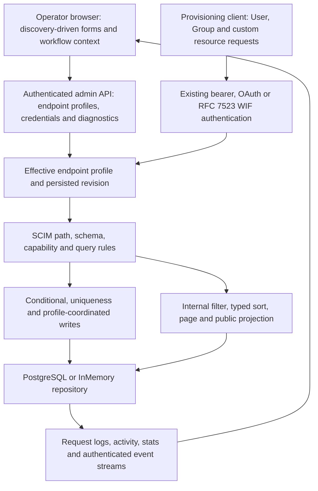
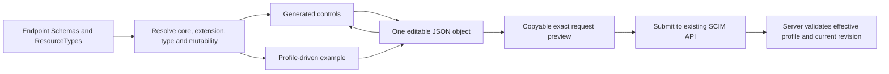
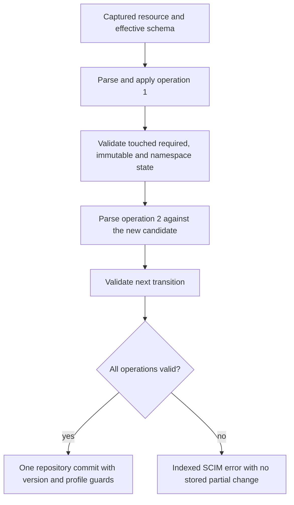
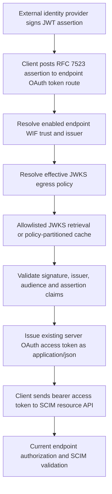
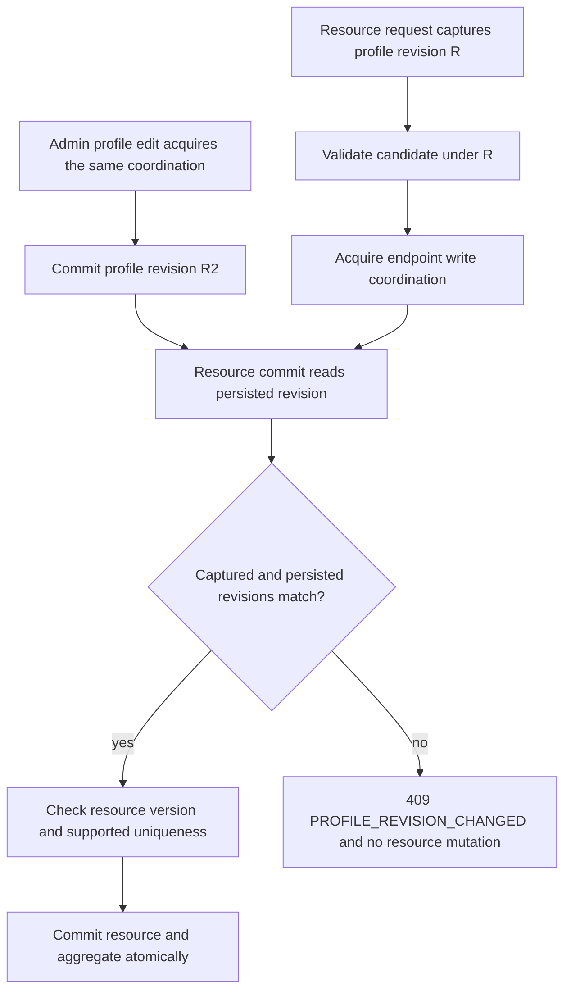
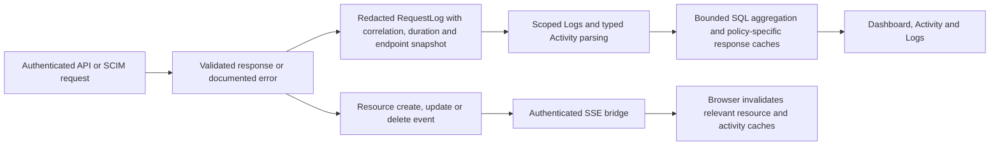
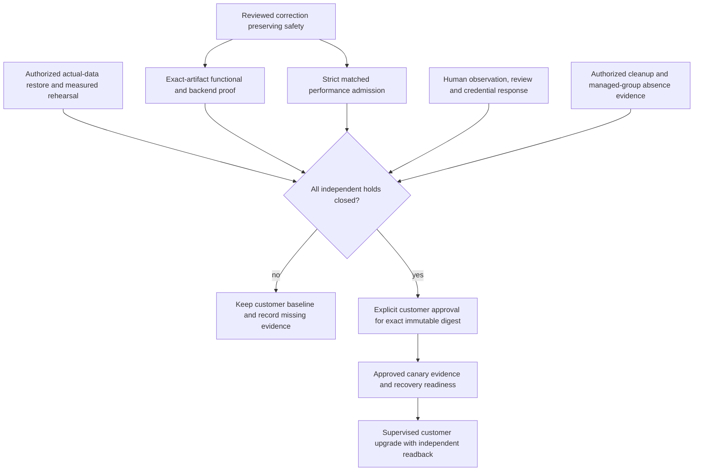

# Customer upgrade report: published 0.55.20 to published 0.55.56

**Last verified:** 2026-10-18  
**Scope:** Exact published source trees, not the current working directory  
**Decision:** Customer upgrade remains on hold. This report does not authorize deployment, data repair, credential changes or cleanup.

## Executive summary

This is a substantial correctness, operator-experience and release-assurance upgrade, not simply a version bump or an authentication feature release. The exact-tree comparison contains **971 changed tracked paths and 411 commits**, including 93 merge commits. Every changed path is assigned to a component family and a report section; none is unclassified. There are **10 added database migrations**, taking the historical migration inventory from 19 to 29.

The target improves existing SCIM, OAuth, workload identity federation (WIF), endpoint profiles and custom resources. It adds profile-driven browser forms, better credential migration and lifecycle controls, effective authentication-policy visibility, consistent navigation, and stronger correctness boundaries around writes. It also corrects Group member-reference loss and OAuth token response media types, and stops startup disclosure of database connection strings.

**The upgrade is not currently safe to approve on performance evidence.** The full common-runtime control `6a4e2ce5` compares the published application bundles on the same older runtime with 2,000 samples per operation/version. It records **53,372 versus 110,614 database calls**, **application CPU +97.17%**, and **12 of 12 latency comparisons failing** the strict threshold. A separate safe local prototype `93e57f5b` still fails 5 of 12 checks. Unsafe laboratory treatments that remove safeguards are diagnostic evidence, not release candidates.

Existing functional receipts are substantial, but do not erase this hold: dev Chromium 324 passes, live suites 1,797 assertions each, API units 6,072, PostgreSQL HTTP 2,520, InMemory HTTP 2,516 plus four explicit exclusions, and Web tests 1,624. These are **retained receipts, not tests rerun for this report**, and their source selections and dates differ. Independent actual-data measured rehearsal, authorized managed-group absence verification, exact review closure, credential-response work and human observation remain separate holds.

### Reading guide

- Sections 1-2 establish exact provenance and the full release timeline.
- Sections 3-7 explain the browser, protocol, authentication, persistence and observability changes.
- Section 8 inventories every migration and its recovery implications.
- Sections 9-11 cover runtime/dependencies, tooling/CI and documentation.
- Sections 12-14 distinguish measured results from missing claims and give a conditional upgrade plan.
- Section 15 explains complete path coverage and the retained machine-readable inventories.

## 1. Exact provenance and evidence rules

### 1.1 Immutable endpoints

| Identity | Published customer baseline | Published target |
|---|---|---|
| Product version in `api/package.json` | `0.55.20` | `0.55.56` |
| Full source commit | `6785200ff59ccbc12f62b795439fb245e1635480` | `d43959e11e36c5607ef58323e2d520458f6cd14d` |
| Git tree object | `9191e6720d209dbb14b95604a76b07f2226dcb0f` | `c6033fe7ced9dd935f7917f816fe6fb6d8e6bb15` |
| Publisher receipt | [33823450302](https://github.com/pranems/SCIMServer/actions/runs/33823450302) | [39043579816](https://github.com/pranems/SCIMServer/actions/runs/39043579816) |
| Published image digest | `sha256:8b00fff083b8aae3226e9680ba987cc776bdb43d7a4ad8fc2812edf8019ecd4a` | `sha256:07f08b855ebe178c6a9a5b60af80d4177c267b8878c959a09e5f1a64fdc03aa2` |
| Source link | [Baseline tree](https://github.com/pranems/SCIMServer/tree/6785200ff59ccbc12f62b795439fb245e1635480) | [Target tree](https://github.com/pranems/SCIMServer/tree/d43959e11e36c5607ef58323e2d520458f6cd14d) |

The reviewed documentation HEAD `36724c49` is runtime-equivalent to the target, but is **not** substituted for the publication source. Later `f8bf981a` is not the customer image's source. The customer has not been upgraded.

Inventory commands read the two Git objects directly: `git diff --name-status --no-renames <baseline> <target>`, `git diff --numstat --no-renames <baseline> <target>`, `git log <baseline>..<target>` and historical `git show <commit>:<path>`. Rename detection is intentionally disabled: a moved file appears as an old deleted path and a new added path. Consequently, 971 is a count of changed **path identities**, not 971 independent features.

Publication identities and operational receipts above are retained evidence supplied to this investigation and corroborated by the [comparative performance RCA](CUSTOMER_UPGRADE_PERFORMANCE_RCA.md). No publisher, registry, portal or cloud query was performed while drafting this report.

### 1.2 How apparently conflicting documentation is interpreted

The exact target's [changelog](https://github.com/pranems/SCIMServer/blob/d43959e11e36c5607ef58323e2d520458f6cd14d/CHANGELOG.md) and [release notes](https://github.com/pranems/SCIMServer/blob/d43959e11e36c5607ef58323e2d520458f6cd14d/docs/RELEASE_NOTES.md) retain intermediate labels such as “candidate,” “not released” and “pending deployment.” Several package-level implementation reports also preserve their original isolated-worktree status. Those labels describe the time that evidence was captured; they do not override the supplied final publisher identity. Conversely, a final publication does not retroactively close a package's independent performance, customer-data, permission or human-review hold.

**Source rule:** behavioral claims here refer to the pinned target tree. Relative feature-document links provide explanation and retained receipts; a later local source file must not be used to infer what the published image contains. Current unreleased performance prototypes, compact reads, uniqueness projections, joined-read experiments and laboratory controls are excluded from the published delta.

### 1.3 Broad component and request flow

Figure 1 shows the target's major layers. Most boxes already existed at the baseline; the upgrade makes their effective contract more consistent and their commit boundaries stronger.



## 2. Evidence-based version timeline: 0.55.21 through 0.55.56

These rows come from **actual `api/package.json` version transitions**, checked against commit subjects, historical source and release documentation. They are not an assertion that every intermediate number has an independently verified publisher or customer deployment. Dates below are package-transition author dates, not necessarily merge, changelog or deployment dates. Full commits, dates and metadata are in [the version inventory](../test-results/release-comparison-05520-05556/version-timeline.json).

| Version | Transition date | Evidence commit | Main change family and interpretation |
|---|---|---|---|
| 0.55.21 | 2026-09-04 | [db85be98](https://github.com/pranems/SCIMServer/commit/db85be98) | Surfaces existing bcrypt-to-keyed migration in the UI; Connect flow and existing-client-ID handover improve. The hashing architecture itself was already present. |
| 0.55.22 | 2026-09-15 | [43386dbe](https://github.com/pranems/SCIMServer/commit/43386dbe) | Contextual endpoint settings, dependency/impact explanations and more discoverable controls. |
| 0.55.23 | 2026-09-16 | [9479bc1d](https://github.com/pranems/SCIMServer/commit/9479bc1d) | Bounded WIF trust lookup cache and supporting credential lookup index. |
| 0.55.24 | 2026-09-17 | [d7ac139c](https://github.com/pranems/SCIMServer/commit/d7ac139c) | Settings and credential operator experience refinement, not a new auth protocol. |
| 0.55.25 | 2026-09-23 | [e36aabea](https://github.com/pranems/SCIMServer/commit/e36aabea) | Retires the combined credential-enablement setting; dedicated bearer and OAuth settings become authoritative. |
| 0.55.26 | 2026-09-23 | [64a46743](https://github.com/pranems/SCIMServer/commit/64a46743) | Shared profile-driven create/edit forms for built-in and custom resource types. |
| 0.55.27 | 2026-09-23 | [8a99bde9](https://github.com/pranems/SCIMServer/commit/8a99bde9) | Profile-driven Workbench examples; subsequent fixes normalize authorization headers. |
| 0.55.28 | 2026-09-23 | [c2198197](https://github.com/pranems/SCIMServer/commit/c2198197) | Discovery-authoritative resource UI, synchronized form/JSON editing and dynamic resource tabs. |
| 0.55.29 | 2026-09-24 | [3550303e](https://github.com/pranems/SCIMServer/commit/3550303e) | Custom-resource activity/events and shared URL-owned Logs filters; Docker context includes the new Logs source. |
| 0.55.30 | 2026-09-24 | [420ab1da](https://github.com/pranems/SCIMServer/commit/420ab1da) | Explicit credential/trust lifecycle, transactional rotation and inactive-only purge. |
| 0.55.31 | 2026-09-24 | [d96bd64a](https://github.com/pranems/SCIMServer/commit/d96bd64a) | Context-preserving navigation and workflow-specific endpoint selection. |
| 0.55.32 | 2026-09-24 | [8f1b1c01](https://github.com/pranems/SCIMServer/commit/8f1b1c01) | Effective WIF/JWKS egress policy and editing; follow-ups isolate key caches by complete policy. |
| 0.55.33 | 2026-09-24 | [2d01c72f](https://github.com/pranems/SCIMServer/commit/2d01c72f) | Identifier/output fidelity, effective auth discovery, retained admin secrets and public/durable redaction. |
| 0.55.34 | 2026-09-25 | [31176497](https://github.com/pranems/SCIMServer/commit/31176497) | Global Back/Forward and workflow context; structured `/Me` subject filter escaping follows. |
| 0.55.35 | 2026-09-25 | [79cb22d2](https://github.com/pranems/SCIMServer/commit/79cb22d2) | Dependency-pin correction and clean-CI lock alignment. |
| 0.55.36 | 2026-09-30 | [123dd1be](https://github.com/pranems/SCIMServer/commit/123dd1be) | Consolidates P1-P9 SCIM correctness: ordered typed PATCH, conditional writes, uniqueness, Group atomicity, query/schema/capability contracts, lifecycle and profile fences. |
| 0.55.37 | 2026-10-09 | [7d53d7e5](https://github.com/pranems/SCIMServer/commit/7d53d7e5) | Aged dependency remediation, vulnerable development-toolchain removal, browser/event and endpoint-log identity improvements. |
| 0.55.38 | 2026-10-09 | [0bcbf85c](https://github.com/pranems/SCIMServer/commit/0bcbf85c) | Post-merge validation isolation, immutable-resource binding and analytics/runtime correction consolidation. |
| 0.55.39 | 2026-10-09 | [1d36e77a](https://github.com/pranems/SCIMServer/commit/1d36e77a) | Serializes Dashboard and log-list database fan-out to protect the small connection pool. |
| 0.55.40 | 2026-10-09 | [2ec57125](https://github.com/pranems/SCIMServer/commit/2ec57125) | Bounded Activity database concurrency and shared in-flight analytics work. |
| 0.55.41 | 2026-10-09 | [434aa261](https://github.com/pranems/SCIMServer/commit/434aa261) | Nonblocking route prefetch and page-owned loading/error states; shell can render while data waits. |
| 0.55.42 | 2026-10-09 | [2a7eba56](https://github.com/pranems/SCIMServer/commit/2a7eba56) | Covering Activity index, concurrent index construction and related validation corrections. Changelog date is October 10. |
| 0.55.43 | 2026-10-12 | [deda72c1](https://github.com/pranems/SCIMServer/commit/deda72c1) | One-minute completed Activity-summary cache and churn-aware RequestLog autovacuum tuning. |
| 0.55.44 | 2026-10-12 | [d5e18649](https://github.com/pranems/SCIMServer/commit/d5e18649) | Thirty-second completed Dashboard cache, mutation-generation invalidation and freshness preservation. |
| 0.55.45 | 2026-10-12 | [3b8c5d8c](https://github.com/pranems/SCIMServer/commit/3b8c5d8c) | Endpoint timeline index and browser credential-cache state coherence. |
| 0.55.46 | 2026-10-12 | [db8771b1](https://github.com/pranems/SCIMServer/commit/db8771b1) | Avoids unconsumed exact log counts for latest-row Dashboard/Overview views; public paginated Logs keep exact totals. |
| 0.55.47 | 2026-10-12 | [d288d2f5](https://github.com/pranems/SCIMServer/commit/d288d2f5) | Cached endpoint identity for accepted/rejected per-endpoint token logs; global token logs stay server-scoped. |
| 0.55.48 | 2026-10-13 | [cc0833cb](https://github.com/pranems/SCIMServer/commit/cc0833cb) | Corrects false profile-revision conflicts caused by runtime normalization of unchanged legacy rows. Changelog date is October 14. |
| 0.55.49 | 2026-10-14 | [0e79accd](https://github.com/pranems/SCIMServer/commit/0e79accd) | Activity/endpoint readability, bounded provenance columns and inventory/discovery improvements. |
| 0.55.50 | 2026-10-15 | [f05fbc84](https://github.com/pranems/SCIMServer/commit/f05fbc84) | Complete absolute UTC timestamps, copy-action separation and plain Operations endpoint links. |
| 0.55.51 | 2026-10-15 | [848412c4](https://github.com/pranems/SCIMServer/commit/848412c4) | Admits unchanged persisted endpoint rows before repeated profile conversion, cloning and hashing. This published list-work optimization is distinct from later unreleased request-path prototypes. |
| 0.55.52 | 2026-10-16 | [afe29947](https://github.com/pranems/SCIMServer/commit/afe29947) | Validates minimal Group member input before internal projection introduces absent properties. |
| 0.55.53 | 2026-10-16 | [9ebbd2e1](https://github.com/pranems/SCIMServer/commit/9ebbd2e1) | Preserves accepted `members.$ref` end to end and adds nullable storage for it. |
| 0.55.54 | 2026-10-16 | [c04b06f1](https://github.com/pranems/SCIMServer/commit/c04b06f1) | Available-height endpoint inventory and compact Dashboard endpoint rows; assurance/tooling closeout follows. |
| 0.55.55 | 2026-10-17 | [c1fe8ab8](https://github.com/pranems/SCIMServer/commit/c1fe8ab8) | Transient package transition in the startup-redaction branch; separate OAuth media-type delivery also used this release number. Do not identify an image from the number alone. |
| 0.55.56 | 2026-10-17 | [58967716](https://github.com/pranems/SCIMServer/commit/58967716) | Reserves the final redaction version, integrates Prisma startup redaction and retains the OAuth media-type fix; exact final publisher is the target in section 1. |

For 0.55.55, the historical source transition and prose release intent differ. The complete range includes [b27e15c2](https://github.com/pranems/SCIMServer/commit/b27e15c2), which fixes OAuth media types, and [c1fe8ab8](https://github.com/pranems/SCIMServer/commit/c1fe8ab8), which initially labels shell redaction 0.55.55. The final 0.55.56 identity contains both. This report does not invent a one-feature-per-version history.

## 3. Browser and operator-workflow changes

### 3.1 Before/after matrix

| Surface | Baseline or earlier limitation | Published target | Reason and operator impact |
|---|---|---|---|
| Endpoint settings | Existing flags were available but their relationships and consequences were difficult to discover. | Contextual groups, help, impact information, effective auth state and dedicated method controls. | Operators can identify the control that actually governs a behavior without treating strict validation as a universal compatibility switch. |
| Connect and migration | Existing migration API/keyed credentials were not fully surfaced; existing-client-ID overlap was hard to discover. | Algorithm/progress information, actionable active-legacy work queue, connection cards and supported handover. | Easier deliberate migration without forcing an OAuth client-ID cutover. Inactive historical bcrypt rows are not unfinished active work. |
| User/Group create and edit | Resource workflows did not consistently expose the endpoint's complete effective schema. | Shared profile-derived fields and exact-body preview, extension placement, changed-field PATCH and ETag-aware editing. | Fewer hardcoded assumptions; stricter endpoint profiles may expose missing required inputs rather than silently accepting them. |
| Custom ResourceTypes | Generic API/profile support already existed. | Dynamic first-class resource tabs, create/edit/delete, generated forms and custom-resource events. | Custom resources become operable through the same UI, not a newly invented generic SCIM protocol. |
| Form/body synchronization | UI controls could be a second model of the request. | Controls and JSON body share ownership; known-field changes preserve unrelated operator-authored members. Invalid JSON disables submission. | The preview is the submitted body, rather than an approximation. |
| Resource discovery | Selection, advertised shapes and endpoint context could diverge. | Endpoint-scoped ServiceProviderConfig, profile-authoritative types, cache invalidation and redirect when a selected type is removed. | UI follows current discovery instead of presenting a removed or stale collection. |
| Workbench | Examples and authorization header state could diverge from current endpoint context. | Profile-driven examples, normalized nonblank auth headers, redacted durable history and context-aware exports. | Better reproducibility without retaining credential material in history. |
| Navigation | Local fallback/history behavior and workflows were inconsistent. | Global Back/Forward uses router-owned indices; URL state restores filters, tabs, drawers, pages and selected endpoint. | Direct links do not accidentally navigate outside the app; a new navigation truncates the forward branch. |
| Endpoint selection | One selector style obscured action, aggregate and inspection intent. | Shared identity model with searchable action targets, aggregate “all” scope, provenance links and comparison selectors. | Inactive endpoints remain inspectable in Discovery, but are disabled as mutation targets. |
| Endpoint inventory | Fixed result height, layout/copy friction and repeated derived profile work. | Available-height scroll owner, stable filters outside results, left-aligned bounded names and unchanged-row admission before conversion. | More usable large inventories; does not establish SCIM request hot-path performance admission. |
| Dashboard | Endpoint cards/activity fields were inconsistent; data waits could block the shell. | Compact five-endpoint summary in inventory order, Browse all endpoints, aligned six-field activity rows and page-owned loading/error states. | The five entries are not a favorite/recent ranking. Navigation remains available while data is delayed. |
| Operations | Long provenance values could dominate tables; copy/navigation actions were conflated. | Bounded percentage-based columns, plain endpoint links and separate copy/open controls; horizontal scroll remains panel-owned. | Resource state is readable without mistaking it for request history. |
| Date/time | Partial timestamps and nested action targets caused ambiguity. | Full absolute UTC date/time with milliseconds; source value copied separately; relative ages stay relative. Invalid/timezone-free expiry is not presented as valid. | Easier correlation across logs, token diagnostics and resources; keyboard copy does not trigger row navigation. |
| Event streams | Stream authorization/reconnect and refresh behavior had gaps. | Authenticated stream handling, stale-token reconnect-loop correction and invalidation aligned with actual resource events. | More reliable freshness without accepting an unauthenticated stream as evidence. |

Sources: [profile-driven forms](PROFILE_DRIVEN_RESOURCE_FORMS_AND_CUSTOM_RESOURCES.md), [profile-authoritative UI](PROFILE_AUTHORITATIVE_RESOURCE_UI.md), [Workbench examples](WORKBENCH_REQUEST_EXAMPLES.md), [navigation](GLOBAL_NAVIGATION_AND_WORKFLOW_CONTEXT.md), [readability](UI_ACTIVITY_ENDPOINT_READABILITY.md), [timestamps](UI_DATE_TIME_IDENTITY_CONSISTENCY.md), [responsive inventory](RESPONSIVE_ENDPOINT_INVENTORY.md), and the pinned [browser source tree](https://github.com/pranems/SCIMServer/tree/d43959e11e36c5607ef58323e2d520458f6cd14d/web/src).

### 3.2 Data-driven forms, not a new schema authority

Figure 2 explains how discovery becomes a request. The browser helps construct a body; the server remains authoritative.



The `AIAgent` reference fixture illustrates a project-defined custom type. It is not a standard SCIM schema and is not an AI inference service. A declared numeric field produces a number; an extension field is nested under its schema URN; readOnly fields are not editable; immutable fields are create-time inputs rather than ordinary PATCH fields. Published `canonicalValues` inform browser choices without turning every RFC suggestion list into a new server-side closed enum.

## 4. SCIM and API contract changes

SCIM Users, Groups, Bulk, `.search`, custom resources, discovery, ETags and schema characteristics existed before this interval. The major change is consistent interpretation and atomic enforcement across these existing surfaces.

### 4.1 Protocol before/after matrix

| Family | Earlier behavior or risk | Published target behavior | Compatibility consequence |
|---|---|---|---|
| Typed PATCH paths | Separate parsers could treat selectors or dotted paths as literal keys. | Shared typed grammar resolves registered namespaces and selectors; malformed, repeated or nested selectors fail explicitly. | Clients relying on malformed literal-key storage receive a client error instead. No automatic repair of old malformed records is included. |
| Ordered PATCH | Array `add` could replace values; filtered changes could affect only the first match. | One executor appends multi-valued input, changes every selected entry and evaluates each operation against the evolving candidate. | Existing values are preserved when the protocol says append. A later invalid operation rolls back the whole request. |
| Transition validation | End-of-request checks could allow remove-then-restore of required/immutable data. | Required/immutable and binding-presence checks occur after each operation, including applicable checks with strict validation off. | A final valid-looking body does not legitimize an invalid intermediate operation. |
| ReadOnly and PUT retention | Input validation/preservation could conflate client fields with server-owned retained entries. | POST/PUT recursively ignore client readOnly input; PUT preserves omitted non-required immutable values and matches retained entries one-to-one. | Legacy entry reorderings no longer duplicate another entry's server-owned values. Explicit immutable changes still fail. |
| Query order | Response projection could remove an operand before filtering; custom numeric sort could be lexical. | Internal filter, typed sort, full count, page, then public projection. | A hidden-but-queryable field may select a record while remaining absent in the response. |
| JSON `.search` | Array projection forms were not handled consistently. | Arrays are accepted along with legacy comma-separated strings; invalid shapes and excessive lengths fail 400. | GET projection parameters remain comma-separated strings. |
| Capability boundaries | Bulk/custom paths could bypass disabled capabilities or limits. | Shared effective profile checks apply across built-in, custom and Bulk paths. | Unsupported operations now fail rather than silently succeed. |
| Conditional requests | A service check could precede an unconditional repository write. | Version predicates are enforced at commit; applicable required-If-Match behavior depends on ETag support. | Stale writes return 412; required missing conditions can return 428; no silent overwrite. |
| Profile/schema admission | Malformed declarations could become apparently valid after expansion. | Validate original and expanded profiles, attribute characteristics, shapes, duplicate case aliases and bindings. | A profile-subblock edit can expose an old unsupported declaration in the merged profile. |
| Common `externalId` | Core and extension homonyms or promoted columns could override common semantics. | Common top-level `externalId` is a single, exact-case, readWrite string across resource cores. Bound extension homonyms retain independent valid types. | Do not infer custom payload types from convenience-column names. No default server-wide `externalId` uniqueness is introduced. |
| Namespace-aware uniqueness | Service-only checks could race; Group member paths could be treated as an unrelated shape. | Supported unique values are reserved at repository commit using endpoint/resource/schema/path context. | Simultaneous conflicts produce one winner, one 409 uniqueness, and no partial membership/version mutation. |
| Canonical output | Internal persistence keys and casing aliases could escape or diverge. | Remove internal fields recursively, canonicalize registered URNs, and enforce returned/writeOnly rules. | Public responses do not become raw database exports. |
| Error contract | Validation arrays or raw database/server details could reach `detail`. | SCIM detail is textual, diagnostics remain structured and repository failures are sanitized; OAuth errors keep their own envelope. | A hidden server failure is not relabeled as a successful write; clients should inspect status and documented diagnostics. |
| Endpoint identity | Case-only names and alias resolution were inconsistent. | Case-insensitive endpoint-name/UUID lookup, builtin/custom collection identifiers and schema/path identifiers, with canonical output casing. | Case-only duplicate endpoint names block the uniqueness migration until explicitly resolved. |

Sources: [correctness consolidation](SCIM_CORRECTNESS_DESIGN_AND_IMPLEMENTATION.md), [typed paths](SCIM_P1_IMPLEMENTATION.md), [ordered execution](SCIM_P2_IMPLEMENTATION.md), [conditional writes](SCIM_CONDITIONAL_WRITES_IMPLEMENTATION.md), [capabilities](SCIM_CAPABILITY_BOUNDARY_IMPLEMENTATION.md), [query semantics](SCIM_QUERY_SEMANTICS_IMPLEMENTATION.md), [profile validation](SCIM_P7A_PROFILE_VALIDATION.md), [PATCH contracts](SCIM_P7B_PATCH_SCHEMA_CONTRACTS.md), [common attributes](SCIM_P7_COMMON_ATTRIBUTE_CONTEXT.md), [uniqueness](SCIM_UNIQUENESS_IMPLEMENTATION.md), [PUT retention](SCIM_PUT_ENTRY_PRESERVATION.md).

### 4.2 Request/data flow

Figure 3 distinguishes the public response from the internal object used to decide whether a record matches.


Residual filters and schema-aware sorts can still materialize all scoped candidates. The target is not a general database-pushdown optimizer. The retained [query assessment](SCIM_QUERY_PERFORMANCE_ASSESSMENT.md) measured a 50,000-row residual boundary: an indexed equality fetched one row at 2.190 ms local median, while the selective custom numeric case fetched 50,000 rows/20.1 MB at 401.049 ms fetch median plus 23.203 ms service evaluation median. These are historical scenario measurements, not customer-upgrade latency guarantees.

### 4.3 Worked example: ordered, typed PATCH

This synthetic example uses a custom schema declaring `contacts` as multi-valued complex data and `primary` as Boolean. It is explanatory, not a customer payload.

```json
{
  "schemas": [
    "urn:ietf:params:scim:api:messages:2.0:PatchOp"
  ],
  "Operations": [
    {
      "op": "add",
      "path": "contacts",
      "value": [
        {
          "value": "new@example.invalid",
          "primary": true
        }
      ]
    },
    {
      "op": "replace",
      "path": "contacts[primary eq true].value",
      "value": "selected@example.invalid"
    }
  ]
}
```

The target appends the first value, applies configured primary handoff and evaluates the selector against that new candidate. It does not create a property literally named `contacts[primary eq true].value`. If a later operation is invalid, none of these changes commits. User-specific explicit dotted-core-path behavior still depends on its dedicated compatibility control; generic schema parsing is not permission to bypass that control.

Figure 4 makes operation order and all-or-nothing persistence explicit.



### 4.4 Search and schema compatibility details

JSON `.search` projection arrays have at most 100 items and at most 2,000 joined characters per field. Nulls, objects, nested/mixed arrays, blank items and comma-containing items fail; empty selections preserve default returned behavior. When both include/exclude projection members exist, existing `attributes` precedence remains. These details are documented in [the search contract](SCIM_SEARCH_CONTRACT_IMPLEMENTATION.md).

Schema-characteristic omission still uses RFC defaults, rather than silently tightening every preset. Present declarations are authoritative within the provider's supported capability set. `global` is an RFC keyword, but this implementation cannot prove uniqueness across external providers and rejects that promise; it is not an invalid RFC word. Boolean/dateTime/binary/whole-complex server-unique declarations are not turned into arbitrary string comparisons. References compare exactly and are not URI-normalized. See [characteristic reconciliation](SCIM_CHARACTERISTIC_RECONCILIATION.md) and [Entra compatibility](SCIM_ENTRA_COMPATIBILITY.md).

Keep `StrictSchemaValidation` enabled for Entra unless an owner approves a specific compatibility change. It is not the inverse of “Entra mode.” Boolean coercion, readOnly handling and explicit dotted User paths have distinct controls. Malformed paths, immutable changes and required transitions do not become acceptable merely because strict unknown/type validation is disabled.

### 4.5 API and media-type changes worth checking explicitly

| API surface | Target contract | What did not change |
|---|---|---|
| `POST /scim/oauth/token` | Successful token response remains `application/json`. | Global OAuth credentials, response token fields, success status and cache policy are not redesigned. |
| `POST /scim/endpoints/{endpointId}/oauth/token` | Client-secret and WIF assertion success responses remain `application/json`; shared classifier distinguishes token routes from SCIM. | Does not establish that Entra saved-credential validation is resolved. |
| User, Group and custom SCIM resources | `application/scim+json`, with existing Location behavior on resource creation. | OAuth correction does not convert SCIM responses to ordinary JSON media type. |
| `/Users/.search`, `/Groups/.search`, custom `/.search` | JSON arrays or backward-compatible strings for projection. | GET query syntax remains string-based. |
| `GET /scim/admin/endpoints/{endpointId}/egress-policy` | Closed 11-field effective policy read model with provenance/bounds. | It is an authenticated admin diagnostic, not public discovery or a secret export. |
| Credential deactivate/activate/rotate/purge | Explicit lifecycle routes; existing DELETE-as-deactivate compatibility retained. | A purge is not a soft-deactivate alias. |
| Endpoint profile writes | Conditional checks and persisted profile-content revision coordination. | A resource ETag is not a substitute for an endpoint profile revision. |

The media-type source is [the pinned interceptor](https://github.com/pranems/SCIMServer/blob/d43959e11e36c5607ef58323e2d520458f6cd14d/api/src/modules/scim/interceptors/scim-content-type.interceptor.ts) and [shared token classifier](https://github.com/pranems/SCIMServer/blob/d43959e11e36c5607ef58323e2d520458f6cd14d/api/src/oauth/token-endpoint-path.ts), introduced by [b27e15c2](https://github.com/pranems/SCIMServer/commit/b27e15c2).

## 5. Authentication, OAuth and WIF

### 5.1 Existing mechanisms versus new improvements

The baseline already contains WIF assertion validation/discovery, endpoint OAuth, generic resources, credential migration, encrypted-secret infrastructure and endpoint profile presets. This release must not be described as introducing all those mechanisms.

**WIF here uses the RFC 7523 JWT bearer assertion grant. It is not RFC 8693 token exchange.** The release does not add an RFC 8693 endpoint or support claim.

| Concern | Baseline/earlier state | Target change | Operator consequence |
|---|---|---|---|
| Credential migration | Backend mechanism existed, UI could not fully explain/complete handover. | Active legacy algorithm/progress surfaced; same-client-ID issuance and active-only queue. | Can stage consumer switchover before retiring an old secret. Inactive legacy rows are audit history, not active migration work. |
| Method enablement | Combined `PerEndpointCredentialsEnabled` fallback coexisted with dedicated controls. | Retired combined key; migration preserves valid dedicated values or transfers valid legacy intent. | Scripts/imports should use dedicated bearer and OAuth keys. Do not assume the retired key is accepted indefinitely. |
| Credential lifecycle | Separate operations could compose rotation unsafely or blur delete meanings. | Repository-owned atomic rotation, explicit deactivate, activation cap checks and inactive-only permanent purge. | A failed replacement cannot strand the old credential inactive; active purge and inactive rotation return conflict. |
| OAuth rotation | Handover could require a hard client identity change. | Preserve public `client_id` while issuing keyed replacement material atomically. | Consumer secret still must change; this is not a transparent credential update to Entra. |
| WIF trust lookup | Repeated active-trust reads had no dedicated bounded endpoint cache. | Cached issuer-indexed trust sets, shared in-flight loads, TTL/bounds and lifecycle invalidation. | Lower lookup work without making a local cache an unlimited revocation guarantee across instances. |
| WIF/JWKS policy | Raw overrides did not explain actual runtime values. | One resolver yields effective endpoint/server/default values, bounds and clamping. | Operators can inspect what enforcement really uses. Null removes an individual override only on saved edit. |
| JWKS isolation | Same-URI endpoints could inherit cache behavior established under another policy. | Cache, single-flight, stale fallback, refresh, unknown-key throttling and prewarm are keyed by URI plus complete policy. | A stricter endpoint does not inherit a looser endpoint's key cache allowance. |
| Auth discovery | Raw `authentication.methods` could omit an effectively enabled dedicated setting. | ServiceProviderConfig uses effective auth enablement. | Advertised authentication matches runtime rather than incomplete input syntax. |
| Diagnostic controller | Credential controller also owned substantial WIF diagnostics. | WIF resolve/verify/debug routes move to a dedicated controller. | Route ownership changes, not a new trust protocol or permission grant. |
| Secret visibility | `once` could purge retained envelopes. | New create/rotate retains encrypted copies; authenticated admin reveal/exports can include recoverable secrets. Legacy `once` resolves to retained policy. | Admin exports/clipboard/downloads are sensitive; previously purged secrets require rotation, not attempted recovery. |
| Token logs/media type | Endpoint identity and successful token media type could be wrong or absent. | Cache-only endpoint-name snapshot; JSON token response preserved. | Easier correlation and standards alignment, but saved-credential response verification remains independent. |

Sources: [authentication configuration](AUTHENTICATION_CONFIGURATION_REFERENCE.md), [lifecycle](CREDENTIAL_AND_WIF_TRUST_LIFECYCLE.md), [effective egress policy](EFFECTIVE_WIF_JWKS_EGRESS_POLICY.md), [output/secret boundary](API_OUTPUT_FIDELITY_AND_SECRET_SURFACE_CONTRACT.md), pinned [credential controller](https://github.com/pranems/SCIMServer/blob/d43959e11e36c5607ef58323e2d520458f6cd14d/api/src/modules/scim/controllers/admin-credential.controller.ts) and [JWKS validator](https://github.com/pranems/SCIMServer/blob/d43959e11e36c5607ef58323e2d520458f6cd14d/api/src/oauth/external-jwks-validator.service.ts).

Figure 5 separates WIF token issuance from the later SCIM resource request. Public trust metadata is not a shared secret.



The 11 effective egress fields are `timeoutMs`, `retries`, `retryBackoffMs`, `cacheMaxAgeMs`, `totalDeadlineMs`, `maxResponseBytes`, `maxKeys`, `maxCacheEntries`, `refreshIntervalMs`, `unknownKidMinIntervalMs` and `staleIfErrorMs`. Each explains effective/configured value, source, unit, bounds and clamping. The closed response does not expose the database URL, secret material or the server JWKS host allowlist.

### 5.2 Worked example: splitting the retired setting

Illustrative stored input:

```json
{
  "settings": {
    "PerEndpointCredentialsEnabled": true,
    "SecretTokenBearerAuthEnabled": false,
    "StrictSchemaValidation": true
  }
}
```

The migration's relevant result is:

```json
{
  "settings": {
    "SecretTokenBearerAuthEnabled": false,
    "OAuthClientCredentialsAuthEnabled": true,
    "StrictSchemaValidation": true
  }
}
```

The dedicated bearer `false` remains authoritative. OAuth inherits the legacy `true` because no valid dedicated OAuth value existed. The retired key is removed; unrelated siblings stay intact. The SQL recognizes valid Booleans and supported string forms; invalid fallback values become JSON `false`. It only rewrites profiles with object-shaped settings containing the retired key. It does not enable WIF or change global-secret policy.

## 6. Persistence, concurrency and endpoint lifecycle

### 6.1 Before/after and safety cost

| Boundary | Earlier weakness | Target safeguard | Benefit and cost |
|---|---|---|---|
| Endpoint freshness | Warm local endpoint copies could survive another application's profile change. | Authoritative persisted endpoint reads at existing call sites. | Current configuration is used, at the cost of repeated full endpoint/profile reads. |
| Resource ETag | Pre-check followed by unconditional write could lose a concurrent update. | Repository write predicate binds expected resource version. | One stale contender fails, rather than silently overwriting. |
| Group aggregate | Group row and member rows could partially persist. | Aggregate creation/replacement and memberships share the transaction/atomic transition. | Failure leaves neither a partial group nor a partially replaced member set. |
| Supported schema uniqueness | Two requests could both pass independent service scans. | Endpoint/resource namespace coordination and repository commit-time uniqueness. | One owner wins; extra locking, reads and candidate hydration add cost. |
| Profile change versus resource write | A request could validate under old schema and commit after an edit. | Carry captured persisted profile revision and compare inside endpoint-scoped write coordination. | Stale profile wins produce sanitized 409 `PROFILE_REVISION_CHANGED`, with no resource mutation. |
| Runtime normalization | Hashing a normalized representation could differ from raw persisted content without a real edit. | Capture persisted revision before compatibility normalization and pair it atomically with the request snapshot. | Removes false 409 while retaining genuine edit-race protection. |
| Endpoint deletion | Owned data cleanup across repositories could fail partway. | Repository-owned lifecycle transaction or equivalent synchronous InMemory operation. | Resources, credentials and owned state do not survive as a half-deleted aggregate. |
| Interrupted create | Endpoint disappearance could become raw foreign-key failure/500. | Safe endpoint-not-found mapping while preserving genuine outage and conditional errors. | Expected races return sanitized 404; real server faults are not hidden. |
| Backend parity | InMemory lacked native database guarantees. | Explicit synchronous write guards/atomic operations and parity contracts. | Equivalent public outcomes, not a claim that an in-process map has PostgreSQL locking semantics. |

Introducing commits include [a1a62484](https://github.com/pranems/SCIMServer/commit/a1a62484) for freshness, [1d37e7b8](https://github.com/pranems/SCIMServer/commit/1d37e7b8) for commit-time uniqueness and [7332fdbc](https://github.com/pranems/SCIMServer/commit/7332fdbc) for profile coordination. See [freshness implementation](SCIM_ENDPOINT_FRESHNESS_IMPLEMENTATION.md), [profile coordination](SCIM_PROFILE_REVISION_WRITE_COORDINATION.md), [Group transactions](SCIM_GROUP_TRANSACTIONS_IMPLEMENTATION.md), [endpoint deletion](SCIM_ENDPOINT_DELETION_IMPLEMENTATION.md), and [write concurrency](ENDPOINT_WRITE_CONCURRENCY.md).

Figure 6 explains why the profile fence must survive performance correction. The two writers coordinate on the same endpoint, so a resource cannot commit against an obsolete profile unnoticed.



Three identities must not be conflated: **resource version/ETag**, **endpoint profile-content revision**, and **whole endpoint row/cache identity**. A display-name edit, runtime schema-cache population and a policy change need not have the same semantics. The published fix keeps persisted revision identity separate from normalized/cached representation. Later local prototypes seek cheaper transport/reuse; they are not part of this report's published target.

### 6.2 Uniqueness scope and retained-entry example

The supported uniqueness namespace is endpoint + resource type + core/extension binding + attribute path. A unique extension `code` is independent from a same-spelled core field. A multi-valued scalar reserves each distinct supported leaf, not one serialized array. Missing/null values reserve nothing; a repeated self-value is not another owner. Ordinary stored inactive/soft-deleted owners are not silently released. Intrinsic User `userName` tightening remains; it is not weakened by a looser profile.

For a PUT containing two entries with the same `value` but different `type`, the target reserves typed matches before occurrence fallback and consumes each retained entry once. Reordering `work` and `home` must not copy the first entry's readOnly metadata into both. This correction preserves accepted entry ownership; it is not a database migration that rewrites all existing arrays.

## 7. Group memberships, logging, observability and security fixes

### 7.1 Minimal members and accepted references

Two distinct fixes are included:

1. **Minimal input validation:** a profile declaring only `members.value` accepts a value-only member. Internally materialized `undefined` properties do not become client-supplied `display` or `type`. Genuinely supplied undeclared fields still fail strict validation atomically.
2. **Reference preservation:** if the effective schema and existing policies accept `members.$ref`, its exact accepted value survives POST, PUT, ordered PATCH, both backends, projection and independent readback. References are not fetched, expanded or rewritten.

Example accepted member, only when the effective schema permits these two fields:

```json
{
  "value": "synthetic-user-id",
  "$ref": "../Users/synthetic-user-id"
}
```

The public `$ref` maps to nullable internal `ResourceMember.reference`; `value` continues to identify the member. It is not replaced with an internal row UUID, and `reference` is not exposed as an extra public SCIM attribute. A minimal value-only schema must still reject genuinely supplied `$ref`. Relative and case-exact references are not normalized into an invented absolute URI. These fixes do not weaken mutability, returned filtering, duplicate/member limits or remove policies.

Sources: [minimal Group membership](GOOGLE_MINIMAL_GROUP_MEMBERSHIP.md), [reference preservation and rollback](GROUP_MEMBER_REFERENCE_PRESERVATION.md), [9ebbd2e1](https://github.com/pranems/SCIMServer/commit/9ebbd2e1), and the pinned [Group repository](https://github.com/pranems/SCIMServer/blob/d43959e11e36c5607ef58323e2d520458f6cd14d/api/src/infrastructure/repositories/prisma/prisma-group.repository.ts).

### 7.2 Observability before/after matrix

| Layer | Earlier limitation | Target change | Impact and limit |
|---|---|---|---|
| Request identity | Historical display names could disappear/change when endpoint configuration changed. | Nullable endpoint-name snapshot on RequestLog; token routes use warmed cache-only identity. | Better historical correlation; old rows are not fabricated/backfilled and a cold cache may lack the name. |
| Custom activity | Custom URLs were not consistently classified with resource identity. | Resource type, endpoint and identifier flow through activity parsing, shared Logs and update events. | Custom inventory participates in the existing operational model. |
| Log filters | Endpoint/global views could diverge in filter state. | Shared URL/query-key toolbar for URL, method, status, range, errors, duration and request ID. | Reload and Back/Forward preserve the actual query; endpoint scope stays fixed on an endpoint route. |
| Analytics | Wide audit rows/application aggregation and concurrent queries pressured a five-connection pool. | PostgreSQL aggregation, UTC buckets, bounded lookups, serialized fan-out and in-flight sharing. | Reduces pool contention without enlarging customer quotas. |
| Activity summary | Immediate repeat scans and high-churn heap visibility undermined index-only access. | Covering index, one-minute completed cache and table-specific vacuum/analyze thresholds. | Reduces repeated work; maintenance still consumes database resources. |
| Dashboard | Overlapping loads repeated identical work; cache invalidation could race. | Thirty-second successful-response cache, mutation generation and guarded in-flight completion. | Failures are not cached; stale builds cannot refill a newer generation. |
| Latest rows | Dashboard/Overview paid for exact totals they did not expose. | Count-free latest reads with one-row lookahead and typed result contracts. | Public paginated Logs retain exact totals by default. |
| Endpoint timeline | Global time index could scan many unrelated rows. | EndpointId/createdAt concurrent index. | Historical dev measurement improved 20-row query from 43.041 seconds to 16.989 ms; not a universal customer SLO. |
| Streaming | Custom changes and stale-token reconnection could leave inconsistent UI state. | Resource update events, authenticated streams and corrected reconnect/cache behavior. | Event freshness is separate from authorization and persisted readback. |
| Diagnostic privacy | Sensitive data could survive in durable history or interpolated startup output. | Structural redaction plus separate shell/Prisma startup-status-only messages. | Does not erase older retained logs or rotate any credential. |

The timeline measurement used a 484,327-row dev log table and previously scanned 225,568 unrelated rows. Its exact count improved from 3.047 seconds to 12.444 ms in that retained scenario. Those improvements do **not** rebut the independently measured Group-membership regression.

Figure 7 shows observability as a post-request record and UI refresh path, not a replacement for request authorization.



Sources: [logging](LOGGING_AND_OBSERVABILITY.md), [traceability](OBSERVABILITY_TRACEABILITY_AND_DIAGNOSTICS.md), [custom observability](CUSTOM_RESOURCE_OBSERVABILITY_AND_SHARED_LOGS.md), pinned [activity service](https://github.com/pranems/SCIMServer/blob/d43959e11e36c5607ef58323e2d520458f6cd14d/api/src/modules/activity-parser/activity-parser.service.ts), [Dashboard controller](https://github.com/pranems/SCIMServer/blob/d43959e11e36c5607ef58323e2d520458f6cd14d/api/src/modules/dashboard/dashboard.controller.ts), and [logging service](https://github.com/pranems/SCIMServer/blob/d43959e11e36c5607ef58323e2d520458f6cd14d/api/src/modules/logging/logging.service.ts).

### 7.3 Security changes and operator response

| Change | Why it matters | Required interpretation/action |
|---|---|---|
| Shell startup no longer prints `DATABASE_URL`; Prisma startup/fallback messages also stop embedding the URI. | Normal application redaction cannot sanitize output emitted before it initializes, or reliably remove a URI already interpolated into text. | Treat older startup logs as potentially sensitive. Restrict access, review retention and coordinate affected credential rotation separately. Do not paste connection strings into this report or evidence. |
| Public/durable secret boundary strengthened. | Admin reveal/export is intentionally sensitive, while discovery, ordinary list projections, RequestLog and Workbench history must not contain plaintext secrets. | Protect authenticated exports and clipboard/download handling; new visibility is not permission to log secrets. |
| `/Me` uses structured SCIM filter escaping. | Quotes/backslashes in a subject must not alter filter structure. | Keep identity-resolution scope distinct from aggregate Operations. |
| PATCH/readOnly object updates rebuilt structurally. | Runtime checks alone were insufficient for static taint analysis at dynamic property sinks. | Immutable entry reconstruction removes the sink without dropping path/schema guarantees. |
| Repository errors sanitized. | Database details are not a public SCIM error contract. | Use internal correlation/diagnostics for investigation, not raw server details in client responses. |
| JWKS cache partitioning and zero-TTL behavior corrected. | A permissive endpoint must not supply an effectively stale/oversized key cache to a stricter endpoint. | Verify effective policy and its provenance, not merely stored overrides. |
| Dependency remediations and stronger source/image evidence. | Source correctness does not prove absence of vulnerable dependencies or that the scanned image is the deployed one. | Retain exact-artifact scan scope and exceptions; historical green scans are not perpetual certification. |

Startup fix sources: [redaction report](STARTUP_DATABASE_CONFIGURATION_REDACTION.md), [c1fe8ab8](https://github.com/pranems/SCIMServer/commit/c1fe8ab8), [58967716](https://github.com/pranems/SCIMServer/commit/58967716), and [published entrypoint](https://github.com/pranems/SCIMServer/blob/d43959e11e36c5607ef58323e2d520458f6cd14d/api/docker-entrypoint.sh). This report performs no security scan and claims no newly completed credential response.

## 8. Complete migration inventory and recovery implications

All ten names below are added between the exact endpoints. The target has 29 migration SQL files versus 19 in the baseline. None is inferred from current uncommitted schema work. SQL is retained in [the exact migration diff](../test-results/release-comparison-05520-05556/migration-diff.txt); the authoritative files are in the [pinned migration directory](https://github.com/pranems/SCIMServer/tree/d43959e11e36c5607ef58323e2d520458f6cd14d/api/prisma/migrations).

| Added migration directory, containing `migration.sql` | Shape or data effect | Upgrade/preflight impact | Rollback/recovery impact |
|---|---|---|---|
| `20260916035422_add_endpoint_credential_type_active_index` | Adds EndpointCredential index on endpointId, credentialType, active. No row rewrite. | Supports active/type-scoped lookup; index build has ordinary DDL resource/locking cost. | Additive index can remain with an older binary; removing it is separate DDL and loses the access path. |
| `20260923020356_split_per_endpoint_credentials_enablement` | Rewrites qualifying Endpoint.profile JSON: preserve valid dedicated bearer/OAuth values, fall back to valid legacy value, otherwise false; remove combined key. | Back up profiles and compare effective auth before/after. Only object settings carrying the legacy key qualify. | Not automatically reversible: removed legacy intent cannot be perfectly reconstructed from two potentially different dedicated values. Restore captured profiles only through an approved recovery plan. |
| `20260924000000_endpoint_name_case_insensitive` | Checks for existing lower(name) collisions, then adds unique `Endpoint_name_lower_key`. Stored casing is unchanged. | Case-only duplicates deliberately abort migration. Resolve with owner approval before retry. | Keep the stronger constraint unless there is an approved reason to remove it; older binaries do not regain safe duplicate handling by merely running again. |
| `20261001070000_add_requestlog_endpoint_name` | Adds nullable RequestLog.endpointName TEXT. No historical backfill. | Existing rows remain valid with null. New logs can retain display-name snapshots. | Additive column is generally harmless to older readers. Removing it loses new historical identity evidence. |
| `20261010185000_add_requestlog_url_trigram_index` | Concurrent GIN index on RequestLog.url using gin_trgm_ops. | Requires the existing pg_trgm capability; plan index time, disk and invalid-index inspection after interruption. | Additive access path can remain. Do not mark a failed build applied without verifying catalog state. |
| `20261010210000_add_requestlog_activity_summary_covering_index` | Concurrent covering index on createdAt, method, url, identifier, status. | Narrows summary scans while allowing inserts during build; consumes disk/write maintenance. | Keep until replacement access paths are proved; an old binary does not require deleting it. |
| `20261010211000_drop_redundant_requestlog_activity_index` | Concurrently drops RequestLog_createdAt_method_url_idx after the covering index succeeds. | Order matters: new leading-column access path must exist first. | A true database rollback may need deliberate recreation of the old index. This is not destructive resource-data deletion. |
| `20261010220000_tune_requestlog_autovacuum_for_index_only_summary` | Sets table-local vacuum/insert-vacuum/analyze thresholds to 1000 and scale factors to 0.01. | More proactive maintenance supports visibility maps under churn; monitor maintenance cost. | Binary rollback leaves reloptions in place. Reverting maintenance policy is explicit database configuration work, not an image switch. |
| `20261012170000_add_requestlog_endpoint_timeline_index` | Concurrent index on endpointId, createdAt. No `IF NOT EXISTS`. | An invalid interrupted index must not be silently accepted as healthy. Inspect and recover exact state. | Keep the additive index unless measured/approved recovery requires otherwise. |
| `20261016094245_add_group_member_reference` | Adds nullable ResourceMember.reference TEXT; no backfill or member-ID change. | Existing memberships remain null-reference rows. New accepted public `$ref` is persisted. | Old binaries may erase newly stored references when replacing member rows. Prefer roll-forward; retain column/backup and suspend affected writes during emergency downgrade. |

### 8.1 What migration replay does and does not prove

Retained fresh-database replay and populated legacy-member checks are useful structural evidence. They do not prove:

- migration duration, blocking and storage impact on the customer's actual table sizes;
- absence of case-only endpoint duplicates or incompatible legacy profile declarations;
- a measured restore of the real backup, including server settings, encrypted envelopes and keys;
- safe mixed-version writes while old and new replicas overlap;
- that an older binary preserves new reference-bearing memberships.

No down migrations are added in this interval. An image rollback and a schema/data rollback are different operations. Concurrent-index migrations require their documented recovery path rather than a blanket transaction wrapper or casual “already exists” suppression. See [deployment guidance](../DEPLOYMENT.md), [migration/deployment infrastructure](DEPLOYMENT_INFRASTRUCTURE_AND_FORM_FACTORS.md) and [mirror safeguards](PROD_TO_DEV_MIRRORING_AND_FIXTURES.md).

### 8.2 Worked data transformation and recovery example

Before the reference migration, a valid stored member has its existing membership identity and nullable optional fields, but no `reference` column. Applying the migration adds `reference = NULL`; it does not generate an absolute `$ref` or change the member's SCIM ID. After an accepted reference-bearing PATCH, that exact string is stored. A later target GET maps it back to `$ref`, subject to the effective returned/projection rules.

If an older binary subsequently replaces that member set without carrying `reference`, the value can be lost even though the additive column still exists. Therefore, “the old image starts against the upgraded database” is not sufficient rollback evidence.

## 9. Runtime, dependencies and packaging

### 9.1 What changed, and what did not

| Layer | Exact baseline to target finding | Meaning |
|---|---|---|
| Actual published Node/OpenSSL | Node 24.20.0 / OpenSSL 3.5.7 to Node 24.22.0 / OpenSSL 3.5.8, from retained image receipts. | Runtime patch drift exists, but common-runtime controls reproduce the regression without it. |
| Prisma/client/adapter, pg, Nest core | Retained actual-image receipts show Prisma/adapter 7.8.0, pg 8.22.0 and Nest core 11.1.27 on both sides. | Do not attribute this upgrade to a Prisma major-version change. |
| Direct API/Web production manifests | No direct production dependency declaration changes between exact manifests. | Transitive lock entries and overrides still change; “no direct dependency change” does not mean byte-identical installed trees. |
| API overrides | Patched/bounded fast-uri, hono, @hono/node-server, multer and further server/toolchain transitive pins. | Dependency remediation, including publicly sourced, aged lockfile evidence. |
| Browser overrides | Pins for ip-address, nanoid families, postcss, seroval, source-map-js, undici and ws. | Remediation spans tooling and runtime transitive graphs; do not label every pin a directly exercised server path. |
| API development tooling | Removes ts-node-dev and ts-jest; development watch/debug uses Node watch plus ts-node, with Jest configuration adapted. | Development workflow changes, not removal of tests or production TypeScript support. |
| Web testing/budgets | Vitest and coverage-v8 pin to 4.1.11; removes @size-limit/preset-app with budget tooling adjusted. | Existing production size budgets remain an independent claim. |
| Documentation renderer | Root Mermaid 11.15.0 to 11.17.0, with renderer/provenance work. | Documentation tooling change, not an application runtime dependency upgrade. |
| Compose | Names, host ports and bind address become parameterized; existing default external binds remain the defaults. | Enables isolated validation projects/loopback overrides. It does not silently harden every deployment's network exposure. |
| Docker context | Explicitly re-includes web/src/components/logs despite broad logs exclusion. | Prevents new shared Logs UI source from being omitted from image builds. |
| Root Dockerfile/infra templates | No changed root Dockerfile or infra template in this exact changed-path inventory. | Actual runtime patch drift may occur through the existing base-image tag without a Dockerfile text change. |

Exact lockfile comparison is retained as [dependency-lock-delta.json](../test-results/release-comparison-05520-05556/dependency-lock-delta.json). It records every changed `packages` entry, including additions, removals and metadata-only changes:

| Lockfile | Changed entries | Added | Removed | Existing entries with version changes |
|---|---:|---:|---:|---:|
| Root | 159 | 3 | 1 | 1 |
| API | 75 | 2 | 43 | 29 |
| Web | 90 | 0 | 68 | 22 |

These are lockfile entry counts, not vulnerability counts. Root changes include dependency metadata changes; counting every changed entry as a new package would be misleading. Manifest override examples include fast-uri 4.1.2 to 4.1.5, hono 4.12.25 to 4.13.7, @hono/node-server 1.19.10 to 1.19.15 and multer 2.2.0 to 2.4.0. Full details belong in the machine-readable delta rather than a copied giant lockfile.

The old actual image's root lock metadata reports 0.55.17 while its application version is 0.55.20. Publication source/image evidence takes precedence over that stale root label; the discrepancy alone is not a performance cause.

Sources: pinned [API manifest](https://github.com/pranems/SCIMServer/blob/d43959e11e36c5607ef58323e2d520458f6cd14d/api/package.json), [Web manifest](https://github.com/pranems/SCIMServer/blob/d43959e11e36c5607ef58323e2d520458f6cd14d/web/package.json), [dependency policy](strategy/NPM_SUPPLY_CHAIN_QUARANTINE_POLICY.md), [local build rules](LOCAL_DOCKER_BUILD.md), and [comparative runtime evidence](CUSTOMER_UPGRADE_PERFORMANCE_RCA.md).

## 10. Tooling, CI, gates, deployment and evidence handling

These are independent change families, not customer-facing SCIM features. The full path inventory includes **77 API integration-test paths, 44 browser regression-test paths, 103 operations/validation-tooling paths and 86 CI/agent-workflow paths**. Unit tests are also colocated inside API/Web source directories, so those four numbers are not a count of all test files or cases.

| Family | Earlier gap | Published-range improvement | What remains independent |
|---|---|---|---|
| Immutable publication | Version/tag/run selection could identify the wrong resource or permit later tag rebuild ambiguity. | Bind publisher/source evidence to exact master SHA and immutable image identity; source proof and artifact handoff checks. | No assumption that a semantic tag can never be overwritten or rebuilt. |
| Deployment prerequisites | A failed prerequisite could be followed by later deploy commands. | Fail-closed command barriers and executable pipeline contracts. | A local command exit is not postdeploy HTTP/browser proof. |
| Isolated Docker validation | Shared names, images or cleanup could mix ownership; child-image handoff could disappear. | Unique project/container identities, parameterized ports, exact image ID handoff after cleanup and explicit missing/malformed-ID failures. | No shared-resource cleanup or ownership weakening is implied. |
| Physical dependencies | Worktree package paths could resolve to a different physical dependency owner. | Dependency-ownership preflight before validation. | Manifest equality alone does not prove which node_modules tree ran. |
| Six-mode parity | Stale mode markers/direct Prisma selections could misrepresent the backend. | Backend isolation, serial matrix alignment and explicit native-only exclusions. | Four exclusions are not PostgreSQL failures and are not silently converted into passes. |
| SCIM acceptance | Broad suite totals could hide missing characteristic/transaction combinations. | Immutable historical corpus, current adapters, exact-artifact and backend dispositions; schema/default/response/error oracles. | An assertion total is not a distinct journey count or proof of every customer schema. |
| Live harness | Nested PowerShell tracing, oracle mistakes and cleanup evidence could fail independently of runtime. | Scope-boundary controls, actual error/state checks and retained earlier failures. | Invalid early harness output is not silently rewritten as product success. |
| Actual gallery provisioning | Synthetic HTTP alone did not prove native Entra mapping/auth flows. | Real gallery evidence gates, per-auth isolation, empty-matrix rejection, WIF connectivity parameters and precise observation capture. | Authorization, exact managed-group cleanup absence and customer-specific identity remain separate. |
| Native member transport | Export/replay could miss actual target membership state. | Add/remove convergence and independent readback rather than only action success. | Does not authorize mutation of unrelated managed groups. |
| Browser assurance | Weak presence checks, stale readiness assumptions and log/credential races created misleading signals. | Rendered row/column outcomes, route loading/error tests, token-stream checks and precise visual evidence. | Human visual review cannot be inferred from Chromium pass counts. |
| Supply chain | Local regeneration and unaged transitive updates could contaminate provenance. | CI-generated lock imports, quarantine/pin checks and vulnerability remediation receipts. | No package install or new audit was performed for this report. |
| Mermaid/docs | Parse-only success and renderer mismatch could appear green with unreadable diagrams. | Required render evidence, bundle-version detection, strict provenance and separation of render success from editor equivalence. | Parent integration owns rendering/export of this new report. |
| Agent workflows | Long prompts and scattered invocation ownership were hard to maintain. | `.github` workflow migration into skills and reference workflows; preservation/standup completeness checks. | Repository instruction changes are tooling history, not a change to the customer's SCIM data plane. |
| Mirror/fixtures | Synthetic seed drift or schema mismatch could make validation ambiguous or destructive. | Convergence hashing, deterministic credential reconciliation, ownership guards and reference-aware database-copy compatibility. | No actual-data restore or fixture mutation is performed by this report. |

Source families are the pinned [scripts tree](https://github.com/pranems/SCIMServer/tree/d43959e11e36c5607ef58323e2d520458f6cd14d/scripts), [CI/workflow tree](https://github.com/pranems/SCIMServer/tree/d43959e11e36c5607ef58323e2d520458f6cd14d/.github), [full validation guide](RUN_ALL_GATES_ORCHESTRATOR.md), [physical ownership preflight](strategy/DEPENDENCY_OWNERSHIP_PREFLIGHT.md), [gallery evidence](ENTRA_GALLERY_SCIM_E2E_EXECUTION_RCA.md), [agent workflow migration](agentic/COPILOT_AGENT_SKILLS_MIGRATION_EXECUTION_ISSUES_AND_RCA.md), and [render-gate hardening](strategy/MERMAID_REQUIRED_GATE_HARDENING_2026-10-14.md).

The seven changed workflow files are `build-and-push.yml`, `build-test.yml`, `codeql.yml`, `dependency-pins-review.yml`, `docs-freshness.yml`, `publish-ghcr.yml` and `regen-lockfile.yml`. Changes include SHA-pinned Docker/CodeQL/checkout action updates, dependency-pin review behavior, exact authorized-SHA publication checks before registry login, and shared lockfile regeneration/provenance verification. Lock regeneration includes root/workspace support, publish-age evidence and blocking young/unknown versions; it is not permission to regenerate locks locally through a corporate feed.

Deployment remains a controlled artifact promotion, not “build latest and switch traffic.” Existing estate-resolution, canary-first, explicit customer approval and revision-retention policies remain relevant; they were not all newly introduced in this delta. A tool improving automated dev/canary delivery does not authorize customer promotion, account substitution, tenant rollover or privilege escalation.

## 11. Documentation and architecture change families

There are **251 changed documentation-classified paths: 171 added, 78 modified and two deleted**. This includes root README/changelog/session memory, guides, architecture/implementation reports, execution RCA ledgers and checked-in evidence. It does not mean 251 new product capabilities. Existing docs were reconciled to new behaviors and clearer provenance.

| Documentation family | Substance and reader value |
|---|---|
| Release and operator guides | Curated release notes, UI/workflow tours, endpoint settings/authentication references and upgrade/rollback warnings. |
| SCIM correctness | P1-P9 architecture, exact behavioral contracts, defaults/characteristics, conditional/aggregate/uniqueness/profile coordination, retained-entry and query limitations. |
| Authentication | Effective enablement/egress, credential lifecycle, admin secret boundaries, connection information, WIF diagnostics and implementation history. |
| UI architecture | Profile-driven forms, discovery-authoritative state, global navigation, timestamp/copy actions, inventory geometry and readability. |
| Observability | Custom resources, correlation, endpoint snapshots, shared Logs, Activity and resource/event flows. |
| Persistence/deployment | Schema changes, member-reference compatibility, mirror/fixture safeguards, form factors and source/artifact evidence. |
| Engineering assurance | Dependency ownership/quarantine, renderer fidelity, pipeline gates, execution issues and independent evidence boundaries. |
| Evidence artifacts | Historical RED/GREEN, immutable corpus, backend dispositions, release receipts and explicit exclusions/limitations. |

The architecture evolves toward shared protocol primitives, repository-owned atomicity and one effective configuration resolver. The browser projects discovery rather than inventing another schema model. The cost is added coordination and validation work, which is precisely why functional correctness and performance admission must be evaluated separately.

## 12. Existing measured evidence, missing claims and strict holds

### 12.1 Retained functional receipts, not newly executed validation

| Claim/lane | Retained receipt | Interpretation |
|---|---|---|
| Dev browser | 324 Chromium passes | Existing full dev result, not a fresh run on this report or an operator visual sign-off. |
| Live HTTP | 1,797 assertions per retained target verification | Assertion counts include helper/oracle checks; not 1,797 independent user journeys. |
| API units | 6,072 | Later integrated target-side unit receipt, not a customer-data performance result. |
| PostgreSQL HTTP | 2,520 | Existing full backend selection. |
| InMemory HTTP | 2,516 plus four exclusions | Native PostgreSQL cases remain explicitly excluded; not “all modes with no skips.” |
| Web tests | 1,624 | Existing unit/component receipt; does not measure browser layout by itself. |
| Earlier 0.55.54 release notes | 6,060 units, 1,795 live, protected HTTP selection 2,460 plus four exclusions | Historical, narrower/different selections. Do not overwrite them with later numbers or sum duplicate lanes. |
| Existing static debt | API lint 513 warnings/zero errors; Web type ratchet retains 66 diagnostics in relevant retained Validate receipt | Green ratchets are not zero-diagnostic claims. |

Evidence locations include [published changelog](https://github.com/pranems/SCIMServer/blob/d43959e11e36c5607ef58323e2d520458f6cd14d/CHANGELOG.md), [release assurance](RELEASE_NOTES.md), [customer-upgrade evidence](CUSTOMER_UPGRADE_PERFORMANCE.md) and [comparative RCA](CUSTOMER_UPGRADE_PERFORMANCE_RCA.md). The rows deliberately retain lane/source distinctions rather than asserting one combined rerun.

### 12.2 Performance evidence that blocks approval

| Evidence | Scope | Result | Disposition |
|---|---|---|---|
| Full common-runtime control `6a4e2ce527c04d5793adcf0fef74546e` | Published new application on the exact older Node/OpenSSL base; 2,000 samples/version/operation | DB 53,372 versus 110,614; application CPU +97.17%; 12/12 latency comparisons fail | Strict hold. Runtime patch drift is not a sufficient explanation. |
| Safe local prototype `93e57f5bbfd146bebb727c3c2e1cb206` | Unreleased implementation retaining safeguards | Still fails 5/12, including all medians | Not a published target change; not promotion evidence. |
| Laboratory legacy-cache treatment | Diagnostic removal of authoritative-read behavior | Read medians recover within that campaign's 5.01%; write medians remain +47.73%/+55.99% | Unsafe counterfactual, not a correction to ship. |
| Laboratory cache plus omitted coordination | Removes two safeguard families | Four medians within 9.32% and CPU within 3.73%, but smaller samples retain tails | Causal investigation only; not strict admission or safe rollback guidance. |
| Earlier quota/sensitivity measurements | Separate historical campaigns, including 2-CPU sensitivity | Some improved aggregates/tails under different conditions | Do not substitute for exact customer-baseline, small-quota common-runtime results. |

The mechanism is concrete: authoritative endpoint lookup adds three full reads on the exercised scoped request, and membership mutation adds seven coordination statements. The comparative RCA attributes these families to the freshness, uniqueness and profile-fence commits. Approximately 26 extra statements per four-request membership cycle explain much of the measured change. This is stronger than blaming the browser, a larger preset or an imagined Prisma major upgrade.

The actual expanded `rfc-standard` preset is byte-identical in the retained old/new bundle comparison: 21,190 bytes, three schemas, SHA-256 `3a98bed831cde1f4757090c8f8f092732820801f13d0ce1875763419fe6b8437`. A larger fixture profile is not established as the cause.

### 12.3 Holds that cannot be merged into “tests passed”

| Hold | Why it remains open | Concrete next action, not performed here |
|---|---|---|
| Strict performance admission | Exact full control fails all 12 comparisons; safe prototype still fails five. | Preserve freshness, uniqueness and profile fences while reducing duplicated reads/transport; rerun immutable matched admission on the corrected reviewed artifact. |
| Independent actual-data measured rehearsal | Synthetic replay/migration success does not measure backup restore or actual customer workload/data shape. | Authorized isolated database-copy rehearsal, measure migration/restore and representative traffic, preserve IDs/settings/encrypted material, verify cleanup. |
| Managed-group absence verification | Exact authorized identity's check remains Forbidden; lack of visibility is not proof of absence. | Obtain specifically authorized verification or accountable owner evidence. Do not substitute another account or broaden permissions implicitly. |
| Human observation | Automated measurements and provisional visual feedback are not explicit target/version-specific operator acceptance. | Observe named surfaces and workflows on the exact target, record account/tenant/version and explicit acceptance. |
| Review disposition | Historical pending rows and later review evidence must be reconciled without rewriting earlier receipts. | Close each exact outstanding reviewer item against the immutable source/artifact. |
| Credential response | Preventing future startup disclosure does not remove old exposure or prove consumer credential replacement. | Restrict/review affected retained logs, coordinate rotation and confirm consumer recovery under separate approval. |
| Saved-credential interoperability | Correct OAuth media type is local/runtime evidence, not proof the native Entra save/validation flow now succeeds. | Repeat the approved exact native flow and retain actual response/readback observations. |

## 13. Compatibility and recovery checklist

- **Profiles:** review merged stored declarations before editing any subblock. An unsupported legacy `global` uniqueness promise may block an unrelated profile edit; do not silently downgrade it to `server`.
- **Names:** preflight case-only endpoint-name collisions before creating the lower-name unique index.
- **Authentication:** export protected effective method settings before the one-way legacy-key split. Verify bearer, OAuth and WIF independently rather than inferring one from another.
- **Secrets:** admin exports are now deliberately recoverable/sensitive. A purged envelope cannot be reconstructed. Secret visibility is not an authorization grant.
- **Protocol:** expect invalid selectors, schema shapes, unsupported capabilities and immutable/required violations to fail where older code might have accepted or corrupted data.
- **Concurrency:** clients should handle 409 profile-change conflicts, 412 stale resource versions and applicable 428 missing preconditions deliberately. Do not blindly replay a non-idempotent write without current state.
- **Search:** verify hidden-field filtering, numeric sorting and query limits on actual profile bindings. Residual materialization remains a scalability boundary.
- **Membership:** test both value-only and reference-bearing cases against their effective schemas; preserve public/internal ID mapping and rejection atomicity.
- **Migration recovery:** concurrent indexes may leave invalid catalog entries after interruption. Verify before marking anything applied or retrying.
- **Rollback:** prefer roll-forward after reference-bearing writes or credential-setting transformation. Retaining additive schema does not make every old-binary write lossless.
- **Data-copy tooling:** verify source/target schema compatibility, server settings, secret envelopes and encryption material. API replay is not an identity-preserving database restore.
- **Capacity:** do not infer customer CPU/pool headroom from large-quota diagnostics, browser suite success or dev log-index improvements.
- **Authorization:** forbidden cleanup/readback remains unverified, not successful. Do not change identity or elevate permission to manufacture evidence.

## 14. Conditional step-by-step upgrade plan

This is a proposed decision sequence, not an execution record. No deployment or customer mutation is authorized by it.

1. **Keep the customer on its current immutable baseline.** Preserve source/digest identity and current data/traffic state; do not promote unreleased prototypes or laboratory images.
2. **Finish the reviewed performance correction.** Retain all correctness safeguards and use independent functional/backend/race evidence plus strict matched performance admission.
3. **Close permission, review, human and credential-response holds.** Capture explicit evidence, including native saved-credential flow where applicable; do not infer one hold from another's green receipt.
4. **Perform an authorized actual-data isolated rehearsal.** Back up and restore independently, record hashes/IDs/server singleton state, measure all ten migration effects and verify schema-specific resources.
5. **Prepare a concrete recovery decision.** Determine whether rollback must suspend membership writes or restore data, and how legacy-setting transformation and new secrets would be handled. Rehearse the chosen path.
6. **Promote the same reviewed immutable digest to approved preproduction/canary.** Verify functional, browser, log/redaction and measured workload outcomes on the actual artifact; retain original failures and exclusions.
7. **Obtain explicit customer-production approval.** Record the exact digest, source, estate and approved window. Existing publication is not approval.
8. **Upgrade under observation and verify independently.** Compare endpoint/resource IDs, settings, credentials/trust state, references, native provisioning and workload counters; perform exact authorized cleanup/readback.
9. **Close out with measured evidence.** Record customer-specific acceptance, actual migration/recovery time and residual limits. If any gate fails, stop and execute the approved recovery plan rather than weakening the gate.

Figure 8 shows independent holds converging before a customer decision. A functional green path cannot bypass performance or permission evidence.



## 15. Complete inventory reconciliation and reproducibility

### 15.1 Every changed tracked path is accounted for

The component buckets below are deterministic path classifications, not independent feature counts. Tests colocated under `api/src` or `web/src` remain in those component buckets. The deployment bucket contains `docker-compose.yml`; `.dockerignore`, entrypoint and package/tool configuration are intentionally in the root/configuration bucket. Markdown source outside `.github` is documentation; `.github` skill/prompt markdown remains workflow tooling.

| Component family | Added | Modified | Deleted | Total | Explanation section |
|---|---:|---:|---:|---:|---|
| API runtime and colocated tests | 73 | 168 | 1 | 242 | 4-7 |
| Browser application and colocated tests | 43 | 101 | 0 | 144 | 3 |
| API integration tests | 39 | 38 | 0 | 77 | 10 |
| Browser regression tests | 17 | 27 | 0 | 44 | 10 |
| Database schema and migrations | 10 | 1 | 0 | 11 | 8 |
| Operations and validation tooling | 83 | 20 | 0 | 103 | 10 |
| CI and agent workflow | 42 | 8 | 36 | 86 | 10 |
| Documentation and retained evidence | 171 | 78 | 2 | 251 | 11 |
| Root configuration and dependencies | 0 | 12 | 0 | 12 | 9 |
| Deployment and packaging | 0 | 1 | 0 | 1 | 9 |
| **Total** | **478** | **454** | **39** | **971** | **971 classified; zero unclassified** |

The 39 deletions are not 39 removed runtime features. Most are workflow moves under the explicit no-renames inventory. The API deletion is `api/src/modules/endpoint/controllers/endpoint-etag.ts`, with the helper now owned under `api/src/modules/endpoint/common/endpoint-etag.ts`. The two documentation deletions are the former `docs/auth/syncfabricScimserverAuthEvolution.memory.md` and `docs/auth/syncfabricScimserverAuthEvolution.prompt.md`; the architecture guide remains, while workflow ownership is reorganized. Every old/new path remains explicit in the ledger.

### 15.2 Retained machine-readable artifacts

All are under gitignored `test-results\release-comparison-05520-05556\`. They were generated from local Git history without tests, builds, dependency installation, cloud calls, publication or Git mutations.

| Artifact | Contents |
|---|---|
| [changed-paths.json](../test-results/release-comparison-05520-05556/changed-paths.json) | Complete 971-row status/path/family/report-section ledger. |
| [changed-paths.csv](../test-results/release-comparison-05520-05556/changed-paths.csv) | Same complete inventory for spreadsheet/import use. |
| [commits.json](../test-results/release-comparison-05520-05556/commits.json) | All 411 reachable range commits, full SHA, author timestamp, parent SHAs and subject; 93 merges. |
| [version-timeline.json](../test-results/release-comparison-05520-05556/version-timeline.json) | All 36 package-version transitions, 0.55.21 through 0.55.56. |
| [coverage.json](../test-results/release-comparison-05520-05556/coverage.json) | Unique/classified counts, no unclassified paths, family/status reconciliation and merge counts. |
| [summary.json](../test-results/release-comparison-05520-05556/summary.json) | Exact endpoint commits/trees and total path/commit/status counts. |
| [diff-numstat.tsv](../test-results/release-comparison-05520-05556/diff-numstat.tsv) | Per-path exact-tree line-change inventory without dumping the full diff. |
| [dependency-lock-delta.json](../test-results/release-comparison-05520-05556/dependency-lock-delta.json) | Complete changed lockfile package entries, before and after. |
| [migration-diff.txt](../test-results/release-comparison-05520-05556/migration-diff.txt) | All ten added migration SQL bodies from the exact range. |
| [changelog-target.md](../test-results/release-comparison-05520-05556/changelog-target.md) and [release-notes-target.md](../test-results/release-comparison-05520-05556/release-notes-target.md) | Pinned historical prose, including original candidate/pending labels. |
| [inventory-sha256.json](../test-results/release-comparison-05520-05556/inventory-sha256.json) | SHA-256 values for the core inventory files; historical feature-document snapshots sit alongside them. |

Core inventory SHA-256 values:

| File | SHA-256 |
|---|---|
| `changed-paths.json` | `76861c415fa198b10fbd60f9b3453f254eb823da9c2775d88d25f69929f99052` |
| `changed-paths.csv` | `f270dace3b3903defd663c442ebe84d3b90b45edb2aa6a63232bca50a47377f8` |
| `commits.json` | `d1192eddf1865866ca471db1def1be11442893584ff1efc824d61e573d77514d` |

These ignored links are local evidence references, not promises that GitHub will contain those artifacts. A handoff must carry the ignored evidence directory separately or regenerate it from the exact Git objects.

### 15.3 Reproducible exact-source recipe

The following PowerShell recipe regenerates the raw inputs without checking out either revision, reading current runtime files, contacting a service or running a test/build. Run it from the repository root. The reproduction filenames deliberately differ from the signed-off inventory files, so a later investigation need not overwrite the retained receipts.

```powershell
$Baseline = '6785200ff59ccbc12f62b795439fb245e1635480'
$Target = 'd43959e11e36c5607ef58323e2d520458f6cd14d'
$Range = "${Baseline}..${Target}"
$Output = 'test-results\release-comparison-05520-05556'
New-Item -ItemType Directory -Path $Output -Force | Out-Null

git rev-parse "${Baseline}^{tree}" "${Target}^{tree}"
git diff --name-status --no-renames $Baseline $Target |
  Set-Content -Encoding utf8 "$Output\reproduced-path-status.tsv"
git diff --numstat --no-renames $Baseline $Target |
  Set-Content -Encoding utf8 "$Output\reproduced-numstat.tsv"
git log '--format=%H%x09%aI%x09%P%x09%s' $Range |
  Set-Content -Encoding utf8 "$Output\reproduced-commits.tsv"
git log '--format=COMMIT %H %aI %s' -p $Range -- api/package.json |
  Set-Content -Encoding utf8 "$Output\reproduced-version-history.txt"
git diff $Baseline $Target -- api/prisma/migrations |
  Set-Content -Encoding utf8 "$Output\reproduced-migrations.txt"
git show "${Target}:CHANGELOG.md" |
  Set-Content -Encoding utf8 "$Output\reproduced-changelog.md"
git show "${Target}:docs/RELEASE_NOTES.md" |
  Set-Content -Encoding utf8 "$Output\reproduced-release-notes.md"

$Paths = Get-Content "$Output\reproduced-path-status.tsv"
$Commits = Get-Content "$Output\reproduced-commits.tsv"
"Changed paths: $($Paths.Count); commits: $($Commits.Count)"
```

Git object paths in the command arguments use Git's own slash-separated syntax; local output paths are Windows paths. For any runtime claim, use the same `git show "${Target}:<Git object path>"` pattern, not `Get-Content` against a possibly modified runtime file.

The JSON inventory is reproducible from the first two tab-separated fields of each path-status row: `status`, `path`. Assign exactly one family in this precedence order:

1. `api/prisma/`: Database and migrations.
2. `api/src/`: API runtime, including colocated specs.
3. `api/test/`: API integration tests.
4. `web/e2e/`: Browser regression tests.
5. `web/src/`: Browser application, including colocated tests.
6. `docs/`, or a `.md` path outside `.github/`: Documentation.
7. `.github/` or `.githooks/`: CI and agent workflow.
8. `scripts/`: Operations and validation tooling.
9. `infra/`, or a path containing `Dockerfile`, `docker-compose`, `containerapp` or `prod-app-template`: Deployment and packaging.
10. All remaining paths: Root configuration and dependencies.

The terminal bucket is explicit, not a silent unassigned state; its twelve paths are listed in the retained ledger and described in section 9. Map each family to the section in the coverage table, assert 971 unique rows and zero missing family/section values, and reconcile status sums to 478 added + 454 modified + 39 deleted. The commit TSV has full SHA, author timestamp, space-separated parents and subject. More than one parent identifies each of the 93 merge commits.

For the timeline, parse added `version` members in the historical package diff; retain the enclosing full commit/date/subject. This yields 36 transitions without assuming that every transition was independently published. For lockfile inventory, compare the two historical `packages` maps by package path and preserve every differing before/after entry, including null for an addition/removal and metadata-only differences.

### 15.4 Evidence completeness and limits

**Coverage established:** all 971 changed path identities, all 411 range commits, all 36 package transitions, all ten added migrations and every broad requested component family are reconciled. Source-level analysis uses historical target content and specific introducing commits, not current prototype code.

**Not established here:** independent publisher/registry readback, a new scan, a fresh functional/browser/performance run, actual customer-data restore or migration duration, authorized managed-group absence, explicit human acceptance, completed credential response or universal standards/security certification. Historical package prose and version metadata are not silently corrected into facts they never proved.

**Self-improvement disposition:** applied in this report's evidence method: complete path-to-section reconciliation and package-derived timeline prevent a UI-only or performance-only summary from masquerading as a whole-release comparison. Earlier candidate labels, version collisions and failed receipts remain visible.

**Design/architecture disposition:** accepted for this documentation-only change. Shared protocol primitives, effective resolvers and repository-owned atomicity are explained without proposing another speculative abstraction. The performance correction must preserve those responsibilities while reducing unnecessary work; no runtime redesign is implemented here.

## 16. Documentation validation performed for this report

These are new documentation checks, not new executions of the application
suites listed in section 12:

| Check | Result |
|---|---|
| Exact changed-path inventory versus the two Git objects | PASS: 971 identical status/path pairs, no duplicate paths and zero unclassified paths. |
| Status totals | PASS: 478 added, 454 modified and 39 deleted path identities. |
| Commit inventory versus the exact Git range | PASS: 411 commits; inventory records 93 merges. |
| Timeline and migration coverage | PASS: 36 package transitions reference range commits; all ten added migration names appear in this report. |
| Retained inventory integrity | PASS: seven inventory artifact SHA-256 values match their manifest. |
| Diagrams in real Chromium | PASS: eight report diagrams, strict rendering in both light and dark themes. The accompanying RCA separately has eleven passing diagrams. |
| Standalone visual export | PASS: both reports export all nineteen diagrams as inline SVG, independent of Markdown-preview extensions. |
| Literal JSON and relative links | PASS: the four literal JSON examples in this report parse; linked local paths resolve. |
| Existing measured RCA values | PASS: twelve median pairs still match their retained assessments; benchmark collector/workload hashes are unchanged. |
| User-facing documentation freshness and whitespace | PASS: 27-document freshness gate and Git whitespace check. |

The inventory section-field validator initially assumed a single section
number. It was corrected to support the report's explicit `4-7` range and
now verifies all headings in that range, without altering the inventory.
This is recorded as PERF-34 in the
[comparative RCA](CUSTOMER_UPGRADE_PERFORMANCE_RCA.md). It was validation-tool
friction, not an application or migration failure.

To reproduce the diagram checks and readable local copies:

```powershell
npm run docs:mermaid:doctor
npm run docs:mermaid:render -- docs\CUSTOMER_UPGRADE_PERFORMANCE_RCA.md docs\CUSTOMER_UPGRADE_05520_TO_05556_REPORT.md
npm run docs:html -- docs\CUSTOMER_UPGRADE_PERFORMANCE_RCA.md docs\CUSTOMER_UPGRADE_05520_TO_05556_REPORT.md
```

The output index is `test-results\docs-html\index.html`. These generated files
and the full inventories are local build/evidence artifacts, not proof of
a deployment or new published release. The report's source-based conclusions
do not depend on a knowledge graph; none was present in this checkout.

## Glossary

| Term | Plain-language meaning |
|---|---|
| SCIM | System for Cross-domain Identity Management, the provisioning protocol for resources such as Users and Groups. |
| Endpoint | One isolated profile/authentication/resource namespace in this application, not just one HTTP URL. |
| WIF | Workload identity federation: this server accepts a trusted signed JWT assertion through RFC 7523 to obtain its OAuth access token. |
| JWT / JWKS | A signed JSON Web Token / the public JSON Web Key Set used to verify its signature. |
| Effective configuration | The resolved value actually enforced after endpoint override, server value, default and bounds are considered. |
| ETag / If-Match | A resource version tag / the client's condition that a write must apply to that version. |
| Profile revision | A content identity for the endpoint rules captured during validation and compared before commit. |
| Transaction / atomicity | A boundary where all related changes commit together or none does. |
| Advisory lock | Cooperative database coordination acquired by writers using the same key; not itself a unique constraint. |
| Projection | Selecting allowed response attributes after applying the protocol's returned and privacy rules. |
| Residual query | A condition evaluated on fetched candidate resources because safe database pushdown is unavailable. |
| SSE | Server-sent events, a persistent server-to-browser notification stream. |
| p50 / p95 / p99 | Median / 95th / 99th percentile request latency; each describes a different part of the distribution. |
| Immutable artifact | An image identified by its content digest rather than a mutable tag. |
| Roll-forward | Recover by deploying a corrected compatible version, rather than assuming an older binary preserves new data. |
| Rehearsal | An authorized isolated exercise proving restore, migration, workload and cleanup behavior before customer change. |
