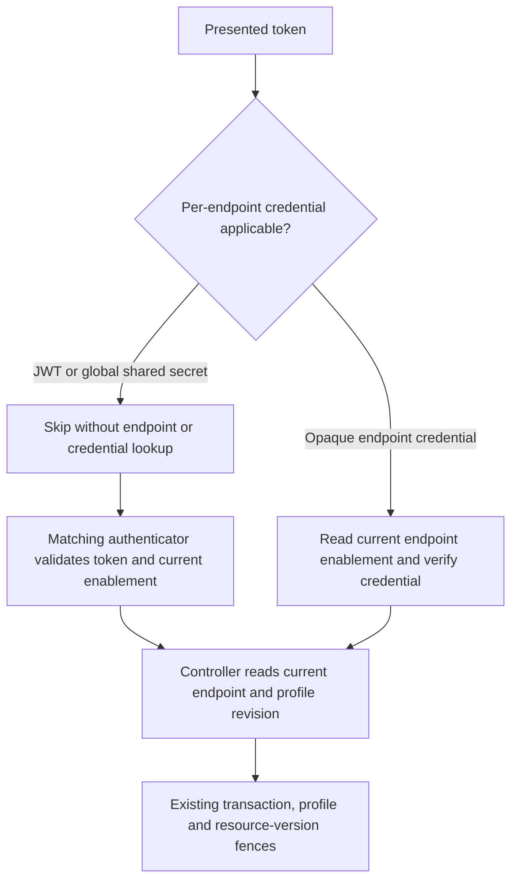

# Customer-upgrade performance hold and focused query correction

**Last verified:** 2026-10-20

## Executive summary

**Newest local implementation:** an ordered populated-membership
delete/insert statement reduces the final storage boundary from three
operations to two, preserving the separate parent conditional update and all
freshness/locking safeguards. Focused units: 79 PASS; combined related
receipts: 213 PostgreSQL PASS and 181 InMemory PASS / 32 database-only
exclusions. The 56-check live contract passes on each backend. Private image
`fa482c1b` verifies 20 modules and exact schema/migration hashes. Full
unchanged-limit half-CPU BAAB `34ca7f2d` passes all twelve latency limits:
database calls -4.10%, application CPU -13.39%, empty GET p99 48.879 versus
52.832 ms. SQL inventories reconcile; values, logging/redaction and exact
cleanup PASS. Aggregate SQL execution time increases 35.89%, mainly in
log insertion; this is not database CPU and not every metric improves.
This closes the local synthetic latency admission, not the independent
customer-data, review, release-artifact, deployment or browser gates.

**Earlier endpoint-token treatment:** the database-owned endpoint UUID removes repeated
full-row hashing. A frozen scoped observation now also omits repeated
profile-body work only after the existing locks and a new authoritative
token comparison; a token mismatch retains canonical content comparison.
Combined unit receipts prove 746 distinct PASS, not one final 16-suite
invocation. Final focused PostgreSQL: 92 PASS; combined related receipts:
230 unique PASS. InMemory: 65 PASS / 31 database-only exclusions.
Build/static/schema, private populated migration and lock-timeout proof pass.
Historical image `41f9ff4d` full BAAB passes five latency limits and fails
seven. New image `72d2eec3` verifies 19 modules plus schema/migration hashes.
Full unchanged-limit BAAB `6d80c293` passes eleven latency limits and fails
empty GET p99: 56.383 versus 48.966 ms (+15.15%). DB calls +0.026228%,
application CPU -3.834776%; values/logging/redaction/memory/cleanup PASS.
The full SQL attribution validator rejected a three-call collection
mismatch. One materialized statistics capture fixes future collection;
the bounded real diagnostic `6db7e99f` reconciles all four rounds and is
not replacement admission evidence. Individual slow-read correlation
now shows long server-side durations for some tails, with other tails
outside that clock. A separate two-CPU treatment reduces both versions'
empty GET p99 to about 7 ms and nearly eliminates throttling. This supports
quota/runtime sensitivity, not request-specific stall causality, permission
to resize production or admission of the failed half-CPU candidate.
The subsequent same-kernel diagnostic `6b83fb53` correlates all 1,600
reads: definite throttle-update overlap occurs in 20/29 slow customer and
15/21 slow candidate empty reads, none in fast under-10-ms reads. All slow
empty reads have at least possible overlap. Exact observer cost and
sampling gaps are retained; these are associations, not stall durations
or substitute admission.
No performance PASS or deployment is claimed. See
[design, migration costs and RCA](ENDPOINT_SNAPSHOT_REVISION.md).

**Historical completed measured checkpoint:** scoped observations bind the
final endpoint/type/version, exact-key profile hashing avoids locale sorting,
and ordered batching retains both existing write locks with a separate fresh
post-lock profile read. Newest source combines the profile and uniqueness
data in one statement after those locks, without changing the final version
predicate. Current focused evidence: 577 unit PASS, 219 PostgreSQL
HTTP PASS, 197 InMemory PASS / 22 database-only exclusions; build and 18 test
roots pass, no introduced lint diagnostics. The newest completed unprofiled
full ordered-lock run `eba12c39`, image `fcdb74ca`, passes all twelve
unchanged pooled latency limits at 2,000 samples per operation/role.
Database +8.27%, CPU -16.31%. Nineteen compiled modules are verified;
values/logging/redaction/cleanup pass. However, customer add p50 differs
materially between its first and last rounds (20.17 / 11.60 ms). One
independent candidate-first full run `c93f2a5f` then fails add p50 +11.96%,
remove p50 +12.96% and empty GET p95 +18.38%, with DB +8.28% and CPU +6.98%.
Values/logging/redaction/cleanup pass. Both full receipts are retained.
Performance closure is still blocked; the first pooled PASS is not proof
of a stable causal speedup, and no release is implied. New protected-snapshot
image `55a9f64f` verifies 19 serving modules. Its full candidate-first run
`82a897e8` passes eleven latency limits but fails add p99 +12.84%;
DB +0.028%, CPU +6.292%, values/logging/redaction/cleanup PASS. Actual
aggregate database execution remains higher. Timed run `02888a0e`
attributes 48.32% to fresh endpoint/fingerprint SQL and 21.65% to the
protected snapshot, with complete inventory/aggregate reconciliation.
This identifies the next design target, not isolated SHA/p99 causality.
A cheap persisted revision requires a separate design/migration outcome;
none was added here. Older receipts do not certify this source.
See [implementation and chronological measurements](SCIM_OBSERVED_VERSION_IMPLEMENTATION.md#14-carry-observed-write-scope-and-bind-it-at-the-final-mutation).
All remain local overlays, not performance-admitted releases.

**Latest unchanged-name diagnostic:** candidate `b19f39c5`, verified across
16 serving modules, skips only the service's unchanged-name lookup; atomic
uniqueness still rejects invalid legacy duplicates on both backends.
Group units: 127 PASS; PostgreSQL HTTP: 185 PASS; InMemory: 175 PASS and ten
database-specific exclusions. Run `dea371f8` at 400 pooled samples fails
six of twelve unchanged latency limits. Database calls are 14,588 / 18,216
(+24.87%); application CPU is +12.61%. Value/readback, redaction and exact
cleanup pass. This supersedes the following diagnostic as the newest result,
not as a causal comparison or a full admission PASS. See the
[complete latest table](SCIM_OBSERVED_VERSION_IMPLEMENTATION.md#13-unchanged-name-candidate-measurement-six-limits-still-fail).
Further safe write-path reduction remains necessary.

**Latest request-snapshot diagnostic:** immutable candidate `5d8e7411`
contains both precise database-id enforcement and request-bounded endpoint
observation, with 16 compiled module hashes verified. Matched run `8f3f6649`
at 400 pooled samples passes eight latency comparisons and fails four:
add p50 +11.41%, remove p50 +20.90%, remove p99 +23.27%, empty GET p95 +11.81%.
Database calls are 14,591 / 19,416 (+33.07%); application CPU is +6.56%.
Both read medians pass in this run. Value/readback, redaction and exact
isolated cleanup pass. This is not a 2,000-sample admission or an individual
optimization's causal speedup against another historical run.
See the [complete table and current-source evidence](SCIM_OBSERVED_VERSION_IMPLEMENTATION.md#10-exact-candidate-diagnostic-after-both-query-optimizations).
The performance hold remains open; further write-path work is required.

**Latest local correctness/query checkpoint, 2026-10-20:** independent
observed-version safety and Group responses from their own committed
aggregate are implemented locally. Immutable diagnostic `68cb2d52`
at 400 pooled samples still fails seven of twelve unchanged latency checks:
database calls +49.57%, application CPU +18.76%. All value/readback,
redaction and exact labeled-resource cleanup checks pass. This is not a
2,000-sample admission run or a causal comparison against a different run.
A subsequent unmeasured optimization delegates only common scalar id
uniqueness to the existing UUID constraint. Its focused evidence is 107
repository units, 181 PostgreSQL HTTP passes and 172 InMemory HTTP passes,
with nine database-only exclusions and 50 live assertions on each backend.
The [implementation and execution RCA](SCIM_OBSERVED_VERSION_IMPLEMENTATION.md)
records the races, negative controls, transaction-delegate instrumentation
and fixture corrections. Customer promotion remains blocked.

**Version-to-version RCA, 2026-10-18:** introducing commits and activated
same-runtime experiments identify repeated fresh endpoint reads plus
repository uniqueness/profile coordination as the principal measured families.
The exact new published bundle on the old production runtime still fails all
12 checks, with DB calls 53,372 / 110,614 and CPU +97.17%. Diagnostic legacy
cache behavior restores read medians; additionally omitting write coordination
brings all four medians within 9.32% and CPU within 3.73%, but removes required
safety and still fails three tail checks. These are not deployable fixes.
See the [comparative RCA](CUSTOMER_UPGRADE_PERFORMANCE_RCA.md) for commits,
query arithmetic, treatment activation, limitations and PERF-27 through PERF-31.
No new production change, version bump or deployment occurred in that phase.

Customer production remains on 0.55.20. The published 0.55.56 image passes its
dev correctness/browser gates, but fails all 12 matched customer-baseline
latency comparisons at the 10% relative limit. Issue #246 tracks this blocker.
Deployment authorization does not turn a failed measurement into a pass.

A local, unreleased correction eliminates an unnecessary full endpoint lookup
when the per-endpoint credential authenticator receives a JWT or the global
shared secret. Unit and HTTP regression checks pass, and a synthetic PostgreSQL
diagnostic confirms fewer full endpoint queries. This is not yet a complete
performance correction, a released version or permission to promote.

The subsequent content-validated snapshot prototype is now measured, not
merely proposed. It passes 205 focused units, 34 real PostgreSQL HTTP cases,
the same 34 InMemory HTTP cases, eight live assertions and one actual
Chromium regression. Its full 2,000-sample-per-operation comparison passes
three latency checks but still fails nine. Customer promotion remains held.

A further local optimization omits member relations from namespace uniqueness
reads when the compiled policy does not use builtin Group members. It keeps
the namespace lock, post-lock snapshot, profile revision and write/version
checks. Five new units include case-insensitive member paths, extension
member-named attributes and actual conflict rejection. The focused set passes
116 units. HTTP evidence totals 125 PostgreSQL cases and 124 InMemory cases;
the one InMemory exclusion requires two independent PostgreSQL pools.
The first PostgreSQL run had one invalid root-client spy assertion, corrected
without changing production code; its 31 passing adjacent cases and the
94-case corrected atomic suite supply the PostgreSQL total.

The exact new local image's three modified compiled modules match the host
build. Diagnostic `4389cda32d6f4c6691166d267790d074` confirms 1,201 member
relation SELECTs per candidate round rather than the preceding prototype's
1,601 at the same workload size. Its 804 advisory locks and 402 profile-fence
reads remain. This smaller run is query-attribution evidence, not admission;
the previous full-run failures remain preserved. The new complete run below
also fails admission.

**Further local Group-read prototype:** a scoped single-statement aggregate
now replaces the two-statement Group/detail-member read. It does not change
the production Prisma generator or enable a global preview flag. Two
meaningful unit assertions were RED before implementation. Build and focused
lint pass; 125 unit cases pass across five resolved suites. Real PostgreSQL
HTTP: 180 PASS, including exact persisted aggregate/date equality under
`America/New_York`. InMemory: 178 PASS plus the two existing PostgreSQL-only
cases (independent pools and native foreign-key rollback).
Subsequent hardening adds a 1,000-member fixture, complete value/display
readback and cross-endpoint isolation. The changed atomic suite passes
95 PostgreSQL cases and 94 InMemory cases plus its independent-pool exclusion.
Together with the unchanged four suites, current unique coverage is
181 PostgreSQL PASS and 179 InMemory PASS plus two PostgreSQL-only exclusions.
The large test takes 407 ms on the isolated PostgreSQL fixture and 79 ms in
InMemory; these are test durations, not deployment SLO measurements.

The four compiled runtime modules match experimental image
`sha256:280d8d6d2dbac7c2269107d03f7b611b3e7ba48ae0c3bfae16f81bed16e053e3`.
Small run `1295aecf9bb246489a3ef2af7f6191b5`, at the same 807 requests per
round, replaces 1,201 separate member reads with 1,201 aggregate reads.
Total attributed candidate statements fall from 8,877 to 7,676, while 804
advisory locks and 402 profile-fence reads remain. This demonstrates query
reduction, not customer admission. Its new full measurement below fails
nine of twelve latency checks.
The earlier eleven-failure full receipt is for the preceding image.

**Newest local runtime-index correction:** internal SCIM request snapshots
used the public profile projection, which correctly strips runtime indexes
but caused them to be rebuilt on every request. Keep the derived bag on the
verified cached snapshot, share it through shallow request-profile copies,
and clear it whenever either backend publishes a replacement cached record.
The public and persisted profile remain free of these maps. Independent
authoritative reads, captured in-flight snapshots and all write fences remain.
The actual HTTP RED observed two builds instead of zero on warm reads.
Backend parity then caught an inherited stale bag after InMemory updates;
a dedicated service unit independently reproduces that defect.
Focused proof now passes 177 unique units across four suites, 96 PostgreSQL
atomic HTTP cases and 95 InMemory cases plus the independent-pool exclusion.
Build and focused production/HTTP/unit lint pass. The PostgreSQL fixture and
network are removed and the marker restored. Its fresh full-image run
`93e57f5bbfd146bebb727c3c2e1cb206` now fails five of twelve latency checks.
All four medians fail; seven tail checks pass. This is still an admission
failure, not release readiness or causal proof from cross-run failure counts.

The authentication-advertisement work remains stopped. This correction does
not implement another authentication method or alter accepted credentials.

## Actual baseline and admission result

The actual customer image is
`sha256:8b00fff083b8aae3226e9680ba987cc776bdb43d7a4ad8fc2812edf8019ecd4a`.
The published 0.55.56 candidate is
`sha256:07f08b855ebe178c6a9a5b60af80d4177c267b8878c959a09e5f1a64fdc03aa2`.
Customer ARM metadata independently confirms 0.5 CPU and 1 GiB. Both local
application containers use that verified quota, separate synthetic PostgreSQL
databases and loopback-only ingress.

The authoritative comparison uses baseline/candidate/candidate/baseline order,
100 warmups and 1,000 measured iterations per round: 2,000 pooled samples per
version per operation and 17,628 full lifecycle requests.

### Latest runtime-index prototype: admission FAIL

Local-only image
`sha256:d92ae4c7e3990bf64a054bc2ecc2729b307fc18c3a60f354febeb641ab65563c`
matches all four validated compiled runtime modules. Corrected diagnostic
`de02af608cb44e06827a4613a2b5d9a9` completes four 807-request rounds.
Full run `93e57f5bbfd146bebb727c3c2e1cb206` uses the unchanged 0.5 CPU /
1 GiB, ABBA order, 100 warmups and 2,000 pooled samples per version/operation.
All 17,628 lifecycle requests, privacy, memory and exact cleanup checks pass.
The collector exits 0; the strict admission assessor exits 1.

| Operation | p50 baseline/prototype ms | p95 baseline/prototype ms | p99 baseline/prototype ms |
|---|---|---|---|
| Add | 11.164 / 16.903 | 55.168 / 51.417 | 95.038 / 98.228 |
| Populated read | 4.413 / 5.873 | 19.632 / 19.988 | 58.976 / 58.169 |
| Remove | 9.436 / 14.999 | 48.311 / 53.621 | 84.003 / 89.316 |
| Empty read | 4.283 / 5.785 | 18.130 / 18.334 | 67.747 / 49.490 |

All four p50 checks fail: +51.40%, +33.07%, +58.96% and +35.07% respectively.
Remove p95 also fails at +10.99%; the other seven checks pass. DB calls remain
53,372 versus 84,198, +57.756876%. Application CPU is 53,253,447 versus
67,895,548 microseconds, +27.495123%. Largest measured post-round candidate
Node RSS is 183.89 MiB; no OOM. This is a same-run baseline comparison.
Nine prior versus five current failures is not causal latency/CPU proof:
both runs have different baseline distributions. Independent build counters
prove eliminated reconstruction, but do not establish sufficient admission.
No customer mutation, version bump, publication or promotion occurred.

### Preceding Group-read prototype: admission FAIL

Run `87b5da20784b4b759ef976cc90ad46a3` measures the four-module-verified image
above at 0.5 CPU / 1 GiB. ABBA order, 100 warmups and 2,000 pooled samples per
version/operation produce 17,628 lifecycle requests. The collector exits 0;
the admission assessor exits 1. Correctness, privacy and exact cleanup pass.

| Operation | p50 baseline/prototype ms | p95 baseline/prototype ms | p99 baseline/prototype ms |
|---|---|---|---|
| Add | 12.135 / 17.646 | 51.588 / 52.612 | 95.191 / 95.485 |
| Populated read | 4.911 / 6.320 | 16.435 / 18.255 | 61.186 / 73.651 |
| Remove | 10.181 / 15.664 | 44.700 / 50.034 | 83.014 / 87.755 |
| Empty read | 4.754 / 6.230 | 15.917 / 20.335 | 57.541 / 69.104 |

Database calls: 53,372 versus 84,198, +57.76%. Application CPU:
55,425,403 versus 70,553,550 microseconds, +27.29%. Largest measured post-round
prototype Node RSS: 182.70 MiB; no OOM. Add p95/p99 and remove p99 pass;
all remaining nine checks fail. These figures compare that image with
its same-run baseline. Differences from preceding runs are not causal proof
of CPU or latency improvement. The independently proven query reduction
does not waive admission.

### Preceding namespace-projection prototype: admission FAIL

Run `de8497028a4c4b1cb31f7d893914a045` measures the exact three-module-verified
local image, not the published 0.55.56 digest. It uses the same customer quota,
ABBA order, warmups and 2,000 pooled samples per version/operation.
The collector and correctness/privacy/cleanup checks pass; the assessor
exits 1 because eleven of twelve latency checks fail.

| Operation | p50 baseline/prototype ms | p95 baseline/prototype ms | p99 baseline/prototype ms |
|---|---|---|---|
| Add | 12.848 / 21.120 | 50.146 / 68.816 | 88.220 / 151.237 |
| Populated read | 5.278 / 7.603 | 17.911 / 28.761 | 50.978 / 74.597 |
| Remove | 10.814 / 18.677 | 43.423 / 69.833 | 83.584 / 159.329 |
| Empty read | 5.170 / 7.480 | 20.852 / 27.873 | 71.746 / 75.822 |

DB calls: 53,372 baseline versus 97,403 prototype, +82.50%.
Application CPU: 57,356,264 versus 91,446,528 microseconds, +59.44%.
Largest measured post-round prototype Node RSS: 181.82 MiB; no OOM.
Only empty-read p99 passes the relative limit. Different runs have different
baselines: nine intermediate versus eleven latest failures is not a causal
measurement of the projection change. Query reduction is proven separately;
an HTTP latency improvement or admission PASS is not.

The original published-image comparison below remains intact and failed.

### Original published-image result

| Operation | p50 old/new ms | p95 old/new ms | p99 old/new ms |
|---|---|---|---|
| Add member | 11.021 / 19.197 | 49.153 / 67.681 | 85.276 / 165.035 |
| Read populated group | 4.378 / 8.340 | 22.158 / 38.539 | 58.981 / 71.364 |
| Remove member | 9.341 / 17.476 | 44.471 / 63.891 | 81.632 / 114.383 |
| Read empty group | 4.198 / 8.257 | 13.664 / 36.925 | 49.733 / 81.412 |

All 12 comparisons fail the 10% limit. Database calls increase from 53,372 to
110,614 (+107.25%); application CPU increases from 51,418,169 to 92,809,890
microseconds (+80.50%). Measured post-round Node resident memory remains below
384 MiB and no out-of-memory event occurs. Correct fixture values, cleanup,
request-log correlation and credential redaction pass.

These are local synthetic upgrade measurements, not customer-data or Azure
service-level evidence. They compare cumulative release changes, not just the
narrow startup-redaction correction.

## Request flow and preserved boundaries

The diagram shows the local prototype's global-secret path. Only the first,
inapplicable probe loses its endpoint lookup. The matching authenticator still
reads current enablement, and the controller still obtains an independent
current endpoint/profile snapshot.

Relevant implementation:

- [Endpoint credential authenticator](../api/src/modules/auth/authenticators/endpoint-credential.authenticator.ts).
- [Global-secret authenticator](../api/src/modules/auth/authenticators/global-shared-secret.authenticator.ts).
- [Persistent endpoint reads](../api/src/modules/endpoint/services/endpoint.service.ts).
- [Group controller snapshot](../api/src/modules/scim/controllers/endpoint-scim-groups.controller.ts).

No time-based or request-scoped authorization snapshot bypass is added.
The existing endpoint cache can now reuse a representation only after the
current database row's complete content fingerprint matches that captured
object. Tests cover concurrent disablement, profile changes, deletion,
same-timestamp metadata and logging-policy synchronization. Required
advisory locks, profile/version checks and namespace snapshots are retained.

The diagnostic skip explanation now identifies the inapplicable token shape
before checking whether endpoint credentials are enabled. It remains a
`not-applicable` result, never an accept or a rejection of the matching method.

## Initial credential-probe evidence

| Check | Observed result | What it establishes |
|---|---|---|
| Unit RED | Two failures: expected zero endpoint reads, observed one | The pre-fix defect is reproduced |
| Focused unit GREEN | 30 tests / three suites | JWT/global-secret probes perform no endpoint or credential read; applicable tokens still read current flags |
| Adjacent guard/JWT units | 46 tests / two suites | Existing authenticator-chain and JWT behavior remains compatible |
| Changed-file ESLint | PASS | No lint errors in the changed runtime/unit files |
| Documentation freshness | 27 manifest documents PASS | Existing version, date, link and source-coupling checks pass |
| API build | PASS | Runtime source compiles |
| InMemory HTTP | 18 tests / two suites | One global-secret authorization read plus independent controller snapshot; exact empty ListResponse; disablement is enforced on the next request |
| PostgreSQL HTTP | The same 18 tests / two suites PASS | Query-boundary and disablement cases also pass on a real isolated database |
| Local Docker build | PASS | Unreleased experimental image, not a registry publication |
| Compiled-image comparison | PASS | Experimental authenticator JavaScript equals the tested host build |
| Synthetic PostgreSQL diagnostic | Four rounds PASS | Actual query reduction, fixture correctness, privacy and exact cleanup |
| Full first-prototype admission | Not run | This first image was diagnostic only |
| Complete release matrix | Not run for the prototype | Published 0.55.56 evidence must not certify changed source |

The smaller diagnostic uses 100 samples per operation per round, with the same
warmups, quota and four-round order. First candidate-round full endpoint reads
fall from 2,407 in the pre-fix diagnostic to 1,605 with the prototype. The
separate 402 profile-fence projection reads remain. The second patched round
has 1,610 full reads; asynchronous work must not be mistaken for an exact
per-request count. The HTTP spy independently verifies the request-boundary
call count.

The post-fix diagnostic still has elevated latency relative to 0.55.20. It
does not supersede the authoritative 2,000-sample failure. Its successful
collector exit establishes correct measurement and cleanup, not admission.
The local image retains package version 0.55.56 only as a clearly labeled
experimental build; it is not the published 0.55.56 digest.

Ignored, session-owned receipts include the authoritative run
`ab5d73c3343c42058170deb4f4accb62`, attribution run
`65b0ff23b7aa4ae988f6de8dd75c61d4` and patched diagnostic
`5bfbc940d8cb4c70b2b7a5a8b975d3f1`. These are not downloadable CI artifacts.

## Execution issue and prevention

**PERF-01 - incomplete fast-path assertion.** Type: test correctness and
avoidable database work. Severity: High, because the earlier test could pass
while a database-backed applicability probe remained expensive.

- Symptom: existing JWT/global-secret tests proved that the credential
  repository was not scanned, but did not assert that endpoint loading was
  skipped.
- Root cause: enablement resolution preceded token applicability. Persistent
  freshness later made each endpoint lookup a real full-row read.
- Local resolution: move the existing always-inapplicable checks before that
  lookup. Do not change matching authenticators or introduce stale caches.
- Why it works: impossible credential matches need no per-endpoint policy
  lookup. Applicable opaque credentials still require current policy.
- Prevention applied: assert zero endpoint and credential calls, current
  enablement on successive applicable attempts, the independent HTTP
  authorization/controller reads and post-disablement refusal.
- Detection: customer-matched performance attribution, followed by focused
  RED. Earliest applicable gate: the authenticator query-budget unit test.
  The introducing commit has not been bisected; no exact historical escape
  interval is claimed.
- Commit: not yet committed, reviewed, merged or released.

Test/gate self-improvement: **applied**. The strengthened assertions measure
the missing work boundary rather than merely a successful authentication
outcome or absence of a credential scan.

Design/architecture disposition: **accepted**. Reordering existing checks
adds no responsibility, dependency, strategy or caching abstraction. Wider
endpoint-read reuse is not assumed safe simply because it is faster.

**PERF-02 - diagnostic patch context mismatch.** Type: tooling friction.
Severity: Low. A session-runner patch assumed a quoted Docker port argument,
but the existing argument was unquoted. The atomic patch failed without
changing the file. Reading the exact affected lines and applying their real
context resolved it; PowerShell parsing and the subsequent complete diagnostic
passed. Detection and earliest possible gate are the same patch operation.
No runtime defect, additional dependency or policy change resulted.

**PERF-03 - PowerShell split a native mount argument.** Type: tooling friction.
Severity: Low. The first standalone PostgreSQL HTTP fixture passed an unquoted
comma-containing mount expression to Docker. PowerShell split it into an
array, producing `invalid reference format` before the container started.
The created network was still removed by the `finally` path. Quoting the
complete mount specification preserves one native argument; the corrected
run passed all 18 PostgreSQL HTTP tests and verified exact cleanup and marker
restoration. Detection and earliest applicable gate are the native Docker
fixture startup. Keep comma-containing native argument values quoted.

**PERF-04 - table-level SQL counts mixed two read shapes.** Type: diagnostic
correctness. Severity: Low. An exploratory aggregation counted every
`Endpoint` read together, obscuring the distinction between full rows and
the 402 required profile projections. Inspecting the normalized selected
columns separated those shapes before recording the performance conclusion.
Prevention: classify by statement shape, not just table name. Detection and
earliest applicable gate are the same attribution review; no product
behavior or release-admission result changed.

## Subsequent compact authoritative-read prototype

The continuation now implements a second local correction: every UUID
lookup still reads the current PostgreSQL row, but the same statement returns
only its SHA-256 fingerprint when the complete row matches the captured
cached representation. Changed rows return their data for the existing
hydration/logging synchronization path. Name fallback, database failure and
deletion handling remain authoritative. No lock or post-lock profile read
is combined or removed.

Focused RED: three meaningful compact-query/snapshot validation failures.
Initial GREEN: 15 freshness cases and 18 real PostgreSQL HTTP cases.
The real HTTP case also checks that both independent endpoint reads occur
and at least one response is compact, rather than merely checking status.
Final focused source evidence: 205 unit cases across six suites; API build
and changed-service ESLint pass. Four HTTP suites pass 34 cases on each
backend, including a real second application instance, same-timestamp
out-of-process metadata changes, exact timestamps and retained write fences.
All synthetic database/network fixtures were removed.

### Full compact-prototype measurement

Run `e55672ee50114bc48aeac4ea714f8309` compares the actual customer image with
local-only `scimserver-local:ep-compact-snapshot-20261017`, pinned to image ID
`sha256:0e71100d9b65c44b2b6ae0502729fc73d4faaa27f6f144f64df0c72799975304`.
Both compiled runtime-file hashes equal the tested host build. This package
still reports 0.55.56; it is not the published 0.55.56 artifact.

The full run uses the same 0.5 CPU / 1 GiB, round order, 100 warmups and 2,000
pooled measured samples per operation. All 17,628 lifecycle requests,
privacy/log correlation assertions and exact fixture cleanup pass.

| Operation | p50 baseline/prototype ms | p95 baseline/prototype ms | p99 baseline/prototype ms |
|---|---|---|---|
| Add member | 11.822 / 18.903 | 55.090 / 58.740 | 100.002 / 111.276 |
| Read populated group | 4.713 / 6.699 | 21.159 / 24.668 | 65.661 / 51.731 |
| Remove member | 9.956 / 17.071 | 45.380 / 55.340 | 84.290 / 95.453 |
| Read empty group | 4.590 / 6.631 | 19.046 / 23.818 | 57.166 / 52.797 |

**Admission FAIL: nine of twelve latency comparisons exceed 10%.**
The three passing checks are add p95 and both read p99 values. Database
calls are 53,372 versus 101,804 (+90.74%); application CPU is 55,916,339 versus
79,757,065 microseconds (+42.64%). Maximum measured post-round Node RSS is
184.37 MiB for the prototype; no OOM occurs. These results do not supersede
the separate original published-image failure or prove an Azure/customer SLO.
Different runs have different baselines; do not turn directional improvement
into an exact causal speedup claim.

### Actual browser and live regression evidence

The new opt-in live case in
[the auth-diagnostics browser spec](../web/e2e/auth-diagnostics.spec.ts)
creates its own endpoint, disables opaque credential methods, makes a real
global-secret SCIM request and opens that actual correlated decision in the
browser. Published 0.55.56 produces meaningful RED: the displayed check says
`per-endpoint credentials not enabled` instead of explaining token
applicability. The prototype passes the exact explanation and actual UTC
date/time assertions. Fixture deletion is independently verified by 404.

This is **one focused real Chromium PASS**, not a complete post-deployment
browser run for unreleased source. The earlier 324 deployed browser passes
belong only to the published dev image. No visual baseline was regenerated;
the RED is an intended pre-fix text assertion, not a visual-regression diff.

The new `9z-DR` live section is wired before cleanup and smoke-run on the
actual prototype: **eight PASS**. It checks UTC timestamp equality, current
settings, endpoint/ListResponse key allowlists, actual correlated skip text,
and exact owned-endpoint deletion/absence. It is reusable through the normal
live runner on local, Docker and resolved Azure estates; no new FQDN is stored.

**PERF-05 - shared fixture initially discarded the requested identifier.**
Type: test harness correctness. Severity: Low. The first endpoint-service
regression run failed one existing identifier-forwarding assertion because
the new SQL mock called its backing reader without the requested ID.
Forwarding the bound ID preserves the original test's intent. The corrected
service/freshness run passes 135 cases. Earliest and actual detection:
the existing endpoint-service unit test.

**PERF-06 - PostgreSQL JSON timestamps lost Prisma UTC interpretation.**
Type: runtime correctness and fixture fidelity. Severity: High.
The first compact-read prototype parsed timezone-free PostgreSQL timestamp
JSON with native local-time semantics. Its initial mock emitted a trailing
`Z`, masking this difference. Under `America/New_York`, the corrected
realistic fixture reproduced a five-hour shift and unwanted rehydration:
two meaningful failures.

The parser now explicitly interprets timezone-free database timestamps as
UTC, preserves explicit offsets, and rejects invalid timestamps before
cache publication. Both service/freshness suites pass all 135 cases under
that non-UTC timezone. The real PostgreSQL HTTP fixture also runs non-UTC
and compares endpoint timestamps with Prisma's actual stored Date values.
Detection: timezone-focused unit check after initial HTTP success. Earliest
possible gate: a realistic PostgreSQL JSON fixture plus non-UTC assertion;
the new checks close that gap before any release.

A parent-process `TZ` setting alone would not enforce this in ordinary UTC
CI. The permanent unit suite therefore launches one isolated source-level
Jest case in a real non-UTC Node process and asserts the actual offset.
Its negative control fails with the five-hour shift even when the parent is
UTC; restoring the parser makes all 205 focused cases pass. The filtered
child deliberately selects one case; the parent suite runs all its cases.

Design disposition for this second prototype: **accepted**. A private
authoritative-read helper and weakly keyed fingerprint metadata reuse the
existing endpoint cache. Every read still checks current database contents;
the in-flight test proves a late old result cannot revert a newer cached
profile. No new policy, provider hierarchy or persistent schema is added.

**PERF-07 - verification used a reserved PowerShell variable.**
Type: tooling friction. Severity: Low. An image-hash verification command
assigned to PowerShell's read-only `$Host` variable and stopped before
writing its receipt. Renaming it `$hostHash` made the same verification
pass: both compiled runtime files match the tested host build. Detection
and earliest possible gate: command execution. Use descriptive variable
names that do not shadow shell automatic variables.

**PERF-08 - Playwright treated a Windows path as a regular expression.**
Type: tooling friction. Severity: Low. The first runner selected zero tests
with a backslash-containing selector. This was not meaningful RED.
Using the unique spec basename fixes selection; the runner now requires
discovery of exactly one test before creating infrastructure. The corrected
published-image run fails at the intended explanation assertion, and the
prototype passes. Detection: actual invocation. Earliest possible gate:
the now-enforced test-discovery preflight.

**PERF-09 - timestamp test assumed the wrong DOM relationship.**
Type: test correctness. Severity: Low. The initial prototype browser run
passed the explanation check, then looked for a child `time` element inside
the copy-field test ID. The actual primitive wraps that field in `time`.
Selecting the semantic `time` containing the test ID fixes the locator;
the actual timestamp attribute and complete date/time text now pass.
The failed receipt, screenshot and trace are preserved separately.
Detection and earliest possible gate: the real browser. This was a test
selector defect, not a product timestamp or visual baseline change.

**PERF-10 - expanded HTTP lint found untyped new assertions.**
Type: test type safety. Severity: Low. The normal API lint command checks
`src`, not HTTP specs. An explicit expanded check found seven introduced
unsafe body/spread accesses alongside eleven existing errors in the original
authentication HTTP spec. Match the complete response as an object, require
the stored row explicitly and append unknown rows individually instead of
spreading an untyped array. Final expanded lint has only the exact eleven
HEAD-baseline errors; the new helper, freshness HTTP spec and all modified
runtime/unit scopes have zero errors. Final HTTP reruns pass 34 cases per
backend. Detection: expanded lint after HTTP success. Earliest possible gate:
type-aware lint on authored assertions, now included in this focused check.
No unrelated baseline errors were silently fixed or called passing.

**PERF-11 - TypeScript 6 explicit-file mode needs an explicit config choice.**
Type: tooling friction. Severity: Low. The first focused browser type-check
stopped with TS5112 because a project config exists while files were given
on the command line. `--ignoreConfig` plus explicit strict compiler options
correctly checks the actual spec and its fixture imports with zero errors.
The normal web config includes only `src`, so its separate 66 existing
diagnostics cannot certify this browser spec. Those compiler inputs and
dependencies are unchanged from HEAD. Detection and earliest possible gate:
the compiler invocation. Use explicit-file mode intentionally instead of
claiming a project check covers excluded files.

**PERF-12 - Azure MCP discovery cannot replace approved-identity verification.**
Type: tooling/authentication friction. Severity: Low. A read-only ARM tool
discovery request failed because its credential chain could not obtain a
token. This is not evidence about the approved customer's permissions.
Resolution: use the existing registry-selected customer CLI profile, verify
its tenant, subscription and service-principal application ID before any
resource lookup, and retain the result separately. The identity verification
passes; the exact managed-group existence check still exits 1 with Forbidden
at 2026-10-17T18:43:01Z. Absence remains unknown and the cleanup receipt is
unchanged. No identity substitution, role change or new rehearsal occurred.
Detection and earliest possible gate: tool preflight, before cloud mutation.
Prevention: discover tool support separately from proving identity and
resource access; never treat a successful account check as resource access.

**PERF-13 - uniqueness snapshots loaded unrelated member relations.**
Type: avoidable database work. Severity: Medium. Every namespace snapshot
included Group member relations even for policies containing only scalar or
extension attributes. Read the compiled policy before requesting this
relation, requiring it only for builtin Group member paths in column-backed
representation. No namespace lock, post-lock scan, profile or version fence
is removed. Two query-shape assertions fail before the fix; all five new
projection/conflict cases and 111 adjacent units pass afterward. Actual SQL
counts confirm 400 fewer member SELECTs in each diagnostic candidate round.
Detection: post-failure SQL attribution. Earliest possible gate: repository
query-shape unit tests, now added, with actual SQL counters as independent
execution evidence. The HTTP admission failure is not closed by this result.

**PERF-14 - the IDE test runner did not discover the linked-worktree suite.**
Type: tooling friction. Severity: Low. The test tool returned no tests for
the exact owned absolute path. This is not meaningful RED. The repository's
explicit Jest command selected the suite and produced two actual assertion
failures, then the complete four-suite 116-case GREEN. No package installation
or configuration change was needed. Detection and earliest possible gate:
runner discovery; require selected-case output before accepting RED/GREEN.

**PERF-15 - a root Prisma delegate spy cannot observe transaction delegates.**
Type: test correctness. Severity: Low. A new HTTP test expected two namespace
reads on a spy attached to the root client; actual writes use a distinct
transaction client, so it saw zero despite correct HTTP results. The first
matrix had 124 passing cases and that one failing assertion. Keep exact
projection assertions at the repository unit boundary, verify actual SQL
counts independently, and make HTTP assertions prove persisted membership,
conflict rejection, unchanged data and response key allowlists. The corrected
atomic HTTP suite passes all 94 cases. Detection: real PostgreSQL HTTP.
Earliest possible gate: transaction-client-aware instrumentation design.
The three independent claims remain; the invalid spy is not called a
production failure or silently converted into a presence-only assertion.

**PERF-16 - exported search output contains multiple JSON records.**
Type: tooling friction. Severity: Low. Parsing the entire exported tool
response as one JSON document failed on additional content after the first
record. Reading and parsing the first complete record recovered the bounded
answer without dumping the export. No product input or runtime was changed.
Search summaries remain unverified until matched to the installed dependency
version and an executable capability check. Detection and earliest possible
gate: artifact parsing; inspect the tool's output shape before selecting a
parser. No external search conclusion is treated as a runtime proof.

**PERF-17 - generator configuration requires a URL even without a connection.**
Type: tooling/configuration friction. Severity: Low. Isolated diagnostic
generation initially stopped because the normal Prisma config resolves
`DATABASE_URL`. Supplying a non-connecting localhost placeholder lets the
installed 7.8.0 generator run without opening a database connection, changing
dependencies or reading a cloud credential. Detection and earliest possible
gate: generator preflight. Distinguish config evaluation from data-plane
connectivity.

**PERF-18 - the architecture reference also requires the source update.**
Type: documentation coupling. Severity: Low. Final freshness validation
correctly failed F4 because the endpoint service changed without a matching
review of the profile architecture reference. Added a clearly unreleased
description of per-lookup content validation, independent reads and preserved
fences. The unchanged gate now passes all 27 documents. Detection and earliest
applicable gate: documentation freshness, with no escape. Prevention already
exists in the manifest; no duplicate gate is necessary. This closeout issue was
recorded immediately after the successful rerun.

**PERF-19 - Group detail reads incurred a second relation roundtrip.**
Type: avoidable database work. Severity: Medium. Actual SQL receipts showed
6,601 resource reads and 6,601 associated member reads in a full candidate
round. Replace only the scoped Group detail read with a correlated JSON
aggregate in one PostgreSQL statement. Resource and membership now share a
statement snapshot, without repeating the parent payload per member. Member
timestamps use epoch milliseconds, avoiding session-dependent JSON date
parsing. Both endpoint/resource-type filters and existing error translation
remain. No writer, namespace/profile/version fence, global query strategy or
pool changes. Two initial assertions were RED; 125 focused units and 180 real
PostgreSQL HTTP cases are GREEN. Independent actual SQL attribution proves
the removed roundtrips. Detection: matched SQL attribution; earliest applicable
gate: repository query-shape unit test, now added. No admission PASS is claimed.
Architecture disposition: **accepted** - the read stays in the existing
cohesive repository, with no additional service, pool or generator feature.

**PERF-20 - one selected test path was guessed in the wrong layer.**
Type: tooling/test-selection friction. Severity: Low. The first combined unit
command passed 119 tests but exited 1 because a requested infrastructure
profile-revision spec did not exist. Glob resolved the actual domain spec.
Only the two remaining domain suites were run, passing six cases, rather
than repeating the unchanged 119. Preserve the failed selection log and count
125 unique passing tests across the five real suites. Detection: runner
ENOENT; earliest possible check: resolve test paths before invocation.
Prevention is the existing discovery-first convention, not a missing-package
installation or a fabricated all-green receipt. No commit exists yet.

**PERF-21 - dense diagnostic expressions failed before measurement.**
Type: tooling/shell friction. Severity: Low. A Node hash one-liner had an extra
closing parenthesis; a PowerShell inventory attempted to pipe directly from
a `foreach` statement. Neither produced accepted evidence. Extract the hash
helper into a readable session-local script, run `node --check`, and assign
the PowerShell loop result before piping it. The corrected checks verify all
four compiled modules and preserve the actual query inventory. Both hash
fixtures are absent, including the failed one. Detection: parse preflight;
earliest possible gate: syntax check before container invocation. Keep
nontrivial diagnostics in syntax-checked scripts rather than dense expressions.
No production code, dependency or credential changed for these repairs.

**PERF-22 - a Jest matcher callback returned an unsafe value in strict lint.**
Type: test correctness/tooling friction. Severity: Low. The new large-fixture
assertion returned `expect.objectContaining` from a mapped callback; strict
ESLint correctly rejected its `any` return. Replace it with guarded unknown
response elements and an exact typed value/display map comparison. The
existing lint now passes, and both actual backend hardening runs pass. This
also verifies every returned member rather than array presence alone.
Detection and earliest gate: focused static lint, before either backend run.
No production code or benchmarked runtime changed; no benchmark rerun needed.

**PERF-23 - public projection discarded reusable internal schema indexes.**
Type: runtime performance. Severity: High. `getEndpointForRequest` reused
`toFullResponse`, whose privacy boundary deliberately removes `_schemaCaches`.
Consequently two warm HTTP reads rebuilt characteristics twice. Keep a
separate derived bag on `CachedEndpoint`, shared only by shallow request
profiles for that verified snapshot. Public serialization remains unchanged.
Two service regressions prove retained maps, fresh authoritative reads,
same-timestamp invalidation, non-disclosure and in-flight snapshot isolation.
Actual HTTP proves zero warm builds, rebuilding after a settings change and
the changed DELETE behavior. Detection: runtime-path trace and HTTP counter
RED; earliest applicable gate: internal snapshot reuse unit, now added.
GREEN: 177 unique units, 96 PostgreSQL HTTP and 95 InMemory HTTP plus its
independent-pool exclusion. Full exact-image run `93e57f5b...` still fails
five of twelve latency checks. No version, release or admission PASS exists.
Architecture disposition: **accepted** - the existing snapshot owns its
derived indexes; no new service, authorization cache, TTL or broker.

**PERF-24 - InMemory update inherited a stale derived-cache reference.**
Type: backend parity/cache invalidation. Severity: High. InMemory spreads the
current cached record when publishing an update. The newly added derived bag
was therefore inherited after the profile changed. The backend HTTP gate
expected rebuilding but observed zero calls. Clear the bag in the existing
shared `cacheSet` publication helper rather than patching one backend branch.
This resets new snapshots without mutating maps held by in-flight snapshots.
A dedicated InMemory service negative control fails on the actual retained
map with that one clearing statement removed; restoring it passes all 122
service tests. This raises the four-suite unique total from 176 to 177
without repeating the unchanged three suites. Both backend HTTP suites pass.
Detection: InMemory HTTP; earliest applicable gate: InMemory update unit.
The added negative-control-proven unit closes that escape in-place.
Architecture disposition: **accepted** - invalidation belongs in the shared
cache-publication helper; no speculative abstraction is introduced.

**PERF-25 - a search used unsupported regular-expression look-around.**
Type: tooling friction. Severity: Low. Rust ripgrep rejected `(?!=)` before
searching. Replacing it with the supported `=[^=]` expression completed the
bounded assignment search. No source, test result or performance evidence
depended on the failed command. Detection and earliest gate: tool parsing.
Use supported regex syntax; this does not justify new tooling or dependencies.

**PERF-26 - an experimental label was passed as the actual runtime version.**
Type: tooling/evidence invocation. Severity: Low. Diagnostic `b56a7f52...`
stopped before candidate workload because its expected version was set to
`0.55.56-local-runtime-index`, while the unversioned prototype correctly still
reports `0.55.56`. The existing runtime-identity gate rejected the mismatch.
Keep the experimental image tag separate from the actual application version;
remove the incorrect override, without changing the harness or runtime.
Corrected diagnostic `de02af608cb44e06827a4613a2b5d9a9` completes all four
807-request rounds, privacy checks and verified exact cleanup. The failed
partial run remains preserved and is not pooled into any accepted comparison.
Detection and earliest gate: existing runtime-identity preflight, before
candidate data mutation. The existing gate already catches this issue; no
new abstraction, dependency or duplicate gate is needed.

## Additional CPU attribution for the first prototype

Native Node sampling was collected from both isolated images in diagnostic
run `96d10402e7d54377b843f26fcfb1211a`. Both profiles were credential-scanned
before being accepted, and all labeled containers/network were removed.
Sampling includes startup and workload; sampled stacks are not exact CPU
attribution, and profiling overhead makes these rounds diagnostic only.

Baseline has 10,177 non-idle/non-program samples; the prototype has 16,551.
The candidate's endpoint fingerprinting accounts for 818 inclusive samples,
and persistent endpoint resolution for 998. Network `writev` accounts for
1,586 self samples versus 865 on baseline. Garbage-collector samples increase
from 352 to 715. These observations support continuing the investigation;
they do not establish that removing a required query or caching authorization
would be safe, or that one remaining function explains the whole regression.

## Follow-up transport experiment

After the full admission failure, a separate isolated experiment captured the
actual compiled compact-read method's SQL and bound values. It compared that
same unchanged-row statement through Prisma, its existing underlying pool,
and a named prepared statement. Each method has 2,000 checked samples with
100 warmups per round, ordered Prisma/native/prepared/prepared/native/Prisma.
Every response must contain the same fingerprint and null compact payload.

| Method | First/second round p50 ms | First/second round p95 ms |
|---|---|---|
| Prisma | 1.073 / 1.011 | 1.661 / 1.419 |
| Native existing pool | 0.938 / 0.884 | 1.119 / 1.066 |
| Prepared existing pool | 0.852 / 0.843 | 1.020 / 0.982 |

This is not an HTTP benchmark or admission result. It shows a transport cost,
but does not demonstrate that bypassing the query engine would close the
remaining 42% to 71% median HTTP regression. No production pool exposure,
new connection pool, transaction rewrite or native-driver path was added.
The diagnostic endpoint, application, database and network were removed and
absence verified. Design disposition: **accepted**; avoid a speculative
infrastructure seam that this experiment does not establish as sufficient.

## Isolated relation-loading capability experiment

An external search summary claimed the installed Prisma generation did not
support joined relations; the current vendor page redirected to a different
major version. Neither was accepted as proof. An exact-model diagnostic
client generated with installed Prisma 7.8.0, the existing pg adapter and the
`relationJoins` preview feature actually executes both strategies.

The same pool and populated synthetic Group produce equal complete records
through both paths, including Date values and persisted member fields.
Across 2,000 samples per strategy, `query` uses two statements per call and
`join` uses one verified LATERAL-join statement. Round medians are
1.240/1.114 ms for `query` and 0.762/0.807 ms for `join`.
This is a capability and query-shape experiment, not HTTP admission.

The production schema and generated client remain unchanged. The generator
feature would affect the production client rather than only this diagnostic,
so it is not adopted on the basis of one-call measurements. The temporary
diagnostic client and schema are cleanup-owned, not release inputs. Exact
endpoint deletion/404, empty inventory and container/network cleanup pass.

## Evidence provenance and consolidation boundary

The full available continuation event stream was reconciled with signal and
causal-narration passes: 31,422 records, including 9,403 in the approved
delivery window. The scanner retains only record metadata and category
labels, not raw messages or credential-bearing diagnostics. This is the
recovered continuation, not the deleted original transcript.

Expected unit/browser RED, compact-snapshot/UTC errors, fixture forwarding,
shell/CLI friction, test selectors and expanded type checks are accounted for
in PERF-01 through PERF-26 above. Metadata categories include expected
assertion failures, the invalid transaction spy, generator preflight and
multi-record tool-export parsing. The credential-preflight category includes
the actual MCP discovery failure and source/recording echoes.
The scan includes the closeout F4 failure, Group snapshot RED/GREEN, guessed
path failure, both diagnostic syntax failures, internal projection/invalidation,
unsupported regex and incorrect runtime-version override. Recording/source
echoes are not additional incidents or accepted benchmark samples. The metadata
field label for Docker image identity was clarified without changing the image;
that correction is not a runtime failure or an additional benchmark result.
The final pass also includes the large-fixture matcher lint failure and both
successful backend hardening runs. The suspected global-registry cloning
cost was checked against its implementation and dismissed; no speculative
policy cache was added.
Source/search echoes,
normal CRLF conversion warnings and the existing Jest force-exit notice
were reviewed as reporting/tooling context, not new product defects.
The original published-image performance failure remains a release blocker;
no successful diagnostic has relabeled it PASS.

The follow-up transport experiment and approved-identity permission recheck
are retained separately. The latter still cannot establish managed-group
absence; its Forbidden result is not an empty inventory or cleanup PASS.
Fresh approved-identity ARM metadata at 2026-10-17T19:24:14Z confirms the
customer's original digest and revision still carry 100% traffic.
The diagnostic client/schema and exact exported search temporary file have
been removed; the production generated client was not changed.

The normal web type check still reports 66 diagnostics in unchanged `src`
inputs; its config excludes browser specs. The actual changed browser spec
and fixture imports pass their own strict TypeScript 6 check. Expanded HTTP
lint retains exactly the eleven errors already present at HEAD, with no new
errors; normal modified runtime/unit/helper lint exits zero with 22 existing
warnings. These baseline results are recorded, not described as clean
whole-project compiler/lint passes.

Documentation JSON parsing passes for all 12 literal blocks in the seven
edited Markdown documents. All 768 Mermaid blocks render in both strict
themes with the version-matched built-in renderer. The changed source is
still an unreleased local prototype; full protected consolidation, browser
release-matrix execution, version metadata and exact artifact admission remain
future work, not implicitly completed gates. The focused actual browser
regression described above is complete locally.

## Remaining release gates

The operator was unavailable to choose between the strict relative threshold
and reviewing a formal exception proposal. The default remains the strict
10% threshold. Existing deployment approval is not interpreted as approval
of a newly discovered performance exception.

1. Continue the bounded performance investigation and re-measure the complete
   matched acceptance criteria before treating #246 as resolved. The
   transport-only alternative was measured but is not established as a
   sufficient correction. Do not add it speculatively or remove independent
   freshness/profile/write checks to manufacture a pass.
2. If a runtime correction is consolidated, follow normal versioning,
   CI-generated lock metadata, protected push, exact-tip review/CI,
   clean-master publication and immutable-image dev validation.
3. Obtain authorized final managed-group cleanup verification and repeat the
   protected actual-data migration rehearsal with its structured receipt.
4. Obtain actual target-specific human visual observation.
5. Close the reviewer audit dispositions and historical credential disclosure,
   log-retention and coordinated-rotation response. Blanket deployment approval
   is not evidence that those reviews or operational actions occurred.
6. Complete canary-first and customer blue/green verification only after the
   holds are closed. Preserve the customer roll-forward recovery policy.

The [startup delivery ledger](STARTUP_DATABASE_CONFIGURATION_REDACTION.md)
records the distinct migration, cleanup-permission and visual-observation
limits. Deployment authorization remains granted; none of those technical
or observational requirements is waived.
