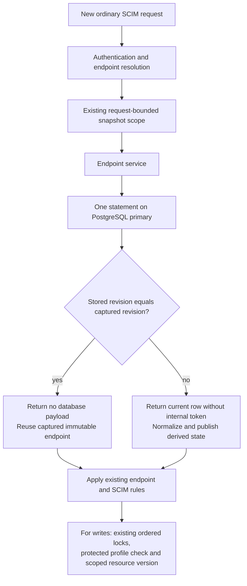
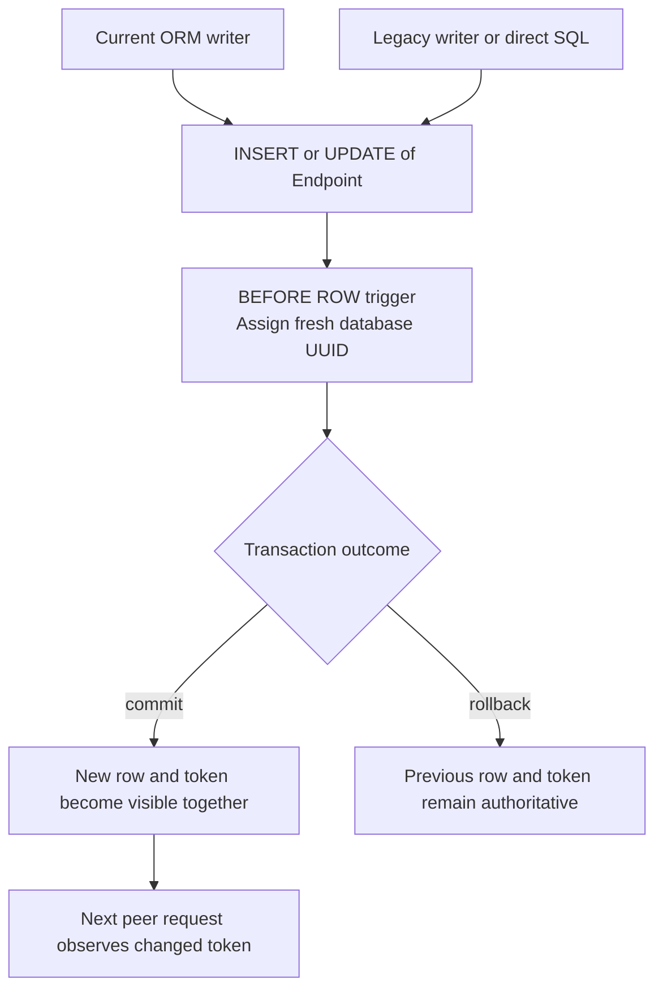
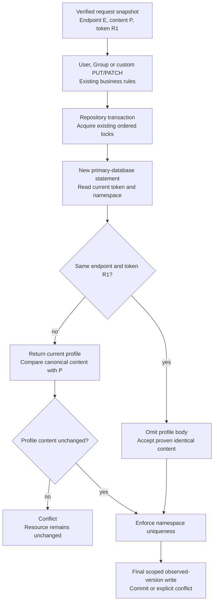

# Compact database-owned endpoint snapshot revisions

**Last verified:** 2026-10-20

**Status:** Implemented and tested locally, not released or deployed.
Performance admission and the independent release gates remain open.

## 1. Executive summary

### Prospective Linux performance qualification

**2026-10-22 checkpoint:** PR #250 is merged at `e1070ba2`. Its current
immutable 0.55.58 image starts with `f57b765a`. The current correctness matrix
passes, but deployment remains blocked by performance. In the retained
Windows/Docker BAAB run, add p99 increases 10.22% and empty-read p99 increases
25.98% over actual customer 0.55.20. Opposite order passes all twelve limits.
A separate identical-current-image control flags eight of twelve comparisons.
This shows that a code difference is unnecessary for these flags in that
allocation, not that the candidate is safe or that the gate may be waived.

The user requests autonomous implementation of the next step. A separate
tooling-only change moves a **prospective** qualification to the existing
public GitHub Actions Linux-runner service. No paid host is provisioned and
no serving code, migration, dependency or release version changes. The
earlier proposed 128-round, two-history-stratum confidence-bound campaign is
not adopted: its cost and statistical decision properties were not justified.

The following figure shows the fixed fail-stop flow. Every block has four
rounds; A is the pseudo-baseline and B the pseudo-candidate.

```text
Pinned images + source hashes + host identity, before timings
                         |
Same current image: BAAB, then ABBA
  Each block: both directions of all twelve point ratios within 10%
                         |
                  Both controls PASS?
                   /             \
                 no              yes
                  |               |
        retain FAIL and stop       Actual 0.55.20 vs 0.55.58: BAAB, then ABBA
                                  Each block: all twelve original +10% ceilings
                                             |
                                  retain every result and exact cleanup
                                             |
                                  remaining independent deployment gates
```

| Property | Retained behavior / explicit decision |
|---|---|
| Manifest | [membership-protocol.json](../scripts/performance/membership-protocol.json) freezes four blocks before execution |
| Workload | Add member, read exact populated membership, remove member, read exact empty membership; 100 warmup plus 1,000 measured complete cycles per round |
| Samples | Four operations x 1,000 x four rounds = 16,000 measurements/block; two visits yield 2,000 samples per operation/role |
| Estimator | Original nearest-rank p50/p95/p99 over all 2,000 raw values, not rounded summaries, selected repeats or cross-block pooling |
| Original ceilings | All twelve candidate/baseline ratios at most 1.10 in each A/B block; a single failure stops the campaign |
| A/A qualification | Additionally require all twelve ratios at least 1/1.10 in each control; failure prevents either A/B block |
| Allocation | App containers remain 0.5 CPU / 1 GiB, CPU quota/period 50,000/100,000 microseconds, original Node RSS ceiling 384 MiB; actual settings checked |
| History | Fresh app/PG processes per block, role app/database reused on its second visit within that block; no additional history stratum |
| Client identity | Same immutable candidate image's Node runtime drives both roles through host networking; this is a declared environment change from the Windows-host client |
| Runtime controls | Original 4,407 requests/round, two version checks and exact fixture absence; 66 functional and 200 private logging/correlation checks per completed block |
| Safety | Private labelled Docker network/databases; generated ephemeral credentials; no raw private logs exported; ownership-checked exact-ID cleanup and absence readback |
| Budget | At most sixteen rounds; rough historical extrapolation about 43 minutes before setup, not a measured Linux duration; 60-minute work deadline, 65-minute qualification step, 75-minute job cap, no automatic retries |
| Workflow authority | [performance-qualification.yml](../.github/workflows/performance-qualification.yml) has contents-read permission only, no Azure credentials or deploy command |
| Evidence | Every completed/failed block, raw timings, source/image identities, cgroup counters, privacy and cleanup receipts retained as a 14-day Actions artifact |
| Scope limit | Two passing controls do not quantify false-failure probability or establish actual-customer concurrency/capacity; a runner VM can share physical hardware |
| Original failure | Remains FAIL/unresolved historically; a later valid prospective result is separate evidence, never a retrospective PASS |

**Worked decision example:** if A/A empty-read p99 is 60 ms versus 80 ms,
the ratio is 0.75, below 1/1.10, so the environment is not qualified and
neither old/current comparison starts. If both controls pass but the first
A/B add p99 is 98 ms versus 88 ms, 98/88 = 1.1136 exceeds 1.10; retain
the failure and do not run the second A/B block hoping for a better result.
Only all four passing blocks satisfy this bounded prospective protocol.

**Tests and execution RCA (ER-62).** Eleven focused Node contracts pass, after
the initial missing-evaluator RED. They exercise exact numerical outcomes,
tail-only failure, raw unrounded limits, complete sample/image/quota validation,
parser validity and the actual extracted PowerShell orchestration. Injecting
failure at each of its four positions proves no later block or retry runs.
Two real local HTTP client controls verify the full 4,407-request lifecycle,
1,000 retained samples per operation, and exact fixture deletion even when
incorrect membership readback deliberately fails the client.
A local parser check caught `$role:` interpolation before execution; the
permanent parser test reproduced the exact error before `${role}:` fixed it.
Type: tooling/shell; severity: Low; detection and earliest possible stage:
local parser, zero stage escape. Why it works: explicit braces delimit the
variable before the punctuation. Prevention is now executed by the workflow
before Docker resources are allocated. No Linux benchmark PASS is claimed at
this authoring checkpoint.

The local YAML check initially requested an absent optional `yaml` package.
It then reused the already installed `js-yaml` dependency to parse the actual
workflow and verify read-only permissions, PR triggering and the 75-minute
cap. No installation or lockfile change was needed. Type: tooling; severity:
Low; detected at the first local workflow check, with no stage escape.
Prevention: resolve an existing parser rather than adding a dependency for
a one-off validation. Both failed and successful commands remain in the
available continuation transcript; no deleted predecessor transcript is claimed.

**Self-improvement applied:** the previously private benchmark now has a
versioned manifest, executable percentile/fail-stop/parser guards, immutable
dependencies and independently retained failure evidence. The unchanged
existing application suites remain independent; do not rerun them manually
immediately before the required hook owns that same run.

**Design/architecture disposition: accepted.** The small client measures
HTTP, the evaluator validates data and computes comparisons, and the runner
owns resources/order. These are distinct existing responsibilities, not a
new general framework or production dependency. Extra history strata, eight
blocks per phase and an unvalidated confidence formula are deliberately
excluded. Statistical repeatability beyond these controls and actual customer
capacity remain explicit limits, not silent success-shaped fallbacks.

### Linux initialization readiness correction (ER-63)

The first Linux qualification run `39778828864`, source `33c93e4e`, fails
before its first measured round. PostgreSQL reports no socket immediately
after the default `pg_isready` probe accepted readiness. The retained campaign
has zero completed blocks and independently verified container/network absence.
This is a failed setup receipt, not a performance sample or admission result.

Inspection of the **actual pinned PostgreSQL image's** entrypoint confirms
that its temporary initialization server starts with `listen_addresses=''`.
It accepts Unix-socket probes, then stops before the final server starts.
That makes a default socket probe a false readiness signal during first boot.
The runner now probes `--host=127.0.0.1`: the socket-only temporary server
cannot satisfy it. No arbitrary startup sleep, changed app quota, workload,
sample count, threshold or retry loop is introduced.

Two new tests execute the actual extracted readiness loop with a socket-ready
but TCP-unready initialization phase. Both reproduce RED before the fix;
GREEN waits through that phase and proceeds only on the final TCP probe.
The unavailable-TCP control exhausts the existing bounded attempts and stays
unready. Focused contracts increase from 11 to **13 PASS**.

| RCA field | Disposition |
|---|---|
| Type / severity | Container initialization / Medium: first real Linux execution blocked before timings |
| Detection | Linux workflow startup; earliest possible gate was an extracted-loop unit control, now added |
| Escape | Unit/parser tests missed initialization-server semantics; no defect reached deployment |
| Why the fix works | TCP distinguishes the final listener from the official image's socket-only bootstrap process |
| Prevention | Both actual-loop controls run before Docker allocation in every qualification workflow |
| Evidence preserved | Original failed run/artifact, zero completed blocks and successful exact-owned cleanup |
| Next result | Corrected-source protected publication and Linux execution remain independent, not yet claimed |

Documentation editing also hit two low-severity partial-patch frictions:
final lessons/infra-file hunks used non-matching context. The patch tool
explicitly preserved earlier successful files. Only failed hunks were retried
against inspected anchors, without repeating successful edits. Detection and
earliest possible stage were both editing feedback, with no stage escape.
This is not a runtime failure and did not cause a benchmark rerun.

### Hosted qualification review: failed evidence and deadline guards (ER-64/ER-65)

Review `5614222330` on `33c93e4e` reports three relevant findings, not merely
the startup failure. The TCP correction above addresses one. The other two
are corrected together, with permanent controls:

| Finding | Earlier behavior and consequence | Correction / proof |
|---|---|---|
| ER-64: failed-round evidence lost | Client wrote only after successful round/cleanup; runner rejected failed exit before copying and then deleted the container. The old corrupt-read test wrongly expected no output, conflating a failed receipt with a success receipt. | Always save an explicitly complete PASS or incomplete FAIL receipt on controlled outcomes. Capture each received measurement before readback validation; retain sanitized failure stage/kind and cleanup outcome. Copy it before rejecting failed exit. Tests fail after two measured cycles and retain ten values, preserve all 4,000 measurements on cleanup failure, and execute the actual runner's copy-before-rejection path. |
| ER-65: no upload headroom | A 75-minute qualification could exhaust the whole job; `always()` cannot guarantee a later upload after job termination. | Cooperative 60-minute work deadline in runner/client; cleanup requests retain their own bounded 30-second transport limits. A 65-minute step limit leaves headroom before the unchanged 75-minute job limit. Checkout, tests and upload have 2/3/4-minute caps. Extracted deadline and real expired-client tests prove rejection, not admission of a partial campaign. |

The evaluator now rejects any row not explicitly `status: PASS` and
`complete: true`, even if someone supplies a failed row with full-length
arrays. Partial values are evidence only: never included in percentiles,
pooled into a later run, or used to resume the failed block. Receipts contain
no token, payload, raw assertion text or response body. They identify a bounded
failure category and operation. Persistence is outside the measured request
window: keep values in memory and save on controlled completion/failure rather
than adding per-request disk writes that would perturb quota behavior.
Unexpected host loss or hard process termination still cannot guarantee
unsaved in-memory values; missing evidence fails admission.

Both issues are **Medium**, type measurement tooling/test correctness.
Hosted review caught them; unit behavior/operational-budget controls were the
earliest possible gates, now added. Focused tests increase **13 -> 17 PASS**.
The next TCP-only protected push was deliberately stopped, with its commit
`216d3961` preserved, to batch all findings before one complete new hook run.
Its partial execution is not reported as a passing push.

Two Low tooling/test-harness frictions were also closed locally. The deadline
test was initially nested inside an HTTP test's successful path, so the RED
test count exposed its missing registration; it is now a top-level test.
Two negative PowerShell fixtures then retained failure status after catching
the expected exception, despite blank error streams. They now explicitly
exit successfully only after verifying the exact expected throw and required
outcomes. Unexpected throws still fail. The complete named 17-test GREEN
receipt verifies that neither correction silently removed a control.

**Self-improvement applied:** distinguish failed evidence from success
receipts, test post-measurement failures, assert copy-before-delete ordering
and reserve evidence-export time outside the operational work budget.
**Design disposition: accepted:** the existing client/evaluator/runner seams
remain cohesive. No production policy, resource quota, sample threshold,
additional history stratum or general scheduling framework is added.
Corrected-source publication, review and Linux execution remain separate.

### Linux control result and resource-failure retention (ER-66)

**The Linux host is available, but performance admission is still blocked.**
Source `23d23220` passes all 28 protected Validate gates in 997 seconds.
Run `39784232793` then completes the first A/A BAAB block: four successful
rounds, 17,628 checked requests and 16,000 retained timings. Both roles use
the **same 0.55.58 image**, not different product versions. Recomputing the
assessment from all raw samples reproduces its five failed control limits:

| Operation | Percentile | Pseudo-baseline ms | Pseudo-candidate ms | Difference |
|---|---:|---:|---:|---:|
| Populated read | p50 | 1.665015 | 1.833981 | +10.15% |
| Populated read | p99 | 46.506172 | 41.384983 | -11.01% |
| Remove member | p95 | 38.207279 | 42.583400 | +11.45% |
| Empty read | p50 | 1.603564 | 1.773389 | +10.59% |
| Empty read | p99 | 48.794521 | 42.834387 | -12.21% |

Three exceed the original directional +10% ceiling. Two are faster, but
outside the A/A reciprocal lower bound of 1/1.10. Those faster results also
fail calibration; they are not product regressions. The second control and
both actual 0.55.20/current comparisons correctly **do not run**. Functional
checks (66), private-log checks (200) and exact owned-resource absence pass.
All four rounds meet the original memory/RSS limits, with no OOM termination.
This is a measurement-control failure, not another PostgreSQL setup failure.
It establishes neither a version regression nor candidate safety.

The retained resource counters also show substantial execution-history
differences even though each round has the same warmup and measured workload:

| Round / role | Process visit | Node CPU seconds, full counter window | SQL calls | Recorded CPU periods throttled / total |
|---|---|---:|---:|---:|
| 1 / pseudo-candidate | First | 15.840051 | 25,591 | 316 / 323 |
| 2 / pseudo-baseline | First | 14.867627 | 25,593 | 297 / 302 |
| 3 / pseudo-baseline | Second | 11.182160 | 25,590 | 223 / 228 |
| 4 / pseudo-candidate | Second | 11.765579 | 25,590 | 235 / 241 |

CPU counters cover the broader lifecycle and settle window, not just timed
requests. These ratios are fractions of recorded scheduler periods, not
percentages of requests or time spent throttled. Both roles use less CPU on
their second visit; SQL statement counts barely change. Descriptive first/last
250-sample read medians also fall within each round. None of those slices
replaces the full-sample decision. Startup, runtime optimization, database
warming and scheduling remain hypotheses: this receipt has no profile that
separates them. Moving from Windows to Linux alone did not remove the issue.
Do not change application logic, enlarge quotas, select favorable repeats,
increase sample counts without a justified plan, or silently redefine admission.
The next measurement design must address process history and decision
repeatability prospectively, with separately reviewed calibration and cost.

**One additional relevant review finding is corrected (ER-66).** Hosted
review `5614795378`, on exact source `23d23220`, confirms the original three
corrections but identifies a previously missed failure-evidence path:

| RCA field | Evidence / correction |
|---|---|
| Type / severity | Measurement tooling and test correctness / Medium |
| Symptom | Memory/RSS acceptance throws before `rounds.json` is saved; `finally` then deletes the app and its unsaved CPU, SQL, peak-memory, RSS and OOM observations |
| Root cause | Successful admission was also the only persistence path for resource measurements, although client timings already had a separate failure receipt |
| Fix | Save `round-<n>-<role>-resources.json` in a resource-collection `finally`, before owned cleanup; retain explicit FAIL status, collection completeness, the failed stage and every measurement collected so far |
| Why it works | Limit rejection and missing-probe errors propagate unchanged, but destroying the container no longer destroys observations already returned; failed resources never enter admitted `rounds.json` |
| Prevention | Eight actual-round/actual-cleanup controls cover success, exact 1 GiB memory limit, exact 384 MiB RSS limit, OOM, missing RSS/CPU/OOM observations and deadline expiry after the client; assert receipt existence before removal, exact field values after cleanup, no admitted failed row and no later round |
| Detection / earliest gate | Fresh hosted review / local failure-path contract; one review-stage escape, now closed by executable controls |
| RED / GREEN | Six missing-resource-receipt assertions fail before the runner fix; the complete focused suite increases 17 -> 26 PASS after extending failure coverage and testing actual A/A and A/B role selection |

The resource receipt begins before the first counter probe, so a failed
client or later deadline also retains already collected before-counters.
Missing observations remain explicit nulls in a partial FAIL receipt, never
fabricated zeros. A separate control executes the actual runner's image,
version and BAAB/ABBA selection for all four blocks, then validates their
synthetic receipts through the real evaluator. This closes branch-selection
coverage without pretending the unexecuted old/current Linux blocks ran.

A Low fixture issue appeared in the first GREEN attempt: PowerShell's
case-insensitive `[switch]$Network` parameter hid the outer `$network` name
inside the mock ownership check. This caused an unexpected ownership error,
not a product failure. The fixture now uses a distinct `$networkName`, leaving
the real ownership guard unchanged. The eight controls all execute actual
cleanup and verify its absence receipt; no mock failure is relabelled GREEN.
Detection and earliest possible gate are the same focused run, with no escape.

The standing commit-message prompt path was also checked, but this worktree
has neither that file nor its `.github/prompts` directory. This is Low
documentation/tool-discovery friction, detected at commit preparation.
The normal descriptive commit and required coauthor trailer remain applicable;
do not claim that an absent prompt ran or create a substitute workflow here.

**Self-improvement applied:** failure receipts must include resource
observations as well as timings, and tests must assert survival through
actual teardown, not just the presence of a write statement.
**Design/architecture disposition: accepted.** A small local `try/finally`
extends the existing resource owner; no production abstraction, new dependency
or admission-policy change is warranted. The receipt-only fix does not repair
the measured A/A instability and is not a reason to repeat unchanged timing
experiments until one happens to pass. Both unexecuted A/B paths remain
explicitly unverified by Linux execution.

### Diagnostic-only request and CPU timeline (ER-67)

**Published execution follow-up:** exact source `a7e51d10` passes all 28
protected gates. Linux diagnostic `39799891906` retains 17,628 spans and
44,489 CPU observations. Of 168 p99-tail spans, 142 (84.52%) contain an
interior throttling-counter increase. This establishes temporal association,
not causal per-request delay. The independent untraced qualification
`39799892493` still fails three same-image limits: populated-read p95
-74.04%, remove p95 +13.69%, and empty-read p95 -68.24%. Faster controls
outside the reciprocal floor also fail. The two jobs use different CPU
models, so their timing difference cannot measure profiler overhead.
All functional, private-log and exact-cleanup checks pass. Fresh review
`5616280374` reports no open code finding; release admission remains blocked.

**Recommendation: measure the unresolved scheduling hypothesis before changing
application code or release limits.** Corrected source `117d5b1e` passed all
28 protected Validate gates. Fresh review `5615359957` reported no remaining
code finding. Its automatic Linux run `39790526704` still failed the first
same-image control: add p99 was 79.200360 versus 70.747433 ms (+11.9480%);
remove p99 was 77.481641 versus 67.455442 ms (+14.8634%). Every other comparison
passed. All four new resource receipts match the raw rows; assessment
recomputation, 66 functional checks, 200 logging checks and exact cleanup pass.
The second control and both actual old/current blocks did not run.

This second Linux result again compares **identical 0.55.58 images**.
It cannot identify a version regression. CPU usage across its four broader
counter windows was 14.826410, 14.761272, 12.235910 and 12.214127 seconds;
SQL calls were 25,591, 25,593, 25,590 and 25,593. Lower CPU on second visits
with almost unchanged statement counts is observed. Runtime optimization,
database warming, logging, background work and quota scheduling remain
possible explanations, not established causes.

The new diagnostic preserves the original workload, immutable image and
0.5 CPU / 1 GiB allocation. It executes **one** four-round current/current
BAAB block, not a new admission campaign. It adds the following evidence:

| Component | Observation / transformation | Safeguard and cost |
|---|---|---|
| HTTP client | In-memory monotonic start/end timestamps, original elapsed milliseconds, operation, cycle, phase and success for every request | No bodies, URLs, resource IDs or credentials; tracing is opt-in and can perturb client timing |
| Owned host observer | Exact app PID identifies its own cgroup; read `cpu.stat` approximately every 2 ms, preserving each read's start/end | Reject another container or a root-only namespace; observer runs outside app quota but still uses shared-host CPU |
| Analyzer | Match all 4,000 measured spans per round exactly to the original sample arrays; check clock kind, full coverage, monotonic counters and observer cost | Missing coverage, wrong clock or missing cost fails analysis; every raw sample remains retained |
| Association | Subtract counters only between two read windows wholly inside a request span | Fewer than two interior observations means unknown/null, never a fabricated zero |
| Output | Eight role/operation summaries with unchanged 2,000 samples each, p50/p95/p99 and counts of tail spans by association | Always `admissionEligible: false`; this output cannot replace the original twelve-comparison release decision |

The following flow separates the observed request from the app-wide counter.
Both clocks use Linux monotonic time on the same host; the analyzer checks
their recorded kind and range rather than joining unrelated wall clocks.

```text
One serial synthetic HTTP request
  client: start -> fetch -> read and parse body -> end
               | same Linux host monotonic timeline |
  host:    [read A] ... [read B] ... [read C]
               |                 |
               +-- only fully interior reads --+
                                  |
                  whole app cgroup counter difference
                                  |
             temporal association, not causal request delay

Complete four-round diagnostic
  raw spans + CPU reads + original samples + resource/privacy/cleanup receipts
                                  |
                  diagnostic analyzer, never admission evaluator
                                  |
                diagnostic-only summary and retained unknowns
```

**Worked example:** suppose a request spans 9-31 ms and complete counter reads
finish at 10, 20 and 30 ms. An increase in `nr_throttled` between the first
and last interior reads establishes an app-group counter increase inside
that span. It does **not** establish how long that request itself was delayed:
background work shares the group. A 21-29 ms request with only one interior
read is classified as insufficient evidence. Neither example is a measured
result from the new Linux diagnostic.

The [diagnostic workflow](../.github/workflows/membership-cpu-diagnostic.yml)
has read-only repository permission, no cloud credentials and the same
concurrency group as qualification. Its cooperative work budget is 15 minutes,
step cap 20 minutes and job cap 30 minutes; checkout/tests/upload have
2/3/4-minute caps. One observer is owned and stopped per round before app
cleanup. Its absolute Node executable receives no inherited Linux environment.
Windows helper tests allow only `SystemRoot`, which Node requires for
cryptographic startup, not application secrets or Node options.
Complete and partial evidence is retained for 14 days. A forced process or
host termination can still lose the current in-memory buffer; absent data
cannot become analysis success.

| RCA field | Evidence / correction |
|---|---|
| Type / severity | Measurement assurance / Medium |
| Symptom | Broad CPU totals cannot associate individual long requests with scheduler-counter activity; a superficially complete diagnostic could omit clock identity or observer cost |
| Root cause | Lifecycle counters are coarser than request spans; initial analyzer validation checked sample mapping and coverage but not both additional provenance fields |
| Fix / why | Keep request spans and bounded external counter observations; reject mismatched clock identity and absent cost before output, explicitly retain deadline/counter failure stages |
| RED / GREEN | Initial implementation RED: 34 tests, 25 PASS / 9 FAIL. Initial implementation GREEN: 34 PASS; integration coverage: 40 PASS. Additional assurance RED reproduces wrong-clock/missing-cost admission and missing failure stages; final combined run: 44 PASS, zero skips (28 existing/client and 16 CPU) |
| Prevention | Actual analyzer CLI negative controls, real monitor success/failure/deadline controls, actual PowerShell child lifecycle, actual diagnostic-first-block-only execution and rejection of diagnostic-marked clients by normal qualification |
| Detection / earliest gate | Focused tests / focused tests; no review or live escape |

### Native function-profile capture assurance (ER-68)

**Current status: local diagnostic implementation, not published or release
admission.** Native function observations can identify candidate code paths
behind the broader CPU totals. They do not turn wall-clock profiler gaps
into CPU time. Retain unweighted exclusive sample counts, including idle
observations, and compare source locations rather than only function names.

| Issue | Type / severity | Symptom and root cause | Fix and why it works | Prevention and detection-stage escape |
|---|---|---|---|---|
| ER-68a | Evidence retention / Low | The first synthetic capability probe cannot copy a profile after container stop because its output was on a tmpfs mount, which disappears at stop. | Use the app container's ordinary writable overlay and copy before removal. The actual collector now succeeds on both frozen images without a new persistent mount or permission workaround. | Real frozen-image collector probe verifies profile and metadata after stop. Capability probe detects the fault; earliest useful gate is the same probe. |
| ER-68b | Lifecycle assurance / Medium | A failed app may already be stopped, so sending its flush signal first prevents collection of the profile it already wrote. | Inspect initial state, skip the signal for an exited process, copy evidence and only then reject its nonzero exit. Preserve an explicit partial capture receipt in `finally`. | Focused already-stopped scenario is confirmed RED, then GREEN. This closes the gap before runner integration. |
| ER-68c | Ownership boundary / Medium | Generic benchmark ownership alone does not authorize sending the profiler's exit signal to an ordinary app. The new negative test reproduces a signal reaching a non-profiler container. | Require both existing exact-run ownership and `scimserver.profile=native-function` before signalling. Missing-marker RED becomes GREEN with the exact rejection message, not an unrelated mock failure. | Actual collector negative controls verify no signal without opt-in; all 13 native tests pass. Earliest useful gate and detecting gate are the focused collector test. |

The actual collector, bootstrap and strict parser are also exercised against
both immutable images in network-disabled synthetic Node containers. Baseline
runtime is **v24.20.0** and current runtime is **v24.22.1**. Both exit zero,
retain complete non-admitting capture receipts and have bootstrap clocks
within their native profile ranges; the parser counts 20,905 and 20,805
samples respectively. These are capability observations, **not SCIM application
comparisons**. Exact-owned container absence is verified after removal.

**Test/gate self-improvement: applied.** Preserve already-exited evidence and
test the explicit profiler authorization marker before integration.
**Design/architecture disposition: accepted.** Keep profiling in opt-in
benchmark helpers, separate from application runtime and release evaluation.
No product change, dependency, policy relaxation or version bump is justified.

**Integrated local mode:** the new read-only workflow selects only the original
old/current BAAB schedule. It preserves the pinned protocol and each app's
first/second visit, profiles only `exec node ... dist/main.js`, and keeps
migrations and ordinary qualification uninstrumented. App output stays in the
writable container overlay. Both profile captures are attempted before exact
cleanup, even if one fails. Each capture retains explicit completion, work
status, exit and container identity. The analysis requires the original role
images, actual bundled Node identities, all four complete diagnostic rows,
all 17,628 ordered request spans, every original measured timing, successful
privacy checks and cleanup readback. It never calls the admission evaluator.

```text
Frozen old image + private baseline database
  migration, without profiler
    -> opted-in app Node + native profiler
       -> first baseline visit -> same live process -> second baseline visit

Frozen current image + private candidate database
  migration, without profiler
    -> opted-in app Node + native profiler
       -> first candidate visit -> same live process -> second candidate visit

Original BAAB order and quotas
  -> raw clients, timings and resource receipts
  -> candidate-only functional/private-log checks
  -> collect baseline profile, then candidate profile, even on capture failure
  -> exact-owned container/network removal and absence check
  -> validate immutable identities, profile clocks and every original timing
  -> diagnostic function/module observations, never release admission
```

**Worked example, illustrative:** a validation function observed twice and an
idle frame once contribute two and one unweighted samples. A 50 ms gap before
one observation does not assign that function 50 ms of CPU: the process may
have been suspended by its quota. Real profiles also cover startup, idle,
background work and the candidate-only privacy checks, so lifetime sample
differences cannot establish a measured-request-only version regression.
Different bundled Node versions are another explicit confounder.

The initial analyzer/selection RED and independent-capture RED are retained.
The first combined run passes 65/66 cases: the intended clock-coverage negative
fixture mistakenly still fits within its profile window. Move its synthetic
round clocks beyond that window rather than weakening the assertion.
Final focused result is **68 PASS, zero failures/skips**, including CLI
negative controls and actual runner selection/launch/finally execution.
This is a local implementation result; exact-source Linux application
profiles, publication and fresh review are still required.

**RCA follow-up:** ER-68d, test correctness / Low. The initial negative fixture
did not reproduce its stated missing-clock-coverage condition. The focused
suite catches its unexpected success; the corrected fixture spans multiple
visits beyond the truncated profile and fails for missing coverage. Detecting
and earliest useful gate are the same focused analyzer test.

**Design/architecture disposition: accepted.** The existing orchestration file
already exceeds 400 lines; native parsing/capture stay in dedicated helpers,
and shared raw-round validation is extracted from the timeline analyzer rather
than duplicated. This adds one finite diagnostic mode, not a general policy
language or a new production strategy hierarchy. Broader runner decomposition
is not required for this coherent diagnostic outcome.

**Provenance / completeness:** reconcile this increment against the complete
available recovered continuation through record 58,275 (about 308 MB), using
separate error-signal and causal-narration passes. The native increment has
93 relevant matching records, not 93 distinct incidents. Confirmed problems
map to ER-68a-d; absent-implementation REDs, expected negative-control errors,
source-read echoes and repeated receipts are dismissed as non-incidents.
The earlier template/CSPRNG issues remain ER-67. This scan does not restore
or claim access to the deleted original UI transcript.

**ER-68e, validation environment / Medium:** protected publication of
`8f4e1697` is blocked after 27 passing gates. Web Vitest reports 1,653 passing
assertions in 123 files, but one fork worker never completes its startup
handshake for the endpoint-context selector file. This is **not** a 1,655-test
PASS and no assertion failure is reported. The omitted file's two tests pass
when run alone with the unchanged standard runner. The observed mechanism is
worker-startup timeout; resource pressure is a hypothesis, not a proven cause.
The original failed 1,220.9-second hook remains retained. The gate correctly
blocks partial execution, and its definition now documents that requirement.
No timeout, worker count, test, exit condition or application code is changed.
One normal protected publication attempt can establish whether the transient
recurs; an isolated PASS alone cannot satisfy the complete gate.
Detecting and earliest useful stage are both the protected full Web gate.
Track recurring worker-startup reliability separately rather than silently
increasing deadlines or declaring missing files passed.

**Protected publication follow-up:** the unchanged complete Web gate passes
1,655 assertions in all 124 files on the next normal protected attempt.
Tip `5c60e41c` passes all 28 Validate gates in 991.4 seconds and is verified
clean and published. The first failure is retained, not relabeled successful.
No underlying worker-startup cause is claimed fixed.

**ER-68f, workflow scheduling / Medium:** native run `39816471809` is canceled
before any job or measurement. Three workflows share a concurrency group,
but `cancel-in-progress: false` protects the running workflow, not every
pending workflow: the default single pending slot replaces the earlier waiter.
The [current GitHub documentation](https://docs.github.com/en/actions/how-tos/write-workflows/choose-when-workflows-run/control-workflow-concurrency)
explicitly supports `queue: max`, retaining up to 100 waiters without adding
active concurrency. Apply it to **all three participants**, so a default-mode
arrival cannot continue replacing existing queued work. A focused RED checks
each workflow's real configuration before the correction. This changes no
measurement, sample, quota, timeout or admission threshold. Queue saturation
remains explicit, and canceled-before-start is not a timing failure or a PASS.
The detecting stage is GitHub scheduling; earliest local prevention is the
new all-participant configuration contract. Exact-source GitHub acceptance
and native execution are required before claiming the correction verified
on the service.

**Local correction GREEN:** all 68 focused contracts pass, including the
three-participant queue guard. YAML parsing independently verifies every
participant has `queue: max` and `cancel-in-progress: false`. This is local
configuration evidence, not proof of GitHub scheduler acceptance.

Two Low execution frictions were also caught locally. A raw PowerShell
continuation backtick inside a JavaScript template caused a parser error;
use PowerShell parameter splatting in the fixture, so interpreter delimiters
cannot collide. The real Windows helper test then exposed Node exit 134,
`ncrypto::CSPRNG(nullptr, 0)`, after clearing the entire environment. An
allowlist containing only Windows `SystemRoot` restores cryptographic startup;
the lifecycle test verifies no other parent variables reach the observer.
Both were fixed and confirmed by the real child lifecycle control, not skipped.
Detection and earliest possible gate are the same local parse/lifecycle tests.

**Next:** publish normally, execute this diagnostic once on its exact Linux
source, verify its full artifact, and use the result to select a justified
prospective calibration correction. Do not enlarge quotas, discard samples,
repeat unchanged measurements until favorable or claim a causal profile from
counter correlation alone. Publication, Linux execution, fresh review,
performance admission and all downstream deployment gates remain distinct.

**Self-improvement: applied.** Assert clock provenance, unknown coverage and
observer cost as outcomes; execute actual child lifecycle and admission
isolation rather than checking that configuration text exists.
**Design/architecture disposition: accepted.** The client records spans, the
small observer owns counter collection, and the analyzer owns interpretation.
Production code and the admission evaluator's numerical policy are unchanged;
a profiler framework or new configurable admission strategy is not justified.

### Earlier implementation checkpoint (historical)

**Current result:** the latest immutable local candidate passes eleven of
twelve full half-CPU latency limits; empty Group GET p99 still fails by
15.15%. Correctness controls pass, but release admission remains blocked.
Actual client/server correlation and a separate CPU treatment show material
quota/runtime sensitivity in both versions. They do not waive the failed
gate or authorize a production resize. Sections 11-12 contain the current
results; section 7 preserves the earlier token-only treatment.

Replace the repeated full-row database hash used for endpoint cache
verification with a database-owned UUID equality token. PostgreSQL assigns
a fresh token on **every** endpoint insert or update. A request still checks
the authoritative database; only the work needed to verify an unchanged
endpoint becomes smaller.

This is not a resource cache, an event bus, an authorization bypass, a
replacement for resource versions, or a replacement for the protected
profile-content check. No notification is required for correctness.

The preceding immutable candidate failed one of twelve full latency limits:
add p99 was 98.262 ms versus customer 0.55.20's 87.083 ms, a 12.84%
regression. A separate complete statement inventory attributed 48.32% of
candidate SQL execution time to endpoint freshness/fingerprint verification.
That observation justifies a controlled treatment, not a claim that hashing
alone caused the p99 failure. See the
[measured implementation/RCA](SCIM_OBSERVED_VERSION_IMPLEMENTATION.md#24-actual-statement-time-attribution).

## 2. Earlier and replacement designs

| Concern | Previous local candidate | This local implementation |
|---|---|---|
| Freshness authority | Current PostgreSQL endpoint row | Same current PostgreSQL endpoint row |
| Per-request equality check | Convert the whole row to JSON text and compute SHA-256 | Compare the row's stored UUID token |
| Unchanged hit | Return no endpoint body | Same behavior, without full-row hashing |
| Changed/missing token | Return current row and rebuild derived state | Same behavior |
| Profile fence at resource commit | Canonical profile-content revision under the established locks | Same authority; section 11 avoids repeating body work only when the locked row token proves the already-verified content |
| Resource lost-update protection | Final scoped observed-version predicate | Unchanged |
| Legacy SQL writer | Detected from changed row content | Database trigger changes the token automatically |
| Storage cost | No additional column | One UUID per endpoint plus trigger/write overhead |
| Notification dependency | None | None |

The token covers all endpoint-row fields, including enablement, names,
metadata and profile. A metadata-only update conservatively invalidates
the endpoint snapshot even when its profile content is unchanged.
Separating security/profile/metadata epochs would add complexity without
an independently measured need, so it is not part of this change.

## 3. Component and request flow

The first figure shows the authoritative read boundary. Reuse remains
bounded to the already-admitted request, not an unchecked cross-request
cache hit.



The second figure shows why old and direct SQL writers do not need to
know about the new token. The change and its token commit or roll back
together.



## 4. Storage contract and implementation

The additive migration creates `Endpoint.snapshotRevision` as a required
UUID with a database default, installs a `BEFORE INSERT OR UPDATE` trigger,
and enables it **ALWAYS**. The trigger assigns a new UUID even if a writer
explicitly supplies a token, updates only the token, or leaves all other
values unchanged.

The field is represented in the Prisma schema with `@ignore`: Prisma
Migrate can represent the column, but generated application model/input
types do not expose a writable revision field. This avoids changing
existing endpoint creation/update contracts or public response types.
The raw snapshot query explicitly removes the field from its JSON body.

Implementation:

- [Additive migration](../api/prisma/migrations/20261020160000_add_endpoint_snapshot_revision/migration.sql).
- [Schema](../api/prisma/schema.prisma).
- [Endpoint read path](../api/src/modules/endpoint/services/endpoint.service.ts).
- [Real PostgreSQL tests](../api/test/e2e/endpoint-snapshot-revision.e2e-spec.ts).

The token is an opaque equality value, **not** a sortable sequence,
public ETag, credential revision, or profile-content hash. UUID collisions
are probabilistically negligible, not mathematically impossible. Do not
use greater-than comparisons or use it to order future events.

## 5. Worked example and edge cases

Consider two API instances sharing one PostgreSQL primary:

1. Instance A reads endpoint E, including active status and profile P.
   Its internal verified token is R1.
2. Instance B changes E's active status without changing `updatedAt`.
   The database trigger assigns R2 in the same transaction.
3. Instance A's next request compares R1 with R2 and receives E's current
   row. The old cached active status cannot authorize that new request.
4. If B rolls back, R2 never becomes authoritative; E and R1 remain.
5. If B changes P and then restores the old content, a new token is still
   assigned. Equality does not accidentally identify a different write as
   the previous incarnation.
6. Deleting E returns no row on the next check. Recreating its exact UUID
   and supplying R1 still invokes the insert trigger and receives a new
   token.

A request already admitted under its first verified snapshot retains the
existing request-local semantics. The token does not introduce mid-request
reverification or weaken the separate final profile/resource checks.

## 6. Migration, mixed versions, restore and rollback

| Situation | Required handling and cost |
|---|---|
| Existing endpoints | Database-generated defaults backfill tokens. Existing profile, identity, active state and timestamps must remain unchanged. |
| Migration lock unavailable | Fail after the 5-second lock timeout, roll back the transaction and hold deployment. Do not continue with half a migration. |
| Large endpoint/profile table | The volatile UUID default can require a table rewrite. A 30-second statement timeout bounds each statement; actual-data duration and lock impact remain release gates. |
| Old application writer | Its existing SQL still fires the trigger; no revision field must be supplied by the writer. |
| Old published application reader | The additive column is intended to remain compatible. Legacy ORM statements are tested; a shared-database mixed-published-artifact rollout is a separate uncompleted release check. |
| New application before migration | The query fails explicitly for the missing column; it must not fall back to an unverified cached object. Apply migrations before starting it. |
| Replication-role changes | `ENABLE ALWAYS` keeps this trigger active in the tested replica session mode. This is not a claim of supported multi-primary or logical-replication topology. |
| Administrator disables/drops triggers | Outside the runtime writer contract. Treat it as an integrity incident, repair/reseed tokens and restart cache owners before traffic. Database owner powers can bypass constraints too. |
| Database restore/import | Quiesce writers and restart all API/cache owners before reopening traffic. Verify row/token consistency and trigger health; do not switch a live cache to a historical restored database. |
| Application rollback | Roll back the application while retaining the additive column and trigger. Do not drop them while a newer instance can still issue the revision query. |
| InMemory backend | No new database token or trigger is introduced. Its existing synchronous in-process authority remains. |

The trigger covers `COPY` inserts while installed and ordinary updates.
A dump restored before trigger creation can restore stored tokens as data;
the quiesced restore and cache-restart boundary remains mandatory.
Credential/trust tables keep their independent authentication contracts.

## 7. Historical first token-only treatment: correctness and measurement

| Evidence | Result |
|---|---|
| Pre-implementation unit RED | Whole-row SQL did not contain the required persisted-revision projection. |
| Pre-implementation PostgreSQL RED | Six revision cases failed on the missing storage contract; the existing payload/response control passed. |
| Affected endpoint/auth/request-scope units | 163 PASS. |
| Production build and schema validation/generation | PASS. |
| Focused test compilation | 19 roots, zero diagnostics. |
| Lint comparison | No introduced diagnostics; existing 11 errors / 149 warnings versus HEAD 11 / 150. |
| PostgreSQL revision controls | Seven PASS, including internal-field key allowlists. |
| Related conditional-write controls | 81 PASS, including real profile-lock wait, final scope/version predicates and request-boundary freshness. |
| Five other related PostgreSQL suites | Passed on the same production-source correction; initial test-only failures retained and explained below. |
| InMemory HTTP subset | 65 PASS, 27 genuine PostgreSQL-only exclusions. |
| Historical replay/backfill/lock-timeout proof | PASS on private PostgreSQL; preserves both populated and null profiles, including a 50,000-character value. Not an actual-customer-data restore proof. |
| Immutable performance image | `sha256:41f9ff4d3df4670245c6980cc07f8021b969f4a95fee0cbf4feaf040d9351b9c`; 19 compiled modules verified; private overlay, not release eligible. |
| Full counterbalanced performance | Run `a6c3f7ffda9e4519ae1e8eb394195611`: five latency PASS, seven FAIL. Database calls +0.0300%, application CPU +11.8992%. Values, logging/redaction, memory and exact cleanup PASS. Performance remains held. |

The full comparison keeps 0.5 CPU / 1 GiB, the actual immutable customer
0.55.20 image, 100 warmups per round, 2,000 pooled samples per operation
and role, candidate/customer/customer/candidate order, and the unchanged
10% latency limits. No unchanged-candidate rerun is authorized merely to
find a green sample.

### Actual full-run latency and SQL results

| Operation | Percentile | Customer ms | Candidate ms | Change | Result |
|---|---|---:|---:|---:|---|
| Add | p50 | 11.139 | 12.579 | +12.93% | FAIL |
| Add | p95 | 50.992 | 55.556 | +8.95% | PASS |
| Add | p99 | 91.131 | 102.997 | +13.02% | FAIL |
| Populated GET | p50 | 4.358 | 4.637 | +6.40% | PASS |
| Populated GET | p95 | 19.625 | 23.252 | +18.48% | FAIL |
| Populated GET | p99 | 51.354 | 58.880 | +14.66% | FAIL |
| Remove | p50 | 9.386 | 10.495 | +11.81% | FAIL |
| Remove | p95 | 45.376 | 47.445 | +4.56% | PASS |
| Remove | p99 | 82.588 | 90.105 | +9.10% | PASS |
| Empty GET | p50 | 4.224 | 4.424 | +4.73% | PASS |
| Empty GET | p95 | 9.802 | 18.977 | +93.60% | FAIL |
| Empty GET | p99 | 43.831 | 48.717 | +11.15% | FAIL |

All four complete statement inventories reconcile to the independent
database call and execution totals. Candidate statement execution totals
3,714.889 ms versus customer 1,608.514 ms. The largest candidate families
are the protected profile/namespace snapshot (41.25%), request-log inserts
(27.47%) and consistent Group reads (11.21%).

The earlier fingerprint statement is no longer the leading SQL family,
but the required end-to-end outcome still fails. Comparing these totals
to a different historical run does not isolate a causal speedup.
Candidate round 4 is slower than its round 1 on several medians, and the
customer's empty-GET p95 varies between its own two rounds. Retain those
observations without excluding any round or changing limits.

A separate short CPU-profile collection is diagnostic only. Its startup,
warmup and sampling overhead cannot replace the full unprofiled admission
result above.

## 8. Execution issues and root-cause ledger

All fixes below are local and uncommitted; no commit identifier exists yet.
The independent PostgreSQL failures were test defects, not reasons to
weaken the database contract.

| ID | Type / severity | Symptom and root cause | Fix and why it works | Detection / earliest useful check |
|---|---|---|---|---|
| ER-01 | Tooling / Low | A RED receipt check treated a search pattern as a path because PowerShell positional binding was reversed. | Use explicit `-Path` and `-Pattern`; the saved meaningful unit failure was verified without rerunning it. | Receipt reader / same receipt reader. |
| ER-02 | Environment / Low | Prisma validation could not load configuration without `DATABASE_URL`, before any database operation. | Supply a nonconnecting loopback validation-only URL for validate/generate commands; no live credentials or database connection are required. | Static config load / same stage. |
| ER-03 | Test correctness / Medium | Catalog inspection returned PostgreSQL internal `char`, unsupported by Prisma's raw decoder. | Cast `tgenabled` to SQL `text`; assert actual `A` trigger status instead of mocking it. | Real PostgreSQL / real PostgreSQL. |
| ER-04 | Test correctness / Low | The reincarnation test expected an absent profile to be `undefined`, but the existing response was `null`. | Assert the existing exact null contract; do not change production serialization to satisfy a new test. | Real HTTP/service test / same test. |
| ER-05 | Instrumentation / Medium | An existing query counter required `AS MATERIALIZED`, so it reported zero after the statement stopped materializing a composite row. | Match the stable named read boundary; retain the assertions for exactly one fresh snapshot before resource read and for the following disabled request's rejection. | Related PostgreSQL suite / same suite. |
| ER-06 | Test type safety / Medium | New response-body and matcher expressions introduced three unsafe-`any` lint errors; TypeScript compilation alone accepted them. | Guard unknown response bodies and compare the actual token rather than an untyped matcher. Include the new test in the complete static manifest. | Static lint after initial HTTP / static lint before HTTP; one-stage escape, now closed. |

## 9. Release sequence and design disposition

1. Finish the one immutable-image comparison and retain every round,
   actual SQL timing, values, logs/redaction, memory and cleanup receipt.
2. If performance still fails, retain the hold and investigate the new
   measured result; do not remove the trigger, profile fence, version
   predicate, logging or latency limit.
3. Complete mixed-artifact and actual-data migration/restore evidence,
   then review the storage change as its own explicit migration outcome.
4. Perform normal versioned consolidation, hook-protected push, exact-tip
   CI, review and merged-master immutable publication.
5. Run the applicable current-artifact API/backend/live/browser matrix,
   then dev, canary and approved customer promotion with independent
   cleanup and human visual-acceptance gates.

**Test/gate self-improvement: applied.** The seven real database cases and
historical migration timeout/backfill proof test the new writer contract,
not just whether a revision column exists. Query-shape and payload controls
verify that the intended repeated hash/body work is actually absent.

**Design/architecture disposition: accepted.** One database-owned column,
one small trigger and one changed read statement provide one coherent
cache-verification outcome. Existing domain profile and resource version
seams remain independent. A second revision hierarchy, event bus, resource
cache or new strategy framework is rejected as speculative.

## 10. Sources and interpretation

- [PostgreSQL 17: CREATE TRIGGER](https://www.postgresql.org/docs/17/sql-createtrigger.html):
  a row-level BEFORE trigger can modify the row before constraints.
- [PostgreSQL 17: ALTER TABLE](https://www.postgresql.org/docs/17/sql-altertable.html):
  trigger enablement modes, locking and volatile-default rewrite behavior.
- [Prisma: database-generated values and unsupported features](https://www.prisma.io/docs/orm/v7/prisma-schema/data-model/unsupported-database-features):
  database defaults cover non-Prisma writers; SQL triggers require a
  customized migration.
- [Approved concurrency/cache design](SCIM_CONCURRENCY_AND_CACHE_COHERENCE_DESIGN.md#9-cache-changes-distinguish-convenience-from-authority):
  persisted revisions are a separate migration outcome covering every writer.
- [AI-efficient delivery process](strategy/AI_EFFICIENT_CHANGE_DELIVERY_PROCESS.md):
  independent evidence, explicit rollback boundaries and no selective reruns.

The live estate is unchanged. Local correctness, local synthetic performance,
published-runtime compatibility, actual-data migration and deployed browser
behavior remain distinct claims.

## 11. Follow-up: reuse the verified snapshot at the protected profile boundary

The bounded CPU run `5fb2747d0fb74937802bbd4df5f418a1` collected both actual
process profiles. The candidate has 14,750 non-idle self samples: 192 in
profile canonicalization and 116 in the profile-revision function. Startup
and warmup are included; these are not exact steady-state percentages or
proof of tail-latency causality. Values, logs/redaction and exact cleanup
passed. No profiled timing substitutes for section 7's failed admission.

### Equivalent profile checking without repeating the body work

The same database-owned token can prove that a protected row is exactly
the endpoint row whose profile the request already verified. The request
carries a frozen internal observation:

- endpoint identity;
- the existing canonical profile-content revision;
- the authoritative database snapshot token.

After acquiring the existing locks, the **new** protected SQL statement
compares the current row token with that observation. On an exact scoped
match, it returns no profile body; the proven row identity establishes the
same profile content without canonicalizing it again. Namespace inputs and
the independent final resource version predicate remain authoritative.

If the token differs, the SQL returns the current profile and the original
canonical comparison runs. Thus a metadata-only change does not create a
new false profile conflict; an actual changed profile still rejects.
Legacy string-only observations retain content checking. InMemory retains
its content-revision authority and does not invent a database proof.

The token is checked again **after** waiting, not carried unchecked through
the wait. Missing endpoints still fail. A matching token for another
endpoint cannot activate the shortcut.

This figure separates the request observation from the later protected
proof. Both paths still reach the same uniqueness and resource-version
checks; only demonstrably repeated profile-body work is removed.



This preserves the established cooperating-writer profile-lock protocol.
The new trigger guarantees cache-token maintenance for direct SQL; it does
not make arbitrary administrator SQL acquire application advisory locks.
Direct profile maintenance outside that protocol requires quiesced writers.

### Tests and execution issues

A meaningful unit RED expected the new observation but received the old
string. A real PostgreSQL RED expected an omitted profile body but received
the full current profile. The correction adds domain controls for absent,
different-token and different-endpoint proof; actual HTTP guards verify
successful matching-token writes, metadata fallback and wrong-scope
rejection. Existing changed-profile-after-real-wait tests remain mandatory.
The current production build and 19-root type/lint preflight pass, with no
introduced diagnostics. Across the initial 14 passing unit suites and the
two corrected focused suites, **746 distinct affected unit cases pass**.
This is combined evidence, not a single clean 16-suite final invocation.
The unchanged real non-UTC subprocess also passes in that focused receipt.

The final affected PostgreSQL invocation passes **92/92** cases: 84
conditional-write controls and eight snapshot-revision controls. The six
other passing suites from the preceding invocation use the same production
source; together the receipts prove **230 distinct PostgreSQL cases**,
not a single 230-case final invocation. InMemory passes **65 cases**, with
**31 genuine PostgreSQL-only exclusions** out of 96 discovered cases.
The eighth revision case independently checks the profile-only helper's
matching-token, metadata-fallback and changed-profile paths.

A new immutable image, `72d2eec3`, contains this source. Nineteen compiled
module hashes and the exact schema and migration hashes match the owned
worktree. The earlier `41f9ff4d` result remains historical and failed;
it does not certify the new code.

### Full immutable-image result: still held on empty-Group GET p99

Run `6d80c293cf91494ab8e7d842ded9614b` compares the actual customer
0.55.20 image with candidate
`sha256:72d2eec33bac45e4ae528f915827b9a3d9acac096df7f8ab8754219fc89ecb44`.
The order is BAAB, with 0.5 CPU / 1 GiB per application, 100 warmups per
round and 2,000 pooled measured samples per operation/role. Each round
performs 4,407 exact lifecycle requests. The unchanged +10% latency limit
passes eleven checks and fails one; **performance is not admitted**.

| Operation | Percentile | Customer ms | Candidate ms | Change | Result |
|---|---|---:|---:|---:|---|
| Add member | p50 | 13.046 | 12.790 | -1.96% | PASS |
| Add member | p95 | 58.690 | 55.626 | -5.22% | PASS |
| Add member | p99 | 96.904 | 93.334 | -3.68% | PASS |
| Populated Group GET | p50 | 5.240 | 5.167 | -1.40% | PASS |
| Populated Group GET | p95 | 25.818 | 19.014 | -26.35% | PASS |
| Populated Group GET | p99 | 60.351 | 63.397 | +5.05% | PASS |
| Remove member | p50 | 11.095 | 10.628 | -4.21% | PASS |
| Remove member | p95 | 53.007 | 50.933 | -3.91% | PASS |
| Remove member | p99 | 95.040 | 98.204 | +3.33% | PASS |
| Empty Group GET | p50 | 5.060 | 4.960 | -1.97% | PASS |
| Empty Group GET | p95 | 19.417 | 16.583 | -14.60% | PASS |
| Empty Group GET | p99 | 48.966 | 56.383 | +15.15% | FAIL |

Aggregate calls are 53,378 customer / 53,392 candidate (+0.026228%).
Application CPU is 59,498,631 / 57,216,992 microseconds (-3.834776%).
These are application CPU and database call counts, not combined
application/database CPU. Maximum measured candidate Node resident memory
is 185.82 MiB, below 384 MiB. Values/readback, negative-path logging,
correlation, status/duration, credential redaction and exact run-owned
container/network absence pass.

Per-round variation is material and must not be hidden:

| Round | Role | Empty GET p99 ms | Add p50 ms | Application CPU seconds |
|---|---|---:|---:|---:|
| 1 | Candidate | 66.39 | 12.03 | 28.283 |
| 2 | Customer | 57.44 | 14.34 | 33.767 |
| 3 | Customer | 41.76 | 11.90 | 25.732 |
| 4 | Candidate | 45.30 | 13.51 | 28.934 |

This does not prove that the protected-profile optimization caused a
stable speedup or that the residual tail is harmless noise. Retain all
rounds and the failed admission. The next causal experiment should
correlate individual slow empty reads with server duration, actual SQL
and quota/runtime scheduling before proposing another production edit.

### Attribution collection correction, not a replacement admission run

The full run's fourth-round statement inventory contains 26,699 calls,
while its separately captured aggregate has 26,696. Its time difference
is 0.349323 ms. The validator correctly refuses to publish reconciled
full-run percentages. The old collector read totals, then CPU, then
inventory in separate database calls; background work can advance live
statistics between those boundaries. The exact identity of the three
intervening calls is not proven.

Meaningful collector RED precedes a one-statement materialized statistics
capture. Totals and the complete inventory now derive from the same
captured row set; this is a consistent collection boundary, not two
independent sampling windows. Positive and call/time/scope negative
controls pass, and both round boundaries use it.

Bounded diagnostic `6db7e99fb9894f808149198181fdba2e` uses the **unchanged**
image, BAAB and 400 pooled samples per operation/role to validate the
collector and identify SQL contributions. All four complete inventories
reconcile calls exactly and times within 0.000001 ms. Candidate execution
totals 667.003 ms: request-log inserts 35.68%, consistent Group reads
19.60%, member inserts 11.06%, protected profile/namespace reads 10.04%.
These are diagnostic SQL execution shares, not database CPU or empty-GET
p99 causality. Values/logging/redaction/cleanup pass. This short diagnostic
is **not admission evidence** and does not replace the failed full run.

| ID | Type / severity | Symptom and root cause | Resolution and prevention | Detection / earliest useful check |
|---|---|---|---|---|
| ER-07 | Test setup / Low | A new test guessed `getEndpointForScim`; the actual API is `getEndpointForRequest`. | Read the declaration, correct the call and retain the setup failure separately from the subsequent meaningful assertion RED. | Focused unit / declaration lookup. |
| ER-08 | Test registration / Medium | A patch inserted a test inside another test callback; a filtered run skipped every case. | Move registration to suite scope. A TypeScript AST guard reproduces the nested-registration RED and passes the fixed file with positive/negative controls. The RED receipt guard rejected the all-skipped run. | Filtered HTTP registration / AST preflight. |
| ER-09 | Test type safety / Low | New tests guessed a repository arity and accessed an unknown diagnostic field directly. | Use the existing endpoint-scoped two-argument read and structured envelope matcher. Production build passed; focused test compilation caught both before execution. | Focused test compilation / same stage. |
| ER-10 | Test contract / Low | Two existing internal tests expected the old string carrier rather than content plus verified snapshot. | Assert exact raw persisted content revision and database token, while preserving old-snapshot isolation and legacy normalization checks. | Unit / unit. |
| ER-11 | Environment / Low | The real non-UTC Node subprocess exceeded its unchanged 30-second budget in the broader first run. | Preserve the timeout; the unchanged real-child check passes in the targeted rerun. The precise transient scheduling/loading cause is not isolated, so no unsupported cause or increased timeout is claimed. | Unit child-process limit / same stage. |
| ER-12 | Test contract / Low | The new wrong-scope case expected a plain `diagnostics` property, but the existing error contract uses its SCIM extension URN. Production correctly returned 409 and the expected error code. | Assert `urn:scimserver:api:messages:2.0:Diagnostics`; the complete affected two-suite run passes 92/92. Do not change the public envelope to satisfy a mistaken test. | PostgreSQL HTTP / existing contract lookup before authoring. |
| ER-13 | Instrumentation / Medium | Separate statistics reads differed by three calls / 0.349323 ms in round 4, so the reconciliation guard rejected attribution. | Capture a materialized statistics row set once and derive totals plus complete inventory from it. Meaningful RED, positive/call/time/scope negative controls and the real four-round diagnostic pass. Preserve the failed full result and do not relabel the diagnostic as admission. | Post-run reconciliation / collector contract before measurement; one-stage escape closed for future captures. |
| ER-14 | Tooling / Low | A helper lookup guessed `matched-statement-delta.ps1`, which does not exist. | Use the runner's actual `get-matched-statement-deltas.ps1` reference discovered from the existing file list; no implementation change was needed. | File lookup / reference-guided lookup. |
| ER-15 | Instrumentation / Medium | The first request-correlation diagnostic sent native multiline `psql` JSON fragments separately to `ConvertFrom-Json`, producing an additional-text parse error. | Join the native output lines before parsing. Retain the failed receipt and verified cleanup. The corrected half-CPU and two-CPU diagnostics each correlate all 1,600 measured reads by actual response request id. Trace-on/off controls prove the admission path does not collect headers. | First real correlation round / multiline collector contract; apply the existing native-output join convention before parsing. |
| ER-16 | Harness / Low | A separate observer inherited the application image's HTTP healthcheck even though it runs no HTTP server, so Docker labeled it unhealthy. | Disable only the observer's inherited healthcheck. Its own exact-target readiness, lifecycle and completion receipts remain mandatory; API healthchecks are unchanged. | First observer smoke / observer launch contract. |
| ER-17 | Instrumentation / High | Windows-to-Linux wall-clock calibration had a best 3,705 ms uncertainty window; a monotonic-derived UTC estimate also drifted 23.48 ms. The guard rejected the receipt rather than claiming precise request overlap. | Move the diagnostic client into the same private Linux kernel, use monotonic timestamps, and verify zero time offsets. Never widen a wall-clock guard to manufacture overlap. Real replacement smoke is required before interpreting timelines. | Observer receipt / clock-domain design before measurement. |
| ER-18 | Gate correctness / High | The existing assessor did not explicitly reject read-traced or profiled runs, allowing diagnostic timing to be interpreted with admission-shaped output. | Meaningful RED precedes a guard rejecting instrumented runs. Negative diagnostic and positive original-full-run controls pass; the original empty-read p99 failure remains unchanged. | New admission-boundary contract / same contract before adding instrumentation. |
| ER-19 | Harness / Medium | A local elapsed-time variable shadowed the monotonic-clock function, causing the observer to exit on its first real sample. Parser-only unit tests missed actual startup. | Reproduce the exact TypeError through the full observer startup/sample/readiness/shutdown lifecycle in a mocked filesystem, then rename the local variable. The lifecycle passes. Preserve owned observer startup diagnostics before cleanup. | Real smoke / full lifecycle unit; one-stage escape closed. |
| ER-20 | Instrumentation / Medium | The first same-kernel guard assumed matching time-namespace inode numbers. Actual owned containers had different inodes but both published zero monotonic/boot-time offsets. | An exact owned-kernel probe verifies the offsets. Require the same target PID namespace and verified zero offsets, not identical time-namespace inode numbers. Reject unsupported nonzero offsets; retain namespace metadata. Real replacement smoke is required. | Same-kernel smoke / actual kernel metadata probe. |
| ER-21 | Research tooling / Low | Initial public manual fetch failed transport, a guessed kernel documentation path returned 404, and search discovery returned 504. | Retain those failures rather than claiming successful verification. Later direct retrieval of the canonical kernel cgroup documentation and Linux time-namespace manual succeeds; the relevant semantics are cited in section 14. Runtime scope and offset checks remain mandatory, not replaced by documentation. | Documentation discovery / same discovery. |
| ER-22 | Instrumentation / High | The smoke's observer-cost estimate exceeded seven CPU cores despite a quarter-CPU limit. A generic collector read the host cgroup root because this observer uses the host cgroup namespace. Its cost estimate is invalid, even though all eight request correlations passed. | Lifecycle RED/GREEN verifies the exact observer cgroup. Capture its own start/end CPU counters inside the observer, calculate the monotonic-interval delta, and reject cost above the verified quarter-CPU budget plus one period of boundary allowance. Impossible-cost/reset/scope negative controls pass. Retain the flawed smoke; real corrected measurement is required. | First analyzed smoke / scope-aware counter collection and budget invariant; one-stage escape closed. |
| ER-23 | Profiling / Medium | Whole-process CPU profiles include startup file reads and module compilation; interpreting them as steady-state request cost overstates that work. Earlier profiles also predate the current protected-proof image. | Collect a current-image diagnostic and bound a second analysis between first/last actual PATCH frames. Explicitly retain warmups/background work and sampling limitations. No per-request or native-worker attribution is claimed. | Profile interpretation / workload-scoped collection and attribution design. |
| ER-24 | Tooling / Low | The VS Code test tool finds no tests in the separately owned worktree. | Use the repository's Jest command with explicit owned working directory and test paths. No tests-found result is treated as validation. | Test discovery / same discovery. |
| ER-25 | Error contract / High | PostgreSQL raw replacement correctly rolls back on duplicate membership, but Prisma's driver adapter stores SQLSTATE under `meta.driverAdapterError.cause.originalCode`, not the initially tested `meta.code`. Conflict translation incorrectly becomes UNKNOWN. | Meaningful unit RED and the real PostgreSQL failure precede a guarded extractor covering both metadata shapes. Other SQLSTATEs stay UNKNOWN. Final focused units and real PostgreSQL duplicate rollback/error-code checks pass; messages do not expose row values. | PostgreSQL integration / real adapter-shaped unit; one-stage escape closed. |
| ER-26 | Test registration / High | A generic patch anchor inserts parameterized negative controls inside another parameterized test. The old AST guard recognizes only direct registrations, not curried `it.each(...)` calls. | Preserve the failed run. Move controls using the complete suite-boundary anchor; extend the guard to call/property chains with parameterized positive/negative controls. Run it on both changed tests before creating PostgreSQL. Meaningful final RED is one failed / 28 passed, rather than nested-registration errors; GREEN is 79/79 units and 213/213 related PostgreSQL cases. | Jest registration / expanded AST preflight; recurring escape closed structurally. |
| ER-27 | Live-test bookkeeping / Medium | The expanded live helper passes 56 actual HTTP checks, but its E2E receipt still expects 50. The main live wrapper also retains an older 33-check expectation. | Update the E2E receipt to 56, and require at least 56 checks with the actual count in the main wrapper. Real loopback HTTP runs pass on InMemory and PostgreSQL, including same-member replacement and response/version contracts. The first failed parity receipt is retained, not hidden. | InMemory HTTP campaign / same live receipt assertion; no escaped false green. |
| ER-28 | Benchmark orchestration / Low | A descriptive image suffix is incorrectly passed as the expected runtime version. The real version is `0.55.56`; the client rejects the first round before measurement, after private services have already started. | Preserve run `554e8dac` and cleanup. The corrected invocation completes full run `34ca7f2d`. Meaningful mock-based RED proves allocation precedes version rejection; GREEN adds immutable-image package-version probes before network/database allocation, with three rejection controls and one valid allocation-boundary control. Actual image probe also returns `0.55.56`. | Client preflight / image preflight; recurring tooling escape closed before allocation. |
| ER-29 | Receipt tooling / Low | A RED-receipt matcher assumes the causal text is on one line, but PowerShell wraps the exception across lines. | Preserve the receipt and verify the actual allocation-boundary RED with a multiline-aware matcher. Do not rerun the benchmark or relabel the failed outer matcher as a product defect. | Receipt verification / same verification; no product escape. |
| ER-30 | GitHub tooling / Low | `gh pr status --json currentBranch` is rejected because `currentBranch` is not a supported output field. | Use branch-scoped `gh pr view` with documented fields. It correctly reports no PR for the current branch; no remote mutation occurs. | CLI validation / same validation. |
| ER-31 | Report formatting / Low | A heterogeneous PowerShell pipeline formats later SQL-family objects using the first object's columns, hiding their properties in the displayed table. | Emit bounded, explicit JSON records instead. The exact SQL-family calls/times are visible and reconcile; no missing fields are interpreted as absent data. | Output inspection / same inspection. |
| ER-32 | Database execution cost / Medium | The unchanged client-latency admission passes, but aggregate SQL execution rises 35.89%. Log insertion accounts for 350.706 ms of the 613.860-ms increase. | Retain the cost explicitly, with full SQL reconciliation and per-family calls/times. Particular field/index causes and database CPU are not established. Review this cost during consolidation and current-artifact load validation before customer promotion; no unqualified all-metrics improvement is claimed. | Full SQL attribution / same attribution; open follow-up, not concealed by latency PASS. |

**Additional self-improvement applied:** registration is now checked before
rerunning the targeted HTTP experiment, rather than mistaking an all-skipped
selector for a RED or GREEN. The private validator retains both AST controls
and is wired before database creation; the filtered RED guard also requires
an actual failed test. Image verification now includes storage files, not
only compiled JavaScript.

**Design/architecture disposition: accepted.** Reuse the existing revision
argument and immutable carrier across the existing service/context/repository
seams. Content-only and database-proven observations are the two real cases;
no second revision column, event transport, mutable global proof cache or
per-service duplicate logic is introduced.

## 12. Remaining tail: server timing and CPU-quota treatment

**Conclusion:** the remaining tail needs runtime/quota investigation, not
another speculative removal of correctness checks. The half-CPU full run
still fails and remains authoritative for admission. A different CPU quota
is a diagnostic treatment only, not permission to resize production.

The diagnostic-only collector records the actual `X-Request-Id` from each
measured GET, then matches exactly one successful persisted request-log row
and its duration. Both 400-sample-per-operation/role campaigns correlate
1,600 measured reads in total. Trace mode is disabled for admission runs.
No token, request header/body or raw credential is exported.

Historical 0.55.20 and the current source both establish the request clock
in early correlation middleware and record duration when the handler emits
its response. Client duration additionally includes other boundaries such
as transit, scheduling before middleware and final response work. Their
difference is **not pure network time**.

### What was actually measured

| Diagnostic | CPU per API | Role | Empty GET client p99 ms | Logged server p99 ms | Throttled periods, both role rounds |
|---|---:|---|---:|---:|---:|
| `978e25dd` | 0.5 | Customer | 60.387 | 36 | 394 |
| `978e25dd` | 0.5 | Candidate | 53.342 | 50 | 381 |
| `176f9e2e` | 2 | Customer | 7.122 | 4 | 1 |
| `176f9e2e` | 2 | Candidate | 7.043 | 4 | 0 |

The images, memory quota, workload, warmups and BAAB order remain the same.
Only the CPU treatment changes between these two diagnostic campaigns.
The customer has one 9.775 ms throttled interval in the two-CPU campaign;
the candidate has none. At half CPU, aggregate throttled time is 27.949
seconds customer / 24.813 seconds candidate. These are whole-round counters,
not request-specific attribution.

For a concrete candidate example, the slowest half-CPU empty read takes
93.088 ms at the client and 86 ms in the matched server log. It is not just
a slow client/network reading a fast server. Another customer request takes
71.808 ms at the client but only 5 ms in its server log, demonstrating that
not every tail has the same boundary. Both kinds need to remain visible.

The large tail reduction and near-elimination of throttling support a
material quota/runtime contribution. They do not identify one exact
request's throttling interval or distinguish garbage collection, event-loop
work, host scheduling and every synchronous logging cost. The campaigns
ran sequentially, so host/time variation remains a limitation. In
particular, the favorable short half-CPU comparison is **not** a replacement
for the full half-CPU p99 failure.

### Safe next steps

1. Preserve the full failed half-CPU result, all diagnostic rounds and the
   current correctness safeguards.
2. Correlate quota stalls and runtime pauses at finer resolution, or move
   the unchanged half-CPU acceptance campaign to a controlled runner, before
   attributing this residual tail to another production code path.
3. Treat any larger production CPU allocation as a separate explicit
   infrastructure/cost decision. Do not silently substitute a two-CPU PASS
   for a half-CPU gate or weaken the +10% limit.
4. Once strict performance admission passes, finish the independent
   actual-data/mixed-artifact/review/current-browser/release gates.

**Self-improvement: applied.** Actual response-to-server-log correlation
replaces an untested claim that a client tail is network delay. Atomic
statistics and diagnostic flags preserve evidence boundaries.

**Design/architecture disposition: accepted.** These bounded collectors
remain private evidence tools, not production middleware, a new protocol
or a reason to expand the application architecture.

## 13. Provenance and completeness

The execution ledger was reconciled against the **full available current
continuation**, not compacted memory alone: 42,147 event records, including
20,128 in the approved implementation window, through the reconciliation
checkpoint. The scan uses both failure/signal patterns and causal-narration
patterns, with category/record metadata retained rather than raw messages
or credentials. New revision, trigger, proof, registration, diagnostics-URN,
atomic-statistics, native JSON and quota/correlation signals are included.

The distinct confirmed issues at that reconciliation checkpoint map to
ER-01 through ER-22, including observer lifecycle, clock/namespace identity,
admission separation and CPU-cost scope. Search echoes,
quoted historical failures, deliberate negative controls, expected RED
assertions and genuine PostgreSQL-only InMemory exclusions are not counted
as additional implementation defects. The unchanged non-UTC child later
passes; its exact transient scheduling cause remains unproven. A rejected
attribution receipt is retained as a real collection issue, not dismissed
because its count difference is small.

This is a reconstructed continuation. It is not the deleted original
conversation, recovery of its transcript, or an exact reconstruction of its
historical task list.

All three diagrams render under the pinned built-in Mermaid version in
both strict themes. The standalone Chromium checks measure actual bounds,
labels and a 16 px minimum rendered label font for these three figures.
Together with the main implementation report, eleven diagrams pass and no
browser diagram errors occur. This verifies **report readability**, not
current application Playwright behavior. The old application's historical
324-test Chromium receipt does not certify this new source.

## 14. Request-specific quota investigation: bounded private instrumentation

The next experiment preserves the application images and their exact
`50000 100000` CPU quota: 50,000 microseconds of CPU budget per
100,000-microsecond period. A separate, no-network observer reads only the
exact owned API container's cgroup. It has its own CPU quota, so sampling
does not consume the API's half-CPU budget. It records actual polling gaps
and its CPU cost rather than assuming a perfect five-millisecond timer.

The diagnostic client runs in a private container with an independent CPU
budget, sharing the target's PID namespace. Client and observer publish
their Linux monotonic-clock domain, time-namespace metadata and verified
zero offsets. This avoids an unreliable Windows/Linux wall-clock
calibration. A nonzero offset, wrong target, incomplete timeline, reset
counter or missing request id is an explicit failure.

An event's change interval spans the preceding read through the current
read. Classify an update as definitely inside a request only when the whole
observed interval lies within that client's request window. A partial
intersection remains **possible**, not definite. Even definite overlap
does not identify which earlier write, logging work, native driver or
JavaScript task exhausted the quota, nor equal the request's exact stall
duration.

Smoke `001245ee235c470dbb03b0f6aa637037` completes BAAB and correlates all
eight measured reads, with values/logging/redaction and exact cleanup
passing. Its observer-cost metric is rejected for ER-22. The corrected
200-sample-per-round diagnostic is complete, as detailed below.
This is not admission: it changes the diagnostic client location and adds
observers. The assessor now refuses instrumented timing, while preserving
the original full half-CPU failure. No additional production code,
infrastructure, capacity or correctness-policy change is introduced.

### Measured result: quota updates align with slow reads in both versions

Run `6b83fb535a5e4e4089beaadc9bc7d0cd` preserves BAAB, the immutable
images, API half-CPU/1 GiB limits and 100 warmup lifecycles per round.
All **1,600 measured reads** correlate to actual response request ids and
persisted successful durations. Values, logging, redaction and exact owned
container/network cleanup pass.

| Empty Group GET observation | Customer 0.55.20 | Private candidate |
|---|---:|---:|
| Measured reads | 400 | 400 |
| Client p99, diagnostic only | 56.564 ms | 55.595 ms |
| Logged server p99 | 55 ms | 52 ms |
| Reads taking at least 30 ms | 29 | 21 |
| Slow reads with definite counter-update overlap | 20 | 15 |
| Slow reads with only possible overlap | 9 | 6 |
| Slow reads with no possible overlap | 0 | 0 |
| Reads taking less than 10 ms | 368 | 374 |
| Fast reads with definite overlap | 0 | 0 |
| Fast reads with only possible overlap | 5 | 9 |
| Separate observer average CPU cores | 0.03237 | 0.03109 |
| Maximum observed sampling gap | 71.028 ms | 74.522 ms |

The actual sampling gaps matter: this is not a perfect five-millisecond
trace. Uncertain intersections remain uncertain, and no samples are dropped
to improve the conclusion. Observer costs are below their independently
verified quarter-CPU limits and do not consume the API's quota.

**Worked example:** candidate read
`84e8a4de-570d-452e-b538-da316390e463` takes 99.655 ms on the client
and 98 ms inside the logged server boundary. The observer sees a throttle
counter update somewhere between 88.950 and 94.216 ms after request start,
entirely inside the request window. Its reported cumulative throttle-time
increase is 179.917 ms, greater than this single request's duration. It
cannot be substituted for the request's exact blocked time.

```text
Client request:    0 ms --------------------------------------- 99.655 ms
Counter update:                         [88.950 ms, 94.216 ms]
Classification:   Definite update overlap, not an exact stall-duration trace
```

Another candidate read takes 100.581 ms on the client but only 3 ms inside
the logged server boundary, while an update interval at 88.557-93.885 ms
still lies inside its client window. The same-kernel client removes the
Windows loopback hop, but not server ingress/response scheduling, client
scheduling or work outside the logger's boundaries. Do not label the
remaining 97.581 ms as pure network time or assign it to one CPU consumer.

**Conclusion:** this strengthens the measured association between slow
reads and half-CPU quota exhaustion in both releases. It does not prove
that the candidate has no regression, prove an exact per-request cause,
or replace the full run's **+15.15% empty-GET-p99 failure**. The next decision
must keep that distinction: preserve the correctness changes, investigate
quota/burst scheduling without removing safeguards, and require separately
predeclared full admission for any changed implementation or deployment
capacity. A production resize remains an explicit infrastructure/cost
decision, not a hidden benchmark fix.

**External semantics verified on 2026-10-20:** the
[Linux cgroup v2 documentation](https://docs.kernel.org/admin-guide/cgroup-v2.html)
defines `cpu.max` as maximum CPU time per period and `cpu.stat` usage as
covering the cgroup and its descendants. A root-cgroup reading is therefore
not an observer-container cost. The
[Linux time-namespace manual](https://man7.org/linux/man-pages/man7/time_namespaces.7.html)
defines the published clock offsets relative to the initial time namespace.
The private receipts verify actual zero offsets; different namespace inode
numbers alone do not establish a different monotonic epoch.

**Test/gate improvement: applied.** Real observer lifecycle, exact cgroup
cost, impossible-budget negatives and diagnostic-admission rejection now
operationalize scope and outcome assertions instead of parser/presence
checks.

**Design/architecture disposition: accepted.** Observation and analysis
remain separate private tools; production orchestrators and safety seams
are unchanged. Further generalized infrastructure for this one bounded
experiment would be speculative.

## 15. Reducing the final populated-membership write boundary

The current-image CPU diagnostic is
`876dd7e0c7d1403abb977883af97a941`. A second analysis excludes initial
startup and final cleanup by bounding the first/last actual PATCH stack.
It still includes warmups, intervening fixture work and background tasks.
It is neither exact per-request CPU nor admission. Database query submission
accounts for 9.07% of customer and 8.28% of candidate non-idle samples in
that region; structured console output accounts for about 2.66% and 2.58%.
The `writev` stacks identify PostgreSQL submission, not just logging. This
supports reducing avoidable database round trips without disabling logs.

### Smallest safe implementation

Keep the parent conditional update as its own Prisma operation. This retains
the existing scoped version predicate and error translation. Only fuse the
subsequent **delete old members + insert replacement members** into one
parameterized PostgreSQL statement. It consumes the delete's returned rows
before insertion, so a member retaining the same unique value can be
reinserted safely.

```text
Unchanged: observe -> validate -> begin transaction -> ordered locks
           -> NEW post-lock profile/namespace read -> uniqueness checks
           -> parent UPDATE with endpoint/type/version condition

Before:    DELETE old members -> INSERT new members RETURNING rows
After:     ONE statement: consume DELETE output -> INSERT RETURNING rows

Unchanged: build response from this commit -> commit transaction
```

| Claim | Previous implementation | New local implementation |
|---|---|---|
| Final parent/populated-membership storage statements | 3 | 2 |
| Parent scoped conditional update | Retained | Retained, separate |
| Lock and post-lock freshness boundary | Retained | Unchanged |
| Empty-membership replacement | Parent update + delete | Unchanged |
| Same member value replaced | Delete then fresh insert | Delete consumed before fresh insert |
| Member identity/date/default generation | Database defaults and explicit date | Same |
| Response membership source | This insert's returned rows | This insert's returned rows |
| Late insert failure | Roll back parent and children | Same transaction rolls everything back |

Meaningful PostgreSQL RED reports **expected 2, received 3**, with six
other cases passing. The local implementation then passes **79 focused
unit tests** and **213 PostgreSQL cases across five related suites**.
Those include repeated unique values, native Date hydration, scalar/payload
updates, empty replacement, duplicate/foreign-key rollback, stale versions,
wrong scope, profile fencing, concurrent aggregate writes and uniqueness.
The real duplicate case verifies the actual driver-adapter error shape.

The live conditional contract now also replaces the same Group member
after version 4 and verifies version 5, one correct returned member,
matching body/header ETags and the public key allowlist. Its **56 HTTP
assertions** pass against both actual backends. The final conditional suite
is **84 PostgreSQL PASS** and **61 InMemory PASS / 23 PostgreSQL-only
exclusions**. Combined with the other unchanged-source related receipts,
that is **213 distinct PostgreSQL cases** and **181 InMemory PASS / 32
PostgreSQL-only exclusions**, not a claim of one final whole-suite rerun.
The expanded 20-root TypeScript check has zero diagnostics; lint adds no
diagnostics against HEAD (11 existing errors; warnings 150 to 149).

### Full unchanged-limit local comparison

Private image `fa482c1b` verifies all **20 serving module hashes** plus the
schema/migration hashes. Full digest:
`sha256:fa482c1befb8d527b5715b6b6dd8aa1dafb83af9c0f1fc0ed72213680e1bf899`.
It is an unreleased local overlay, not a release artifact. The early
runtime-version mismatch and exact cleanup are retained in ER-28.

Corrected full run **`34ca7f2d5db84f70804ec3f47a7cc021`** completes
candidate/customer/customer/candidate order at **0.5 CPU / 1 GiB**, with
100 warmup iterations and 1,000 measured lifecycles per round. Each role
has **2,000 measured samples per operation** and 8,814 total requests,
including warmup/control traffic. No profiler, read trace or quota observer
is enabled. The original **+10%** limits are unchanged.

**All twelve latency limits pass.** Values, persisted logging, credential
redaction, memory and exact owned container/network cleanup also pass.
Every SQL inventory reconciles exactly in calls and within 0.000001 ms in
execution time with the same atomically captured round totals.

| Operation | Customer p50, ms | Candidate p50, ms | Customer p95, ms | Candidate p95, ms | Customer p99, ms | Candidate p99, ms |
|---|---:|---:|---:|---:|---:|---:|
| Add member | 11.782 | 9.990 | 51.058 | 43.567 | 99.233 | 83.783 |
| Read populated Group | 4.586 | 4.333 | 20.627 | 13.501 | 66.888 | 52.207 |
| Remove member | 9.885 | 9.030 | 47.266 | 44.855 | 84.617 | 83.157 |
| Read empty Group | 4.463 | 4.222 | 18.303 | 8.782 | 52.832 | 48.879 |

| Resource metric | Customer image | Candidate image | Interpretation |
|---|---:|---:|---|
| Database calls | 53,379 | 51,192 | 4.10% lower |
| Application CPU, microseconds | 55,227,222 | 47,830,803 | 13.39% lower |
| Maximum sampled Node resident memory | 182.109 MiB | 188.203 MiB | About 6.1 MiB higher, within the unchanged 1-GiB limit |
| Aggregate SQL execution time | 1,710.208 ms | 2,324.068 ms | 35.89% higher; this is not database CPU |

**Important cost, not a hidden green:** aggregate database execution time
is higher despite fewer calls, lower application CPU and passing client
latency limits. RequestLog insertion accounts for 350.706 ms of the
613.860-ms total difference, with 176 insert batches in each role. This
identifies a measured family, not the particular field/index causing its
cost. The additional database execution is about 0.070 ms per total request
in this synthetic workload; database CPU and production concurrency were
not measured. The new ordered replacement executes 2,200 times for
289.233 ms. Do not claim every resource metric improved or that this
single-member fixture certifies large production Groups.

The previous image's eleven-pass/one-fail receipt remains an actual
historical failure. This changed-image pass closes **this local synthetic
latency admission**, not actual-customer restore/migration, reviewed/versioned
integration, exact-tip CI, a merged-master artifact, the full applicable
deployment/backend/browser matrix, managed-group cleanup, credentials/review
or final-target human visual acceptance.

### Phase provenance and completion boundary

The full available continuation was reconciled through **43,575 event
records**, including **21,556** records in the approved window, using both
error/signal and causal-narration passes plus adapter, registration,
assertion-count and early-version categories. Counts include search echoes
and embedded historical receipts, not just incidents. Expected duplicate/FK
RED tests, the retained old admission failures and genuine PostgreSQL-only
exclusions are not new product failures. ER-23 through ER-32 account for
the confirmed current-phase issues and the open database-cost question.
No raw credentials or transcript content is retained in the reconciliation
receipt. This is the available reconstructed continuation, not the deleted
original conversation.

The next phase is reviewed/versioned consolidation under the documented
[delivery process](strategy/AI_EFFICIENT_CHANGE_DELIVERY_PROCESS.md), using
the persistent checkpoint rather than replaying this transcript. The
branch currently has no PR. Its normal pre-push hook owns the complete
applicable unit/InMemory E2E run; do not duplicate that unchanged run merely
to precede the hook. Current-source focused receipts do not replace it.

**Design/architecture disposition: applied.** A small membership-specific
storage helper owns the SQL and reuses the existing member-data mapping.
The repository remains a thin orchestrator; no new service/policy framework
or cache protocol is introduced.

## 16. Reconciliation with merged token-lifetime master, 2026-10-21

### Current verified state

The owned branch is fast-forwarded from `36724c49` to master **`5841f724`**,
including reviewed token-lifetime PR #249 and Vite prerequisite #247.
The previous owned changes remain recoverable in named stash
**`320a8360d84079918d65ec88dff9542ac56ab468`**. It was reapplied without
being popped or dropped. No other worktree was edited.

Seven documentation overlaps were resolved by retaining both the merged
lifetime work and the private performance history, keeping the newer
version headers and distinguishing historical receipts. Runtime changes
auto-merged. The 0.55.56 private image and its successful local performance
run remain valid historical evidence, **not proof of this combination**.

| Integrated check | Actual result |
|---|---|
| API production build | PASS |
| Complete API source lint | Zero errors / 512 warnings, below master's 513 warnings |
| Expanded API test-root compiler | 20 roots, zero diagnostics |
| Expanded lint ratchet | Zero introduced diagnostics; existing E2E lint issues retained |
| Focused units, including TTL providers/controllers | 22 suites / 1,327 PASS |
| PostgreSQL HTTP/repository integration | Nine suites / 303 PASS, including TTL, authentication, snapshots, Groups and conditional writes |
| Real loopback conditional contract | Executed within the integrated PostgreSQL suite |
| Web included-source type baseline | Same source/config/shared types as master; all 66 existing diagnostics retained |
| Modified browser-spec compiler | Zero diagnostics with actual Node test types, same as its master baseline |
| Web production build and size budgets | PASS using installed Vite 8.1.6 |
| Dependency ownership and restore | Physical owned directories; Web `npm ci` leaves the public lockfile byte-identical |
| Web dependency audit | Zero High/Critical, three Moderate findings in Vitest/coverage/mocker; major suggested upgrade not applied |

Version **0.55.58** is the intended correction release. The API/Web manifests
are bootstrapped first; lockfile version metadata must come from the sanctioned
public-registry CI workflow, not local regeneration. At that bootstrap
boundary, hook-owned tests and the lock artifact were still pending. The
completed protected checkpoint below supersedes that preparation status;
current-artifact live/browser/performance, exact-tip review, merge and
deployment remain separate gates.

One independent read-only automated code review of the combined changes
reported no significant issues. That is a bounded automated result, not
human approval, exact-tip CI or runtime certification. The focused receipts
above precede only the version metadata bootstrap, not a production logic edit.

### Protected publication and CI-only locks

The normal `Validate` push of **`85f01c7d`** passes **all 28 gates** in
893.4 seconds. Commits `a6b56aeb`, `e44ed615` and `85f01c7d` remain intact.
There was no history rewrite, hook bypass, production fallback or deployment.

| Evidence | Current actual result | Comparison / limit |
|---|---|---|
| API units | 213 suites / 6,208 PASS | Merged TTL baseline 6,128; 80 additional cases |
| Hook InMemory HTTP subset | 117 passing suites / 2,511 PASS; 42 PostgreSQL-only pending in 119 suites | Not comparable to a full matrix count; two existing log-suite exclusions remain outside this run |
| Web Vitest | 124 files / 1,655 PASS | Unchanged from TTL baseline; 445.9-second runner duration, no failure |
| Prisma generation | PASS, client 7.8.0 | Explicit generation-only nonconnecting loopback configuration, no database/password |
| Migration linter | PASS, zero violations across 30 migrations | No destructive override |
| Hook static/governance gates | All PASS | The Web type gate accepts the independently unchanged 66-diagnostic baseline, not zero errors |
| Mermaid render gate | All 811 blocks render, strict mode in both themes | Real Chromium content check, not application browser acceptance |
| Public lockfile CI | Run [39690345727](https://github.com/pranems/SCIMServer/actions/runs/39690345727), source `85f01c7d`, PASS | No local regeneration |
| Downloaded API/Web locks | Only root and root-package version fields change from 0.55.57 to 0.55.58 | All other metadata and the complete dependency graphs are equal |
| Lock provenance | API 685 package entries; Web 396; public npm/SHA-512 checks PASS | Exact artifact hashes verified again after import |
| Package-age report | Minimum seven days, no changed third-party packages | Version-only product metadata is not a dependency update |

The 42 pending HTTP cases are atomic uniqueness (1), conditional writes
(23), endpoint deletion (2), snapshot revision (8), aggregate reads (1)
and member commits (7). These backend-specific exclusions must not be
confused with the separately excluded endpoint-scoped-logs/log-config
suites. The 303-case PostgreSQL campaign proves its selected behavior,
not an unexecuted complete backend matrix.

The final lock commit `164859e5` and CodeQL cleanup `4bf55093` both pass
their normal protected Fast pushes, 25 gates each. All seven exact-tip CI
checks pass at `4bf55093`; alert 336's PR instance is fixed. PR #250 remains
draft. Copilot's returned billing-entity error is not a substantive review,
so merge remains held while independent validation continues.
JSDOM's scroll/navigation warnings during the completed Web gate are not a
browser result or a failed test.

### Current immutable-image latency admission

The 0.55.58 CI image has digest
`sha256:272644270ea012f551edf7027b2d6800f8b8b2ac36cf460b800259d805b1e410`.
Its OCI source label is `4bf5509382e4da59b7196754d616f9b8a6122ed5`,
runtime is Node v24.22.1, and the actual package reports 0.55.58. All 246
serving JavaScript modules match after only CRLF-to-LF canonicalization:
239 are byte-identical and seven contain platform-preserved line endings.
Raw hashes and the initial strict rejection remain retained. Changed-code
and raw-template VM controls prevent accepting a non-line-ending difference.
Schema and additive migration hashes also match. Generated platform-specific
Prisma code is explicitly outside the cross-platform byte comparison.

Full run `883e4aa1fabb4bc88a276e1eb3aa6573`, measured 2026-10-22 UTC,
compares that image with the actual 0.55.20 baseline `8b00fff0`.
It uses the predeclared BAAB order, 0.5 CPU / 1 GiB, 100 warmups and
1,000 measured lifecycles per round: 2,000 pooled samples per operation/role.
Profiling and read/quota instrumentation are disabled. All 12 original
latency ceilings pass without an unchanged retry or relaxed threshold.

| Operation | p50 baseline / candidate ms | p95 baseline / candidate ms | p99 baseline / candidate ms |
|---|---:|---:|---:|
| Add member | 12.942 / 11.876 | 51.055 / 49.427 | 101.619 / 93.205 |
| Read populated Group | 5.180 / 5.196 | 18.675 / 11.150 | 62.933 / 53.036 |
| Remove member | 10.913 / 10.624 | 46.036 / 45.632 | 84.410 / 92.064 |
| Read empty Group | 5.112 / 5.078 | 17.042 / 11.880 | 51.179 / 47.138 |

Database calls decrease from 53,378 to 51,192 (-4.10%), and application
CPU decreases from 58,400,790 to 53,716,855 microseconds (-8.02%).
Candidate maximum measured Node resident memory is 187.965 MiB.
Removal p99 increases **9.07%**, inside but close to the +10% boundary.
Do not hide that limited margin behind an aggregate improvement.

**Separate cost remains open:** database SQL execution totals increase
from 1,850.131 to 2,537.255 ms (**+37.14%**). This is execution-time
accounting, not measured database CPU or a proven field/index cause.
The earlier +35.89% receipt remains historical rather than overwritten.
All four complete statement inventories reconcile their calls exactly and
their execution totals within 0.000001 ms. The largest observed differences
are below; the categories explain where time was recorded, not why a
particular field or index caused it.

| SQL category | Baseline calls / candidate calls | Baseline ms / candidate ms | Execution delta ms |
|---|---:|---:|---:|
| Request-log inserts | 178 / 178 | 623.107 / 969.908 | +346.801 |
| Resource reads and uniqueness probes | 19,814 / 15,418 | 475.385 / 748.635 | +273.250 |
| Compact endpoint observation | 0 / 8,804 | 0 / 178.114 | +178.114 |
| Transaction control | 9,164 / 13,568 | 9.479 / 50.110 | +40.631 |
| Protected write locks | 0 / 4,404 | 0 / 39.243 | +39.243 |
| Membership persistence | 6,600 / 4,400 | 342.604 / 353.203 | +10.599 |
| Other endpoint reads | 10 / 12 | 1.147 / 2.322 | +1.175 |
| Resource parent writes | 4,400 / 4,400 | 209.974 / 186.729 | -23.245 |
| Separate member reads | 13,204 / 0 | 182.263 / 0 | -182.263 |
| Remaining fixture statements | 8 / 8 | 6.171 / 8.991 | +2.820 |

Request-log inserts account for about half the net execution-time increase
despite the same 178 batches on each side. That rules out an increased batch
count in this run; it does not identify row-size, index, buffer or CPU causes.
Coherent Group reads remove the separate member queries while adding work
inside the resource-read statement. These safety/cost tradeoffs remain
explicit rather than being hidden by the lower application latency.

Database capacity/cause review, full backend matrix, shipping-entrypoint live
tests and measured application browser checks remain independent gates.
Synthetic local latency admission does not certify customer data, larger
Groups, concurrent load, Azure service levels or a merged-master artifact.
Changed-path values/logging/redaction checks pass; exact owned containers
and network are removed and absence is verified.

### Other worktrees and remaining history

Read-only metadata inventory finds **38 registered worktrees**, **seven
with local edits**, and **18 with commit objects not in master's ancestry**.
The completed TTL integration worktree is clean and its tip is contained in
master. The earlier TTL/API/UI worktree remains preserved; its older port is
not reapplied over the newer reviewed implementation.

Several historical correctness branches contain non-ancestor commits even
where current code and tests implement related behavior. Ancestry or patch-id
inequality alone does not prove that behavior is absent. Do not blindly merge
old persistence/profile/uniqueness code over the newer safety implementation.
Separate TLS/protocol and analysis work is not silently included in this
performance rollback unit. The full read-only inventory is retained with the
session evidence; unresolved historical scope is not marked complete.

### Integration issues and prevention

| ID | Type / severity | Symptom and mechanism | Resolution and earliest detection |
|---|---|---|---|
| ER-33 | Git coordination / Medium | Sixteen master commits overlap the same living documentation updated by the private performance work. Mixing old and new headers could misrepresent product version or renew historical tests. | Retain the named stash, fast-forward normally, preserve both narratives and label the new integration as awaiting its own evidence. Seven expected conflicts resolved; unit/PostgreSQL/static gates pass. Detected at stash application, the earliest integration boundary. |
| ER-34 | Test environment / Low | Compiling the Node-based Playwright spec with browser-only ambient types falsely reports missing `node:crypto`/`process`. | Preserve the failed receipt; explicitly load already-installed Node types for the E2E compiler only. Baseline and changed spec both have zero diagnostics. Browser source options and its 66-diagnostic baseline are unchanged. Detected at expanded test compilation; prevention is separate browser and Node test environments. |
| ER-35 | Supply-chain freshness / Medium | A fresh audit reports three Moderate Vitest-related findings despite the previous day's zero Web findings. | Record actual current findings and severity. No High/Critical blocker is present. Do not use `npm audit fix --force`, apply a major upgrade implicitly or weaken the seven-day quarantine. Reassess through the separate dependency process. Detected during dependency restore/audit, before publication. |
| ER-36 | Integration test-double drift / Medium | The first protected Validate push passes all preceding static gates, then fails five of 6,208 unit cases in the newly inherited conditional-endpoint suite: its Prisma double has no `$queryRaw`. The focused pre-integration selector omitted that master-added consumer of the changed read seam. | Reuse the established snapshot-query mock, retaining every conditional write, outage and ABA assertion. All six endpoint-service suites pass 174 tests; expanded test compilation/lint has zero introduced diagnostics. No production fallback or hook bypass. Detected at full pre-push units; earliest possible detection was the post-merge endpoint-service neighborhood. The focused preflight now discovers that complete service test directory rather than relying only on the older selected filenames. |
| ER-37 | Validation environment / Low | The second normal Validate push passes 6,208 units and the InMemory HTTP subset (2,511 PASS / 42 PostgreSQL-only pending), then code generation fails because Prisma's configuration requires `DATABASE_URL` even though generation does not connect to a database. | Explicitly provide a loopback, nonconnecting code-generation-only URL in the validation process environment, without a password, live database or persistent `.env` mutation. Isolated Prisma 7.8.0 generation passes. The corrected invocation contract requires this configuration preflight before the normal Validate hook. Detected at the post-test generation gate; earliest detection was configuration preflight. No production fallback, hook-mode downgrade or waived test. |
| ER-38 | Documentation formatting / Low | The pre-commit whitespace check rejects two Markdown hard-break spaces on an edited status line. | Replace them with a blank line; `git diff --check` passes. Keep the existing pre-commit whitespace check and avoid adding trailing spaces when editing metadata. Detected at the first whitespace check after the edit, before staging/commit; no execution-stage escape or production change. |
| ER-39 | Browser-test hygiene / Low | CodeQL comments on a dead assignment in the new real auth-diagnostic test's `finally`: the local ID is assigned the deletion helper's result and never read again. Overall CI is green, which does not mean its review comments are empty. | Keep the awaited deletion and actual 404 assertion; remove only the unused assignment in `4bf55093`. Browser-spec baseline/current compilation remains zero/zero, with the same 66 existing application diagnostics. All seven fresh exact-tip CI checks pass and alert 336's PR instance reports `fixed`. Actual browser execution remains separate. Detected during PR code-scanning review; retain that analyzer and inspect comments as well as check conclusions, rather than adding a duplicate text-matching gate. |
| ER-40 | GitHub CLI identity / Low | Requesting reviewer `copilot` is treated as an ordinary user login and fails GraphQL resolution. | Use the supported `@copilot` reviewer alias; `gh pr edit 250 --add-reviewer '@copilot'` succeeds. This requests review, not approval or a billing/availability guarantee. Detected at the first reviewer request; use the alias in the reviewer invocation contract. |
| ER-41 | Cross-platform artifact verification / Low | An initial strict byte comparison of the exact CI image rejects seven of 246 modules. All seven contain platform-preserved template line endings: Windows CRLF versus Linux LF. There is no filename/count difference. | Retain the rejection and both raw hash maps. Compare only canonical CRLF-to-LF source hashes: all 246 agree, 239 are byte-identical. Explicit Node VM controls confirm template raw-string line-ending equivalence; a changed-code control remains unequal. OCI source label/version still match exact tip `4bf55093` / 0.55.58. Do not call canonical equality byte equality or normalize any other difference. Detected at the first image-source comparison, the earliest cross-platform artifact boundary. |
| ER-42 | External review service / Medium | The real Copilot review is a COMMENTED billing error: billing is not configured or multiple standalone licenses require a billing entity selection. A successful request and green CI did not produce a substantive Copilot review. | Keep PR #250 draft and the merge hold explicit. An authorized user must select the billing entity under GitHub Settings / Copilot / Features, or arrange a substantive human review. Do not alter billing/account identity or treat blanket deployment approval, the error comment or the separate internal automated review as GitHub approval. Continue independent isolated validation. Detected in the returned review body, before merge. |
| ER-43 | Documentation coupling / Low | The initial integration freshness run rejects F4: API/Web version manifests changed but their bound release notes did not. Updating context headers alone did not document the new release. This confirmed issue was initially summarized without its own ledger row. | Update the actual 0.55.58 release-note scope and retain the initial rejection; the 27-document audit and protected Validate gate pass. Keep source-bound F4 as the earlier detection gate, not just automatic date/version stamping. Full transcript reconciliation catches the missing ledger entry; source-read/search examples and ordinary Git CRLF warnings are dismissed as non-incidents rather than inflated into new defects. |
| ER-44 | Test-worker infrastructure / Medium | The current two-fork Web unit mode exits 1: 122 files / 1,531 tests pass, but CredentialsTab and SettingsTab workers do not finish startup. The first causal stack is Vitest's 60-second worker-response handshake timeout, not an assertion failure. There is no fatal heap signal; npm node-options is null and the observed host has 17.16 GiB free of 63.95 GiB. Do not reuse the earlier lifetime run's 512 MiB heap diagnosis without evidence. | The supported thread pool passes both affected files / 124 tests in 24.49 seconds, then the complete 124 files / 1,655 tests in 663.47 seconds. Separate complete fork coverage also passes 1,655 tests with unchanged floors. Retain the original failed matrix; the six-mode closure references its five passing modes and the complete thread-unit repair rather than relabeling the original run. The shipping queue correctly refuses the original receipt and resumes only after complete closure. No timeout, assertion, coverage floor, dependency or product behavior changes. The lower-level reason for the missed fork handshake is not proven; a startup smoke and explicit complete-case counts prevent false acceptance. |
| ER-45 | Patch tooling / Low | A batched documentation patch applies ER-44, then rejects a redundant no-op handoff hunk whose context does not match. | Keep the successfully applied RCA row and drop the unnecessary hunk. Do not roll back the earlier successful edit or claim that the entire patch failed. The tool's per-file result is the first detection boundary; retry only intended remaining changes. |
| ER-46 | Time-dependent browser fixture / Medium | The first complete 328-case Chromium run fails three notification timestamp cases. Their persisted 2026-10-14 notification has aged beyond the production seven-day retention window; the store correctly removes it before rendering. | Browser fixed-time setup keeps the fixture within retention without stopping timers or changing production retention. All three viewport cases pass in the focused 28-pass neighborhood. Keep literal timestamp/value/clipboard assertions, not a presence-only substitute. Detected in full Chromium; earliest detection is the fixture clock/retention preflight. |
| ER-47 | Browser concurrency fixture / Medium | The same full run fails one stale-edit conflict case. The retained network trace shows a fresh endpoint ETag reaching the browser after navigation but before its late GET freeze, so the PATCH legitimately uses the fresh version and returns 200. | Read the real endpoint and install its frozen GET before navigation. Assert the actual stale If-Match and HTTP 412 before checking the dialog; preserve force-overwrite and successful-save cases. All three cases pass focused Chromium. The server's compare-and-swap is unchanged. Detected by the full conflict case; earliest detection is the test's first-read/interleaving contract. |
| ER-48 | Browser authentication fixture / Low | The activity-table case receives 401 because it hardcodes the default global OAuth secret while the isolated shipping campaign correctly generates a nondefault one. | Accept `E2E_OAUTH_CLIENT_SECRET`, retaining the ordinary development default, and pass the generated value only through the private runner environment. The focused real token-mint/log case passes. No secret is committed, displayed or put in a URL. Detected at real token issuance; the earliest useful gate is a nondefault-secret browser smoke. |
| ER-49 | Pixel-mask geometry / Medium | Two endpoint pixel cases fail: their table mask follows inventory-dependent row height and can cover off-screen content beyond the visible scroll panel. The original and repaired diffs are each inspected. This is not a production layout change. | Mask the actual scroll panel and independently assert row identity/value, four column bounds, proportional name width and viewport containment. Those outcomes pass in the focused run. Intended baseline correction: replace the invalid off-screen table mask with the visible panel mask; preserve thresholds and all other baselines. The exact two-case update passes with effective mode `changed`; only the Windows endpoint PNG changes. The complete unchanged-baseline rerun is a separate check. Detected in the first full small-inventory browser campaign; earliest detection is a low-row-count mask/height-chain control. |
| ER-50 | Windows runner discovery / Low | The browser-only repair runner's first discovery finds zero tests because Playwright treats Windows backslashes in its filename selectors as regular-expression escapes. A later two-case selection is correctly discovered but rejected because the parser expects plural `files`, not singular `file`. Neither rejection allocates application resources. | Use unique filename-only selectors, accept both summary forms and require exactly two cases for the narrow baseline update. The corrected discovery finds 30 neighborhood cases or the intended two baseline cases. Keep the zero-discovery rejection and unique per-run evidence directories. Detected before resource allocation, the earliest selector boundary. |
| ER-51 | Inherited test typing / Low | Expanded compilation of all four touched browser specs finds an existing TS2322 in the conflict spec: `expect.poll` receives a function-valued diagnostic message, but Playwright requires a string. The first overly strict check also incorrectly expects the unchanged baseline to have zero diagnostics. | Preserve the baseline error receipt, use the correctly typed message string, then verify current zero against the actual one-error baseline. Production Web inputs remain unchanged, so the separate 66-diagnostic application baseline is not relabeled zero. Detected in expanded browser-spec compilation; earliest detection is including this spec in that compiler. |
| ER-52 | PowerShell native arguments / Low | The first narrow baseline attempt runs with effective Playwright mode `missing`, not the requested `changed`. A single-element array emitted from an `if` expression becomes a scalar string; native splatting expands it into characters. The snapshots remain unchanged and both comparisons correctly fail. | Explicitly type every native selector/option collection as `string[]`. A native argument probe demonstrates scalar expansion, an allocation-free CLI check verifies the intended option, and the repaired two-case campaign reports effective mode `changed`, two PASS and verified cleanup. Record the effective mode in every repair receipt. Detected by the retained failed pixel run; earliest detection is the native argument/configuration preflight. |
| ER-53 | Host power state / Low | The normal Fast push of `1e96fa33` passes all 25 gates but reports 9,185.9 seconds overall; its HTTP gate reports 8,748.2 seconds and Jest 8,725.323 seconds. This is far above the earlier complete matrix duration. Windows Power-Troubleshooter event 1 records sleep from 2026-10-22 02:03:04.4236235 UTC to 04:26:24.7331399 UTC, overlapping this gate. | Classify the approximately 143-minute host sleep separately from active execution. Preserve the actual 6,208-unit / 2,511-HTTP PASS, 42 genuine database-only exclusions and timing; do not relabel the run as a normal seven-minute push or infer a database regression from suspended wall time. No power-policy change or favorable full-suite rerun is used to replace it. Check host power evidence before interpreting anomalous elapsed time. Detected in the hook summary; earliest useful boundary is execution-environment timing context. |

The first normal push was blocked before API HTTP, migration and Web-test
gates could run. Its 6,203 passing cases do not make it a passing unit run.
The hook stopped publication as intended. The isolated six-suite GREEN
confirmed the mock correction; a complete protected retry was still required.

The second invocation retains the complete unit PASS and the HTTP subset
PASS but is not a successful push: Prisma generation stopped later gates.
The 42 pending HTTP cases are backend-specific, not a complete PostgreSQL
receipt. The hook also retains its two existing log-suite exclusions, which
are not counted as executed tests. The full deployment matrix remains a
separate requirement. The fixed validation environment supplies only a
configuration URL for code generation; it is not permission to connect
any test to customer or shared data.

### Complete current-source and shipping-browser closure

The six-mode closure retains the original failed matrix rather than changing
its outcome. API units pass **6,208 per backend**. Complete PostgreSQL HTTP
passes **2,609 / 121 suites**; InMemory passes **2,567**, with 42 genuinely
database-only cases and two wholly database-only suites excluded. Both log
suites excluded by the normal hook run in these complete HTTP campaigns.
Web unit and coverage each pass **124 files / 1,655 tests**. Coverage remains
85.74% lines, 75.89% branches, 75.53% functions and 83.06% statements,
above unchanged floors. Only the failed unit mode uses the complete supported
thread-pool replacement described in ER-44.

| Independent shipping claim | Actual result |
|---|---|
| Immutable serving image | `272644270ea012f551edf7027b2d6800f8b8b2ac36cf460b800259d805b1e410`, runtime source `4bf55093`, actual 0.55.58 |
| Actual image entrypoint | 24 contract assertions PASS; no source bind-mount |
| Real PostgreSQL startup | All 30 migrations applied |
| Complete Docker live | 1,819 PASS, zero FAIL |
| Complete native Windows Node/InMemory live | 1,819 PASS, zero FAIL; initial/final zero endpoints; owned listener removed |
| Original complete real Chromium | 321 PASS / seven unexpected failures, zero skips or flakes; remains FAIL |
| Repaired browser neighborhood | 28 PASS; two inspected baseline differences remain before deliberate regeneration |
| Narrow baseline update | Exactly two cases PASS; effective mode `changed`; only the inspected Windows endpoint PNG updated |
| Final complete real Chromium `b6ecd1118891` | 328 PASS / 50 files in 360.56 seconds; zero skipped/unexpected/flaky, all opt-ins enabled; no update flag |
| Fixture and cleanup controls | Six seeded endpoint IDs preserved; initially 18 persisted users; credential-redaction and fatal-signal checks PASS; exact owned containers/network removed |
| Expanded changed-spec compilation | All four specs zero diagnostics; actual inherited baseline had one TS2322 |

The native app uses the existing listener binding, not a test listener shim;
only the Docker app is explicitly loopback-bound. Generated secrets are passed
through environment/configuration, never committed or displayed. In particular,
set `E2E_OAUTH_CLIENT_SECRET` to the target's global OAuth secret when it
differs from the usual development default. The private repair runner passes
its generated secret this way. All mutation, shape and pixel opt-ins are
enabled in the full browser campaign, with three workers and zero retries.

Both endpoint diff PNGs were inspected before baseline regeneration.
**Intended visual baseline correction because the mask now follows the
visible scroll panel, not off-screen table height.** The production UI layout
is unchanged. Independent assertions verify actual first-row identity/value,
four column bounds, proportional name width and viewport containment.
The baseline PNG's SHA-256 equals the previously inspected repaired actual
image. Pixel thresholds remain unchanged. The final complete browser run
uses Playwright's normal existing-baseline comparison, not an update run.

No production code, manifest, dependency, schema or lockfile changes during
this browser repair; the exact-image performance/backend/live receipts retain
their unchanged runtime inputs. The test/docs follow-up still requires its
own normal protected push and exact-tip CI. Copilot's billing error remains
an external substantive-review hold. These results authorize neither a merge
without review nor a claim of merged-master, Azure dev or customer validation.

The normal protected publication of `1e96fa33` subsequently passes all
**25 Fast gates**, including 6,208 units and 2,511 InMemory HTTP cases.
Its unusually long elapsed time is explained in ER-53, not substituted for
the matched performance benchmark. The hook retains Jest's force-exit warning;
an exit-zero assertion run is not a claim of leak-free worker teardown.
That warning's individual cause remains unproven and is separate from the
verified host sleep. No timer or cleanup diagnosis is invented.
The same warning exists in the earlier complete InMemory matrix, confirming
that it predates this browser-only repair. Maintainer follow-up, target
2026-10-23: isolate its originating suite/open handle before changing teardown
or running another broad diagnostic campaign. It is a retained baseline
limitation, not evidence that the measured service benchmark failed.

**Continuation provenance:** the entire available continuation event stream
was reconciled through **47,798 records**, using signal-frequency, host-power
and causal
narration passes. This is not recovery of the deleted original transcript.
Confirmed integration issues map to ER-33 through ER-53. Source/search/patch
echoes, ordinary Git CRLF warnings, deliberate invalid-input HTTP rejections
and the native-argument negative probe are not counted as new product bugs.
The existing depth-10 live-report serialization warning does not truncate
executed assertions; no complete nested-payload export claim is made.

**Test/gate improvement: applied.** The new combination has its own focused
TTL/write-safety campaign and an explicitly typed browser-spec preflight;
neither the prior TTL release nor the prior performance image is substituted.
The browser failures add durable time/interleaving/secret/mask controls and
real outcome assertions; the central engineering-patterns document records
their reusable lessons and the native-argument preflight.
**Design/architecture disposition: accepted.** Existing token-lifetime policy
providers and snapshot seams remain separate, with no speculative strategy
or event-invalidation layer added during consolidation.

### Controlled request-log write-cost follow-up

Measured 2026-10-22 UTC, diagnostic `27253acc419e` uses the actual immutable
0.55.20 and 0.55.58 image migration chains in a disposable PostgreSQL 17
instance. It completes **28 cases**, seven variants across four rounds,
reversing variant order on even rounds. Every case inserts exactly
**4,407 rows in 89 batches**: 88 batches of 50 and one batch of seven.
All original complete statement inventories still reconcile.

The original comparison also inserts the same rows and batch sizes on both
versions. Equal batch counts do not imply equal database work: the actual
migrated baseline has nine physical RequestLog indexes, including its
primary key; the candidate has eleven. The candidate adds a URL trigram
index and endpoint/time index, replaces the old three-column activity index
with a five-column covering index, and persists endpoint name.

```text
0.55.20: buffered rows -> 19 supplied columns -> heap + 9 indexes -> WAL
0.55.58: same row count -> 20 supplied columns -> heap + 11 indexes -> WAL
                                      |
                                      +-> controlled one-change variants
                                          preserve every audit row
```

WAL means write-ahead log, the recovery information PostgreSQL generates.
These are mean statement execution totals per 4,407-row case, not client
latency, database CPU, physical disk-flush time or a capacity forecast.

| Controlled schema variant | Mean insert execution ms | Mean WAL KiB |
|---|---:|---:|
| Actual 0.55.20 | 126.440 | 9,056.5 |
| Baseline plus endpoint name only | 134.363 | 9,209.9 |
| Actual 0.55.58 | 219.094 | 13,025.5 |
| Candidate without endpoint name | 207.475 | 12,897.4 |
| Candidate without URL trigram index | 140.016 | 9,640.4 |
| Candidate without activity covering index | 202.778 | 12,182.0 |
| Candidate without endpoint/time index | 213.278 | 12,675.1 |

Removing only the trigram index lowers synthetic insert execution by
**79.078 ms / 36.09%** and generated WAL by **3,385.1 KiB** per case.
Every round's no-trigram case is lower than that round's full candidate.
Removing only endpoint name lowers the aggregate by **11.619 ms / 5.30%**,
with round-to-round variation. Do not add individual variant savings
together: layout, cache and index effects can interact.

**Established:** maintaining the trigram index has a substantial write
cost in this controlled fixture. **Still unproven:** its exact share of the
original application's 346.801-ms logging increase and the actual customer
database's CPU, storage and concurrency headroom. The diagnostic uses empty
tables, single-client SQL rather than Prisma protocol, synthetic compressible
1,024-byte bodies and temporary in-memory filesystem storage. It does not
reproduce production payload distributions, retained log volume, concurrent
operator reads, or Azure durable-storage behavior. The original application
admission remains unchanged.

**Recommendation:** keep all shipped indexes and audit behavior. The trigram
index serves URL predicates, the covering index serves narrow activity reads,
and the endpoint/time index avoids scanning unrelated endpoint history.
A write-only improvement does not justify removing those read access paths.
After substantive review and reviewed merge, validate the canonical image
through dev/canary and assess representative concurrent SCIM writes, URL
filtering, activity summaries and endpoint log reads. Collect database CPU,
connections, WAL, I/O, locks and client latency. Any justified index/query
redesign is a separate measured change with read plans and migration safety.
Customer restore, permissions, credential and visual holds remain.

The run retains raw statement counters, migrated index definitions, immutable
image identities, assessor hashes and a standalone explanatory report in
session evidence. All **123,396** synthetic inserted rows are accounted for.
Exact owned container/network cleanup is verified; unrelated containers are
untouched. No runtime, manifest, dependency, schema or lockfile change occurs.

**Test/gate improvement: applied.** Check rows as well as calls, and inspect
actual migrated indexes and WAL before attributing equal-batch insert cost.
**Design/architecture disposition: accepted.** This bounded evidence harness
adds no production abstraction or dependency and preserves existing read/write
responsibilities. The source documentation follow-up has its own normal
protected publication and exact-tip CI receipt.

### Substantive review disposition and ER-54

The earlier hosted-review-only hold is superseded by verified repository
policy and actual review evidence. PR #247 uses an explicitly labelled
independent automated source review after the same hosted Copilot billing
error. The delivery process requires substantive review and green exact-tip
CI, not that specific provider; master has no required approving-review
configuration. This is not permission to skip review or self-approve.

The genuine read-only `code-review` agent reviewed the integrated correction
against master `5841f724`, including untracked production helpers, migration
and tests. Its actual result at 2026-10-21 22:14:37 UTC is **"No significant
issues found in the reviewed changes."** Only documentation/private handoff
edits occur between that result and source commit `a6b56aeb`.

A fail-closed coverage check compares that committed source with `e565d1fe`.
Serving source and migrations are unchanged. The later delta consists of
documentation, directly reviewed fixture/test repairs, the inspected browser
baseline and public-CI locks whose dependency graphs and provenance are
identical after removing only root-version fields. Negative controls reject
new serving-code or migration paths. The real 328-case browser closure and
complete backend/live receipts remain independent validation, not a substitute
for this actual reviewer result.

| ID | Type / severity | Symptom and mechanism | Resolution and prevention |
|---|---|---|---|
| ER-54 | Process / Medium | Delivery was held after treating a hosted Copilot billing failure as absence of every valid review path, despite an existing substantive independent review and accepted repository precedent. | Verify the actual policy, branch requirements, reviewer result and exact scope before declaring an external-provider outage a hard blocker. Carry forward the genuine independent review only with unchanged serving inputs, explicit later-delta review and fail-closed controls. Publish it transparently as automated review, never human approval. Detected when the operator requested continued autonomous execution; the earliest check was the first hosted-review failure. |

**Test/gate improvement: applied.** Review coverage is checked against Git,
the intact continuation's actual reviewer result and intervening edits;
production/migration negative controls and strict lock-graph comparisons
prevent a success-shaped review carry-forward after a material change.
**Design/architecture disposition: accepted.** No runtime abstraction,
permission, billing setting or correctness policy changes. Normal protected
publication, exact-tip CI, reviewed merge and deployment evidence stay distinct.

### Hosted review correction: ResourceType cache binding (ER-55)

**Executive summary:** the hosted Copilot review successfully completed after
the user selected billing. Its relevant finding is reproduced and corrected:
two ResourceTypes can share a core schema but have different extension rules.
They must not share one characteristics-cache entry. This changes serving
inputs, so the earlier immutable image, performance and unchanged-source
review receipts do not certify the correction or a deployment.

Previously the generic service used only the core schema URN as its key.
For example, `PlainDevice` and `ProtectedDevice` both use the Device core,
but only the latter binds the Protected extension. Warming PlainDevice first
published a cache without that extension's hidden, write-only and read-only
rules. A later ProtectedDevice request reused it.

```text
Before:
PlainDevice request -> cache[Device core] -> no Protected extension rules
ProtectedDevice request -> same entry -> protected fields incorrectly visible

After:
Verified endpoint snapshot
  -> generic binding key [id, name, endpoint, core, ordered extension bindings]
       -> PlainDevice characteristics
       -> ProtectedDevice characteristics, including hidden/write-only/read-only
  -> builtin core-URN entries remain in their separate existing namespace
```

The replacement key uses a prefixed JSON tuple, including each extension's
schema and required flag. It preserves order and uses exact strings, so no
delimiter ambiguity or lossy normalization can alias distinct bindings.
Identical bindings still reuse the snapshot's derived cache. Profile/schema
changes continue to invalidate the owning snapshot. Builtin helpers cannot
consume a generic entry because their core-URN keys have a different namespace.
No new service, strategy, migration or dependency is needed.

| Evidence | Observed result |
|---|---|
| Unit RED | Two failures: hidden extension fields leaked in core-only-first order; reverse order produced only one entry instead of two. Existing 70 cases passed. |
| HTTP RED | Core-only-first POST returned hidden, write-only and client-supplied read-only fields. Reverse-order control passed. |
| API build GREEN | `npm run build`: exit 0. |
| Unit GREEN | Generic service: 72/72, including both warming orders. |
| Focused HTTP GREEN | Binding regression, custom ResourceType CRUD and returned-characteristic suites: 24/24 across three suites on InMemory. |
| Focused PostgreSQL HTTP GREEN | Same three suites: 24/24 on a newly owned ephemeral PostgreSQL database; container removal verified. |
| Native live GREEN | New section 9z-DS: 22/22 assertions through the built production server, both warming orders, POST/GET/list/projection/PUT/PATCH/DELETE; zero fixture endpoints remain and owned listener removed. |
| Expanded test types / lint GREEN | Both new test roots compile with zero diagnostics. Changed-file lint has zero errors and the existing 11 production warnings; new unit/HTTP tests have zero warnings. |
| Remaining evidence | Normal publication and corrected-image/deployment evidence are tracked separately; not inferred from the earlier image. |

| ID | Type / severity | Symptom | Root cause | Fix and why it works | Detection / prevention |
|---|---|---|---|---|---|
| ER-55 | Cache identity / High | A ResourceType without extensions warms a shared cache; another type leaks hidden/write-only values and accepts read-only input. | Cross-request reuse widened the lifetime of a cache whose key described only the core schema, not the full input binding. | Partition generic entries by complete ResourceType binding in a namespace separate from builtin entries. Different rule inputs cannot reuse the same entry. | Hosted review caught it before merge; earliest gate was a two-ResourceType HTTP regression when cross-request sharing was introduced. New unit and HTTP tests exercise both warming orders, explicit hidden-field projection, list, PUT and PATCH, with exact extension-output and public-key assertions. |
| ER-56 | Test typing / Low | Jest passed the new fixture, but expanded compilation found missing attribute fields and schema descriptions; explicit E2E lint also found 22 unsafe untyped-response/server uses. A generic server-call attempt was rejected by the actual Nest interface. | The transformer does not fully type-check, the production build excludes specs, and Supertest response bodies default to `any`. | Complete the typed fixture; follow the existing typed `Response` and `Server` assertion pattern instead of assuming a generic API or suppressing lint. Final expanded compile has zero diagnostics; new tests have zero lint errors/warnings. | Expanded compiler and explicit test-file lint caught this before publication. Keep both independent of Jest GREEN; apply the existing typed HTTP prior art directly. |
| ER-57 | Documentation coupling / Low | The first correction push is blocked at doc freshness F4 after the earlier static gates pass; no push occurs. | Clarifying the runtime-cache type comment also changes a manifest-bound source. Three operator/profile documents had not been updated with the new binding semantics. | Update the operator settings guide, creation wiki and profile architecture with tested-unreleased behavior and its exact boundary; retain the failed push log. A first focused check still sees RED because explicit `-BaseRef` compares committed history, not working-tree repairs: commit the documentation, then check the exact pending range. | Existing F4 gate worked before publication. Run the focused freshness audit against the tracking ref after the repair commit and before restarting the expensive protected hook; do not weaken coupling or treat comments as an exemption. |
| ER-58 | Validation subprocess / Medium, unresolved | After the F4 repair, the protected push passes all preceding static/contract gates but stops with 6,209 unit PASS / one FAIL. The unchanged non-UTC timestamp probe's nested Node/Jest process exceeds its 30-second deadline (`spawnSync ... ETIMEDOUT`). | Root cause is not established. The isolated parent suite reproduces the deadline failure (20 PASS / one FAIL); running the selected child directly in the real non-UTC timezone passes its one assertion in 14.229 seconds. This distinguishes a nested-run deadline problem from a demonstrated timestamp assertion defect, but does not establish why the nested run is slower. | Keep the push blocked and retain both failed push/isolation logs plus direct-child output. Do not raise the timeout, skip the assertion or label the full suite green from the direct child's PASS. | The protected unit gate catches it before publication. Next action is to measure nested child startup/output/exit and host timing under the same parent environment, then close the cause before another full push. No third unchanged hook run is used as a lottery. |

**Provenance:** the exact hosted comment is
[discussion 4345084199](https://github.com/pranems/SCIMServer/pull/250#discussion_r4345084199),
review 5609928192 on `e565d1fe`. RED/GREEN logs are retained in the private
integration evidence directory. This entry was captured immediately after
confirmed GREEN, not reconstructed at build end.

**Test/gate improvement: applied.** Assert cache identity with different
ResourceTypes sharing a core schema, in both warming orders, through HTTP.
Presence-only tests or one ResourceType cannot prove protection isolation.
**Design/architecture disposition: applied.** Correct the existing cache key
at its construction boundary; all generic readers/writers already use that
single accessor. Keep builtin keys disjoint without adding an abstraction.

Version remains **0.55.58**: this fixes review findings in the same unreleased
consolidation PR, not a new release or dependency change.

**ER-58 follow-up:** a fresh isolated parent run passes all 21 cases in
37.797 seconds. The six-suite endpoint-service neighborhood then passes
174 cases with two workers (39.822 seconds), and again with default scheduling
(20.067 seconds). Jest's configured default is 15 workers on 16 available
logical CPUs. Those observations demonstrate condition-dependent execution,
not a proven contention mechanism or a repaired timestamp defect. The probe
now retains child stdout/stderr, exit status, signal, original error cause and
elapsed time on a subprocess error. Its real non-UTC assertion and existing
30-second deadline are unchanged. The next normal protected run supplies
complete current-state evidence or actionable child diagnostics on failure;
none of the earlier failures is erased.

### Follow-up review: deliberate conditional request headers (ER-59)

The corrected-tip hosted review 5611024787 on `8dcf0f2d` confirms the
cache-binding fix, but reports a previously missed live-test gap in its review
body. "No open issues" in that review is not evidence that every relevant
finding is resolved.

| Issue | Type / severity | Symptom and root cause | Fix and why it works | Prevention and detection-stage escape |
|---|---|---|---|---|
| ER-59 | Test correctness / High, false-green live gate | The full live runner supplies `If-Match: *`. The conditional helper clones that map and overwrites the header only for a nonempty argument. An empty argument therefore repeats the wildcard case rather than exercising absent-header behavior for Users, Groups and Devices. | Remove `If-Match` from the clone before optionally setting the explicitly requested value. Preserve the caller's original map. With a permanent per-request presence assertion added first, the owned native live run is RED: `POST explicitly selected If-Match presence: expected False, received True`. After the one-line removal it passes 87 assertions, including stale/current/wildcard/absent headers, committed versions, membership and response contracts. Caller wildcard remains unchanged; dedicated endpoint and listener are removed. | Applied: assert header presence immediately before dispatch, not just the response status. Existing API tests could not inspect what this separate live helper actually sends. Hosted re-review detects the gap after earlier live PASS; the earliest possible detection was this helper's first native smoke with the full runner's inherited wildcard. |

**ER-58 publication follow-up:** normal protected push of `8dcf0f2d` passes
all 25 gates in 681.4 seconds, including 6,210 units / 213 suites and 2,513
HTTP cases with 42 genuine backend exclusions. The deadline is unchanged;
this result does not establish the cause of the earlier subprocess delays.
Exact-tip CI is separately RED in the dashboard hour-rollover assertion,
not the timestamp probe. No merge or deployment is inferred from local PASS.

**Test/gate improvement: applied.** Every conditional live request now proves
that the constructed header map matches its intended header-presence case.
**Design/architecture disposition: accepted.** A one-line correction at the
existing request-construction boundary is cohesive; another transport
abstraction would be speculative.

### CI boundary correction: compare the same chart hours (ER-60)

| Issue | Type / severity | Symptom and root cause | Fix and why it works | Prevention and detection-stage escape |
|---|---|---|---|---|
| ER-60 | Test correctness / Medium | Exact-tip CI run 39744225323 crosses 08:00 UTC and fails the dashboard's `afterCurrent >= baseCurrent` assertion (expected at least 1, received 0). A 24-hour rolling chart's last array position denotes a different hour after rollover. Its 24-hour total can also decrease when the oldest bucket expires. | Control application Date while retaining real network and flush timers, seed a nonzero baseline, expire the actual 30-second dashboard cache, and compare only matching UTC-hour buckets. Require the known request's hour to increase by at least one, rather than merely remain nondecreasing. Same-hour and rollover cases pass all four focused InMemory HTTP tests. | Applied: force an hour boundary in the test instead of waiting for wall-clock coincidence. CI detects the failure; the earliest useful gate was the original focused chart test with a controlled boundary. An initial frozen-clock attempt reused timestamp-derived endpoint names and hit HTTP 400; use unique fixture names. A subsequent apparent PASS still reused dashboard cache data; explicitly advance beyond its real TTL before claiming rollover coverage. The cache-aware old assertion is confirmed RED (expected at least 3, received 1). |

**Design/architecture disposition: accepted.** Keep the correction in the
existing HTTP test and preserve runtime caching/aggregation behavior. No
new production clock abstraction, migration or dependency is justified.

**Backend parity:** the same four chart HTTP cases also pass on an owned
ephemeral PostgreSQL instance, with the existing Prisma migrations/setup.
No database row timestamps are rewritten or aggregation results mocked.
The instance is removed afterwards. Both same-hour and rollover paths retain
the strict known-request increment.

**Focused static follow-up:** all four expanded unit/HTTP type roots compile
with zero diagnostics. Linting the newly touched chart spec exposes its
inherited untyped Supertest assertions (14 errors / seven obsolete suppression
warnings). The existing `Server` and typed dashboard response contract remove
those unsafe boundaries without changing assertions; final focused lint has
zero errors or warnings. Original failure output is retained.

**Continuation completeness checkpoint:** the full available continuation's
`events.jsonl` was streamed through record 51,138 using the existing
signal-frequency and causal-narration passes. ER-55 through ER-60 record the
review, documentation, subprocess, header and hour-boundary failures discussed
in this segment, including fixture/cache false-green attempts and focused
typing/lint friction. Expected 401/404/412 negative-test traffic and source-read
echoes are not additional incidents. This is the available reconstructed
continuation, not recovery of the deleted original transcript.

### Protected-hook consumer correction (ER-61)

| Issue | Type / severity | Symptom and root cause | Fix and why it works | Prevention and detection-stage escape |
|---|---|---|---|---|
| ER-61 | Integration test contract / Medium | The normal protected push of `23072a00` passes units and all preceding gates but fails one HTTP assertion: the loopback PowerShell helper reports 87 successful checks while its wrapper test still requires the previous literal 56. The new per-request guards increased the count; initial focused discovery omitted this API-side consumer. | Update the exact expected receipt to 87. Also pass inherited `If-Match: *` through the existing loopback wrapper and assert the caller map is unchanged before printing its second success line. The selected real HTTP/PowerShell case passes; 83 intentionally unselected cases are not reported as passing. All five expanded test roots compile with zero diagnostics. | Applied: the hook-owned HTTP case now automatically exercises the full runner's inherited-header scenario and caller immutability. The full pre-push gate catches the stale count; the earliest possible gate was a focused run of this existing wrapper consumer after changing the helper. Trace helper references and exact-output consumers across both scripts and API tests, not only the script test directory. |

**Design/architecture disposition: accepted.** Reuse the existing loopback
wrapper and its hook-owned HTTP test; no new runner or gate mode is added.
