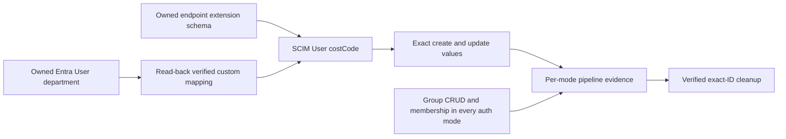

# Entra gallery custom extension and complete transport coverage

**Status:** Contract GREEN; live provisioning matrix pending
**Last verified:** 2026-10-14

## Executive summary

The default gallery gate now prepares a reviewed custom User extension and
runs Group CRUD plus membership add/remove under SecretToken, OAuth client
credentials, and workload identity federation (WIF). The former explicit
coverage reductions are removed from the implementation, not relabelled as
successful tests.

Behavioral contracts pass. A read-only request against the actual gallery
template confirms that the transformation matches its department definition
and source mapping. The expanded real provisioning matrix has not run yet:
the runtime deployment continuation currently owns the shared gallery
principal and estate. No live success is inferred from these local controls.

## One bounded mapping

| Concern | Reviewed configuration |
|---|---|
| Source | Entra User `department` |
| Source expression | `[department]`, attribute mapping |
| Target extension | `urn:scimserver:validation:gallery:2.0:User` |
| Target attribute | `costCode`, scalar string, optional, read/write, returned by default |
| Values | Create: `SCIM Validation`; update: `SCIM Validation Updated` |
| Ownership | Fresh endpoint and synchronization job, deleted by exact ID |
| Exclusion boundary | This proves one reviewed custom mapping, not arbitrary mappings or every possible characteristic combination. |



The helper clones input state, preserves existing enterprise and Group
mappings, locates the target object by the rule's directory/object names,
and refuses duplicate registration or an absent reviewed department template.
It does not guess a target directory or weaken strict schema validation.

The actual read-only template uses target directory `isvonboarding` and a User
object named `urn:ietf:params:scim:schemas:extension:enterprise:2.0:User`.
Its department definition is a non-anchor, optional, single-valued `String`
with an Attribute source and expression `[department]`. The transformation
and verification both succeeded against that real structure.

References:
[Graph attribute definitions](https://learn.microsoft.com/en-us/graph/api/resources/synchronization-attributedefinition?view=graph-rest-beta)
and [mapping sources](https://learn.microsoft.com/en-us/graph/api/resources/synchronization-attributemappingsource?view=graph-rest-beta).
The existing harness uses Microsoft Graph beta and retains its dev-only
boundary.

## Evidence requirements

Each authentication mode must prove User create, update, disable, reenable,
and deprovision; custom extension create/update; Group create/update,
membership add/remove, and deprovision; and a successful final mode outcome.
Stage 4.8 rejects a missing or duplicate outcome, a non-PASS result, an
unsupported/blocked/skipped check, failed custom disposition, a wrong runtime
version, or unverified cleanup.

The report requires exactly one custom create and update result for each
requested mode. A total count is insufficient: six repeated SecretToken
results cannot stand in for three independent transports. Plan-only intake
reports `NOT_RUN` for the custom mapping rather than claiming coverage.
An explicitly empty authentication selection is rejected during parameter
binding, before any remote action. Report projection also refuses to turn an
empty requested matrix into a custom-mapping PASS.

| Validation | Result |
|---|---|
| Missing mapping helper / missing read-back verifier | Confirmed RED before implementation |
| Profile preservation, target/source values, duplicate refusal, missing template, wrong saved expression | GREEN |
| Actual gallery-template transformation | GREEN, read-only Graph request |
| Actual dev `entra-id` preset plus reviewed extension | GREEN through the built runtime profile validator; no endpoint mutation |
| Group orchestration under OAuth and WIF | Confirmed RED before removing the SecretToken-only branch; GREEN for all three modes afterwards |
| Missing custom/membership evidence, unsupported result, failed disposition | Four pipeline controls RED before acceptance hardening; GREEN afterwards |
| Duplicate-mode report evidence | Confirmed RED before per-mode identity checks; GREEN afterwards |
| Empty authentication selection and vacuous report evidence | Both controls confirmed RED, then GREEN; default remains all three transports |
| Real expanded gallery provisioning and cleanup | Pending shared-estate handoff |
| New documentation diagram | Rendered in Chromium under strict security in both themes; the separate built-in version-discovery warning is not represented as renderer equivalence. |

The post-master integration checkpoint passes 70 gallery contract checks and
42 deployment pipeline contract checks. Reviewed master `f96f31b5` adds the
serial-Prisma scheduling guard without weakening gallery acceptance. Both
infrastructure explanations are retained and the infrastructure audit passes.
The first pushed implementation is `0a884263`; its
normal Fast hook passed all required static, documentation, unit and InMemory
E2E gates. That E2E run passed 2,432 tests with four PostgreSQL-only exclusions.
The exclusions are not PostgreSQL validation, and Jest's worker-exit warning
is not evidence of clean teardown. Neither the hook nor the contracts replace
the pending real expanded provisioning matrix. The separate empty-matrix
correction `e4f1cfa9` is also pushed, and draft PR #218 preserves both logical
commits. Its normal Fast hook passed every gate in 612.9 seconds, including
actual Mermaid rendering in 95.6 seconds and the same 116 InMemory E2E suites.

Run the existing contracts together:

```powershell
pwsh -NoProfile -File scripts\test\entra-gallery-scim-e2e.contract.ps1
pwsh -NoProfile -File scripts\test\dev-deployment-pipeline.contract.ps1
```

After the runtime validation owner releases the gallery principal, run the
default executable gate. It resolves dev from the estate registry and refuses
pre-existing jobs; never delete another run's job to make it proceed.

```powershell
pwsh -NoProfile -File scripts\entra-gallery-scim-e2e.ps1
```

## Self-improvement and design disposition

**Applied:** Behavioral controls now exercise mode orchestration and real report
projection, not just source markers. Pipeline acceptance requires the
previously excluded semantic outcomes.

**Design disposition accepted:** A small pure helper contains profile/mapping
transformation and shared target resolution; the orchestrator keeps remote
calls and lifecycle ownership. Existing scoped provisioning and cleanup are
reused. No new framework or speculative mapping language is introduced.

Execution findings are recorded in
[the gallery RCA ledger](ENTRA_GALLERY_SCIM_E2E_EXECUTION_RCA.md).
