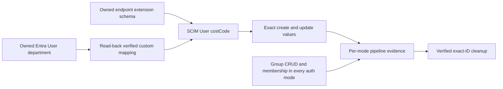

# Entra gallery custom extension and complete transport coverage

**Status:** 92 contracts GREEN; final-source native three-mode matrix 50 PASS/0 FAIL; 15 cleanup checks PASS
**Last verified:** 2026-10-16

## Executive summary

The default gallery gate now prepares a reviewed custom User extension and
runs Group CRUD plus membership add/remove under SecretToken, OAuth client
credentials, and workload identity federation (WIF). The former explicit
coverage reductions are removed from the implementation, not relabelled as
successful tests.

Behavioral contracts pass. A read-only request against the actual gallery
template confirms that the transformation matches its department definition
and source mapping. Final-source run `20261015-201005-60d2bd31` against dev
`0.55.50` passes all 50 checks across all three modes, with all 15 cleanup
checks passed and 46 normalized observations. Native membership add/remove
uses one or two attempts and completes without scheduled fallback in every
mode. The script SHA256 is
`1E8287DFA7BB4F451E559235F674759D6709027E4B6CF916F48CDDFE15E2C60C`.

Earlier failed receipts remain failed. The original expanded matrix reported:
SecretToken and OAuth completed; WIF timed out on User update. An unchanged
WIF-only replay passed that update but timed out creating a Group. Both
verified exact cleanup. Partial replays are not combined into an all-mode
PASS. The final complete run, rather than an aggregation of partial replays,
closes native gallery proof. Protected push and exact-tip CI for this
tooling correction are separate consolidation checks.

## One bounded mapping

| Concern | Reviewed configuration |
|---|---|
| Source | Entra User `department` |
| Source expression | `[department]`, attribute mapping |
| Target extension | `urn:scimserver:validation:gallery:2.0:User` |
| Target attribute | `costCode`, scalar string, optional, read/write, returned by default |
| Values | Create: `SCIM Validation`; update: `SCIM Validation Updated` |
| Ownership | Fresh endpoint and synchronization job, deleted by exact ID |
| Exclusion boundary | This proves one reviewed custom mapping, not arbitrary mappings or every possible characteristic combination. |



The helper clones input state, preserves existing enterprise and Group
mappings, locates the target object by the rule's directory/object names,
and refuses duplicate registration or an absent reviewed department template.
It does not guess a target directory or weaken strict schema validation.

The actual read-only template uses target directory `isvonboarding` and a User
object named `urn:ietf:params:scim:schemas:extension:enterprise:2.0:User`.
Its department definition is a non-anchor, optional, single-valued `String`
with an Attribute source and expression `[department]`. The transformation
and verification both succeeded against that real structure.

References:
[Graph attribute definitions](https://learn.microsoft.com/en-us/graph/api/resources/synchronization-attributedefinition?view=graph-rest-beta)
and [mapping sources](https://learn.microsoft.com/en-us/graph/api/resources/synchronization-attributemappingsource?view=graph-rest-beta).
The existing harness uses Microsoft Graph beta and retains its dev-only
boundary.

## Evidence requirements

Each authentication mode must prove User create, update, disable, reenable,
and deprovision; custom extension create/update; Group create/update,
membership add/remove, and deprovision; and a successful final mode outcome.
Stage 4.8 rejects a missing or duplicate outcome, a non-PASS result, an
unsupported/blocked/skipped check, failed custom disposition, a wrong runtime
version, or unverified cleanup.

The report requires exactly one custom create and update result for each
requested mode. A total count is insufficient: six repeated SecretToken
results cannot stand in for three independent transports. Plan-only intake
reports `NOT_RUN` for the custom mapping rather than claiming coverage.
An explicitly empty authentication selection is rejected during parameter
binding, before any remote action. Report projection also refuses to turn an
empty requested matrix into a custom-mapping PASS.

| Validation | Result |
|---|---|
| Missing mapping helper / missing read-back verifier | Confirmed RED before implementation |
| Profile preservation, target/source values, duplicate refusal, missing template, wrong saved expression | GREEN |
| Actual gallery-template transformation | GREEN, read-only Graph request |
| Actual dev `entra-id` preset plus reviewed extension | GREEN through the built runtime profile validator; no endpoint mutation |
| Group orchestration under OAuth and WIF | Confirmed RED before removing the SecretToken-only branch; GREEN for all three modes afterwards |
| Missing custom/membership evidence, unsupported result, failed disposition | Four pipeline controls RED before acceptance hardening; GREEN afterwards |
| Duplicate-mode report evidence | Confirmed RED before per-mode identity checks; GREEN afterwards |
| Empty authentication selection and vacuous report evidence | Both controls confirmed RED, then GREEN; default remains all three transports |
| Real expanded gallery provisioning and cleanup | Final-source complete matrix: 50 PASS/0 FAIL, all three modes PASS, all 15 cleanup checks PASS; original failed receipts retained |
| New documentation diagram | Rendered in Chromium under strict security in both themes; the separate built-in version-discovery warning is not represented as renderer equivalence. |

## Native Group member transport correction

Group on-demand subjects now include explicit `links.members`: the selected
affected User subject for both addition and removal. Empty Group
create/update requests retain that explicit empty set. User requests do not
gain Group links. Linked selection is not a complete membership replacement:
removal selects the former member after its source relationship is deleted.
The documented five-member limit is enforced before Graph is called.

Scoped changes reuse the existing seven-attempt, ten-second on-demand
convergence policy before choosing scheduled fallback. Membership accepts
an export only when its shared final target predicate also matches: an export
can succeed with the wrong direction or effect. Failed child exports
override parent Success and throw immediately. Fallback reads the owned job state: it starts only a
Paused or Quarantine job, reuses an Active job without posting start again,
and explicitly rejects other states. The target predicates and 240-second
verification timeout are unchanged.

Seven assertion-level RED results preceded the initial implementation.
The first native verification passed Group creation and member addition but
failed removal with an empty selection, retaining 13 PASS/1 FAIL and seven
successful cleanup checks. Three further RED assertions require the affected
member for removal; a fourth exposed a source-derived target fixture.
The focused gallery contract now passes 92 assertions with independent target
state and an omitted-selection negative control. Corrected WIF run
`20261015-195022-dd75d395` passes 18/18 with all seven cleanup checks passed:
native member removal exports on attempt one, Group update succeeds and both
User/Group deprovisioning outcomes are verified. The preceding complete
matrix failed OAuth addition and WIF removal despite successful export
metadata (39 PASS/2 FAIL; all 15 cleanup checks PASS). Five further
assertion-level RED controls led to target-aware convergence. The final
50/0 matrix above verifies the complete corrected source. No timeout,
predicate, cleanup or required-mode reduction was used.

## Diagnostic report contract

Report schema `1.1.0` adds `provisioningObservations` independently of
acceptance results. Each actual on-demand response records only the following
metadata keys:

| Keys | Meaning |
|---|---|
| `observedAt`, `operation`, `attempt` | UTC observation time and the requested operation/attempt |
| `jobId`, `objectId`, `objectType` | Exact owned identities for correlation; a reused job ID alone is not a unique execution identity |
| `result`, `action`, `stepStatuses`, `hasSuccessfulExport` | Normalized result and step metadata, not raw Graph response bodies or error details |
| `path` | `provisionOnDemand`, or `scheduled-sync-fallback` after an owned paused/quarantined job starts successfully or an already-Active job is reused without another start |

An import-only success remains distinct from an Export success. Observations
survive target-poll failures and never turn them into acceptance. Raw response
properties, credentials, headers and tokens are not projected. Failure-stage
labels advance through User updates, account changes, Group operations and
deprovisioning. Contract fixtures execute the real helpers and orchestrator,
with a secret sentinel and exact key allowlist.
The focused command
`pwsh -NoProfile -File scripts\test\entra-gallery-scim-e2e.contract.ps1`
originally passed 78 assertions after the five initial diagnostic RED
assertions. The complete correction now passes 92.

The instrumented WIF run `20261015-190055-3ce748be` passed 12 checks, including
Group creation, then failed membership addition after the unchanged
240-second target wait. Seven cleanup checks passed. User update first
reported no Export, then exported successfully on attempt two. Group create
and membership both used scheduled fallback; membership on-demand reported
`EntrySynchronizationSkip=Skipped`. The in-flight source Group had the
member, while the provider job reported a successful cycle. Those are not
proof of target membership.

Microsoft documents explicit
[linked member subjects](https://learn.microsoft.com/en-us/graph/api/resources/synchronization-synchronizationlinkedobjects?view=graph-rest-beta)
for on-demand provisioning and says
[start resumes a paused job](https://learn.microsoft.com/en-us/graph/api/synchronization-synchronizationjob-start?view=graph-rest-beta),
not that it forces a fresh cycle. It warns against repeatedly starting
an already-running job. The failed diagnostic used a helper that sent no member links. The correction
above now carries them and has verified creation, addition, removal,
update and deprovisioning in the complete 50/0 matrix. These remain distinct
target assertions. Do not increase timeouts or start running jobs
repeatedly to manufacture a PASS.

The earlier post-master integration checkpoint passed 70 gallery contract checks and
42 deployment pipeline contract checks. Reviewed master `f96f31b5` adds the
serial-Prisma scheduling guard without weakening gallery acceptance. Both
infrastructure explanations are retained and the infrastructure audit passes.
The first pushed implementation is `0a884263`; its
normal Fast hook passed all required static, documentation, unit and InMemory
E2E gates. That E2E run passed 2,432 tests with four PostgreSQL-only exclusions.
The exclusions are not PostgreSQL validation, and Jest's worker-exit warning
is not evidence of clean teardown. Neither the hook nor the contracts replace
the pending real expanded provisioning matrix. The separate empty-matrix
correction `e4f1cfa9` is also pushed, and draft PR #218 preserves both logical
commits. Its normal Fast hook passed every gate in 612.9 seconds, including
actual Mermaid rendering in 95.6 seconds and the same 116 InMemory E2E suites.

Run the existing contracts together:

```powershell
pwsh -NoProfile -File scripts\test\entra-gallery-scim-e2e.contract.ps1
pwsh -NoProfile -File scripts\test\dev-deployment-pipeline.contract.ps1
```

After the runtime validation owner releases the gallery principal, run the
default executable gate. It resolves dev from the estate registry and refuses
pre-existing jobs; never delete another run's job to make it proceed.

```powershell
pwsh -NoProfile -File scripts\entra-gallery-scim-e2e.ps1
```

## Self-improvement and design disposition

**Applied:** Behavioral controls now exercise mode orchestration and real report
projection, not just source markers. Pipeline acceptance requires the
previously excluded semantic outcomes.

**Design disposition accepted:** A small pure helper contains profile/mapping
transformation and shared target resolution; the orchestrator keeps remote
calls and lifecycle ownership. Existing scoped provisioning and cleanup are
reused. No new framework or speculative mapping language is introduced.

Execution findings are recorded in
[the gallery RCA ledger](ENTRA_GALLERY_SCIM_E2E_EXECUTION_RCA.md).
