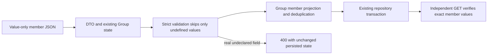

# Minimal imported Group membership correctness

**Last verified:** 2026-10-16
**Status:** Item A implemented and demonstrated locally on both persistence backends. Not yet reviewed, released or demonstrated on live dev/Entra.

## Executive summary

A minimal imported Group schema that declares only `members.value` and
`members.$ref` must accept value-only members while strict validation stays
enabled. The server's DTO transformation, PATCH projection and stored-member
reconstruction may materialize optional `display` and `type` properties with
`undefined` values. These are absent JSON values, not supplied attributes.

Nested validation now follows the existing top-level rule: skip only
`undefined` before looking up an attribute definition. Supplied undeclared
strings, empty strings, nulls, booleans and numbers still fail. Group PATCH
validates the candidate before its member projection can discard genuinely
undeclared properties. Neither fix expands the endpoint schema.

## Evidence and boundaries

The original diagnosis is
`SCIMServer\docs\GOOGLEAPIS_ISV_1_PROD_DEV_DIAGNOSIS_2026_10_16.md`
in the original analysis checkout. It was read in full and remains unchanged:
that checkout contains unrelated dirty work. This document is its resolution
supplement in the exclusively owned implementation checkout, not a rewrite
of historical findings.

At investigation, customer prod was 0.55.20, dev was 0.55.51 and reproduction
source was `c1a466ec11bb5df817a9ed486b99282c296436ad`. Fresh source intake
found reviewed master `0a0966a8` and no intervening implementation fix.
Deployment identity must be refreshed again before live proof; the historical
estate comparison is not a new observation.

Raw captured profiles, headers and production logs remain outside Git.
[The portable fixture](../api/test/helpers/minimal-group-members.fixture.ts)
is a deliberately minimal synthetic contract containing no captured accounts,
endpoint identities, credentials or production requests.

## Flow and implementation

The diagram distinguishes schema validation from lossy member projection.
Validation must see actual supplied fields before projection, not afterwards.
Existing readOnly processing still occurs in the PATCH executor before this
normalization callback. Immutable enforcement, operation ordering and repository
transactions are unchanged. RFC 7643 section 2.5 governs unassigned values;
RFC 7644 section 3.5.2 governs ordered atomic PATCH.

The distinct advertised `$ref` persistence defect is **not fixed by item A**.
It remains its own queued rollback unit. No schema widening, authentication
change or Entra mapping workaround is part of this fix.

## Acceptance evidence

| Claim | Result and limits |
|---|---|
| RED first | Three new desired-success validator tests and all ten new HTTP tests initially failed; POST/PUT/PATCH reported unknown internally materialized display/type. |
| Focused units | 169 PASS across absent-value, existing validator and Group engine suites. |
| InMemory HTTP | 212 PASS across minimal membership, existing Group policy and PATCH schema contract suites. |
| PostgreSQL HTTP | The identical 212 cases PASS on a private fresh PostgreSQL 17 container with the existing migration chain replayed. |
| Production TypeScript build | PASS. |
| New regression file types/lint | Focused ESLint PASS. Full API type check reports three errors only in unchanged existing activity/logging/reporter files; none in the added files. |
| Compiled local HTTP live section | 33 PASS, 0 FAIL, exact owned endpoint cleanup. First smoke run caught a PowerShell singleton-array envelope bug before batching. |
| Values and response contract | Independent GET asserts exact member IDs and member/resource key allowlists. |
| Rejection atomicity | Rejected policy/undeclared-field operations retain full prior response, including metadata. |
| Membership matrix | POST deduplication, PUT empty/populated, PATCH add/replace/filtered remove, duplicate/idempotent operations, multi-member and remove-all flag transitions. |
| Strict negative controls | Real undeclared display/type/unknown fields fail on POST/PUT/PATCH; unit checks also cover empty/null/false/zero. |
| Live dev HTTP | Pending authorized live ownership and reviewed deployment. |
| Entra actual add/remove journey | Pending; requires independent target readback and required Google Group-extension email. |
| Customer production | No action authorized. Promotion requires separate approval. |

Focused commands use `npm test -- --runInBand --runTestsByPath` for the
three named unit files and `npm run test:e2e -- --runInBand --runTestsByPath`
for `minimal-group-members`, `group-parity-gaps` and `patch-schema-contract`.
The same selectors were used with `PERSISTENCE_BACKEND=inmemory` and `prisma`.
Complete logs are retained in ignored `test-results/google-optional-*.log`.
The PostgreSQL container is exclusively named and labelled for this change;
no shared or live database was used by the truncating test teardown.

## Execution issues and root causes

| ID | Type / severity | Symptom and mechanism | Resolution and why it works | Detection / earliest detection |
|---|---|---|---|---|
| GM-A01 | Test fixture / Low | Unit fixture passed both User and Group schema definitions; required User userName incorrectly contaminated Group create/replace expectations. | Pass only the Group definitions, as the real schema helper does. Corrected fixture yields eight passing absent-value/negative cases. | First GREEN / focused unit fixture construction |
| GM-A02 | Test configuration / Low | Initial policy test used retired individual multi-member setting names; changing them did not disable current combined policy. | Use registered MultiMemberPatchOpForGroupEnabled and prove both refusal with unchanged state and enabled multi-member readback. | First GREEN / registry lookup before authoring flag tests |
| GM-A03 | Validation escape / High | After the absent-value fix, PATCH accepted a real unknown member field because member projection discarded it before strict post-validation. POST/PUT correctly rejected it. | Validate the candidate before the existing projection. Meaningful negative-control RED becomes GREEN, with all adjacent PATCH/readOnly/immutable contracts passing on both backends. | New adversarial HTTP test / minimal imported-schema integration before generic suite |
| GM-A04 | Tool availability / Low | Built-in file search stopped with program-not-found for ripgrep during intake. | Use bounded native PowerShell Select-String/Get-ChildItem reads. No content-exclusion denial occurred and no source mutation was involved. | Intake search / same command |
| GM-A05 | Live fixture / Low | PowerShell unrolled a singleton member array returned by an if expression, so the second POST sent an object instead of members[]. | Capture the entire conditional output in an array subexpression. The same live section then passes all 33 assertions against compiled local HTTP. | Mandatory first live-section smoke / same smoke before batch |
| GM-A06 | Shell tooling / Low | A discovery command piped directly from a foreach statement, which PowerShell rejects; another guessed audit path did not exist. | Collect foreach output before piping and use existing known file paths. Neither failed read changed source or evidence. | Intake commands / same command |
| GM-A07 | Test type safety / Low | Focused ESLint rejected direct access to Supertest's untyped response body in new tests. | Give the asserted response boundary a concrete Group shape and type endpoint/error envelopes; focused ESLint then passes and the full type check reports no errors in new files. Three unrelated pre-existing type errors remain explicitly recorded, not fixed or hidden. | Focused lint / same authoring step |
| GM-A08 | Release documentation / Low | The first protected push stopped at doc-content C13: freshness autofix updated the README header but not its separate version badge. | Update the badge to the manifest release candidate and use the existing content audit alongside freshness before retrying. The content gate correctly blocked an inconsistent release claim; no bypass or threshold change is needed. | Protected push static gate / paired freshness and content audits before push |

Self-improvement disposition: **applied**. Permanent minimal imported-schema
coverage includes nonempty membership and actual readback, not empty-Group
or status-only proxies. A strict rejection check runs before information can
be lost by representation conversion.

Design/architecture disposition: **accepted**. Two bounded changes in existing
validation/adapter responsibilities; no controller growth, new framework,
speculative strategy or persistence coupling. The wider `$ref` storage contract
remains separate.
