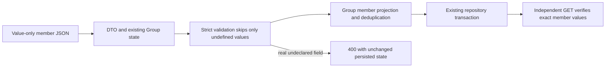

# Minimal imported Group membership correctness

**Last verified:** 2026-10-16
**Status:** Item A and reference item B are delivered to dev and the same-tenant canary in 0.55.54. Both backends, actual dev HTTP membership and native Entra add/remove readbacks pass. Operator visual acceptance and performance follow-up remain open; customer production is not promoted.

## Deployed 0.55.54 evidence

The final no-skip command was
`pwsh -NoProfile -File scripts\dev-deployment-pipeline.ps1 -AutoCanary`
from merged master `db10b13eceb85a4cbf8787e1d2827bec1fb19585`.
It completed exit 0 in 6,349 seconds with **40 PASS, 0 FAIL, 0 SKIPPED
and 9 reviewer PENDING**. The nine judgment rows are not implied PASS.
The immutable matrix is `test-results/dev-deploy-2026-10-16-081024.md`;
the earlier failed matrix remains separate and unchanged.

| Required outcome | Verified evidence |
|---|---|
| Local correctness and both backends | 28 focused cases per backend; 29 fresh migrations and populated legacy upgrade proof |
| Rejection contracts | PR #238 merged at `db10b13e`, preserving `3b072212`; 25 protected gates and seven exact-tip CI checks PASS |
| Full protected inventory | 6,060 units and 2,460 HTTP/oracle cases PASS, with four existing exclusions in the InMemory lane |
| Minimal imported schema on deployed dev | All 66 registered live-section assertions PASS, including exact reference values, real undeclared-attribute rejection and unchanged rejected-operation state |
| Native Entra membership | 50 checks PASS across shared secret, OAuth client credentials and workload identity; actual member addition/removal independently read back from SCIM |
| Native fixture cleanup | All 15 exact-ID cleanup entries report `removed: true`; no secret values persisted |
| Existing dev inventory | 74 endpoints before and after, zero missing IDs |
| Same-tenant canary | Same immutable digest, verified green soak and public post-flip readbacks; 64 endpoints retained, two active revisions |
| Customer production | Not accessed or promoted by this delivery; separate approval required |

Native evidence is in
`test-results/entra-gallery-2026-10-16-081024/summary.md` and its local JSON
receipt. It proves owned connector journeys, not an inspection or alteration
of the saved Google production mapping. Existing Google authentication,
credentials and imported schema were not changed to compensate for the defect.

The accepted artifact remains
`sha256:42613fe093bcb770c8eec849f2ac8840afa1b0ca85a1b8baf98efa33665745f9`,
published from `c3ef1f0d`; the later merged release head is not a fabricated
publication-source tag. See
[the release closeout and open performance observation](RESPONSIVE_ENDPOINT_INVENTORY.md#deployed-release-closeout).
The historical local-only and pending-deployment entries below describe their
original checkpoints, not the current release status.

## Executive summary

A minimal imported Group schema that declares only `members.value` and
`members.$ref` must accept value-only members while strict validation stays
enabled. The server's DTO transformation, PATCH projection and stored-member
reconstruction may materialize optional `display` and `type` properties with
`undefined` values. These are absent JSON values, not supplied attributes.

Nested validation now follows the existing top-level rule: skip only
`undefined` before looking up an attribute definition. Supplied undeclared
strings, empty strings, nulls, booleans and numbers still fail. Group PATCH
validates the candidate before its member projection can discard genuinely
undeclared properties. Neither fix expands the endpoint schema.

## Evidence and boundaries

The original diagnosis is
`SCIMServer\docs\GOOGLEAPIS_ISV_1_PROD_DEV_DIAGNOSIS_2026_10_16.md`
in the original analysis checkout. It was read in full and remains unchanged:
that checkout contains unrelated dirty work. This document is its resolution
supplement in the exclusively owned implementation checkout, not a rewrite
of historical findings.

At investigation, customer prod was 0.55.20, dev was 0.55.51 and reproduction
source was `c1a466ec11bb5df817a9ed486b99282c296436ad`. Fresh source intake
found reviewed master `0a0966a8` and no intervening implementation fix.
Deployment identity must be refreshed again before live proof; the historical
estate comparison is not a new observation.

Raw captured profiles, headers and production logs remain outside Git.
[The portable fixture](../api/test/helpers/minimal-group-members.fixture.ts)
is a deliberately minimal synthetic contract containing no captured accounts,
endpoint identities, credentials or production requests.

## Flow and implementation

The diagram distinguishes schema validation from lossy member projection.
Validation must see actual supplied fields before projection, not afterwards.
Existing readOnly processing still occurs in the PATCH executor before this
normalization callback. Immutable enforcement, operation ordering and repository
transactions are unchanged. RFC 7643 section 2.5 governs unassigned values;
RFC 7644 section 3.5.2 governs ordered atomic PATCH.

The distinct advertised `$ref` persistence defect is **not fixed by item A**.
It remains its own queued rollback unit. No schema widening, authentication
change or Entra mapping workaround is part of this fix.

## Acceptance evidence

| Claim | Result and limits |
|---|---|
| RED first | Three new desired-success validator tests and all ten new HTTP tests initially failed; POST/PUT/PATCH reported unknown internally materialized display/type. |
| Focused units | 169 PASS across absent-value, existing validator and Group engine suites. |
| InMemory HTTP | 212 PASS across minimal membership, existing Group policy and PATCH schema contract suites. |
| PostgreSQL HTTP | The identical 212 cases PASS on a private fresh PostgreSQL 17 container with the existing migration chain replayed. |
| Production TypeScript build | PASS. |
| New regression file types/lint | Focused ESLint PASS. Full API type check reports three errors only in unchanged existing activity/logging/reporter files; none in the added files. |
| Compiled local HTTP live section | 33 PASS, 0 FAIL, exact owned endpoint cleanup. First smoke run caught a PowerShell singleton-array envelope bug before batching. |
| Values and response contract | Independent GET asserts exact member IDs and member/resource key allowlists. |
| Rejection atomicity | Rejected policy/undeclared-field operations retain full prior response, including metadata. |
| Membership matrix | POST deduplication, PUT empty/populated, PATCH add/replace/filtered remove, duplicate/idempotent operations, multi-member and remove-all flag transitions. |
| Strict negative controls | Real undeclared display/type/unknown fields fail on POST/PUT/PATCH; unit checks also cover empty/null/false/zero. |
| Protected consolidation | Normal Validate push at 5b5c3dba: all 28 gates PASS in 724.1 seconds. API units 6,056 across 211 suites; InMemory HTTP 2,442 PASS across 117 suites, four pre-existing skipped cases; Web 1,624 PASS across 123 suites. |
| Release locks | Existing CI-only regen-lockfile workflow 38879494153 succeeded for source 5b5c3dba. Imported API/web locks structurally differ only in the two version fields, now 0.55.52. Public registry and sha512 provenance verified. |
| Live dev HTTP | Pending authorized live ownership and reviewed deployment. |
| Entra actual add/remove journey | Pending; requires independent target readback and required Google Group-extension email. |
| Customer production | No action authorized. Promotion requires separate approval. |

Focused commands use `npm test -- --runInBand --runTestsByPath` for the
three named unit files and `npm run test:e2e -- --runInBand --runTestsByPath`
for `minimal-group-members`, `group-parity-gaps` and `patch-schema-contract`.
The same selectors were used with `PERSISTENCE_BACKEND=inmemory` and `prisma`.
Complete logs are retained in ignored `test-results/google-optional-*.log`.
The PostgreSQL container is exclusively named and labelled for this change;
no shared or live database was used by the truncating test teardown.

## Execution issues and root causes

| ID | Type / severity | Symptom and mechanism | Resolution and why it works | Detection / earliest detection |
|---|---|---|---|---|
| GM-A01 | Test fixture / Low | Unit fixture passed both User and Group schema definitions; required User userName incorrectly contaminated Group create/replace expectations. | Pass only the Group definitions, as the real schema helper does. Corrected fixture yields eight passing absent-value/negative cases. | First GREEN / focused unit fixture construction |
| GM-A02 | Test configuration / Low | Initial policy test used retired individual multi-member setting names; changing them did not disable current combined policy. | Use registered MultiMemberPatchOpForGroupEnabled and prove both refusal with unchanged state and enabled multi-member readback. | First GREEN / registry lookup before authoring flag tests |
| GM-A03 | Validation escape / High | After the absent-value fix, PATCH accepted a real unknown member field because member projection discarded it before strict post-validation. POST/PUT correctly rejected it. | Validate the candidate before the existing projection. Meaningful negative-control RED becomes GREEN, with all adjacent PATCH/readOnly/immutable contracts passing on both backends. | New adversarial HTTP test / minimal imported-schema integration before generic suite |
| GM-A04 | Tool availability / Low | Built-in file search stopped with program-not-found for ripgrep during intake. | Use bounded native PowerShell Select-String/Get-ChildItem reads. No content-exclusion denial occurred and no source mutation was involved. | Intake search / same command |
| GM-A05 | Live fixture / Low | PowerShell unrolled a singleton member array returned by an if expression, so the second POST sent an object instead of members[]. | Capture the entire conditional output in an array subexpression. The same live section then passes all 33 assertions against compiled local HTTP. | Mandatory first live-section smoke / same smoke before batch |
| GM-A06 | Shell tooling / Low | A discovery command piped directly from a foreach statement, which PowerShell rejects; another guessed audit path did not exist. | Collect foreach output before piping and use existing known file paths. Neither failed read changed source or evidence. | Intake commands / same command |
| GM-A07 | Test type safety / Low | Focused ESLint rejected direct access to Supertest's untyped response body in new tests. | Give the asserted response boundary a concrete Group shape and type endpoint/error envelopes; focused ESLint then passes and the full type check reports no errors in new files. Three unrelated pre-existing type errors remain explicitly recorded, not fixed or hidden. | Focused lint / same authoring step |
| GM-A08 | Release documentation / Low | The first protected push stopped at doc-content C13: freshness autofix updated the README header but not its separate version badge. | Update the badge to the manifest release candidate and use the existing content audit alongside freshness before retrying. The content gate correctly blocked an inconsistent release claim; no bypass or threshold change is needed. | Protected push static gate / paired freshness and content audits before push |
| GM-A09 | Read-only tooling / Low | Registry rejected guessed purpose canary; artifact inspection guessed publish-age-report.txt instead of publish-ages.json. | Use declared canary-prod and discover actual artifact names. Registry validation stopped the invalid purpose before cloud mutation; the verified lock import already succeeded and was not rolled back or regenerated locally. | Read-only discovery / same command |

### Provenance and completeness

The full available reconstructed continuation was scanned through event 12,330,
with this execution beginning at event 11,599. An error/signal pass and a causal
narration pass identified 20 candidate hits, reconciled against GM-A01..09.
Expected RED failures, intentionally rejected strict-validation requests,
successful patch outputs quoting failures, and search echoes are not additional
incidents. Three unchanged full-test type errors are retained explicitly.
The deleted original session is unavailable; this is not a claim to have its
transcript. The machine-readable scan stays in session artifacts as
`google-member-rca-reconciliation.json`.

Self-improvement disposition: **applied**. Permanent minimal imported-schema
coverage includes nonempty membership and actual readback, not empty-Group
or status-only proxies. A strict rejection check runs before information can
be lost by representation conversion.

Design/architecture disposition: **accepted**. Two bounded changes in existing
validation/adapter responsibilities; no controller growth, new framework,
speculative strategy or persistence coupling. The wider `$ref` storage contract
remains separate.

## Rejection-contract evidence closeout

This separate test/evidence-only follow-up starts from merged `72eb4fd0`
(provenance PR #237). It changes no runtime input, release version or lockfile.
The existing shared Error/ListResponse/key helpers now check the new HTTP
rejections alongside SCIM media type, string status, exact scimType and
deterministic diagnostic values. Each rejected operation gets immediate
unchanged-state readback and a one-Group collection assertion, including
rejected POST. List/search tests check their envelopes and exact reference
projection, not only successful status.

Thirteen TypeScript oracle cases include a valid contract and twelve corrupt
variants. Eleven false acceptances were observed RED before strengthening
the assertion. The focused InMemory HTTP/oracle suite passes 28 cases.
The live runner carries its own permanent oracle on every invocation, with
fourteen cases including both text and UTF-8 byte response representations.
Its initial eleven corruption failures and subsequent byte-response RED are
retained. Two additional state-oracle cases prove identical serialization
passes and a case-only reference mutation fails; the latter is RED under
the old case-insensitive comparison. The modified live section then passes
66 assertions against the
owned compiled local 0.55.54 node; inventory readback verifies zero remaining
owned endpoints and the exact node PID is stopped. The identical 28 cases
also pass on isolated fresh PostgreSQL 17, with all 29 migrations confirmed.
The existing owner/run guard verifies the disposable container before removal;
its run-label query then confirms absence. Focused ESLint passes. Raw API
TypeScript remains at its three unchanged activity/logging/reporter errors,
with zero diagnostics in this changed test. Protected consolidation remains
pending at this checkpoint.

| ID | Type / severity | Symptom and root cause | Fix and prevention | Detection / earliest |
|---|---|---|---|---|
| GM-C01 | Test completeness / High | New negative tests proved status but not complete Error/diagnostic correctness; corrupted bodies passed the old status-only oracle. | Use shared allowlists and exact values, retain independent atomicity/list readbacks, and execute permanent mutation controls. Eleven wrong acceptances per language become GREEN. | Consolidation review / negative-contract oracle during original test authoring |
| GM-C02 | HTTP representation / Medium | The first real strengthened live smoke reached a SCIM rejection but ConvertFrom-Json received System.Byte[]; string-only oracle fixtures had hidden the transport representation. | Reuse the existing live runner's explicit UTF-8 byte decoding pattern before JSON parsing. A permanent valid-byte control fails first; the final local section passes all 66 assertions. No permissive parse fallback. | Immediate mandatory author smoke / a binary transport fixture in the local oracle |
| GM-C03 | Readiness harness / Low | Initial private-node probe used root health rather than the globally prefixed SCIM health route. The node had started, but the readiness probe never succeeded. | Verify the canonical route and body before fixture creation, and retain a reusable local harness with finally-scoped exact PID cleanup. Corrected readiness and subsequent full smoke pass. | Private readiness admission / canonical route inspection |
| GM-C04 | Test discovery / Low | VS Code test discovery did not include the separately owned worktree and found no tests. | Use the repository's existing Jest command with explicit InMemory backend and exact file/name selectors. Meaningful eleven-assertion RED and 28-case GREEN are retained; no speculative install. | Test-provider discovery / explicit repository runner |
| GM-C05 | Atomicity oracle / High | PowerShell's default equality treats case-only changes as equal, potentially hiding a changed reference URL path in rejected-operation readback. | One case-sensitive serialized-state helper serves both live readbacks. A permanent desired-rejection control fails under the old comparison, then passes with the unchanged-state positive control and all 66 local assertions. | Consolidation review plus focused RED / exact-state oracle during original authoring |

Test/gate self-improvement disposition: **applied**. The live oracle runs
inside the already registered live section, so it cannot become a test that
exists only in an uninvoked gate. Both real transport representations and
corrupted response values have permanent controls. Case-sensitive serialized
state comparison prevents case-only changes from passing atomicity checks.

Design/architecture disposition: **accepted**. Small local test assertions
reuse the shared API helpers and established PowerShell byte decoding.
No production framework, service responsibility, new authentication behavior,
cross-language runner dependency or speculative abstraction is introduced.

Closeout completeness: the full available reconstructed continuation was
rescanned through event 15,908 with expanded error/signal and causal-narration
passes. All 124 candidates were reconciled with the Group/UI ledgers.
New actual failures map to GM-C02..04; expected oracle RED failures map to
GM-C01/C02. The three existing type errors, repeated unavailable search tool,
source patches and scanner echoes are explicitly dismissed as new incidents.
The additional case-only state RED receipt is mapped separately to GM-C05;
the four later scan candidates are historical/scanner/source echoes.
Earlier scan receipts above remain historical, not overwritten evidence.
