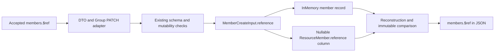

# Group member reference preservation

**Last verified:** 2026-10-16
**Status:** Item B merged in PR #234 at `17031d85` and is delivered in 0.55.54 to dev and the same-tenant canary. Both backends, populated/fresh migrations, exact deployed reference round trips and native Entra add/remove readbacks pass. Customer production remains unpromoted.

**Release closeout:** The final merged-master run at `db10b13e` completed
40 PASS / 0 FAIL / 0 SKIPPED / 9 reviewer PENDING in 6,349 seconds.
All 66 minimal-schema live assertions pass on dev, including exact `$ref`
values after POST, PUT and PATCH and exact rollback after immutable-reference
rejection. The native Entra journey passes all three authentication modes
with actual add/remove readback and 15 exact-ID cleanup successes.
See [the shared deployed evidence](GOOGLE_MINIMAL_GROUP_MEMBERSHIP.md#deployed-05554-evidence)
and [remaining acceptance limits](RESPONSIVE_ENDPOINT_INVENTORY.md#deployed-release-closeout).
Historical pending-deployment entries below retain their original meaning.

## Executive summary

When an effective Group schema accepts `members.$ref`, its exact value now
survives create, replacement, PATCH, persistence and response projection.
Previously, a successful request could silently lose that accepted reference.
Item A, merged in PR #233 at `47d85cdb`, fixed absent optional attributes but
deliberately did not change reference storage. This is its separate change.

RFC 7643 sections 2.3.7 and 4.2 describe references and Group membership.
The effective schema remains authoritative for validation and mutability.
This change stores accepted strings without rewriting URLs or dereferencing
them. It adds no outbound request, authentication rule, mapping workaround,
schema widening or synthetic reference for old records.

The separate [rejection-contract closeout](GOOGLE_MINIMAL_GROUP_MEMBERSHIP.md#rejection-contract-evidence-closeout)
adds complete immutable-PATCH/PUT error contracts, exact list/search envelopes
and reference projection, without another production change. All 28 focused
cases pass on each backend, and 66 local compiled-node assertions pass,
including real UTF-8 HTTP bodies and case-sensitive unchanged-state checks.
Candidate live dev/Entra evidence still requires deployment.

## Data flow



The diagram shows one field crossing existing boundaries, not a new service.
All four service reconstruction paths, the domain PATCH DTO, public DTO/type,
repository input/output mappings and database-copy script carry the field.
The internal name `reference` never appears in a public member response.
The existing returned-characteristic and requested-attribute projection
continues to determine whether an accepted value is visible.

## Migration and compatibility

Prisma generated migration
`20261016094245_add_group_member_reference` adds one nullable TEXT column.
It drops nothing, changes no membership key and performs no backfill.
Existing membership IDs, values, types, displays and timestamps remain
unchanged; their new reference is null and omitted from JSON.

The private PostgreSQL 17 database contained a deliberately seeded legacy
membership before upgrade. Every existing field was compared after migration,
with exact equality and a new null reference. All 29 migrations also replayed
successfully into a different fresh private database.

Old binaries can use the expanded database, but they cannot uphold the new
reference contract and may erase references when replacing membership rows.
Do not describe an old-binary rollback as lossless. Prefer roll-forward; if an
emergency rollback is necessary, suspend affected membership writes and retain
the nullable column and database backup. No destructive down migration is
introduced. Customer production migration/promotion is not authorized here.

## Acceptance evidence

| Claim | Observed result |
|---|---|
| RED first | Three unit assertions and five HTTP desired-success cases failed because the exact submitted reference was missing. Ten existing minimal-schema cases continued to pass. |
| Focused units | 267 PASS across Group service, adapter, InMemory repository and Prisma repository suites. Initial adapter/repository-only selector passed 144. |
| HTTP InMemory | 217 PASS across minimal membership, Group parity and PATCH schema contract suites. |
| HTTP PostgreSQL | Identical 217 PASS against the privately upgraded database. |
| Fresh migration replay | All 29 migrations PASS in a separate private fresh database. |
| Populated upgrade | Legacy member fields unchanged; new reference null. |
| Value-level coverage | POST/write response, independent GET, list, search sub-attribute projection, PUT empty/populated, ordered PATCH add/replace/remove, duplicates and unrelated changes. |
| Mutability and atomicity | A supplied immutable reference cannot change through PUT or PATCH; rejected multi-operation PATCH retains the exact prior response. |
| Missing references | A value-only member remains value-only beside a reference-bearing member. |
| Live-section author smoke | 50 PASS/0 FAIL against an exclusively owned compiled local node; exact endpoint cleanup confirmed. |
| Build and lint | Production build PASS; focused ESLint zero errors and one unchanged repository-test warning. |
| Protected consolidation | Normal Validate retry at 59c0d7e8: all 28 gates PASS in 733.3 seconds. API units 6,060 PASS across 211 suites; InMemory HTTP 2,447 PASS across 117 suites, four pre-existing skipped cases; Web 1,624 PASS across 123 suites. |
| Release locks | CI-only workflow 38885291269 succeeded at 59c0d7e8. Imported API/web locks differ structurally only in the two version fields, now 0.55.53; public registry and sha512 provenance pass. Final-tip CI pending. |
| Dev HTTP, Entra and canary | Pending merged-source deployment and explicit exclusive live ownership. |
| Customer production | No changes authorized. |

Focused commands:

```powershell
npm test -- --runInBand --runTestsByPath `
  src\modules\scim\services\endpoint-scim-groups.service.spec.ts `
  src\domain\patch\group-patch-engine.spec.ts `
  src\infrastructure\repositories\inmemory\inmemory-group.repository.spec.ts `
  src\infrastructure\repositories\prisma\prisma-group.repository.spec.ts

npm run test:e2e -- --runInBand --runTestsByPath `
  test\e2e\minimal-group-members.e2e-spec.ts `
  test\e2e\group-parity-gaps.e2e-spec.ts `
  test\e2e\patch-schema-contract.e2e-spec.ts
```

The HTTP selector is identical for `PERSISTENCE_BACKEND=inmemory` and `prisma`.
Evidence stays under ignored `test-results/google-reference-*.log`; raw captured
profiles, headers and production logs are not committed. The shared live
section 9z-DQ gains 17 reference assertions, from 33 to 50, and remains runnable
against all deployment form factors without targeting an existing endpoint.

## Execution issues and prevention

| ID | Type / severity | Symptom and root cause | Fix and mechanism | Detection / earliest |
|---|---|---|---|---|
| GM-B01 | Test fixture / Low | Initial test draft guessed replaceMembers rather than the repository's existing aggregate update API. The first RED assertion failed earlier, so that later call had not executed. | Use updateGroupWithMembers after inspecting its signature. All 144 unit cases pass. No production workaround was introduced. | GREEN preparation / repository signature lookup |
| GM-B02 | Local smoke tooling / Low | A guessed root health URL returned 404 because the app applies the SCIM global prefix. The node was responsive, not unhealthy. | Use the canonical /scim/health route already used by verify-deployment. The same node passes all 50 live assertions. | Immediate node probe / canonical route lookup |
| GM-B03 | Release documentation / Low | Freshness stamps the README header, not its separate badge. The paired content audit caught the old badge before protected push, the same known class as GM-A08. | Align the badge to 0.55.53 and rerun the existing content audit successfully. No gate bypass or new audit is needed. | Paired pre-push content audit / same static check |
| GM-B04 | Internal contract test / Low | Full unit gate caught an existing exact service-to-repository expectation that omitted the new nullable reference input. The initial focused selector covered adapter/repositories but not that adjacent service seam. | Expect explicit null for missing references and add a reference-bearing parameter case with exact persistence-input/output and public key-allowlist assertions. Expanded focused selector is permanently documented above; 267 cases pass. | Protected full unit gate / focused service seam unit |

Self-improvement disposition: **applied**. Exact accepted reference values are
checked at adapter, repository and HTTP boundaries. A success status and an
empty-Group smoke can no longer masquerade as reference round-trip coverage.
The focused selector now also includes the adjacent service-to-repository seam
whose input contract changes when a member storage field is introduced.

Design/architecture disposition: **accepted**. One optional field passes through
existing cohesive responsibilities. There is no second storage mechanism,
controller responsibility, policy framework or speculative abstraction.
The legacy mirror script must carry the same accepted field to avoid an
information-loss boundary during its existing database-copy operation.

### Provenance and completeness

The full available continuation was reconciled through event 12,771 using the
existing two-pass error/signal and causal narration scanner, with this execution
beginning at event 11,599. New candidates were mapped to GM-B01..03; GM-B04 was
captured immediately when its focused repair passed. Expected
reference-loss RED assertions, successful patches quoting errors and search
echoes were dismissed as additional incidents. Three full-test TypeScript errors
are unchanged baseline in activity/logging/reporter tests; production build and
added-file typing pass. The local health 404 is explicitly included in this
ledger. Machine-readable evidence remains in session artifacts. This is a
reconstructed continuation, not restoration of the deleted original session.
