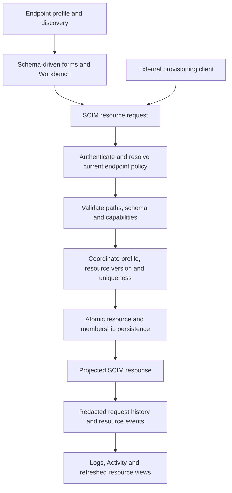
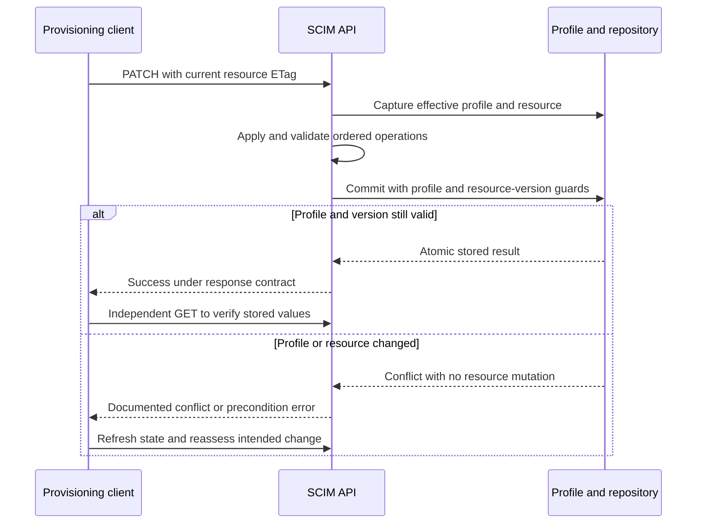
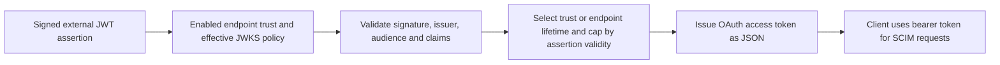
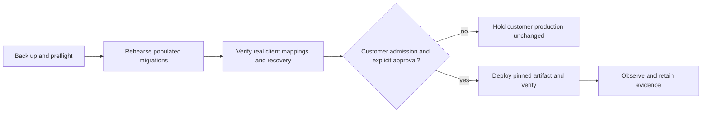

# SCIMServer release notes

> **Status:** User-facing reference - **Last verified:** 2026-11-05 - **Product version:** `0.55.67`

These curated notes explain what changes for operators and integrators, how to
upgrade, and what remains limited. The [engineering changelog](../CHANGELOG.md)
retains implementation and validation history. The [documentation index](INDEX.md)
links to the current task-oriented guides.

The project already follows [Keep a Changelog](https://keepachangelog.com/en/1.1.0/)
and [Semantic Versioning](https://semver.org/spec/v2.0.0.html). These notes are its
user-facing companion, not a second independent version ledger or a raw commit
log. Versions remain in the pre-1.0 development series; inspect compatibility
notes rather than assuming that a patch label makes every rollback lossless.

## 0.55.67

### Executive summary

**Cumulative release since customer version 0.55.20. Published November 5, 2026.**

SCIMServer 0.55.67 improves how operators configure, provision and diagnose
SCIM integrations. It combines schema-driven resource forms, safer concurrent
writes, explicit credential lifecycle controls, configurable endpoint token
lifetimes and more consistent navigation and diagnostics.

**Availability:** deployed to development and canary on November 4.
**Customer production remains on 0.55.20 and has not been upgraded.**
Performance remains **UNQUALIFIED** under a documented exception limited to
this dev-and-canary migration. These notes are not approval for customer
production, a latency promise or a claim that every integration is certified.

The comparison uses actual published baseline `6785200f` and deployed runtime
`b87412b0`, not all branches or the wording of intermediate preparation notes.
OAuth, workload identity federation (WIF), custom-resource APIs, endpoint
profiles and encrypted credential storage already existed in 0.55.20.
This release improves those capabilities; it does not introduce them anew.

### At a glance: what changes for you

| Area | 0.55.20 baseline or earlier limitation | Included in 0.55.67 | Why it matters |
|---|---|---|---|
| Provisioning UI | Existing resource APIs were not consistently represented by complete schema-driven forms. | Profile-derived User, Group and custom-resource forms, synchronized JSON editing and Workbench examples. | Build requests that reflect the endpoint you actually configured. |
| SCIM writes | Path interpretation, multi-operation updates and independent prechecks could produce inconsistent outcomes. | Typed ordered PATCH, atomic aggregate writes, commit-time version/uniqueness checks and profile coordination. | Reject conflicting or invalid writes without silently committing a partial result. |
| Imported Group schemas | Optional fields introduced internally could invalidate minimal input; accepted member references could be lost. | Value-only membership under minimal schemas and exact accepted `members.$ref` preservation. | Integrate without weakening strict validation or losing accepted references. |
| Authentication management | Legacy handover and delete/rotate meanings were difficult to discover. | Migration visibility, explicit lifecycle actions and atomic secret rotation. | Plan consumer switchover and recover from failed replacements safely. |
| Token lifetime | Endpoint-specific lifetime controls were not available in their current form. | OAuth and WIF lifetimes from one minute to seven days, with inheritance and trust overrides. | Choose expiry appropriate to an integration without changing global OAuth lifetime. |
| Navigation and layout | Workflow state, selection and long-value layout were inconsistent. | Context-preserving Back/Forward, URL-owned state, responsive inventory and bounded Bulk results. | Return to your filters and inspect long values without losing context. |
| Diagnostics | Custom-resource history and endpoint identity were inconsistent; analytics could pressure small pools. | Shared log filters, custom-resource events, endpoint-name snapshots and bounded analytics work. | Trace the right request while keeping navigation usable during data waits. |
| Upgrade mechanics | Several older configuration and persistence assumptions remain in existing deployments. | Eleven added migration files, retired-setting conversion and stronger recovery guidance. | Upgrade deliberately; an image-only downgrade is not necessarily a lossless rollback. |

### How the pieces fit together

The browser assists with request construction; the server remains the schema,
authentication and persistence authority. Existing provisioning clients can
continue using SCIM directly without using the browser.



#### 1. Profile-driven provisioning and custom resources

- **One request body:** form controls and editable JSON stay synchronized.
  Valid additional operator-authored members are preserved; malformed or
  non-object JSON blocks submission.
- **Schema-aware controls:** published non-empty canonical-value lists produce
  dropdowns. Types, extension namespaces and mutability guide the form.
  A browser dropdown is not a new server-side closed-enumeration policy.
- **First-class custom-resource views:** configured resource types have
  resource workflows and activity updates. Profile changes refresh discovery
  and relevant views; removed types no longer leave stale panels mounted.
- **Inspectable capabilities:** the endpoint Service Provider Config tab
  shows supported operations, limits, authentication schemes and copyable JSON.
- **Executable examples:** Workbench prepares server, admin, endpoint and
  profile-derived requests, including applicable conditional headers.
  Applying an example creates a draft; it does not send automatically.

Custom types are still defined by each endpoint. An example Device or AIAgent
profile is not a universal built-in schema, an AI service or an automatic
change to your existing endpoint.

See [resource forms](PROFILE_DRIVEN_RESOURCE_FORMS_AND_CUSTOM_RESOURCES.md),
[profile-authoritative UI](PROFILE_AUTHORITATIVE_RESOURCE_UI.md) and
[Workbench examples](WORKBENCH_REQUEST_EXAMPLES.md).

#### 2. Safer SCIM updates and predictable errors

| Safeguard | Expected behavior | Benefit and cost |
|---|---|---|
| Typed, ordered PATCH | Parse selectors and namespaces, append multi-valued additions and evaluate each operation against the evolving candidate. | No literal bracket/dotted-key corruption; malformed paths fail instead of being silently stored. |
| All-or-nothing transitions | Validate applicable required/immutable transitions after each operation; commit only a valid request. | A later invalid operation leaves no stored partial update. A temporarily invalid remove-then-restore sequence may now be rejected. |
| Resource version check | Bind a write to its expected or observed version at the repository boundary. | A stale contender fails rather than overwriting a concurrent change; clients must handle conflicts. |
| Profile coordination | Compare the profile used for validation with the authoritative profile at commit. | A genuine change returns `409 PROFILE_REVISION_CHANGED` without the resource mutation. Unchanged legacy normalization no longer creates a false conflict. |
| Atomic Group mutations | Store the Group and its member changes as one transaction or equivalent in-memory transition. | Failures do not leave a partially replaced member set. |
| Schema-qualified uniqueness | Coordinate supported uniqueness by endpoint, resource type, core/extension binding and attribute path. | Competing owners cannot both win. Default `externalId` duplicate behavior is not universally tightened. |
| Query and projection order | Filter and typed-sort internally, count/page, then project public fields. | A queryable operand can affect selection without leaking into the response. |
| Capability enforcement | Apply effective limits and support checks to built-in, custom and Bulk paths. | A disabled capability cannot be bypassed through another route. |

POST/PUT readOnly handling, one-to-one retained-entry matching, `.search`
projection arrays, endpoint-deletion races and sanitized errors are also
covered by the cumulative correctness work. JSON `.search` accepts supported
array projections as well as legacy strings; GET query syntax remains
string-based. Unsupported uniqueness promises are rejected, not silently
interpreted as arbitrary string comparisons.

**Worked example: ordered PATCH.** The following is an illustrative template,
not captured customer traffic. Assume the effective User schema permits
`emails`, the initial list contains only a home address, and policy permits
the operations. Substitute the endpoint, user, access token and current ETag.

```http
PATCH /scim/endpoints/<endpointId>/Users/<userId> HTTP/1.1
Authorization: Bearer <access-token>
Content-Type: application/scim+json
Accept: application/scim+json
If-Match: <current-resource-etag>

{
  "schemas": [
    "urn:ietf:params:scim:api:messages:2.0:PatchOp"
  ],
  "Operations": [
    {
      "op": "add",
      "path": "emails",
      "value": [
        {
          "type": "work",
          "value": "initial@example.invalid"
        }
      ]
    },
    {
      "op": "replace",
      "path": "emails[type eq \"work\"].value",
      "value": "updated@example.invalid"
    }
  ]
}
```

Expected independent GET readback: the home address remains and the newly
added work address is `updated@example.invalid`. The selector is evaluated
after the add, not against the original list. No property literally named
`emails[type eq "work"].value` is created. If a later operation fails, none
of this request's changes should be stored.

The sequence below explains the conflict boundary. Resource ETags, profile
content revisions and endpoint cache-freshness tokens are different identities.



See [PATCH guidance](PATCH_OPERATIONS_COMPLETE_GUIDE.md),
[schema-characteristic evidence](SCIM_CHARACTERISTIC_RECONCILIATION.md) and
[profile write coordination](SCIM_PROFILE_REVISION_WRITE_COORDINATION.md).

#### 3. Imported Group membership and reference preservation

Two separate fixes matter to integrations with minimal schemas:

1. A schema declaring only `members.value` can accept a value-only member.
   Internally absent optional fields do not become client-supplied `display`
   or `type` attributes.
2. Where the effective schema and policies accept `members.$ref`, the exact
   accepted value survives POST, PUT, ordered PATCH and later readback.

For example, an accepted relative reference remains relative. It is not
replaced with an internal membership-row ID, fetched or expanded into an
invented absolute URL. A schema that does not declare `$ref` can still reject
a genuinely supplied reference under strict validation. Existing mutability,
returned/projection and membership policies remain authoritative.

**Rollback warning:** older binaries may discard references when replacing
membership rows. Prefer roll-forward after reference-bearing writes.
See [minimal Group schemas](GOOGLE_MINIMAL_GROUP_MEMBERSHIP.md) and
[reference migration and recovery](GROUP_MEMBER_REFERENCE_PRESERVATION.md).

#### 4. Credential lifecycle and effective authentication policy

The release improves existing bearer, OAuth client and WIF management:

- Connect surfaces legacy/keyed status, actionable migration progress and
  supported handover. Inactive historical legacy rows are not unfinished
  active migration work.
- Activate, deactivate and permanent delete have distinct meanings.
  Existing DELETE-as-soft-deactivate compatibility is retained.
- Permanent deletion requires inactivity; rotation requires an active
  secret-bearing credential. Secretless WIF trusts do not offer rotation.
- Rotation is atomic. If replacement creation fails, original deactivation
  rolls back. OAuth rotation preserves the public `client_id`, but the
  consumer must still adopt the new secret.
- Settings show effective policy, configured overrides, inheritance,
  bounds and clamping. Removing an override is a saved configuration change,
  not merely clearing a display field.
- WIF trust lookup is bounded and cached with lifecycle invalidation.
  JWKS (JSON Web Key Set) state is partitioned by URI and complete effective
  retrieval policy, so a permissive endpoint does not supply a looser cache
  result to a stricter one.

**Sensitive administration change:** recoverable bearer and OAuth secrets
can appear on authenticated admin screens and in their JSON, clipboard and
download exports. New `CredentialSecretVisibility=once` writes are rejected;
legacy values resolve to retained policy. Already purged secrets require
rotation, not recovery. Protect administrator access and exported files.
Public discovery, ordinary endpoint list projections, durable request logs
and Workbench history must remain plaintext-secret-free.

**Worked example: migrate the retired combined setting.** The SQL migration
preserves valid dedicated values and uses valid legacy intent only where
a dedicated value is absent. This illustrative stored input:

```json
{
  "settings": {
    "PerEndpointCredentialsEnabled": true,
    "SecretTokenBearerAuthEnabled": false,
    "StrictSchemaValidation": true
  }
}
```

becomes:

```json
{
  "settings": {
    "SecretTokenBearerAuthEnabled": false,
    "OAuthClientCredentialsAuthEnabled": true,
    "StrictSchemaValidation": true
  }
}
```

Bearer remains disabled because its dedicated value wins. OAuth inherits the
valid legacy value. The retired key is removed; strict validation is unchanged.
Update provisioning scripts and imported configuration to use the dedicated
keys. The upgrade does not automatically enable WIF or change global-secret policy.

See [authentication](AUTHENTICATION_GUIDE.md),
[credential lifecycle](CREDENTIAL_AND_WIF_TRUST_LIFECYCLE.md) and
[effective WIF/JWKS policy](EFFECTIVE_WIF_JWKS_EGRESS_POLICY.md).

#### 5. Endpoint token lifetimes and OAuth interoperability

| Control | Contract |
|---|---|
| Endpoint OAuth `OAuthClientTokenTtlSec` | 60-604800 whole seconds; default 3600. |
| Endpoint WIF `WifTokenTtlSec` | Same range and default when no trust override applies. |
| WIF trust `issuedTokenTtlSec` | Overrides the endpoint WIF lifetime. |
| Verified assertion validity | Caps the issued WIF token regardless of a larger configured lifetime. |
| Clear endpoint override | Restore inheritance rather than write an empty numeric value. |
| Existing tokens | Not revoked or rewritten by a lifetime-setting change. |
| Token response media type | Global and endpoint OAuth routes return `application/json`; SCIM resources retain `application/scim+json`. |

**Worked lifetime example:** an endpoint requests 7200 seconds, a WIF trust
overrides that with 900 seconds, and the verified assertion has about
120 seconds left. The issued token cannot outlive that assertion, so its
actual lifetime is about 120 seconds or less after processing, not 7200 or 900.
A remaining assertion lifetime below 60 seconds can likewise cap the result
below the configuration minimum. Global OAuth lifetime and static-secret
retention are not changed by these endpoint controls.

WIF still uses the **RFC 7523 JWT bearer assertion grant**, not RFC 8693 token
exchange. A JSON Web Token (JWT) assertion is verified against the selected
trust before this server issues an access token.



#### 6. Navigation, tables and operator workflows

- **Back/Forward preserve intent:** supported tabs, filters, pages, drawers
  and comparison selections are URL-owned. Direct links use safe fallback
  navigation rather than assuming a prior in-app page.
- **Endpoint selectors fit their purpose:** distinguish action targets,
  aggregate history filters, provenance links and discovery comparisons.
- **Operations versus Logs:** Operations shows current cross-endpoint
  resource state; Logs shows recorded requests. Neither is a substitute for
  the other. `/Me` resolves the authenticated subject and gives clearer
  guidance when that subject is unavailable.
- **Readable inventory:** endpoint results use available window height;
  filters stay outside the results scroll area. Dashboard shows compact
  endpoint rows and Browse all endpoints, not a favorite/recent ranking.
- **Unambiguous time:** absolute timestamps include date, time, milliseconds
  and UTC. Copy preserves the source value; relative ages stay relative.
- **Bounded long values:** endpoint names, provenance columns and Bulk result
  URLs/errors no longer widen the document in the covered responsive flows.
  Copy controls retain access to full values.

Bulk layout is the final migration runtime repair: measured long-value
regressions cover 1440 px and 900 px widths, actual clipping and exact copying.
Execution, duplicate rejection, failure CSV output and corrected-row retry
remain covered. No visual baseline was regenerated to hide the failure.
See [UI guide](UI_GUIDE.md) and
[navigation](GLOBAL_NAVIGATION_AND_WORKFLOW_CONTEXT.md).

#### 7. Activity, diagnostics and runtime efficiency

Custom-resource updates now carry resource/endpoint context into Activity,
Logs and relevant view refreshes. Global and endpoint Logs share method,
status, time, duration, request-ID, URL and error filters. Per-endpoint token
requests retain endpoint identity; global requests show Server-wide. Old
request rows are not backfilled with invented historical names.

Dashboard/Activity work is bounded and shared where appropriate. Completed
analytics summaries can briefly lag recent changes; use resource readback
for current stored state rather than treating an aggregate card as a
transactional ledger. Request-log access paths and count usage have been
improved to reduce unnecessary work and connection-pool pressure.

The later snapshot revision correction replaces repeated whole-endpoint
fingerprinting with a database-owned UUID freshness token. An unchanged
endpoint can reuse derived state after an authoritative check; a changed
token causes reload. The database trigger advances the token even for
ordinary older SQL writers.

This is **not** a cross-request resource cache, an event-bus dependency or a
replacement for resource-version/profile checks. It adds a UUID column and
trigger/write overhead. Functional safety and reduced work do not establish
an accepted latency improvement for this final image.
See [snapshot design and restore rules](ENDPOINT_SNAPSHOT_REVISION.md) and
[observability](OBSERVABILITY_TRACEABILITY_AND_DIAGNOSTICS.md).

#### 8. Security and dependency maintenance

| Change | User or administrator action |
|---|---|
| Container and Prisma startup stop embedding database connection strings in corrected messages. | Treat older startup logs as potentially sensitive. Review access/retention and coordinate any affected credential rotation; upgrading does not erase logs or rotate credentials. |
| Public response projection and durable redaction are strengthened. | Keep admin secret exports distinct from ordinary logs/history. Do not copy secret-bearing exports into support tickets. |
| Structured `/Me` filter escaping, sanitized persistence errors and safer PATCH object reconstruction. | Use documented errors and correlation IDs; do not rely on raw database messages or malformed-path acceptance. |
| API request-body and transitive dependency remediations. | Deploy the reviewed immutable artifact rather than assembling a version from selected packages. |
| Web/build-tool and actual-consumer compatibility updates. | Respect the lockfile/build process; a patched override or dormant package name is not proof of browser exploitability or complete advisory clearance. |

Representative target selections include body-parser 2.4.0, multer 2.5.0,
qs 6.16.1, fast-uri 4.2.3, Hono 4.13.11, its Node adapter 2.1.3,
Seroval 1.6.11, Undici 7.30.1 and Vite 8.1.6. Hono's adapter is used through
Prisma tooling; actual-parent lifecycle compatibility was tested. This is
not a blanket zero-advisory or zero-risk declaration.
See [request-body remediation](REQUEST_BODY_SECURITY_REMEDIATION.md),
[API consumer compatibility](API_ADVISORY_CONSUMER_COMPATIBILITY.md),
[web remediations](WEB_SEROVAL_UNDICI_SECURITY_REMEDIATION.md) and
[Prisma parent qualification](HONO_PRISMA_PARENT_QUALIFICATION.md).

### Database changes: eleven pending migrations from the baseline

The exact baseline contains 19 migration SQL files; the deployed source
contains 30. Those are source-file counts, not a claim about every existing
database's migration-history row count. Apply **all pending migrations in order**
through the supported deployment process.

| Added migration | Effect and upgrade consideration |
|---|---|
| `20260916035422_add_endpoint_credential_type_active_index` | Adds active/type-scoped credential lookup index; plan normal index resource/locking cost. |
| `20260923020356_split_per_endpoint_credentials_enablement` | Converts qualifying profile settings to dedicated bearer/OAuth keys and removes the retired combined key. Back up profiles; this rewrite is not automatically reversible. |
| `20260924000000_endpoint_name_case_insensitive` | Adds uniqueness on lowercased endpoint names without changing stored casing. Case-only duplicates abort migration and require an owner-approved resolution. |
| `20261001070000_add_requestlog_endpoint_name` | Adds nullable endpoint-name snapshot storage; no historical backfill. |
| `20261010185000_add_requestlog_url_trigram_index` | Builds a concurrent URL-search index using the required `pg_trgm` capability; budget disk/time and inspect interrupted builds. |
| `20261010210000_add_requestlog_activity_summary_covering_index` | Builds a concurrent covering summary index; allows inserts but still consumes resources. |
| `20261010211000_drop_redundant_requestlog_activity_index` | Removes the superseded index after its replacement. This is an access-path change, not resource-data deletion. |
| `20261010220000_tune_requestlog_autovacuum_for_index_only_summary` | Adjusts RequestLog maintenance policy. Image rollback does not undo table maintenance settings. |
| `20261012170000_add_requestlog_endpoint_timeline_index` | Adds endpoint-timeline access path for latest requests and paginated logs. |
| `20261016094245_add_group_member_reference` | Adds nullable membership-reference storage. Older membership writers can lose reference values. |
| `20261020160000_add_endpoint_snapshot_revision` | Adds required UUID freshness column and ALWAYS-enabled trigger. Apply before new code starts; retain for mixed-version/rollback operation. |

Authoritative SQL is in the
[deployed migration directory](https://github.com/pranems/SCIMServer/tree/b87412b0ad5edac47bf19aaca92bb233c12304ed/api/prisma/migrations).
Do not treat this collection as eleven harmless index additions or as a
schema-free patch. It includes a configuration rewrite, a uniqueness
constraint, maintenance changes and trigger-backed state.

### Upgrade plan for installations on 0.55.20

This checklist is a **proposed customer-upgrade procedure**, not a record
that customer production has already completed these steps.

1. **Inventory and back up.** Capture the database, effective profiles,
   authentication settings, recoverable credential/encryption dependencies,
   migration history and current image identity through approved procedures.
   Keep secrets out of release notes and ordinary logs.
2. **Preflight compatibility.** Check case-only endpoint-name duplicates,
   required database capabilities, available index-build disk/time and
   legacy configuration imports. Replace retired combined settings and
   `CredentialSecretVisibility=once` writes in automation.
3. **Rehearse on an isolated copy.** Exercise all pending migrations against
   representative populated data. Verify identifiers, profile settings,
   memberships/references and credential usability, not only row counts.
4. **Test actual client mappings.** Read effective Schemas, ResourceTypes and
   ServiceProviderConfig. Verify required extensions, minimal membership,
   conditional writes, provisioning and deprovisioning. Keep strict validation
   enabled unless an owner approves a specific compatibility change.
5. **Meet customer admission gates.** Resolve customer performance/capacity
   questions, perform exact-image validation and operator visual acceptance,
   and obtain explicit customer-production promotion approval. The migration
   exception is not transferable approval.
6. **Deploy with the supported migration/startup sequence.** Pin the immutable
   artifact, apply migrations before serving new code and verify actual
   health/version, authentication and image identity.
7. **Repoint only intended clients when addresses change.** Update each SCIM
   base URL as needed; verify the exact integration. Revalidate WIF audiences,
   credentials and configured endpoints rather than assuming a hostname
   replacement updates external directory objects automatically.
8. **Verify and observe.** Compare original IDs/settings, perform independent
   resource GETs, check logs/error rates and revision retention. Keep the
   recovery evidence and record any accepted omissions explicitly.



**Recovery is not just switching images.** Retain additive columns and the
snapshot trigger while newer instances can run. Review the irreversible
configuration interpretation and member-reference risks before older writers
resume. A restored database requires quiesced writers, trigger/token checks
and restart of all API/cache owners before reopening traffic. Do not switch a
live cache to a historical database. Never invent a rollback target: the new
canary currently has only its first active revision and recovers by roll-forward.

### Measured validation and remaining limitations

The following are retained release receipts, not tests rerun while writing
these notes. Different rows establish different claims; their counts must
not be added together as distinct user journeys.

| Evidence lane | Observed result | Claim and limit |
|---|---|---|
| Final dev browser | 352 passed in 52 files; zero skips, failures or flakes. | Actual deployed frontend outcomes; source hashes unchanged during the run. |
| Final canary browser | Same 352/52, zero skips, failures or flakes. | Separate target execution, not inferred from dev. |
| Deployed live integration | 1841 reported passes per target, zero failures. | Includes four explicit retired-API placeholders; they are not exercised checks. |
| PostgreSQL unit / HTTP | 6254 unit tests in 216 suites; 2612 HTTP tests in 122 suites; no skips. | Independent PostgreSQL-backed evidence; not every external provisioning client. |
| In-memory protected-push HTTP | 2514 passes across 118 suites; 42 skipped tests, with two suites entirely unexercised. | Narrower than the complete PostgreSQL lane; no claim that skipped concurrency/database cases ran. |
| Web unit/coverage | 1662 tests in 125 files; statements 83.06%, branches 75.86%, functions 75.53%, lines 85.74%. | Configured floors pass; unit coverage does not measure browser layout. |
| Final state preservation | Eight original non-log tables per target, zero differences; 17 dev/six canary active retained credentials verified. | Point-in-time carry and post-test proof, not a zero-loss synchronized source cutover. |
| Publication | 26 protected-push gates and seven exact-tip hosted checks passed before normal cutover merge. | Review state was COMMENTED, not formal approval; concrete findings were addressed and operational receipts independently verified. |

Explicit boundaries:

- **Performance remains UNQUALIFIED** for the final admitted image. The
  exception is `T10-0.55.67-PERF-EXCEPTION-2026-11-03`, limited to this migration.
  Earlier version-specific measurements do not certify the cumulative release.
- **Browser timing is not a latency benchmark.** Final runner wall intervals
  were about eight hours, while summed test durations were 1149.844 seconds
  on dev and 1115.685 seconds on canary. The large non-test gap has no verified
  cause; it is not normalized away or attributed to service latency.
- **Available-data boundary:** later source writes may be absent. No source
  freeze, synchronized zero-loss promise or automatic reconciliation was included.
- **Recovery boundary:** archive files are hash-verified, but off-device
  Windows CurrentUser-encrypted recovery remains unproven.
- **Security boundary:** existing dev/test encryption-key posture is unchanged.
  Original inactive credential failures remain one on dev/four on canary.
  Healthy active credentials do not establish new private-at-rest qualification.
- **Validation debt:** full web TypeScript retains 66 known diagnostics,
  including two production diagnostics; changed fixtures passed strict checking.
  Web ESLint has no configuration and is N/A, not PASS. Jest also emitted a
  worker/open-handle teardown warning despite passing its assertions.
- **Human/client acceptance:** dev received explicit operator visual
  confirmation; no separate canary operator visual statement is claimed.
  Real Entra proofs exist for selected flows, not a universal certification of
  every identity-provider mapping or authentication combination.
- **Customer production:** unchanged. There was no customer promotion,
  external-client repointing or fresh customer acceptance campaign.

For the in-memory HTTP lane, the 42 skips comprise conditional writes (23),
endpoint snapshot revision (8), Group member commit (7), endpoint deletion (2),
atomic uniqueness (1) and Group aggregate (1). The full browser lanes have
**zero** skipped cases. The older PENDING/FAIL rows in the execution record
are explicitly historical, not unresolved final functional failures.

### Release identity, evidence and further reading

| Identity | Pinned value |
|---|---|
| Previous customer source | `6785200ff59ccbc12f62b795439fb245e1635480` - 0.55.20 |
| Deployed application source | `b87412b0ad5edac47bf19aaca92bb233c12304ed` - 0.55.67 |
| Serving image | `ghcr.io/pranems/scimserver@sha256:302c85387b6ebd352ae88d9648578d22071dddb69c41d60982afb7dbacb5fe93` |
| Reviewed registry/acceptance publication | #272, merge `759f243a0cbaf2ad8f7caa069787e6ed56eacc69`; API/web runtime source unchanged from the deployed source. |
| Verified target runtime | Node.js v24.22.2, Prisma persistence; dev/canary only. |

- [Exact cumulative source comparison](https://github.com/pranems/SCIMServer/compare/6785200ff59ccbc12f62b795439fb245e1635480...b87412b0ad5edac47bf19aaca92bb233c12304ed).
- [Authoritative application build and image checks](https://github.com/pranems/SCIMServer/actions/runs/41740133535).
- [Final exact-tip validation/build](https://github.com/pranems/SCIMServer/actions/runs/41830154648)
  and [CodeQL](https://github.com/pranems/SCIMServer/actions/runs/41830154835).
- [Migration execution record and issue analysis](TENANT_10_MIGRATION_EXECUTION_2026_10_30.md).
- [Historical 0.55.20-to-0.55.56 detailed comparison](CUSTOMER_UPGRADE_05520_TO_05556_REPORT.md),
  which explains earlier designs but does not supersede this release's final
  identity or close customer performance holds.
- [Deployment guide](../DEPLOYMENT.md), [API reference](COMPLETE_API_REFERENCE.md),
  [endpoint settings](ENDPOINT_SETTINGS_OPERATOR_GUIDE.md) and [documentation index](INDEX.md).

**Evidence method:** reconcile the exact baseline/deployed trees, all added
migration SQL paths, final dependency selections, merged feature outcomes and
retained actual-target receipts. Synthetic examples above are explanations,
not new live measurements. No cloud mutation, new security scan, performance
campaign or test rerun is implied by publishing this documentation.

## Historical preparation and earlier release receipts

The sections below retain their original capture-time status and version
scope. Statements such as "pending", "not merged" or "not deployed" are
historical preparation receipts, not the current 0.55.67 availability.
For current scope, limitations and identity, use the 0.55.67 section above.

### Current source consolidation: 0.55.66

Reviewed #259, #260 and #261 are merged, most recently at `cffc64c8`.
The separate Hono actual-parent correction now integrates that master while
preserving original `7379a97e` and its qualification. Both roots retain the
reserved 0.55.66 version. New-head validation, lock confirmation, review and
hosted checks remain required. This is not a merged or deployed release.
Performance #251 remains held; historical preparations below are provenance.

### Actual Prisma parent adapter preparation: 0.55.66

The [actual-parent qualification report](HONO_PRISMA_PARENT_QUALIFICATION.md)
records proposed `@hono/node-server` 2.1.3, stacked on unmerged draft #261.
Real old/new Prisma initialization, synthetic requests/database writes,
public shutdown and isolated cleanup precede the proposed override.
The exact upstream 1.x constraint remains a documented exception.
Natural parent-process exit is not claimed: both versions retained a process
after releasing the tested listeners and data, and the runner stopped its
owned containers explicitly. No operator migration or API contract change.
This is not a reviewed, merged, deployed or performance-qualified release.

### Historical source consolidation: 0.55.64

Reviewed web #259 and API inventory #260 are merged, most recently at
`287ea671`. The proposed 0.55.64 advisory patch now integrates that master,
retaining both fixes and every constituent commit. Its new-head validation,
review and CI remain separate requirements. Historical preparation notes
below remain provenance, not claims about the current merged/deployed state.
The Hono and final-artifact qualification boundaries remain unchanged.

### Stacked API advisory preparation: 0.55.64

The [actual-consumer compatibility report](API_ADVISORY_CONSUMER_COMPATIBILITY.md)
records proposed qs 6.16.1 and fast-uri 4.2.3 pins, stacked on unmerged
draft #260. Five assessed API advisory records are targeted. The Prisma
development adapter advisory remains blocked pending actual-parent lifecycle
qualification; this is not full advisory clearance or a deployed release.
No API response contract, migration or operator configuration changes.

### 0.55.62 web Seroval and Undici security dependency patch

This proposed patch updates exact web overrides from Seroval 1.6.3 to
1.6.11 and Undici 7.29.1 to 7.30.1. These minimal compatible patches address
the five Seroval and eight Undici advisory records listed in
[issue #256](https://github.com/pranems/SCIMServer/issues/256).
Both patches exceed the seven-day quarantine minimum. The existing API
request-body security correction remains intact; six separate API advisory
records remain open. See [ownership, scope and validation](WEB_SEROVAL_UNDICI_SECURITY_REMEDIATION.md).
CI-generated locks now contain only the two intended package updates; the
restored web dependency inventory and all focused pin/owner tests pass.
Final protected validation and hosted review remain required.
No UI behavior, deployment, browser
exploitability assessment or overall release approval is included.

### 0.55.61 request-body security dependency patch

This draft patch pins body-parser to 2.4.0 and multer to 2.5.0 for the two
High request-body advisories tracked by
[issue #256](https://github.com/pranems/SCIMServer/issues/256).
A single exact iconv-lite 0.7.3 override gives its three compatible API owners
one shared npm override context. This corrects an actual dependency inventory
failure without changing the already-patched package versions.
All selected patches meet the seven-day quarantine minimum.
See [scope, ownership and validation](REQUEST_BODY_SECURITY_REMEDIATION.md).
This is not a deployment or release-admission claim; independent release
prerequisites remain open.

### 0.55.60 web dependency override correction

This proposed patch changes only the web ip-address override to exact 10.7.4
for [GHSA-rxp7-6hxx-x8q5](https://github.com/advisories/GHSA-rxp7-6hxx-x8q5),
which fixes quadratic IPv6 zone-identifier parsing. The current dependency
graph does not contain ip-address, so this is preventive override hygiene,
not evidence of a vulnerable browser bundle or a newly installed parser.
The patch is older than the seven-day quarantine minimum. The withdrawn
duplicate GHSA-p3hm-x653-5rc6 is not another active flaw.
See [scope and validation](WEB_IP_ADDRESS_SECURITY_REMEDIATION.md).
No application, UI, API contract or deployment change is included.
Existing performance and customer verification holds remain unchanged.

### 0.55.59 Hono security dependency patch

This pending patch pins transitive Hono to exactly 4.13.11 for
[GHSA-5r4p-p66f-jhc7](https://github.com/advisories/GHSA-5r4p-p66f-jhc7)
([issue #248](https://github.com/pranems/SCIMServer/issues/248)).
The Medium advisory affects Hono >=4.12.4 and <4.13.11: `serveStatic` can
decode a routed path again and bypass middleware protecting a static prefix.
It is not traversal outside the configured root.

The existing frozen 0.55.58 image demonstrably includes Hono 4.13.7 through
Prisma tooling, despite `devOptional` lockfile classification. No direct
application import was found, but that does not prove unreachability.
The eligible patch uses the existing CI-only lockfile process; bootstrap
checks against the old installation are not patch validation.
There is no application/UI change, deployment, new image qualification or
performance admission claim. Existing release holds remain unchanged.
The historical non-UTC nested-Jest timeout was corrected in separate,
normally merged prerequisite #252 without changing either deadline. The
Hono branch preserves all four original commits and merges master normally.
Its protected bootstrap passes, then exact-source CI regeneration
`39965730441` produces only the Hono patch and coordinated version metadata,
with public-registry URLs, sha512 and a verified publication age over 24 days.
The actual restored private dependency tree and lockfile both contain 4.13.11;
42 focused pin/freshness tests pass. This is not a deployed release or new
performance qualification. Final protected publication, exact-tip CI and
hosted Hono review remain separate checks.

Fresh API dependency audit reports zero vulnerabilities. The unchanged web
dependency graph reports three Moderate affected Vitest packages, zero
High/Critical, from GHSA-qxg6-89mg-rqv8 and GHSA-xp26-3454-mjgp. This patch
does not silently upgrade that unrelated toolchain or claim its audit is
clean; separate triage is tracked in the
[supply-chain policy](strategy/NPM_SUPPLY_CHAIN_QUARANTINE_POLICY.md).

### 0.55.58 correction, validated privately and awaiting reviewed merge

The pending correction preserves the merged 0.55.57 endpoint token-lifetime
controls while reducing avoidable endpoint/profile and Group persistence work.
Computed writes retain scoped resource-version checks, profile/uniqueness
locks and responses from their own commit. An additive database-owned endpoint
revision supports compact freshness checks; it is not an event bus or a
cross-request resource cache.

The combined source passes 1,327 focused units and 303 PostgreSQL integration
tests, including lifetime issuance and write safety. API lint is zero errors /
512 warnings; Web build/size pass and the existing 66-diagnostic type baseline
is unchanged. These initial preparation checks are superseded by the complete
pre-merge checkpoint below, not by the older private performance receipt.
The earlier private 0.55.56 performance pass is not a receipt for this version.
See [the current integration and limitations](ENDPOINT_SNAPSHOT_REVISION.md#16-reconciliation-with-merged-token-lifetime-master-2026-10-21).

The subsequent normal protected push passes all 28 gates, including
6,208 API units, 2,511 InMemory HTTP cases (42 database-only pending)
and 1,655 Web tests. Existing hook log-suite exclusions remain, so this is
not a complete deployment matrix. Public CI produces version-only 0.55.58
lock metadata with unchanged dependency graphs and verified provenance.
Later publication and current-image proof are recorded below; review and
merged-master deployment remain separate.

**Current pre-merge checkpoint:** PR #250 publishes 0.55.58 at `4bf55093`
with seven passing exact-tip checks. Complete HTTP now passes 2,609 cases
on PostgreSQL and 2,567 on InMemory, with 42 genuine database-only exclusions.
Both full Web unit and coverage inventories pass 1,655 tests. The failed
fork-worker startup run is retained separately from the successful complete
thread-pool unit run; no assertions, timeouts or coverage floors are relaxed.
The actual immutable CI image passes all 12 matched latency limits against
0.55.20. Calls decrease 4.10% and application CPU 8.02%; removal p99 is
+9.07% and SQL execution +37.14%, so capacity review is still explicit.
Actual-image entrypoint contracts pass 24 cases, all 30 migrations apply,
and complete Docker/native live suites each pass 1,819 assertions. The final
real Chromium run passes all 328 cases in 50 files, zero skips/failures/flakes,
all mutation/shape/pixel opt-ins enabled. Six seeded endpoint IDs remain and
owned cleanup/redaction pass. The first 321/7 browser result stays failed;
test-only fixes address fixture aging, stale-read setup and OAuth input.
The one inspected Windows pixel-baseline correction masks the visible
scroll panel, with separate real row/column/viewport measurements.
No application layout or runtime behavior changes in that follow-up.
Copilot returns a billing error rather than substantive review; there is
no merge or cloud deployment.

Fresh Web audit on 2026-10-21 reports three Moderate findings in
Vitest/coverage/mocker and zero High/Critical. This supersedes the earlier
zero-finding snapshot below; no major dependency upgrade or quarantine
exception is silently applied. The 0.55.58 version-only lock updates came
from public-registry CI, not local regeneration.

### Historical Vite prerequisite receipt

Build-tooling security preparation pins Vite to patched 8.1.6, addressing
the launch-editor advisories affecting 8.0.0-8.1.5. This patch is older than
the seven-day quarantine. It does not change the SCIM contract or deployed
version. The exact-patch CI lockfile has been verified and restored privately;
the fresh web dependency audit now reports zero vulnerabilities. Prerequisite
PR #247 merged after substantive automated review and green exact-tip CI,
not the audit alone. See the
[supply-chain receipt](strategy/NPM_SUPPLY_CHAIN_QUARANTINE_POLICY.md#2026-10-21-vite-security-prerequisite).

The documentation checkpoint below records actual publication/dev evidence and
the customer hold. It introduces no further runtime or version change.

## 0.55.57 - 2026-10-21, merged source with separate deployment gates

PR #249 is now merged as `5841f724`. The local receipts below describe its
pre-merge validation, not a new cloud deployment or the later 0.55.58
performance combination.

Endpoint-scoped OAuth client tokens and WIF tokens can be configured from
60 seconds to 604800 seconds, inclusive, in whole seconds. The default is
3600 seconds. Connect, Settings and the WIF trust form offer common-value
dropdowns alongside editable inputs, including custom values such as 61.
Clearing an endpoint override restores inheritance.

A WIF trust override takes precedence over the endpoint WIF setting.
The verified assertion's remaining validity still caps the issued token, so a
short-lived assertion can correctly produce a token shorter than 60 seconds.
Existing tokens are not revoked or rewritten. Global OAuth lifetime, static
credential retention and authentication-method enablement are unchanged.

All six local matrix modes pass. The versioned Docker candidate passes
1811 live assertions, 24 shipping-entrypoint contracts and all 327 browser
cases without skips or flakes; local Node independently passes 1811 live
assertions. Both report 0.55.57. The preserved original stash and separate
validation resources keep the parallel release cycle untouched.

This version is not deployed by this consolidation work. Normal publication,
reviewed exact-tip CI and merge are PR-controlled release boundaries, not
inferred from local passes. Existing deployed 0.55.56 receipts below are not
evidence for a 0.55.57 deployment. Operator visual verification remains a
later deployment requirement.
See the [active validation handoff](auth/ENDPOINT_TOKEN_LIFETIME_TDD_HANDOFF.md#authorized-release-consolidation-2026-10-21).

## 0.55.56 - 2026-10-17

### Fixed

Container startup no longer prints the database connection string. It reports
only whether the setting is configured. This affects output before the normal
application logger initializes; its redaction cannot protect shell startup.
Prisma startup also stops embedding the URI in application messages and
fallback warnings. Structured-data redaction does not sanitize a URI already
interpolated into a message. The separate OAuth 0.55.55 delivery retains its
own release identity.
No API, UI, authentication, database migration or resource-ID contract changes.
The exact merged-master image is published and deployed to dev. Its version,
full-SHA and latest aliases match one immutable digest. Full deployed Chromium
passed 324 cases without skips; additional headed actual-data geometry passed
six sets. Docker/dev live checks each passed 1,797 assertions; native Entra
passed 50 checks with all 15 cleanups successful.

Customer production remains on 0.55.20. The protected-copy worker exited zero,
but its structured migration measurements were not captured, so the rehearsal
is not certified. All receipt-owned temporary resources are deleted; the final
provider-managed-group check needs authorized read access. Measured migration,
customer performance, actual human visual observation and normal canary/customer
promotion checks remain open. See [the evidence and limits](STARTUP_DATABASE_CONFIGURATION_REDACTION.md#merged-master-dev-checkpoint).

If an older container has started with a password-bearing connection string,
treat its startup logs as potentially sensitive. Restrict access and review
retention. After deploying the corrected image, rotate the affected database
credential through a coordinated update of its consumers. This patch prevents
new startup disclosure; it does not erase retained logs or rotate credentials.

## 0.55.55 - 2026-10-17

### Fixed

- OAuth token responses now retain `application/json`, as required by OAuth
  2.0. Previously the SCIM response interceptor replaced it with
  `application/scim+json` on token routes under `/scim`. Global and per-endpoint
  token contents, credential rules and cache headers are unchanged; actual SCIM
  resources still use their SCIM media type. No database migration is needed.
  Included in the subsequent 0.55.56 dev delivery and its three-mode native
  Entra validation. This does not certify a customer-production upgrade.

### Changed

- Prior 0.55.54 documentation-only closeout added release-note navigation,
  current behavior descriptions and upgrade guidance. Those documentation
  changes did not alter runtime, package versions, lockfiles, deployed quotas
  or the immutable image; the runtime fixes above are separate changes.

## 0.55.54 - 2026-10-16

### Changed

- **Endpoints:** the results table uses the available window height rather than
  a fixed 420-pixel region. Search and filters stay outside the results scroll
  owner; names are left-aligned and long values remain bounded.
- **Dashboard:** the bounded five-endpoint summary uses compact horizontal rows
  with left-aligned names and resource information, plus **Browse all endpoints**.
  It is not a favorite/recent ranking.
- **Date/time and identity, included from 0.55.50:** absolute timestamps show both
  date and time, milliseconds and an explicit UTC timezone across tables, cards,
  tabs, drawers and diagnostics. Copy preserves the source value. Relative ages
  and elapsed durations remain relative. Operations endpoint names are plain
  links, with separate copy and new-tab actions rather than outlined badges.
  Invalid or timezone-free expiry input is not shown as a valid expiry.
- **Inventory and Discovery:** compact searchable endpoint selection, persistent
  URL-owned filters, and the Schemas, ResourceTypes, ServiceProviderConfig tab
  order are included. Operations is current cross-endpoint resource state;
  Logs is request history; `/Me` resolves the authenticated OAuth subject.

### Fixed

- **Minimal imported Group schemas, 0.55.52:** a value-only member is valid when
  the effective schema declares `members.value` but not `display` or `type`.
  Internally materialized `undefined` properties are absent values, not
  client-supplied attributes. Keep `StrictSchemaValidation` enabled: genuinely
  supplied undeclared fields still fail without a partial write.
- **Member references, 0.55.53:** an accepted `members.$ref` retains its exact
  value through POST, PUT, ordered PATCH, both persistence backends and readback.
  Existing mutability, returned/projection and membership policy rules still
  apply. References are not fetched or rewritten.
- **Profile/runtime identity:** legacy profile normalization no longer creates
  a false revision conflict. Genuine concurrent profile edits still fail safely.
- **Endpoint-list work, 0.55.51:** unchanged persisted profiles are fingerprinted
  before repeated conversion, cloning and hashing.

### Upgrade and rollback

1. Review the effective `/Schemas`, `/ResourceTypes` and endpoint settings.
   A historical mapping failure is not permission to widen a schema or disable
   strict validation.
2. Back up the database and follow the existing deployment/migration procedure.
   Migration `20261016094245_add_group_member_reference` adds nullable
   `ResourceMember.reference` TEXT. It does not backfill or change membership IDs.
   All 29 migrations replayed on a fresh database; populated legacy membership
   fields were checked unchanged after upgrade.
3. Verify value-only and reference-bearing membership through independent GET
   readback, including add/remove, duplicates and rejection atomicity under your
   effective policies.
4. Prefer roll-forward after reference-bearing writes. Older binaries may erase
   accepted references when replacing membership rows: an old-binary rollback
   is not lossless. Retain the additive column and backup, and suspend affected
   writes if an emergency rollback is necessary.
5. Database-copy tooling must preserve nullable member references. Verify source,
   target and tool schema compatibility before mirroring an older database.
   Do not run destructive fixtures against active provisioning workloads.

See [deployment options](../DEPLOYMENT.md),
[member-reference migration and compatibility](GROUP_MEMBER_REFERENCE_PRESERVATION.md)
and [mirroring safeguards](PROD_TO_DEV_MIRRORING_AND_FIXTURES.md).

### Validation and deployment status

- Dev and the same-tenant canary received the same immutable artifact,
  `sha256:42613fe093bcb770c8eec849f2ac8840afa1b0ca85a1b8baf98efa33665745f9`.
  Customer production was not promoted by this delivery.
- The successful outer pipeline recorded **40 PASS / 0 FAIL / 0 SKIPPED /
  9 reviewer PENDING** in 6,349 seconds. Later scoped review dispositions are
  separate; the original pending rows were not rewritten.
- The full six-mode selection passed 6,060 API units in each backend mode,
  2,516 InMemory HTTP tests plus four PostgreSQL-specific exclusions, 2,520
  PostgreSQL HTTP tests, and 1,624 Web tests. Default protected CI/pre-push uses
  a narrower 2,460-pass HTTP selection plus the same four exclusions.
- Native Entra provisioning passed 50 checks across three authentication modes,
  including actual Group add/remove readback; all 15 exact cleanup entries
  succeeded. Authoritative dev browser evidence is 324 expected passes with
  zero skipped, unexpected or flaky cases.
- Docker, dev and each canary live verification passed 1,795 registered
  assertions. The 66-assertion minimal membership section includes 14
  error-oracle and two state-oracle self-checks, not 66 distinct HTTP journeys.
  Canary browser checks passed 289 cases with 11 separately disclosed
  mutation-opt-in exclusions per run.
- Dev retained 74 original endpoint IDs; canary retained 64 endpoints. Existing
  test/lint debt and small-quota performance tails remain disclosed.

### Known limits

- The nested Docker validation uses `-SkipLocal`; a later separate full
  compiled-node live run closes that independent claim with 1,795 PASS /
  0 FAIL, empty pre/post inventory and the helper stopped. The earlier receipt
  is not rewritten.
- [Supplemental release assurance](evidence/RELEASE_05554_ASSURANCE_20261016.json)
  records the exact deployed-digest Trivy gate passing and fresh headed
  Chromium geometry on actual dev/canary content. Both estates retain their
  original endpoint IDs. The existing full dev browser run is 324 PASS with
  zero skips; the canary opt-in exclusions remain unexecuted without exclusive
  mutation ownership.
- The image was published from merged `c3ef1f0d` and reused after runtime-input
  equality checks at later shipping checkouts. It was not freshly rebuilt from
  each later documentation commit. A GitHub Release page/version Git tag has
  not been published: the existing `v*` tag workflow would rebuild the image
  and can overwrite the version tag. GHCR release/source/latest tags exist.
- Matched 0.5-CPU measurements retain over-10% membership tail increases.
  A 2-CPU diagnostic improved latency quantiles but did not change deployed
  quotas or establish a production latency guarantee.
- Positive provisional visual feedback was received, but its target/version
  was not confirmed. It is not customer-production promotion approval.
- Discovery comparison is an inspection aid, not a complete recursive or
  symmetric conformance certificate. Native Entra WIF proof does not establish
  every first-party/sovereign acquisition-mode claim.
- Historical Google User mapping errors and cleanup-related 404s were not
  reclassified as current defects or repaired by changing credentials/mappings.

See [minimal Group membership evidence](GOOGLE_MINIMAL_GROUP_MEMBERSHIP.md),
[responsive UI, immutable receipts and performance limits](RESPONSIVE_ENDPOINT_INVENTORY.md)
and [SCIM/Entra compatibility](SCIM_ENTRA_COMPATIBILITY.md).

## Upgrading from 0.55.20: cumulative highlights

This is a curated outcome summary, not a claim that every intervening commit
is a feature. The [source comparison](https://github.com/pranems/SCIMServer/compare/6785200f...a262e27e)
and [engineering history](../CHANGELOG.md) retain implementation detail.

| Area | What is included in 0.55.54 | Current guide |
|---|---|---|
| Credentials and WIF | Keyed/legacy visibility, lifecycle controls, bounded trust lookup/cache and effective configuration provenance | [Authentication](AUTHENTICATION_GUIDE.md) |
| Profile-driven provisioning | User, Group and custom-resource forms, live-profile authority and executable Workbench requests | [Resource forms](PROFILE_DRIVEN_RESOURCE_FORMS_AND_CUSTOM_RESOURCES.md), [UI guide](UI_GUIDE.md) |
| SCIM correctness | Typed ordered PATCH, atomic/conditional writes, uniqueness, Group transactions, schema characteristics, search/query and lifecycle contracts | [API](COMPLETE_API_REFERENCE.md), [PATCH](PATCH_OPERATIONS_COMPLETE_GUIDE.md), [characteristics](SCIM_CHARACTERISTIC_RECONCILIATION.md) |
| Imported Group schemas | Strict value-only membership and exact accepted reference persistence | [Schema customization](SCHEMA_CUSTOMIZATION_GUIDE.md), [member references](GROUP_MEMBER_REFERENCE_PRESERVATION.md) |
| UI workflows | Context-preserving navigation, compact selection, full absolute timestamps, plain endpoint links and responsive inventory | [UI](UI_GUIDE.md), [navigation](GLOBAL_NAVIGATION_AND_WORKFLOW_CONTEXT.md) |
| Performance and observability | Dashboard/activity caching and query improvements, RequestLog indexing and endpoint identity preservation | [Observability](OBSERVABILITY_TRACEABILITY_AND_DIAGNOSTICS.md), [logging](LOGGING_AND_OBSERVABILITY.md) |
| Delivery assurance | Owned backend/Docker fixtures, native Entra proof, zero-skip authoritative dev browser evidence and immutable publication provenance | [Current evidence](RESPONSIVE_ENDPOINT_INVENTORY.md#deployed-release-closeout) |

## Maintaining these notes

1. Add a concise operator-facing bullet under **Unreleased** in the same change
   as a user-visible behavior, and update its task-oriented guide. A new internal
   implementation document alone is not sufficient.
2. At a release cut, move the relevant bullets to a dated version entry. Use
   **Added**, **Changed**, **Deprecated**, **Removed**, **Fixed** and **Security**
   where applicable; do not invent a security finding or an empty category.
3. Include compatibility, migration/rollback, operator steps and known limits.
   Separate tests, assertions, suites and deployment targets; do not aggregate
   repeated selections into a unique test total.
4. Keep [CHANGELOG.md](../CHANGELOG.md) for engineering details and link exact
   evidence. Preserve failed receipts and historical captures rather than
   restamping them as fresh deployment proof.
   At closeout, also inspect current user guides for obsolete local/unreleased/
   not-deployed claims: a current version header alone does not prove that the
   behavioral explanation was updated. Change those labels only with actual
   delivery evidence, and leave explicitly historical receipts unchanged.
5. The [documentation manifest](.doc-manifest.json) binds these notes to both
   package manifests. The existing F4 freshness check therefore requires a
   release-note update when a package version changes. Use CI-only lockfile
   regeneration under the existing supply-chain policy.
6. Documentation-only corrections do not create a runtime version or deployment.
   If GitHub Releases are published, mirror this curated entry; do not treat
   container tags or automatically generated commit lists as a second set of
   user-facing release facts.
