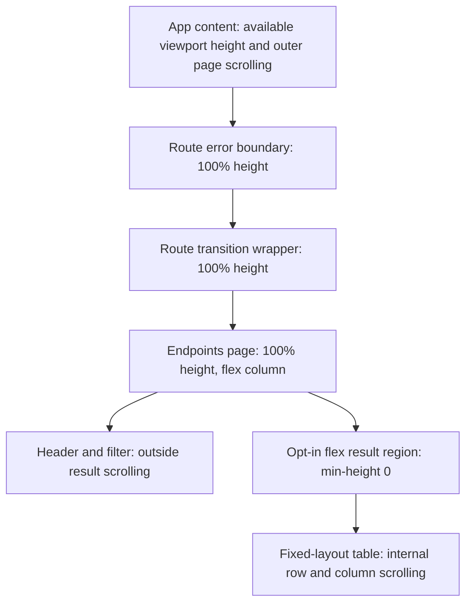

# Responsive endpoint inventory and compact dashboard

**Last verified:** 2026-10-16
**Status:** Local measured browser proof complete. Reviewed delivery, dev/canary and operator visual acceptance pending.

## Executive summary

The Endpoints inventory fills the available window height and scrolls its rows
internally while its filter remains outside the scroll owner. Names are
left-aligned within their existing column. Dashboard summaries place name,
status and user/group counts on one compact desktop row, with a two-line
fallback on narrow phones.

The Group correctness work remains separate: item A merged in PR #233 at
`47d85cdb`; reference item B merged in PR #234 at `17031d85`.
No deployment or customer-production action is part of this local proof.

## Layout contract



The diagram explains why the two route wrappers must propagate height:
a percentage-height page inside auto-height wrappers cannot establish a bounded
result region. The fix does not hardcode a toolbar/header pixel subtraction,
measure layout with JavaScript, change route remounting, or weaken error
recovery. Other long pages retain the main content area's ordinary scrolling.

`FilteredResultsPanel` has an opt-in `fillHeight` mode. Its default 420-pixel
cap remains unchanged for Operations and other consumers. The Endpoints page
opts in only for nonempty results, preserving its empty-state presentation.
The existing 40/25/20/15 percent columns, minimum table width, truncation,
copy controls, URL filters and keyboard navigation remain intact.

Dashboard cards use a two-column grid for identity/status and inline counts
above 600 pixels. Below that width, counts occupy a compact second line.
The clickable name retains its existing navigation and truncation behavior.
This is an intended visual change because the user explicitly requested
viewport-height inventory and compact horizontal endpoint summaries.

## Measured acceptance

The existing portable inventory browser fixture supplies 80 endpoints,
including a very long name, short names and an inactive endpoint.

| Viewport width | Results height at window 540 | Results height at window 1100 | Desktop/mobile summary row |
|---|---|---|---|
| 1440 | 355 px | 915 px | 48 px, counts share the name's vertical center |
| 900 | 355 px | 915 px | 48 px, counts share the name's vertical center |
| 390 | 279 px | 839 px | 72 px, deliberate compact two-line layout |

Every case gains exactly 560 pixels when the window grows by 560 pixels.
Result-region bottoms are 516/1076 pixels, exactly the available content
bottom after its existing padding. Each region has real internal overflow.
Short-name left-edge delta and desktop name/count center delta are zero.
The page itself never horizontally overflows; narrow tables scroll internally.

| Evidence | Result |
|---|---|
| RED first | Eight of nine new/strengthened desired-layout cases fail on the old UI; one compatible mobile case passes. |
| Complete adjacent browser selector | 36 PASS after fixing the complete height chain. Covers filtering/history, real row values, empty/single/80 inventories, long-name clipping, keyboard endpoint navigation, Operations scrolling and Discovery selection. |
| Adjacent DOM/error recovery | 26 PASS across EndpointsPage, DashboardPage and RouteBoundary unit suites. JSDOM is not used to claim layout correctness. |
| Full raw web type check | 66 errors, exactly the same 66 diagnostics at base 17031d85. Compiler-host comparison proves zero added diagnostic signatures without modifying the worktree. |
| Production web build | PASS. |
| Route bundle size limits | PASS. |
| Fixed-table static audit | PASS, no new offenders. |
| Visual inspection | Agent opened wide and phone inventory/dashboard scratch images and verified columns, left alignment, compact counts and internal scrolling. This is not operator acceptance. |
| Baseline visual comparisons | Four PASS with the production UI preview and registry-resolved read-only dev API data, explicitly enabling local canonical baseline checks. No diffs or baseline changes. |
| Protected consolidation | Normal tracking push at c04b06f1: 28/28 Validate gates PASS in 883.7 seconds, including 6,060 API units, 2,447 HTTP cases and 1,624 Web units. |
| CI-only release locks | Workflow 38891306560 at c04b06f1 succeeds. Imported 0.55.54 locks compare identical after normalizing only root/package version metadata; public registry and sha512 provenance PASS. |
| Dev and canary | Pending reviewed merged-source deployment. |
| Operator visual acceptance | Pending an explicit statement about the deployed surfaces. |

Commands:

```powershell
npx playwright test endpoint-inventory-selection.spec.ts --reporter=line
npm test -- src\pages\EndpointsPage.test.tsx `
  src\pages\DashboardPage.test.tsx `
  src\layout\RouteBoundary.test.tsx
npx tsc --noEmit
npm run build
npm run size
pwsh -NoProfile -File scripts\audit-table-layout.ps1
```

The browser spec uses the configured base URL and token, so it is runnable
against local, Docker and registry-resolved Azure dev. Its fixture routes
do not create or delete live resources. Actual live authentication is checked
by the existing global preflight. Logs, exact bound receipts and scratch
screenshots remain under ignored `test-results/`, never the curated doc image
directory. No screenshot baseline has been regenerated at this checkpoint.

## Execution issues and prevention

| ID | Type / severity | Symptom and root cause | Fix and why it works | Detection / earliest |
|---|---|---|---|---|
| UI-H01 | Layout / Medium | First CSS attempt removed the result cap but assumed the page's percentage height reached the main container. Two existing route wrappers had auto height, so the table expanded to 6,202 px and could not scroll internally. Six adjacent browser cases failed. | Measure the complete ancestor chain, then propagate 100% height through both wrappers. All 36 cases pass and viewport deltas match exactly. No viewport-offset shortcut. | First measured GREEN attempt / complete ancestor measurement before CSS choice |
| UI-H02 | Type baseline / Low | Raw tsc exits 2 with 66 unrelated existing errors, which stopped the chained build/size command. | Compare exact diagnostic signatures with the base through an in-memory compiler host: 66/66, zero regressions. Then run build and size independently, both PASS. Do not change unrelated tests or lower a gate. | Local static validation / explicit baseline comparison |
| UI-H03 | Startup timing / Low | An immediate health request raced the new local node's startup and got connection refused. | Confirm actual startup output and the canonical health/authenticated proxy response before testing. Both processes were responsive; no dependency reinstall or shared-node substitution. | Immediate startup check / readiness check |
| UI-H04 | Test admission / Low | The first local visual command selected four cases but the established canonical-dev admission skipped them. | Explicitly enable E2E_VISUAL_BASELINES for the production preview against dev read-only data. The real four comparisons pass. The skipped receipt is not counted as evidence. | Local browser admission / same skip report |

Self-improvement disposition: **applied**. Permanent browser checks exercise
both short and tall windows, measure the entire height chain and assert exact
left edges, desktop row centers, bounded results and real scroll overflow.
Existing unrelated scroll-owner journeys run alongside the change.
Dynamic-content visual masks intentionally hide endpoint rows, so their green
snapshot results are not evidence of row geometry. The unmasked value/bounds
assertions above provide that independent evidence.

Design/architecture disposition: **accepted**. Shared route wrappers expose the
same available-height contract already owned by the shell; the existing panel
has two finite layout modes. No measurement hook, observer, framework or
speculative abstraction is needed. The shared wrapper change requires adjacent
navigation/error-boundary and complete browser validation, not only page tests.

### Provenance and completeness

The full available reconstructed continuation was scanned through event 13,460,
from execution start event 11,599, using error/signal and causal narration
passes. The 43 candidates were reconciled to the Group and UI issue tables.
Expected RED assertions, intentionally rejected requests, patches/searches
quoting earlier failures and existing type diagnostics are not new incidents.
The skipped visual admission and successful explicit retry remain distinct
receipts. The deleted original session is not available or claimed as restored.
