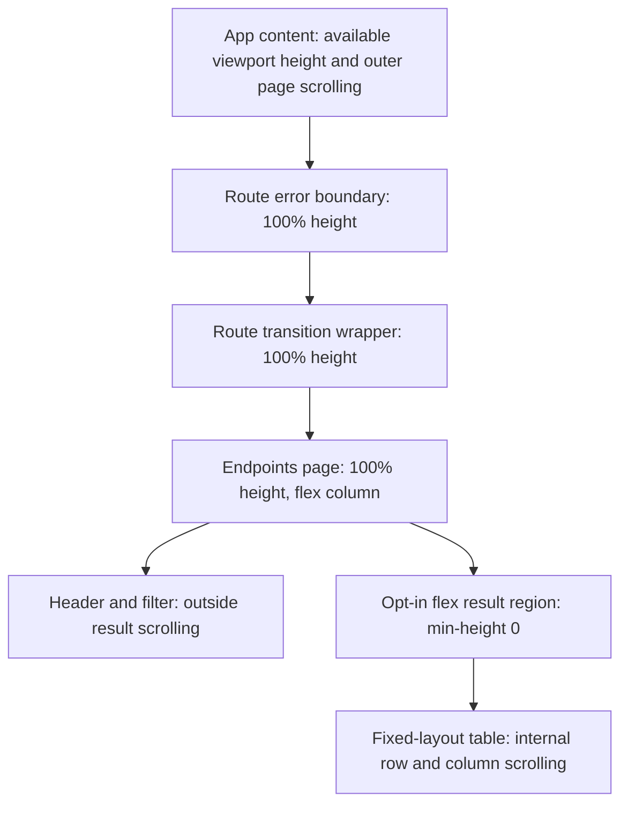

# Responsive endpoint inventory and compact dashboard

**Last verified:** 2026-10-16
**Status:** Delivered in 0.55.54 to dev and the same-tenant canary from merged `db10b13e`. All 324 authoritative dev browser cases pass with zero skips. Operator visual acceptance remains unavailable; performance observations need follow-up. Customer production is not promoted.

## Executive summary

The Endpoints inventory fills the available window height and scrolls its rows
internally while its filter remains outside the scroll owner. Names are
left-aligned within their existing column. Dashboard summaries place name,
status and user/group counts on one compact desktop row, with a two-line
fallback on narrow phones.

The Group correctness work remains separate: item A merged in PR #233 at
`47d85cdb`; reference item B merged in PR #234 at `17031d85`.
The original local proof below is distinct from the deployed evidence that follows.

## Deployed release closeout

The full no-skip `scripts/dev-deployment-pipeline.ps1 -AutoCanary` run
completed exit 0 in 6,349 seconds from merged master `db10b13e`.
The original `test-results/dev-deploy-2026-10-16-081024.md` matrix records
**40 PASS / 0 FAIL / 0 SKIPPED / 9 reviewer PENDING**. Neither this document
nor the process exit relabels those nine judgment rows as PASS.
PR #238's test-only closeout merged after 25 protected gates and seven
exact-tip checks; no new version, lockfile or shipping image was needed.

Dev serves `scimserver-dev--vdb10b13e`; canary serves
`scimserver--green-1016-0927` at 100% after green soak and public verification.
Both use the same immutable digest `42613fe0` documented in
[the Group release evidence](GOOGLE_MINIMAL_GROUP_MEMBERSHIP.md#deployed-05554-evidence).
Each retains two active revisions. Dev preserves all 74 endpoint IDs;
canary preserves its 64 endpoints and the verified per-endpoint inventory.
No customer-production operation occurred.

The authoritative dev JSON receipt
`test-results/playwright-dev-2026-10-16-081024.json` records 324 expected,
zero unexpected, zero skipped and zero flaky cases, including the measured
layout regressions and mutation-enabled seeded-shape journeys.
The separate canary green and public checks each pass 1,795 live assertions
and 289 browser cases; their 11 mutation-opt-in browser exclusions are not
the authoritative zero-skip dev receipt. Do not combine those scopes or
describe the canary subset as the complete dev browser suite.
Native Entra passes 50 checks in all three authentication modes with actual
member add/remove readback; all 15 exact-ID cleanup entries succeed.

Operator acceptance was requested again against the actually deployed
0.55.54 surfaces. The question tool returned user unavailable.
Automated layout measurements are not a substitute for that confirmation.
The release is deployed and automatically verified, not operator-accepted
or approved for customer production.

### Open performance observation

The same version-admitted membership harness compared the retained 0.55.51
baseline with two serial 0.55.54 batches, each containing 18 post-warmup
samples per operation. Every batch independently read actual added/removed
members and verified exact owned-endpoint cleanup.

| Operation | First candidate p50 / p95 change | Repeat candidate p50 / p95 change |
|---|---|---|
| Add | +24.23% / +28.42% | +5.53% / -26.26% |
| Populated read | +7.39% / +0.27% | +11.05% / +9.18% |
| Remove | +22.83% / +56.53% | +8.05% / -1.43% |
| Empty read | +3.47% / -60.06% | +3.20% / +32.37% |

Retain both observations, not only the better repeat. The initial mutation
slowdown did not reproduce at the same magnitude, but other repeat metrics
still exceed the 10% threshold. With 18 samples, both p95 and p99 select the
batch maximum; network-inclusive timings cannot establish the server cause.
No performance PASS, approved regression waiver, query-count bound or
memory-headroom claim is inferred.

Follow-up owner: SCIMServer maintainer. Target: 2026-10-19. Obtain a larger
matched-environment comparison with request/query and memory evidence before
closing performance acceptance or claiming customer-production readiness.
Receipts remain local: `group-membership-perf-baseline.json`,
`group-membership-perf-candidate.json`,
`group-membership-perf-candidate-repeat.json` and their comparison under
`test-results/`. This observation is not a reason to alter schema strictness,
fabricate a green gate or mutate existing provisioning mappings.

## Layout contract



The diagram explains why the two route wrappers must propagate height:
a percentage-height page inside auto-height wrappers cannot establish a bounded
result region. The fix does not hardcode a toolbar/header pixel subtraction,
measure layout with JavaScript, change route remounting, or weaken error
recovery. Other long pages retain the main content area's ordinary scrolling.

`FilteredResultsPanel` has an opt-in `fillHeight` mode. Its default 420-pixel
cap remains unchanged for Operations and other consumers. The Endpoints page
opts in only for nonempty results, preserving its empty-state presentation.
The existing 40/25/20/15 percent columns, minimum table width, truncation,
copy controls, URL filters and keyboard navigation remain intact.

Dashboard cards use a two-column grid for identity/status and inline counts
above 600 pixels. Below that width, counts occupy a compact second line.
The clickable name retains its existing navigation and truncation behavior.
This is an intended visual change because the user explicitly requested
viewport-height inventory and compact horizontal endpoint summaries.

## Measured acceptance

The existing portable inventory browser fixture supplies 80 endpoints,
including a very long name, short names and an inactive endpoint.

| Viewport width | Results height at window 540 | Results height at window 1100 | Desktop/mobile summary row |
|---|---|---|---|
| 1440 | 355 px | 915 px | 48 px, counts share the name's vertical center |
| 900 | 355 px | 915 px | 48 px, counts share the name's vertical center |
| 390 | 279 px | 839 px | 72 px, deliberate compact two-line layout |

Every case gains exactly 560 pixels when the window grows by 560 pixels.
Result-region bottoms are 516/1076 pixels, exactly the available content
bottom after its existing padding. Each region has real internal overflow.
Short-name left-edge delta and desktop name/count center delta are zero.
The page itself never horizontally overflows; narrow tables scroll internally.

| Evidence | Result |
|---|---|
| RED first | Eight of nine new/strengthened desired-layout cases fail on the old UI; one compatible mobile case passes. |
| Complete adjacent browser selector | 36 PASS after fixing the complete height chain. Covers filtering/history, real row values, empty/single/80 inventories, long-name clipping, keyboard endpoint navigation, Operations scrolling and Discovery selection. |
| Adjacent DOM/error recovery | 26 PASS across EndpointsPage, DashboardPage and RouteBoundary unit suites. JSDOM is not used to claim layout correctness. |
| Full raw web type check | 66 errors, exactly the same 66 diagnostics at base 17031d85. Compiler-host comparison proves zero added diagnostic signatures without modifying the worktree. |
| Production web build | PASS. |
| Route bundle size limits | PASS. |
| Fixed-table static audit | PASS, no new offenders. |
| Visual inspection | Agent opened wide and phone inventory/dashboard scratch images and verified columns, left alignment, compact counts and internal scrolling. This is not operator acceptance. |
| Baseline visual comparisons | Four PASS with the production UI preview and registry-resolved read-only dev API data, explicitly enabling local canonical baseline checks. No diffs or baseline changes. |
| Protected consolidation | Normal tracking push at c04b06f1: 28/28 Validate gates PASS in 883.7 seconds, including 6,060 API units, 2,447 HTTP cases and 1,624 Web units. |
| CI-only release locks | Workflow 38891306560 at c04b06f1 succeeds. Imported 0.55.54 locks compare identical after normalizing only root/package version metadata; public registry and sha512 provenance PASS. |
| Dev and canary | Full run from c3ef1f0d: 27 PASS, 2 FAIL, 10 SKIPPED, 9 reviewer PENDING in 3,531 seconds. No deployment. Provenance failure and downstream ACR cascade are retained, not relabeled. |
| Operator visual acceptance | Pending an explicit statement about the deployed surfaces. |

Commands:

```powershell
npx playwright test endpoint-inventory-selection.spec.ts --reporter=line
npm test -- src\pages\EndpointsPage.test.tsx `
  src\pages\DashboardPage.test.tsx `
  src\layout\RouteBoundary.test.tsx
npx tsc --noEmit
npm run build
npm run size
pwsh -NoProfile -File scripts\audit-table-layout.ps1
```

The browser spec uses the configured base URL and token, so it is runnable
against local, Docker and registry-resolved Azure dev. Its fixture routes
do not create or delete live resources. Actual live authentication is checked
by the existing global preflight. Logs, exact bound receipts and scratch
screenshots remain under ignored `test-results/`, never the curated doc image
directory. No screenshot baseline has been regenerated at this checkpoint.

## Execution issues and prevention

| ID | Type / severity | Symptom and root cause | Fix and why it works | Detection / earliest |
|---|---|---|---|---|
| UI-H01 | Layout / Medium | First CSS attempt removed the result cap but assumed the page's percentage height reached the main container. Two existing route wrappers had auto height, so the table expanded to 6,202 px and could not scroll internally. Six adjacent browser cases failed. | Measure the complete ancestor chain, then propagate 100% height through both wrappers. All 36 cases pass and viewport deltas match exactly. No viewport-offset shortcut. | First measured GREEN attempt / complete ancestor measurement before CSS choice |
| UI-H02 | Type baseline / Low | Raw tsc exits 2 with 66 unrelated existing errors, which stopped the chained build/size command. | Compare exact diagnostic signatures with the base through an in-memory compiler host: 66/66, zero regressions. Then run build and size independently, both PASS. Do not change unrelated tests or lower a gate. | Local static validation / explicit baseline comparison |
| UI-H03 | Startup timing / Low | An immediate health request raced the new local node's startup and got connection refused. | Confirm actual startup output and the canonical health/authenticated proxy response before testing. Both processes were responsive; no dependency reinstall or shared-node substitution. | Immediate startup check / readiness check |
| UI-H04 | Test admission / Low | The first local visual command selected four cases but the established canonical-dev admission skipped them. | Explicitly enable E2E_VISUAL_BASELINES for the production preview against dev read-only data. The real four comparisons pass. The skipped receipt is not counted as evidence. | Local browser admission / same skip report |
| UI-H05 | PowerShell tooling / Low | A review command interpolated a variable immediately followed by a colon, so the shell rejected scope-like syntax before any GitHub action. | Delimit the variable as `${head}` before punctuation. Retried review and all seven exact-tip CI checks succeeded; no failed command is counted as an executed review. | Shell parser / shell parser |
| UI-H06 | Delivery integration / Medium | Preflight found the isolated validation child cleans up its containers and has a private project environment, while the parent queried containers in the default project. Two behavioral controls reproduced the missing project/image handoff. | Parent assigns and passes a unique project, then mirrors its surviving image by validated immutable ID. All 58 contract checks PASS, including missing/malformed identity rejection. Cleanup/isolation and canary policy remain unchanged. | Pre-deployment inspection plus behavioral RED / parent-child integration contract |
| UI-H07 | Coupled gate expectation / Low | The first protected tooling push at 9c5317da stopped because the workflow-selector contract still required the removed default-project lookup string. | Replace that stale requirement with explicit project handoff, forbid the old lookup and execute the existing 58 behavioral controls from the registered selector gate. All 22 selector checks plus 58 pipeline checks PASS; no hook bypass. | Protected push / selector contract |
| UI-H08 | Performance harness contract / Low | Benchmark admission expected a version in health, which publishes status/uptime/timestamp instead. It stopped before fixture creation. | Use the version-bearing administrative endpoint. The version-pinned 0.55.51 baseline completes with 18 post-warmup samples per operation. Keep deployment identity separate from health. | Benchmark admission / prior API-contract inspection |
| UI-H09 | Cleanup assertion contract / Low | After owned endpoint DELETE, the benchmark expected a raw inventory array, not the actual endpoints envelope. It correctly withheld a success receipt. | Assert the documented envelope and absence of the exact owned ID before writing results. Final baseline cleanup readback passes; no permissive fallback. | Post-DELETE readback / prior API-contract inspection |
| UI-H10 | Artifact provenance / Medium | CI published from tooling merge c3ef1f0d, but the gate required the nonexistent source tag for the last runtime merge 0fd0a87a. Shipping ACR failure was its cascade. | Resolve a matching source SHA on reviewed first-parent history, then require ancestry and identical declared runtime inputs. Four expected RED assertions become GREEN; all 68 pipeline and 22 selector checks pass. Actual public OCI proof resolves the existing immutable digest without rebuilding or retagging. Permanent controls reject missing source, unmerged history, runtime drift, Git failure and digest drift. | Full delivery source gate / behavioral fresh-publication and reuse contract |
| UI-H11 | Registry metadata permissions / Low | GitHub package-version metadata returned HTTP 403 because read:packages is unavailable; the image has no revision label. | Use existing public OCI source-tag digests and reviewed Git equivalence instead. Real read-only proof succeeds. No privilege elevation, account switch or fabricated label/tag. | Read-only provenance investigation / registry contract and permission inspection |
| UI-H12 | Test authoring / Low | An ambiguous patch anchor placed the new Docker mock inside a Git switch clause, producing a parser error before tests ran. | Move the mock to its own function boundary using complete surrounding context. The actual selector and all 68 behavioral cases pass. Anchor edits on complete unique boundaries; parser rejection remains a failed admission, never test evidence. | Focused contract parser / focused contract parser |
| UI-H13 | Diagnostic AST extraction / Low | SafeGetValue rejected an array-expression wrapper when extracting declared runtime paths for the read-only proof. | Extract its 12 literal string nodes without executing dynamic expressions. Real source/digest proof passes; no production-code workaround. | Read-only proof admission / AST shape inspection |
| UI-H14 | Evidence lookup / Low | A bounded review lookup assumed a helper path that did not exist. | Locate the existing HTTP contract helpers before constructing the follow-up assertion plan. The retained review identifies actual exported shape/key helpers and exact diagnostic expectations; no duplicate helper or production change. | Review source lookup / file discovery |
| UI-H15 | GitHub CLI admission / Low | PR creation succeeded, but the following read-only gh pr view omitted the target required with --repo. Its usage failure is not inspection evidence. | Supply PR 237 explicitly and check native exit codes. The actual head and all seven completed checks were verified before ordinary merge at 72eb4fd0. No source or permission workaround. | Read-only CLI admission / explicit target validation |
| UI-H16 | Tool output formatting / Low | A wide absolute-path column combined with Format-Table -Wrap expanded a bounded lookup into 52 KB of one-character wrapping. | Extract only relevant paths from the offloaded artifact, then emit shortened filename/line strings. Bounded output exposes the real helper and diagnostic contracts without another transcript dump. | Tool output budget / output-column design |

UI PR #235 merged normally at `0fd0a87a`, preserving reviewed `8827402b`
after seven exact-tip checks. The delivery handoff correction is a separate
tooling rollback unit; it does not change runtime inputs or require another
product-version bump. Handoff PR #236 merged at `c3ef1f0d` after 25 protected
push gates and seven exact-tip checks. Full local/backend/Docker and local ACR
mirror gates passed, but the failed shipping source proof prevented dev/Entra
and canary execution. UI-H05 was captured immediately in the persistent continuation issue
receipt and is consolidated here; UI-H06 is recorded at its confirmed GREEN.
Delivery design disposition: **accepted**. One small Docker identity-boundary
helper and the existing child/mirror blocks keep their cohesive roles; no
artifact framework, cleanup retention, new deployment policy or speculative
strategy is introduced. Test/gate self-improvement: **applied** through the
behavioral handoff and missing/malformed identity controls.

Provenance correction disposition: **applied** for permanent test/gate
coverage and **accepted** for design/architecture. A small pipeline-local
resolver reuses the digest reader and Git's ancestry/tree contracts. It does
not add a publication framework, permission dependency, mutable source alias
or new runtime responsibility. The anonymous pull consumes the resolved
identity instead of reintroducing the incorrect anchor assumption.

Provenance PR #237 merged normally at `72eb4fd0`, preserving reviewed
`6e0496ca`, after all 25 protected Fast gates and seven exact-tip CI checks.
The original failed full matrix remains unchanged. The separate membership
assertion closeout now passes 28 cases on each backend and 66 local live
assertions; its [transport/oracle RCA](GOOGLE_MINIMAL_GROUP_MEMBERSHIP.md#rejection-contract-evidence-closeout)
records the byte-response defect caught immediately before batching.

The retained old-runtime benchmark is not candidate membership proof.
Candidate performance comparison, complete negative-response contracts,
deployed privacy observations and actual Entra add/remove remain explicit
follow-up evidence. Nine manual audit rows cannot be marked PASS merely
because local suites passed. No customer-production promotion is authorized.

Self-improvement disposition: **applied**. Permanent browser checks exercise
both short and tall windows, measure the entire height chain and assert exact
left edges, desktop row centers, bounded results and real scroll overflow.
Existing unrelated scroll-owner journeys run alongside the change.
Dynamic-content visual masks intentionally hide endpoint rows, so their green
snapshot results are not evidence of row geometry. The unmasked value/bounds
assertions above provide that independent evidence.

Design/architecture disposition: **accepted**. Shared route wrappers expose the
same available-height contract already owned by the shell; the existing panel
has two finite layout modes. No measurement hook, observer, framework or
speculative abstraction is needed. The shared wrapper change requires adjacent
navigation/error-boundary and complete browser validation, not only page tests.

### Provenance and completeness

Post-delivery reconciliation scanned all available continuation events through
16,381 with 135 candidate signals, followed by the corrected read-only
verification. New observations and diagnostic friction are recorded below;
quoted failures, intentional rejections, expected REDs and old-receipt echoes
were dismissed, not counted as fresh deployment defects.

| ID | Type / severity | Symptom and cause | Resolution and why it works | Detection / prevention |
|---|---|---|---|---|
| UI-H17 | Performance evidence / Medium, open | First candidate add/remove latency exceeded the 10% threshold; a serial repeat changed the outliers and still crossed other thresholds. Network-inclusive 18-sample tails cannot identify the server cause. | Not resolved or waived. Both receipts retained; maintainer owns larger matched comparison plus query/memory evidence by 2026-10-19. | Detected post-canary; earliest candidate-runtime measurement was after dev admission and before canary. Stage 3b.6 remained PENDING, not PASS. Do not convert automated deployment success into performance acceptance. |
| UI-H18 | PowerShell tooling / Low | A read-only verification command piped directly from a foreach statement and failed parsing before any Azure read ran. | Collect loop results in an array, then pipe the array; corrected command verifies actual same-digest traffic and revision counts. | Shell parser caught it before execution; use explicit result collection rather than dense chained statements. |
| UI-H19 | Receipt interpretation / Low | A diagnostic queried cleanup.status, but this structured receipt exposes cleanup.removed; missing values looked like 15 failures. | Inspect the receipt schema and count explicit removed=true: 15/15. No cleanup rerun or live mutation was needed. | Caught by the conflicting successful journey and schema read; assert the published field and its value, not an invented key. |
| UI-H20 | Diagnostic output / Low | Combined documentation reads exceeded the output limit; long existing change-log rows amplified the output. | Used the saved output artifact and bounded line/pattern reads without dumping it. | Output offload caught it; batch independent small ranges, not whole combined sections. Related to existing UI-H16, not another product defect. |

Self-improvement disposition: **applied** for receipt scope and explicit pending
acceptance; performance investigation **scheduled** as UI-H17 with owner/date.
Design/architecture disposition: **accepted** for this documentation-only
closeout; no runtime responsibility, dependency or abstraction is added.

The full available reconstructed continuation was scanned through event 15,306,
from execution start event 11,599, using expanded error/signal and causal
narration passes. The 95 candidates were reconciled to the Group and UI issue
tables, including publication failure, registry permission, benchmark and
local diagnostic/parser failures. The scan artifact remains session-local.
Expected RED assertions, intentionally rejected requests, patches/searches
quoting earlier failures, scanner echoes, repeated missing-search-tool output,
historical browser-host admission errors and existing type diagnostics are
not new incidents.
The skipped visual admission and successful explicit retry remain distinct
receipts. The deleted original session is not available or claimed as restored.
