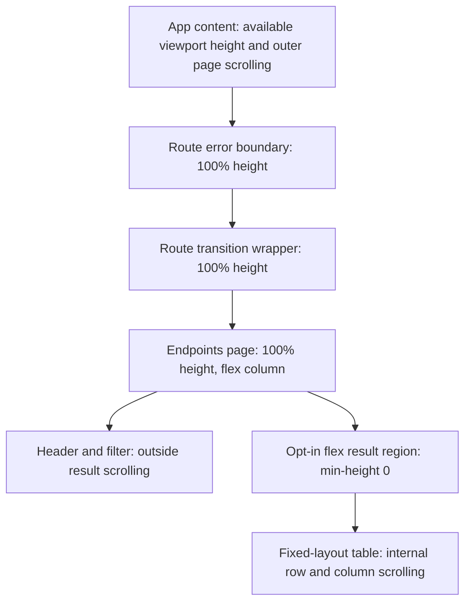

# Responsive endpoint inventory and compact dashboard

**Last verified:** 2026-10-16
**Status:** Delivered in 0.55.54 to dev and the same-tenant canary using the image published from merged `c3ef1f0d`, replayed at runtime-input-equivalent `db10b13e`. All 324 authoritative dev browser cases pass with zero skips. Matched assurance is complete with explicit CPU-quota tail limits; operator visual acceptance remains unavailable. Customer production is not promoted.

## Executive summary

The Endpoints inventory fills the available window height and scrolls its rows
internally while its filter remains outside the scroll owner. Names are
left-aligned within their existing column. Dashboard summaries place name,
status and user/group counts on one compact desktop row, with a two-line
fallback on narrow phones.

The Group correctness work remains separate: item A merged in PR #233 at
`47d85cdb`; reference item B merged in PR #234 at `17031d85`.
The original local proof below is distinct from the deployed evidence that follows.

## Deployed release closeout

The full no-skip `scripts/dev-deployment-pipeline.ps1 -AutoCanary` run
completed exit 0 in 6,349 seconds from merged master `db10b13e`.
The original `test-results/dev-deploy-2026-10-16-081024.md` matrix records
**40 PASS / 0 FAIL / 0 SKIPPED / 9 reviewer PENDING**. Neither this document
nor the process exit relabels those nine judgment rows as PASS.
PR #238's test-only closeout merged after 25 protected gates and seven
exact-tip checks; no new version, lockfile or shipping image was needed.

Dev serves `scimserver-dev--vdb10b13e`; canary serves
`scimserver--green-1016-0927` at 100% after green soak and public verification.
Both use the same immutable digest `42613fe0` documented in
[the Group release evidence](GOOGLE_MINIMAL_GROUP_MEMBERSHIP.md#deployed-05554-evidence).
Each retains two active revisions. Dev preserves all 74 endpoint IDs;
canary preserves its 64 endpoints and the verified per-endpoint inventory.
No customer-production operation occurred.

The authoritative dev JSON receipt
`test-results/playwright-dev-2026-10-16-081024.json` records 324 expected,
zero unexpected, zero skipped and zero flaky cases, including the measured
layout regressions and mutation-enabled seeded-shape journeys.
The separate canary green and public checks each pass 1,795 live assertions
and 289 browser cases; their 11 mutation-opt-in browser exclusions are not
the authoritative zero-skip dev receipt. Do not combine those scopes or
describe the canary subset as the complete dev browser suite.
Native Entra passes 50 checks in all three authentication modes with actual
member add/remove readback; all 15 exact-ID cleanup entries succeed.

Operator acceptance was requested again against the actually deployed
0.55.54 surfaces. The question tool returned user unavailable.
Automated layout measurements are not a substitute for that confirmation.
The release is deployed and automatically verified, not operator-accepted
or approved for customer production.

### Supplemental exact-artifact and headed-browser verification

The [portable follow-up receipt](evidence/RELEASE_05554_ASSURANCE_20261016.json)
closes two independent evidence questions without another deployment or full
suite replay:

- Native Trivy 0.76.0 scanned the actual public release digest above, for
  `linux/amd64`, using the existing HIGH/CRITICAL, ignore-unfixed and
  `.trivyignore` policy: exit 0, zero blocking OS and Node findings. The
  checksum-verified official scanner and database timestamps are recorded.
  PR test-image scanning is not used as a substitute for this digest scan.
- Fresh headed Chromium 149 measured actual dev and canary responses, without
  response fixtures. Each estate passes six measurement sets at 1440/900-pixel
  widths and 540/1100-pixel window heights. Inventory height grows from 355 to
  915 pixels, with zero available-bottom gap. All four columns remain inside
  the table; the name column occupies 38.3-39.0%. Dashboard summary rows are
  48 pixels high, with left-aligned names and counts on the same row.
  Mutating requests were blocked and none were attempted. Exact endpoint IDs
  remain unchanged: dev 74 -> 74, canary 64 -> 64.
- The earlier complete dev Chromium run already passed all 324 configured
  cases after deployment, including measured layout, timestamp and Operations
  link regressions. It combines live journeys and controlled response fixtures;
  the new headed measurements specifically verify actual estate content.
- A later independent compiled-node run passes all 1,795 live assertions with
  an empty private InMemory instance, zero endpoints before/after and the
  helper stopped. This closes the separate local-runtime evidence claim;
  the older nested `-SkipLocal` receipt remains unchanged.

Publication source is merged master `c3ef1f0d`, not the replay checkout
`db10b13e` or later documentation master `68aa5a1c`. The existing semantic image
was reused after declared runtime-input equality checks, not rebuilt at each
checkout. Fresh read-only Azure inspection confirms both estates still use the
same release digest. No GitHub Release object or `v0.55.54` Git tag was created:
pushing that tag triggers the existing
[build-and-push workflow](../.github/workflows/build-and-push.yml), which can
rebuild and overwrite the immutable version tag. Do not trigger it merely to
add release metadata, bypass workflows or change the harness implicitly.

| Historical reviewer gate | Supplemental disposition and limit |
|---|---|
| Test completeness | Scoped PASS: both backend matrices, membership negative/state controls, native Entra and measured browser cases |
| API response contract | Scoped PASS: permanent allowlists and exact value-level reference/readback oracles |
| Error handling | Scoped PASS: strict negative controls and rejected-operation unchanged-state proof |
| Logging | Scoped PASS: two private runs inspect 200 stored rows/seven errors each, actual credential redaction and correlation |
| RFC compliance | Scoped PASS: official reference, unassigned-value, immutable-member and atomic ordered PATCH text verified |
| Security | Scoped self-review plus separate exact-release-digest Trivy PASS; not independent approval or whole-product certification |
| Performance | Bounded dev/canary disposition only; 0.5-CPU tail thresholds did not pass |
| Code hygiene | Scoped self-review; cohesive changes and existing seams, no speculative abstraction |
| Narrative documentation | Current guides and release notes reconciled; original pending matrix and provisional operator status preserved |

These dispositions do not retroactively make the original nine rows PASS or
prove review-before-promotion ordering. Canary's 11 opt-in browser exclusions
also remain explicit: exclusive mutation ownership was requested but could not
be confirmed, so no fixtures or server settings were changed in this follow-up.
Some old live-runner sections report retired Admin API checks as PASS-shaped
skip messages; the registered assertion count is not proof those retired
journeys executed. Neither that reporting debt nor the canary opt-in policy
was silently changed.

Self-improvement disposition: **applied** through independently identified
artifact scanning, actual-data geometry and explicit evidence limits.
Design/architecture disposition: **accepted** because this is bounded evidence
and documentation, not a pipeline/harness redesign. Historical ordering cannot
be repaired by rerunning unchanged suites.

### Initial performance observation

The same version-admitted membership harness compared the retained 0.55.51
baseline with two serial 0.55.54 batches, each containing 18 post-warmup
samples per operation. Every batch independently read actual added/removed
members and verified exact owned-endpoint cleanup.

| Operation | First candidate p50 / p95 change | Repeat candidate p50 / p95 change |
|---|---|---|
| Add | +24.23% / +28.42% | +5.53% / -26.26% |
| Populated read | +7.39% / +0.27% | +11.05% / +9.18% |
| Remove | +22.83% / +56.53% | +8.05% / -1.43% |
| Empty read | +3.47% / -60.06% | +3.20% / +32.37% |

Retain both observations, not only the better repeat. The initial mutation
slowdown did not reproduce at the same magnitude, but other repeat metrics
still exceed the 10% threshold. With 18 samples, both p95 and p99 select the
batch maximum; network-inclusive timings cannot establish the server cause.
At this initial checkpoint, no performance PASS, approved regression waiver,
query-count bound or memory-headroom claim was established.

The follow-up was assigned to the SCIMServer maintainer by 2026-10-19.
The larger matched comparison and resource evidence are now recorded below.
Receipts remain local: `group-membership-perf-baseline.json`,
`group-membership-perf-candidate.json`,
`group-membership-perf-candidate-repeat.json` and their comparison under
`test-results/`. This observation is not a reason to alter schema strictness,
fabricate a green gate or mutate existing provisioning mappings.

### Matched measurement and quota sensitivity

The follow-up used the actual cached 0.55.51 and 0.55.54 immutable images,
not rebuilt approximations. Their digests start `4edcaa07` and `42613fe0`.
Private PostgreSQL 17 databases, loopback-only application ports, generated
process-local credentials and an exact owner/run cleanup boundary isolate
these measurements from dev, canary and customer provisioning.
Each comparison runs baseline, candidate, candidate, baseline, with 100
discarded warmup cycles per batch. Every measured cycle verifies actual
add, populated read, remove and empty read values. Raw distributions are
pooled by version before percentile calculation; batch percentiles are
not averaged.

The larger 0.5-CPU/1-GiB comparison retains 2,000 samples per version per
operation. Median changes are between -0.91% and -0.03%.

| Operation | p95 baseline / candidate milliseconds (change) | p99 baseline / candidate milliseconds (change) |
|---|---|---|
| Add | 69.91 / 76.62 (+9.59%) | 171.59 / 169.50 (-1.21%) |
| Populated read | 38.73 / 41.41 (+6.91%) | 80.26 / 74.73 (-6.89%) |
| Remove | 67.29 / 76.87 (+14.23%) | 115.67 / 157.67 (+36.30%) |
| Empty read | 42.55 / 41.88 (-1.57%) | 69.14 / 84.48 (+22.19%) |

All four measurement batches and exact cleanup succeeded, but a subsequent
private logging probe failed parsing native multiline SQL JSON. That entire
attempt remains a failed orchestration receipt. Its timing arrays survive;
resource totals not saved before that failure cannot be reconstructed.

After fixing the oracle and checkpointing counters after every round, the
successful 0.5-CPU run has 400 samples/version/operation and 1,207 lifecycle
HTTP requests per batch. Its complete changes are retained:

| Operation | p50 change | p95 change | p99 change |
|---|---|---|---|
| Add | +1.94% | -1.12% | +18.08% |
| Populated read | +0.44% | -1.62% | -15.28% |
| Remove | -0.24% | +12.73% | +10.87% |
| Empty read | +2.78% | -11.14% | -29.68% |

Both versions make 30,221 pooled SQL calls. Candidate/baseline CPU use is
28,928.44 / 29,065.45 milliseconds, and SQL execution is 2,828.66 /
2,852.84 milliseconds. Peak cgroup memory is 160.71 / 160.66 MiB, leaving
84.31% candidate headroom under 1 GiB. Both applications are substantially
CPU-throttled: 37.18 / 37.15 seconds of accumulated throttled time.

One separate diagnostic changes only the matched application CPU limit to
2 CPU, retaining 1 GiB and 100 warmups. Actual container quotas are checked,
not inferred from arguments. With 1,000 samples per batch, there are 2,000
samples/version/operation and 4,407 lifecycle requests per batch.

| Operation | p95 baseline / candidate milliseconds (change) | p99 baseline / candidate milliseconds (change) |
|---|---|---|
| Add | 28.67 / 27.76 (-3.18%) | 38.74 / 35.83 (-7.53%) |
| Populated read | 11.13 / 10.38 (-6.76%) | 13.49 / 13.47 (-0.16%) |
| Remove | 27.31 / 25.36 (-7.15%) | 37.79 / 34.82 (-7.85%) |
| Empty read | 11.34 / 10.60 (-6.49%) | 14.49 / 13.74 (-5.17%) |

All median changes also decrease, by 2.33% to 2.47%. Both versions make
110,608 pooled SQL calls. Candidate/baseline CPU use is 91,047.48 /
95,106.69 milliseconds (-4.27%); SQL execution is 10,397.89 /
10,552.60 milliseconds (-1.47%). Accumulated throttled time falls to
13.22 / 40.90 milliseconds. Peak memory is 285.99 / 264.37 MiB (+8.18%),
with 72.07% candidate headroom. All measured states and guarded cleanup pass.

**Performance disposition:** accepted for this bounded dev/canary assurance,
with the over-10% small-quota tails explicitly retained and justified by
the quota-sensitivity result, stable query totals and comparable resource
cost. This is evidence of scheduling-sensitive tails, not proof of a
specific production-code cause. It does not relabel the 0.5-CPU thresholds
as passed, guarantee a production latency objective, alter deployed quotas,
or authorize customer promotion. SQL counts include authentication, logging
and fixture lifecycle work; they do not certify every multi-member workload.
Cgroup peaks include startup/migrations, not only steady application heap.
No speculative performance refactor or schema relaxation was introduced.

Local receipts use these run IDs under `test-results/`:

- `0d10963c956847219c402bcb3532581a`: initial 200-sample batches,
  two warmups; retained separately, not pooled with the warmed comparisons.
- `e4abded34cf84ce9a1b816acebc412dc`: larger 0.5-CPU timing distributions;
  later logging-oracle failure and unavailable resource counters retained.
- `f3238f2fd8aa4b83b79972374a2ce476`: successful instrumented 0.5-CPU run.
- `448c0923258b45ba99465d1ccd9f830a`: successful 2-CPU sensitivity diagnostic.

### Supplemental changed-path assurance

Each successful instrumented run additionally executes the 66 actual
minimal-schema membership outcomes on its private candidate. Each checks
200 persisted Group request-log rows, including seven errors, for UUID
request/endpoint correlation, nonnegative duration, expected 200/201/400
statuses and actual Authorization header value `[REDACTED]`. Generated
credentials are absent from the inspected stored payloads and last 300
console lines. A persisted error UUID prefix and the `scim.group` category
are observed in console output. Raw logs are not exported. This is sampled
changed-path evidence, not an exhaustive personal-data or startup-log audit.
Unchanged shared logger/slow-threshold behavior retains its existing unit
coverage; no new logging path was added.

Direct official text, rather than a search summary, verifies:

- [RFC 7643 sections 2.3.7, 2.5 and 4.2](https://www.rfc-editor.org/rfc/rfc7643.txt):
  references may be relative or absolute and are case-exact; defined
  unassigned values may be omitted; Group member subattributes are immutable
  by default. Unassigned-value handling is not permission to accept genuinely
  supplied undeclared fields.
- [RFC 7644 section 3.5.2](https://www.rfc-editor.org/rfc/rfc7644.txt):
  PATCH operations are ordered and atomic. Existing exact-value and rejected
  state/readback controls exercise these changed paths on both backends.

The scoped security review retains strict negative controls and response
allowlists, additive migration/legacy-record evidence, unchanged authorization
and parameterized repository paths. Accepted references are stored/projected,
not fetched; no new outbound, authentication or dependency surface is added.
Existing protected CodeQL, supply-chain and full-pipeline checks remain
separate evidence. This is direct changed-scope self-review, not independent
GitHub approval or whole-product security/interoperability certification.
The original matrix's nine reviewer-PENDING rows remain immutable; this
supplement records later evidence and its limits rather than rewriting them.

## Layout contract



The diagram explains why the two route wrappers must propagate height:
a percentage-height page inside auto-height wrappers cannot establish a bounded
result region. The fix does not hardcode a toolbar/header pixel subtraction,
measure layout with JavaScript, change route remounting, or weaken error
recovery. Other long pages retain the main content area's ordinary scrolling.

`FilteredResultsPanel` has an opt-in `fillHeight` mode. Its default 420-pixel
cap remains unchanged for Operations and other consumers. The Endpoints page
opts in only for nonempty results, preserving its empty-state presentation.
The existing 40/25/20/15 percent columns, minimum table width, truncation,
copy controls, URL filters and keyboard navigation remain intact.

Dashboard cards use a two-column grid for identity/status and inline counts
above 600 pixels. Below that width, counts occupy a compact second line.
The clickable name retains its existing navigation and truncation behavior.
This is an intended visual change because the user explicitly requested
viewport-height inventory and compact horizontal endpoint summaries.

## Measured acceptance

The existing portable inventory browser fixture supplies 80 endpoints,
including a very long name, short names and an inactive endpoint.

| Viewport width | Results height at window 540 | Results height at window 1100 | Desktop/mobile summary row |
|---|---|---|---|
| 1440 | 355 px | 915 px | 48 px, counts share the name's vertical center |
| 900 | 355 px | 915 px | 48 px, counts share the name's vertical center |
| 390 | 279 px | 839 px | 72 px, deliberate compact two-line layout |

Every case gains exactly 560 pixels when the window grows by 560 pixels.
Result-region bottoms are 516/1076 pixels, exactly the available content
bottom after its existing padding. Each region has real internal overflow.
Short-name left-edge delta and desktop name/count center delta are zero.
The page itself never horizontally overflows; narrow tables scroll internally.

| Evidence | Result |
|---|---|
| RED first | Eight of nine new/strengthened desired-layout cases fail on the old UI; one compatible mobile case passes. |
| Complete adjacent browser selector | 36 PASS after fixing the complete height chain. Covers filtering/history, real row values, empty/single/80 inventories, long-name clipping, keyboard endpoint navigation, Operations scrolling and Discovery selection. |
| Adjacent DOM/error recovery | 26 PASS across EndpointsPage, DashboardPage and RouteBoundary unit suites. JSDOM is not used to claim layout correctness. |
| Full raw web type check | 66 errors, exactly the same 66 diagnostics at base 17031d85. Compiler-host comparison proves zero added diagnostic signatures without modifying the worktree. |
| Production web build | PASS. |
| Route bundle size limits | PASS. |
| Fixed-table static audit | PASS, no new offenders. |
| Visual inspection | Agent opened wide and phone inventory/dashboard scratch images and verified columns, left alignment, compact counts and internal scrolling. This is not operator acceptance. |
| Baseline visual comparisons | Four PASS with the production UI preview and registry-resolved read-only dev API data, explicitly enabling local canonical baseline checks. No diffs or baseline changes. |
| Protected consolidation | Normal tracking push at c04b06f1: 28/28 Validate gates PASS in 883.7 seconds, including 6,060 API units, 2,447 HTTP cases and 1,624 Web units. |
| CI-only release locks | Workflow 38891306560 at c04b06f1 succeeds. Imported 0.55.54 locks compare identical after normalizing only root/package version metadata; public registry and sha512 provenance PASS. |
| Dev and canary | Full run from c3ef1f0d: 27 PASS, 2 FAIL, 10 SKIPPED, 9 reviewer PENDING in 3,531 seconds. No deployment. Provenance failure and downstream ACR cascade are retained, not relabeled. |
| Operator visual acceptance | Pending an explicit statement about the deployed surfaces. |

Commands:

```powershell
npx playwright test endpoint-inventory-selection.spec.ts --reporter=line
npm test -- src\pages\EndpointsPage.test.tsx `
  src\pages\DashboardPage.test.tsx `
  src\layout\RouteBoundary.test.tsx
npx tsc --noEmit
npm run build
npm run size
pwsh -NoProfile -File scripts\audit-table-layout.ps1
```

The browser spec uses the configured base URL and token, so it is runnable
against local, Docker and registry-resolved Azure dev. Its fixture routes
do not create or delete live resources. Actual live authentication is checked
by the existing global preflight. Logs, exact bound receipts and scratch
screenshots remain under ignored `test-results/`, never the curated doc image
directory. No screenshot baseline has been regenerated at this checkpoint.

## Execution issues and prevention

| ID | Type / severity | Symptom and root cause | Fix and why it works | Detection / earliest |
|---|---|---|---|---|
| UI-H01 | Layout / Medium | First CSS attempt removed the result cap but assumed the page's percentage height reached the main container. Two existing route wrappers had auto height, so the table expanded to 6,202 px and could not scroll internally. Six adjacent browser cases failed. | Measure the complete ancestor chain, then propagate 100% height through both wrappers. All 36 cases pass and viewport deltas match exactly. No viewport-offset shortcut. | First measured GREEN attempt / complete ancestor measurement before CSS choice |
| UI-H02 | Type baseline / Low | Raw tsc exits 2 with 66 unrelated existing errors, which stopped the chained build/size command. | Compare exact diagnostic signatures with the base through an in-memory compiler host: 66/66, zero regressions. Then run build and size independently, both PASS. Do not change unrelated tests or lower a gate. | Local static validation / explicit baseline comparison |
| UI-H03 | Startup timing / Low | An immediate health request raced the new local node's startup and got connection refused. | Confirm actual startup output and the canonical health/authenticated proxy response before testing. Both processes were responsive; no dependency reinstall or shared-node substitution. | Immediate startup check / readiness check |
| UI-H04 | Test admission / Low | The first local visual command selected four cases but the established canonical-dev admission skipped them. | Explicitly enable E2E_VISUAL_BASELINES for the production preview against dev read-only data. The real four comparisons pass. The skipped receipt is not counted as evidence. | Local browser admission / same skip report |
| UI-H05 | PowerShell tooling / Low | A review command interpolated a variable immediately followed by a colon, so the shell rejected scope-like syntax before any GitHub action. | Delimit the variable as `${head}` before punctuation. Retried review and all seven exact-tip CI checks succeeded; no failed command is counted as an executed review. | Shell parser / shell parser |
| UI-H06 | Delivery integration / Medium | Preflight found the isolated validation child cleans up its containers and has a private project environment, while the parent queried containers in the default project. Two behavioral controls reproduced the missing project/image handoff. | Parent assigns and passes a unique project, then mirrors its surviving image by validated immutable ID. All 58 contract checks PASS, including missing/malformed identity rejection. Cleanup/isolation and canary policy remain unchanged. | Pre-deployment inspection plus behavioral RED / parent-child integration contract |
| UI-H07 | Coupled gate expectation / Low | The first protected tooling push at 9c5317da stopped because the workflow-selector contract still required the removed default-project lookup string. | Replace that stale requirement with explicit project handoff, forbid the old lookup and execute the existing 58 behavioral controls from the registered selector gate. All 22 selector checks plus 58 pipeline checks PASS; no hook bypass. | Protected push / selector contract |
| UI-H08 | Performance harness contract / Low | Benchmark admission expected a version in health, which publishes status/uptime/timestamp instead. It stopped before fixture creation. | Use the version-bearing administrative endpoint. The version-pinned 0.55.51 baseline completes with 18 post-warmup samples per operation. Keep deployment identity separate from health. | Benchmark admission / prior API-contract inspection |
| UI-H09 | Cleanup assertion contract / Low | After owned endpoint DELETE, the benchmark expected a raw inventory array, not the actual endpoints envelope. It correctly withheld a success receipt. | Assert the documented envelope and absence of the exact owned ID before writing results. Final baseline cleanup readback passes; no permissive fallback. | Post-DELETE readback / prior API-contract inspection |
| UI-H10 | Artifact provenance / Medium | CI published from tooling merge c3ef1f0d, but the gate required the nonexistent source tag for the last runtime merge 0fd0a87a. Shipping ACR failure was its cascade. | Resolve a matching source SHA on reviewed first-parent history, then require ancestry and identical declared runtime inputs. Four expected RED assertions become GREEN; all 68 pipeline and 22 selector checks pass. Actual public OCI proof resolves the existing immutable digest without rebuilding or retagging. Permanent controls reject missing source, unmerged history, runtime drift, Git failure and digest drift. | Full delivery source gate / behavioral fresh-publication and reuse contract |
| UI-H11 | Registry metadata permissions / Low | GitHub package-version metadata returned HTTP 403 because read:packages is unavailable; the image has no revision label. | Use existing public OCI source-tag digests and reviewed Git equivalence instead. Real read-only proof succeeds. No privilege elevation, account switch or fabricated label/tag. | Read-only provenance investigation / registry contract and permission inspection |
| UI-H12 | Test authoring / Low | An ambiguous patch anchor placed the new Docker mock inside a Git switch clause, producing a parser error before tests ran. | Move the mock to its own function boundary using complete surrounding context. The actual selector and all 68 behavioral cases pass. Anchor edits on complete unique boundaries; parser rejection remains a failed admission, never test evidence. | Focused contract parser / focused contract parser |
| UI-H13 | Diagnostic AST extraction / Low | SafeGetValue rejected an array-expression wrapper when extracting declared runtime paths for the read-only proof. | Extract its 12 literal string nodes without executing dynamic expressions. Real source/digest proof passes; no production-code workaround. | Read-only proof admission / AST shape inspection |
| UI-H14 | Evidence lookup / Low | A bounded review lookup assumed a helper path that did not exist. | Locate the existing HTTP contract helpers before constructing the follow-up assertion plan. The retained review identifies actual exported shape/key helpers and exact diagnostic expectations; no duplicate helper or production change. | Review source lookup / file discovery |
| UI-H15 | GitHub CLI admission / Low | PR creation succeeded, but the following read-only gh pr view omitted the target required with --repo. Its usage failure is not inspection evidence. | Supply PR 237 explicitly and check native exit codes. The actual head and all seven completed checks were verified before ordinary merge at 72eb4fd0. No source or permission workaround. | Read-only CLI admission / explicit target validation |
| UI-H16 | Tool output formatting / Low | A wide absolute-path column combined with Format-Table -Wrap expanded a bounded lookup into 52 KB of one-character wrapping. | Extract only relevant paths from the offloaded artifact, then emit shortened filename/line strings. Bounded output exposes the real helper and diagnostic contracts without another transcript dump. | Tool output budget / output-column design |

UI PR #235 merged normally at `0fd0a87a`, preserving reviewed `8827402b`
after seven exact-tip checks. The delivery handoff correction is a separate
tooling rollback unit; it does not change runtime inputs or require another
product-version bump. Handoff PR #236 merged at `c3ef1f0d` after 25 protected
push gates and seven exact-tip checks. Full local/backend/Docker and local ACR
mirror gates passed, but the failed shipping source proof prevented dev/Entra
and canary execution. UI-H05 was captured immediately in the persistent continuation issue
receipt and is consolidated here; UI-H06 is recorded at its confirmed GREEN.
Delivery design disposition: **accepted**. One small Docker identity-boundary
helper and the existing child/mirror blocks keep their cohesive roles; no
artifact framework, cleanup retention, new deployment policy or speculative
strategy is introduced. Test/gate self-improvement: **applied** through the
behavioral handoff and missing/malformed identity controls.

Provenance correction disposition: **applied** for permanent test/gate
coverage and **accepted** for design/architecture. A small pipeline-local
resolver reuses the digest reader and Git's ancestry/tree contracts. It does
not add a publication framework, permission dependency, mutable source alias
or new runtime responsibility. The anonymous pull consumes the resolved
identity instead of reintroducing the incorrect anchor assumption.

Provenance PR #237 merged normally at `72eb4fd0`, preserving reviewed
`6e0496ca`, after all 25 protected Fast gates and seven exact-tip CI checks.
The original failed full matrix remains unchanged. The separate membership
assertion closeout now passes 28 cases on each backend and 66 local live
assertions; its [transport/oracle RCA](GOOGLE_MINIMAL_GROUP_MEMBERSHIP.md#rejection-contract-evidence-closeout)
records the byte-response defect caught immediately before batching.

The retained old-runtime benchmark is not candidate membership proof.
Candidate performance comparison, complete negative-response contracts,
deployed privacy observations and actual Entra add/remove remain explicit
follow-up evidence. Nine manual audit rows cannot be marked PASS merely
because local suites passed. No customer-production promotion is authorized.

Self-improvement disposition: **applied**. Permanent browser checks exercise
both short and tall windows, measure the entire height chain and assert exact
left edges, desktop row centers, bounded results and real scroll overflow.
Existing unrelated scroll-owner journeys run alongside the change.
Dynamic-content visual masks intentionally hide endpoint rows, so their green
snapshot results are not evidence of row geometry. The unmasked value/bounds
assertions above provide that independent evidence.

Design/architecture disposition: **accepted**. Shared route wrappers expose the
same available-height contract already owned by the shell; the existing panel
has two finite layout modes. No measurement hook, observer, framework or
speculative abstraction is needed. The shared wrapper change requires adjacent
navigation/error-boundary and complete browser validation, not only page tests.

### Provenance and completeness

Post-delivery reconciliation scanned all available continuation events through
16,381 with 135 candidate signals, followed by the corrected read-only
verification. New observations and diagnostic friction are recorded below;
quoted failures, intentional rejections, expected REDs and old-receipt echoes
were dismissed, not counted as fresh deployment defects.

The later matched-assurance reconciliation scans the complete available
continuation through 17,362 events with 166 candidate signals, using error/
signal and causal-narration passes. Actual new diagnoses map to UI-H21 through
UI-H26. Native JSON parsing, missing counter checkpoints, comma-argument
binding and continuity contradictions are retained; discovery-output parsing
and normative-summary errors are recorded together as UI-H25. Expected
admission/sample/warmup/oracle REDs are successful detection, not product
failures. Repeated output offload belongs to UI-H20; quoted throw statements,
patches, historical receipt reads and scanner echoes are dismissed non-issues.
This is the available reconstructed continuation, not the deleted original.

The exact-artifact/browser follow-up streamed all 20,585 available continuation
events at its reconciliation checkpoint, with zero malformed records, using
error/signal and causal-narration passes. The 686 signal and 989 narration
matches are noisy candidates, including quoted history and search echoes,
not incident counts. Current diagnoses map to UI-H27 through UI-H31; the
PowerShell foreach-pipeline and output-offload recurrences map to UI-H18/20.
Expected REDs, historical failures and retired-API skip labels were not
invented as new deployment defects. This does not claim access to the deleted
original session or credentials from its history.

| ID | Type / severity | Symptom and cause | Resolution and why it works | Detection / prevention |
|---|---|---|---|---|
| UI-H17 | Performance evidence / Medium, investigated | Initial 18-sample add/remove increases varied on repeat; larger 0.5-CPU measurements still cross tail thresholds. | Retain all results. Completed matched query/CPU/memory proof and a separate 2-CPU sensitivity diagnostic. Equal query totals and decreasing candidate latency with negligible throttling justify the bounded dev/canary disposition above, not a claim that the 0.5-CPU thresholds passed or a production latency guarantee. | Initially detected post-canary; earliest candidate measurement was after dev admission. Original Stage 3b.6 remains PENDING in the immutable matrix. Later scoped evidence and explicit tail justification are separate. |
| UI-H18 | PowerShell tooling / Low | A read-only verification command piped directly from a foreach statement and failed parsing before any Azure read ran. | Collect loop results in an array, then pipe the array; corrected command verifies actual same-digest traffic and revision counts. | Shell parser caught it before execution; use explicit result collection rather than dense chained statements. |
| UI-H19 | Receipt interpretation / Low | A diagnostic queried cleanup.status, but this structured receipt exposes cleanup.removed; missing values looked like 15 failures. | Inspect the receipt schema and count explicit removed=true: 15/15. No cleanup rerun or live mutation was needed. | Caught by the conflicting successful journey and schema read; assert the published field and its value, not an invented key. |
| UI-H20 | Diagnostic output / Low | Combined documentation reads exceeded the output limit; long existing change-log rows amplified the output. | Used the saved output artifact and bounded line/pattern reads without dumping it. | Output offload caught it; batch independent small ranges, not whole combined sections. Related to existing UI-H16, not another product defect. |
| UI-H21 | PowerShell/native binding / Low | An unquoted comma-separated Docker mount argument crossed a function boundary as multiple arguments, causing invalid reference format before any application/database started. | Quote the complete mount argument. Actual isolated runs then succeed; exact network cleanup also succeeds on the initial failure. | First author smoke caught it; preserve native argument shape across PowerShell function boundaries. |
| UI-H22 | Measurement methodology / Medium | Fixed 18-sample/two-warmup behavior could not implement the larger comparison or distinguish startup effects; small-sample p95/p99 were batch maxima. | Actual-harness controls first fail at 18 versus 200 samples and 815 versus 1,207 requests, then pass configurable validated samples/warmups, exact request accounting and raw distributions. CPU/sample admission controls also lock defaults, actual quotas and six invalid inputs. | Harness controls catch it before larger measurement claims; retain all trials and pool raw samples, never averaged percentiles or favorable repeats. |
| UI-H23 | Evidence oracle / High | Native SQL JSON was returned as multiple stdout lines. Per-line JSON parsing failed; string-array Contains also tested element equality rather than credential substring presence and could create a false privacy claim. | Join output once to scalar text, check exact credential substrings, then parse the complete JSON. Desired multiline-success and embedded-credential controls are RED before the fix and GREEN afterward; both actual 200-row/seven-error probes pass. | The real private probe caught parsing before privacy acceptance; the embedded-credential negative control exposes the independent false-negative risk. Normalize the actual transport representation and test the oracle itself. |
| UI-H24 | Evidence durability / Medium | Resource counters were saved only after an optional later probe; its failure lost otherwise valid completed measurement totals. | Persist each completed round before subsequent work. Raw timing receipts survive the first failed attempt; new complete instrumented runs retain CPU/query/memory totals even if later probes fail. Missing older counters are never invented. | Detected on the failed orchestration; earliest protection is the first completed measurement checkpoint, before optional probes/cleanup. |
| UI-H25 | Standards/source interpretation / Medium | A search summary incorrectly required absolute reference URIs and mislabeled Group schema section 4.2 as PATCH; saved discovery output also contained multiple JSON records. | Read official RFC plaintext for conclusions; it permits relative references and places PATCH in RFC 7644 section 3.5.2. Parse only the intended discovery record rather than the entire multi-record export. | Direct primary-source verification catches this before a false compatibility rule or code change; discovery summaries are not normative evidence. |
| UI-H26 | Continuity state / Low | Historical footer strings still named completed workers/pipeline as active and said canary had not been reached, despite current successful delivery objects. | Refresh the current authority/active-process fields and explicitly label old nested snapshots historical. Actual known-shell completion and exact run-label cleanup determine current ownership. | Bounded state reconciliation caught the contradiction; check both current headers and unqualified footers, not only newly added status fields. |
| UI-H27 | Artifact assurance / High | PR test-image Trivy success was not evidence for the separately built release digest; publication had no scan step. | Native remote Trivy on exact digest `42613fe0` passes the existing gate. Official binary checksum, raw receipt hash and database time are retained. This closes current artifact evidence without a rebuild; future scan-before-promotion admission remains a process limitation. | User-requested process audit caught the mismatch after delivery; earliest prevention is exact artifact identity at promotion admission. No harness change was authorized. |
| UI-H28 | Environment / Low | Docker Linux-engine pipe was missing and native Trivy was absent. | Installed only the missing official native scanner in the session workspace after command failure, verified its SHA256 and scanned the public remote image. No daemon retry, reset or disk operation. | Scanner preflight caught this before a suite/deployment; choose a supported daemon-independent scanner rather than repeat Docker startup. |
| UI-H29 | Release metadata / Medium | Adding the missing `v0.55.54` Git tag would trigger a workflow that rebuilds and republishes the version image. | Inspected the actual tag-triggered workflow before mutation and left tag/release publication blocked. Immutable existing artifact identity is preserved. | Pre-mutation workflow inspection caught it; metadata closeout must not silently become image replacement or bypass CI. |
| UI-H30 | Browser evidence / Low | A full-page Dashboard capture showed top-level metrics, not the measured endpoint summary below the fold. | Captured the actual summary element in headed Chromium after scrolling, and inspected its five compact rows. Existing permanent bounds tests and fresh actual-data geometry agree. Screenshots remain ignored local evidence. | Manual evidence inspection caught the wrong capture target; screenshot the promised surface, not just a page that contains it. |
| UI-H31 | Portable metadata / Low | A manually transcribed portable browser start timestamp differed from its raw receipt by 240 milliseconds. | Exact raw-field equality found and corrected the value before commit. Portable validation now compares timestamp, hashes, digest, browser version, geometry and counts against the raw artifacts, rather than checking only JSON syntax. | Receipt validation caught it before consolidation; derive or compare evidence metadata instead of trusting transcription. |
| UI-H32 | Process-reference drift / Low | The standing commit-message prompt path and its parent prompts directory do not exist in this checkout. | Use the existing PR template, delivery process and conventional descriptive commit format; report the absent prompt rather than claiming it ran or creating replacement harness files. | The direct file lookup caught it before commit. A referenced prompt is not executable evidence unless the actual checkout contains it. |
| UI-H33 | Consolidation environment / Low | The first Validate push passed its unit/HTTP gates but failed Prisma generation: `env('DATABASE_URL')` throws during config loading when the variable is absent, before a nullish fallback can apply. | The same existing `prisma generate` passes after supplying CI's non-production placeholder URL in the process environment. Generation does not connect to a database. No `.env`, dependency, source or harness change; the protected push must still rerun normally. | Validate caught this before remote publication; establish the CLI config environment before the hook rather than assume InMemory runtime fallbacks apply to Prisma CLI. Original failed hook evidence is retained. |

Self-improvement disposition: **applied** for actual-helper local regression
controls, raw distribution/request accounting, per-round evidence durability
and primary-source verification. These diagnostic controls remain session-local;
they are not represented as new repository pipeline gates.
Design/architecture disposition: **accepted** for this evidence-only closeout.
No runtime responsibility, dependency, deployment quota or speculative
optimization is added. Explicit operator visual acceptance remains blocked.

The full available reconstructed continuation was scanned through event 15,306,
from execution start event 11,599, using expanded error/signal and causal
narration passes. The 95 candidates were reconciled to the Group and UI issue
tables, including publication failure, registry permission, benchmark and
local diagnostic/parser failures. The scan artifact remains session-local.
Expected RED assertions, intentionally rejected requests, patches/searches
quoting earlier failures, scanner echoes, repeated missing-search-tool output,
historical browser-host admission errors and existing type diagnostics are
not new incidents.
The skipped visual admission and successful explicit retry remain distinct
receipts. The deleted original session is not available or claimed as restored.
