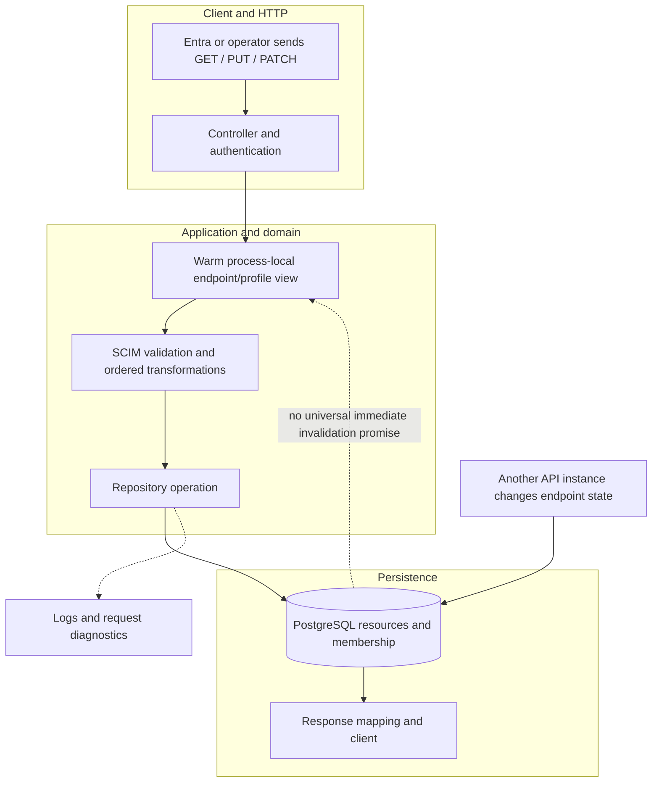
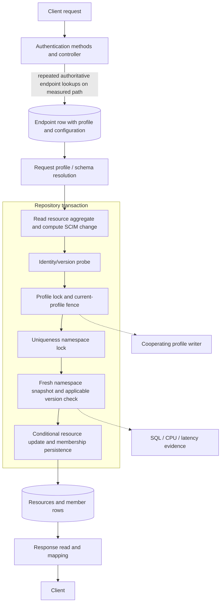
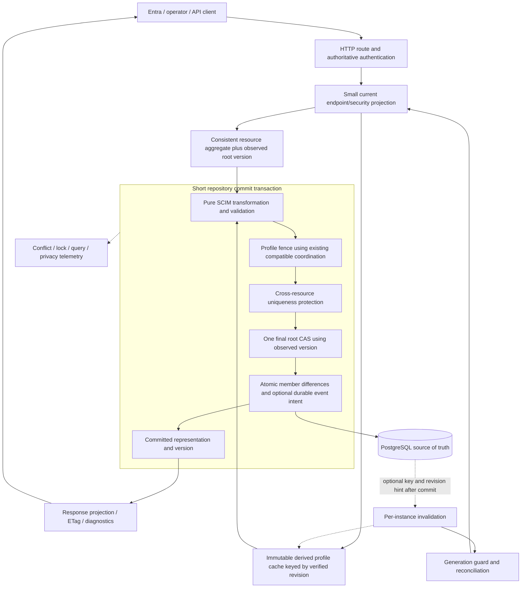
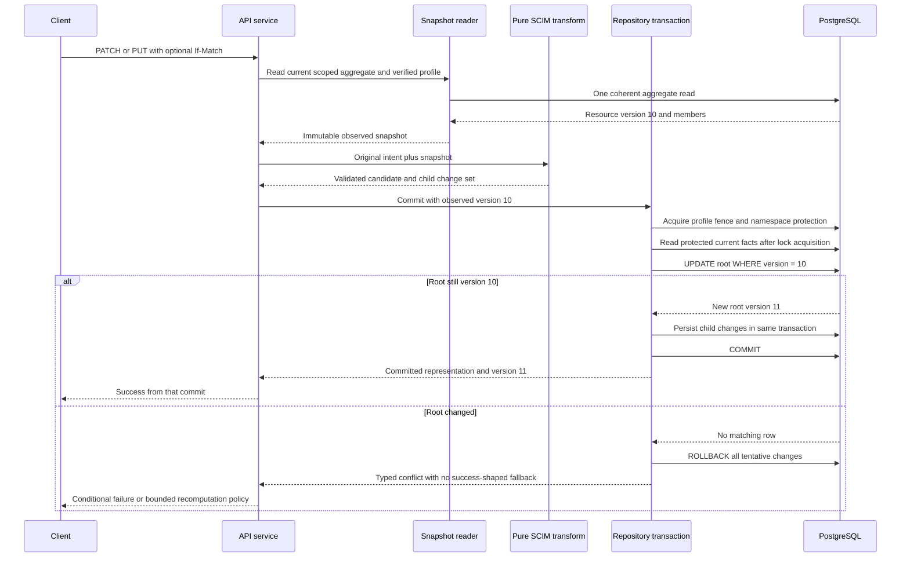
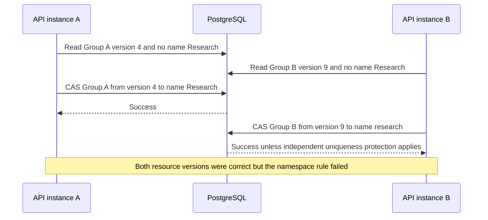
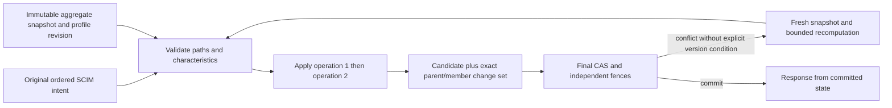
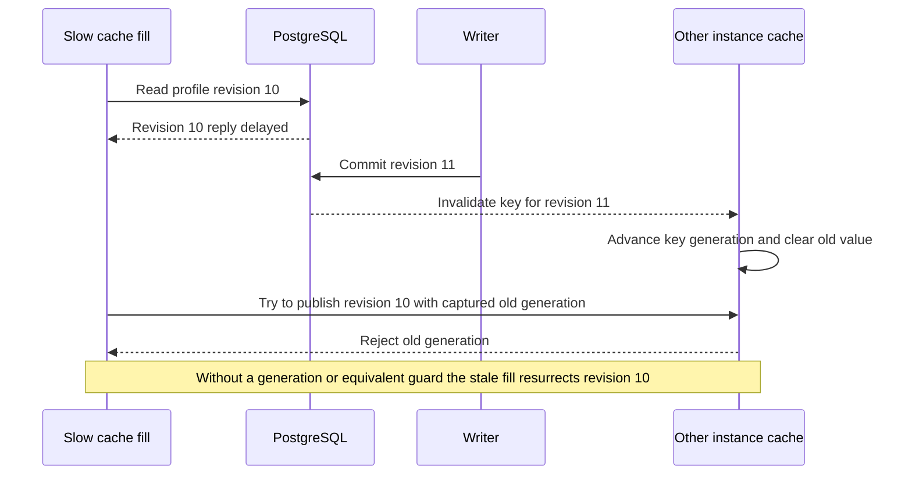
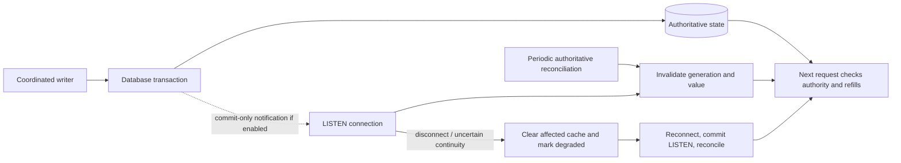
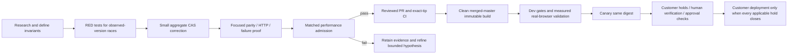

# SCIM writes and cross-instance cache coherence: proposed way forward

**Last verified:** 2026-10-20  
**Status:** Research and design proposal, not implemented or release-admitted  
**Context:** Published 0.55.56 compared with customer 0.55.20; local source
inspection at `36724c49` plus the explicitly unreleased performance prototype.  
**Research boundary:** Public primary sources retrieved on 2026-10-20.
PostgreSQL guidance is pinned to major 17. This report does not claim that
every available publication was searched or that a proposed composition has
already been proven in SCIMServer production.

**Implementation follow-up:** the first bounded
[observed-version correction and execution RCA](SCIM_OBSERVED_VERSION_IMPLEMENTATION.md)
now has local two-backend and real independent-PostgreSQL-pool proof.
This does not implement or validate the whole proposal below. Event transport,
query consolidation, response-from-commit and performance admission remain
separate; no deployment has occurred.

## 1. Executive recommendation

**Yes to the central read-compute-write idea, with independent protections
for independent facts.** Read one consistent resource aggregate, apply the
original SCIM operation to that snapshot, and make the final database update
conditional on the version that was actually read. Commit its resource,
membership changes and any required event intent together.

An **aggregate** means the object that must change atomically: for a Group,
the parent resource and its membership rows, not just its JSON document.
A **compare-and-swap (CAS)** is a write that succeeds only if the stored
version still equals the observed version.

Use this design in small, separately measured increments:

1. Keep authoritative authorization and existing correctness fences.
   Remove avoidable work, not the meaning of those fences.
2. Separate the client's optional `If-Match` condition from an internal,
   always-present read-version check for computed replacement writes.
3. Reduce duplicated aggregate reads and resource version probes. Retain
   profile coordination and cross-resource uniqueness protection until
   equivalent replacements are proven.
4. Cache immutable, derived schema/profile work, keyed by a verified revision.
   Do not introduce broad User/Group caches without evidence that they help.
5. If cross-node invalidation is worth its connection and operational cost,
   start with small PostgreSQL change notifications as **hints**, safe
   refill handling and authoritative reconciliation. Do not use an event as
   proof that authorization is current.
6. Add a durable outbox or change-data-capture pipeline only when a real
   requirement needs durable delivery. Neither is required merely to reuse
   derived schema indexes.

This recommendation **does not restore the old indefinitely stale endpoint
cache, remove write protection, upgrade Prisma, or authorize deployment**.
The current performance hold remains. Full source/runtime attribution and
the exact published release comparison are separate reports:

- [Customer performance RCA](CUSTOMER_UPGRADE_PERFORMANCE_RCA.md).
- [Complete 0.55.20-to-0.55.56 comparison](CUSTOMER_UPGRADE_05520_TO_05556_REPORT.md).
- [Unreleased prototype measurements](CUSTOMER_UPGRADE_PERFORMANCE.md).

### 1.1 Direct answers to the suggested approaches

| Idea | Decision | Reason and required qualification |
|---|---|---|
| Only one database version check | Adopt one final **resource** CAS | It prevents a computed aggregate from replacing a newer version. It cannot establish facts about other resources, profile changes or credentials. |
| Read everything needed in one go | Adopt a small, coherent aggregate projection | One SQL snapshot can combine parent and children. Do not read every endpoint resource, credential or unrelated member just to reduce the apparent query count. |
| Compute business rules on the read data | Adopt | Keep the original request intent, immutable observed versions and a deterministic transformation. Some external facts still need transaction-time validation. |
| Persist the final changed object | Adopt an atomic change set | Preserve SCIM semantics and atomically persist parent plus child differences. A blind whole-row overwrite is not sufficient. |
| Update cache using a database record event | Adopt only with an explicit consistency contract | Events can be delayed or lost. Invalidation plus guarded refill is simpler than applying arbitrary deltas. Security paths still consult authority. |
| Put the changed full object in each event | Usually decline for this server | It increases personally identifiable information exposure, message size, representation coupling and out-of-order overwrite risk. |
| Temporarily restore the old behavior | Not a general release fix | A restricted deployment can reduce some risks, but does not remove concurrent requests, background writers, profile changes or blue/green overlap. |

## 2. What is known, and what is not

### 2.1 Evidence and confidence

| Classification | Observation | Consequence |
|---|---|---|
| Verified published provenance | Customer 0.55.20 source `6785200f`; published 0.55.56 source `d43959e1` | Compare these exact runtime inputs, not a later version label or an uncommitted prototype. |
| Measured attribution | On a common old runtime, the exact published bundle fails 12/12 latency checks; database calls 53,372 / 110,614 and application CPU +97.17% | Runtime version drift alone does not explain the regression. See the RCA for sample size, resource limits and receipts. |
| Measured diagnostic only | Removing freshness and coordination together nearly restores medians, but tail checks still fail | This locates expensive work. It does not make the unsafe treatment deployable. |
| Verified source structure | Group writes assemble resource state and membership changes in a repository transaction; numeric expected versions enter the final write predicate | This provides a useful starting boundary for an aggregate CAS. |
| Verified source distinction | `enforceIfMatch` returns no expected version if the header is absent and optional, or ETags are disabled; `*` is existence only | A client's optional precondition is not an always-present internal read-version token. |
| Design risk, not a demonstrated new HTTP incident | Group PATCH reads the aggregate before computation and passes that optional expected version to replacement persistence | A new two-pool test must establish no-header and wildcard race behavior before claiming lost-update protection. This report does not claim to have run that test. |
| Proposal | Always capture the observed aggregate version; return the committed representation; add safe event hints if justified | These changes are not implemented by this report. |
| Unknown | Event-lag distributions, conflict rates, namespace sizes and new-design latency on real workloads | Instrument and measure before choosing more infrastructure or claiming an improvement. |

The latest safe local prototype still fails 5/12 admission comparisons,
including all four medians. Different experiments have different controls;
do not subtract their failure counts to infer a causal speedup.
No benchmark, live provisioning or customer mutation was performed for this
research document.

### 2.2 Local source map

These links identify actual inspected seams, not a proposed parallel framework.

| Concern | Existing source | What needs investigation or change in an implementation |
|---|---|---|
| Client header to expected version | [SCIM service helpers](../api/src/modules/scim/common/scim-service-helpers.ts) | Preserve header behavior while introducing a distinct observed-version argument. |
| Group read, ordered transformation and final response | [Endpoint Group service](../api/src/modules/scim/services/endpoint-scim-groups.service.ts) | Cover no-header races; preserve ordered PATCH; avoid a post-commit reread accidentally returning another request's version. |
| Aggregate persistence | [Prisma Group repository](../api/src/infrastructure/repositories/prisma/prisma-group.repository.ts) | Parent CAS, membership writes and rollback must use one transaction. |
| Existing uniqueness sequencing | [Prisma uniqueness helper](../api/src/infrastructure/repositories/prisma/prisma-uniqueness.ts) | Avoid duplicated target-version probes without losing the post-lock authoritative uniqueness snapshot. |
| Profile coordination | [Profile revision helper](../api/src/infrastructure/repositories/prisma/prisma-profile-revision.ts) | Keep a matching profile-writer protocol; do not replace it with a plain `EXISTS` predicate. |
| Resource preconditions | [Write precondition contract](../api/src/domain/repositories/write-precondition.ts) | Keep absence, numeric mismatch and wildcard existence distinct. |
| Parent/child schema and constraints | [Prisma schema](../api/prisma/schema.prisma) | Root version, JSONB payload, member relation, unique keys and nullable member references are different concerns. |
| Cached derived profile work | [Endpoint service](../api/src/modules/endpoint/services/endpoint.service.ts) | Reuse only the verified immutable snapshot; preserve public serialization/privacy and all invalidation paths. |

## 3. Terms and the consistency promises

| Term | Plain-language meaning |
|---|---|
| Optimistic concurrency control (OCC) | Work without holding the resource lock for the entire computation, then reject the commit if the observed resource changed. |
| Multi-version concurrency control (MVCC) | PostgreSQL lets statements read committed snapshots while other transactions proceed. A snapshot is not a promise that nothing changes afterward. |
| Linearization point | The point at which a concurrent operation takes effect in the agreed ordering. For a transaction, durable success requires commit, not merely receiving an updated row inside it. |
| Write skew | Two transactions change different rows; both local checks pass but their combined result violates a cross-row rule. |
| Fence | A token or lock that prevents work prepared under an obsolete configuration from being committed under the wrong rules. |
| Eventual consistency | Copies can disagree temporarily, with a designed recovery path. It does not mean immediately current. |
| Change data capture (CDC) | Reading committed database changes from a log or equivalent source, rather than relying on the API to publish each change separately. |
| Transactional outbox | Save business state and an event-intent row in the same transaction, then relay events afterward. |
| Incarnation | The identity of a particular lifetime of an object. Deleting and recreating the same logical name must not make old messages valid again. |

### 3.1 Keep five promises separate

| Promise | Required mechanism | Not established by |
|---|---|---|
| No lost aggregate update | Observed root version plus final CAS, or an equivalent parent lock held across read/write | Optional `If-Match` alone; independent child writes that never advance the root |
| Unique values across resources | Existing namespace protocol, database unique constraint, or proven equivalent | CAS on two different resources |
| Write uses the permitted schema/profile | Coordinated profile fence with participating profile writers | Resource CAS; a stale cached profile; an unlocked other-row predicate |
| Authorization reflects the defined revocation rule | Authoritative security decision and a defined race/commit policy | An asynchronous cache event; a long time-to-live |
| Other nodes eventually discard stale cached data | Delivery/reconciliation protocol plus guarded refill and deletion handling | A single local cache deletion or broadcast send call |

**An authorization race needs an explicit contract.** A request can be
authenticated before a credential is disabled and commit afterward. Decide
whether already-authenticated in-flight requests may complete. If the
requirement is no later commit after revocation, coordinate an authorization
epoch with the write transaction and all credential/trust writers. A fresh
guard read alone cannot provide that stronger promise. This proposal does
not quietly introduce or claim that stronger policy.

## 4. Earlier, published and proposed architectures

The diagrams use the same layers. They are logical component views, not
claims about a newly inspected live Azure topology.

### Figure 1. Earlier behavior: low repeated read cost, weaker freshness



The earlier system was not devoid of transactions or database constraints.
The relevant difference is less persistent endpoint revalidation and less
of the later namespace/profile coordination, not an assertion that every
earlier path was a blind write.

### Figure 2. Published 0.55.56: safer boundaries, expensive repetition



These checks were introduced for real reasons: changed endpoint settings,
competing writers, schema-driven uniqueness and in-flight profile changes.
See the [comparative RCA](CUSTOMER_UPGRADE_PERFORMANCE_RCA.md) for introducing
commits and measured statement counts. The diagram does not imply every
request takes every branch or every client supplies a numeric precondition.

### Figure 3. Proposed target: coherent snapshots, one resource gate



The target is **not one SQL statement for the whole protocol**. It is one
authoritative resource CAS within a transaction, plus the independent
mechanisms still needed for profile, uniqueness and references.

## 5. Read together, but choose the correct snapshot boundary

### 5.1 What belongs in the aggregate read

For Group PATCH, read:

- Internal resource identity, endpoint scope, resource type and public SCIM ID.
- Observed root version and fields needed for schema/immutable checks.
- Relevant persisted payload and the current membership state.
- A verified profile revision or request snapshot reference, not credentials.

One SQL parent-plus-member projection sees one statement snapshot [S01].
A Prisma relation include is **not automatically proof of one SQL statement**:
query strategies can differ. Inspect emitted SQL. Existing experiments with
joined loading do not authorize a preview-feature or package change here.

If the aggregate takes multiple SQL reads, use a demonstrated consistent
strategy: a suitable transaction snapshot, or a parent lock obeyed by all
child writers, or a version-before/after protocol with retry. The latter
adds reads; it may be simpler but is not the desired one-read fast path.
Under `READ COMMITTED`, merely wrapping multiple reads in a transaction
does not make their snapshots identical [S01].

### 5.2 What should not be fetched together

| Temptation | Side effect | Better boundary |
|---|---|---|
| Load the whole endpoint namespace with every aggregate | Cost grows with unrelated objects and large groups | Target aggregate first; fetch only uniqueness-relevant candidates under the required protocol. |
| Join several independent multi-valued relations naively | Cartesian multiplication, duplicated JSON and high memory use | Aggregate each child relation independently; verify row counts and query plans. |
| Fetch credentials alongside the profile for convenience | Wider sensitive-data exposure and accidental response/log leakage | Separate minimal authentication projection with existing provider boundaries. |
| Read all large membership rows for a one-member patch | Serialization and heap pressure can dominate database latency | Begin with correct aggregate behavior; consider operation-aware deltas only with equivalent validation/ordering proof. |
| Compute after taking broad locks | Long lock holds, pool contention and timeouts | Compute outside the short commit transaction when observed-version and independent fences make this safe. |
| Join all safety checks into one statement with an advisory lock function | Statement snapshot may be taken before waiting for the lock | Acquire the lock first, then issue the protected read as a later statement under `READ COMMITTED`. |

**Do not equate fewer round trips with less work.** Record SQL statements,
rows, bytes, plans, CPU, allocations, lock wait and transaction duration.
A single query that scans all resources can be worse than two selective ones.

## 6. Proposed read-compute-commit protocol

### Figure 4. Successful aggregate mutation and conflict path



### 6.1 Keep two version inputs, not one overloaded argument

| Input | Meaning | Example |
|---|---|---|
| Client condition | What the client insists must still be true | Matching accepted ETag, wildcard existence, no header |
| Observed aggregate version | The exact resource state used by this attempt's computation | Integer 10, even if no header was sent |
| Profile revision | The schema/configuration rules used to compute the attempt | Existing canonical profile revision, not resource version |
| Authorization epoch, only if required | The security-state boundary against which a commit must be fenced | Separate proposed policy decision, not silently inferred from profile hash |

If the client explicitly requires version 10 and version 11 now exists, do
not silently recompute against 11 and return success. If there is no client
version condition, the service may retry the **original operation** against a
fresh snapshot under a bounded, documented policy.

`If-Match: *` only requires existence. It does not make a stale computed
membership replacement safe. Internal CAS still uses the observed numeric
version. Disabling public ETag support must not disable internal safety.

### 6.2 The final database gate

The following is a **parameterized illustrative SQL shape**, not an
implemented repository API or a script to execute against production:

```sql
UPDATE "ScimResource"
SET
  "payload" = $1::jsonb,
  "version" = "version" + 1,
  "updatedAt" = CURRENT_TIMESTAMP
WHERE
  "id" = $2::uuid
  AND "endpointId" = $3::uuid
  AND "resourceType" = $4
  AND "version" = $5
RETURNING
  "id",
  "version",
  "payload",
  "updatedAt";
```

Here `$5` is the observed aggregate version, not an optional client value.
Production persistence must also maintain all mirrored columns, metadata
and member relations according to existing contracts. This snippet alone
does not do that.

PostgreSQL rechecks the target row's `WHERE` condition after a conflicting
updater commits [S01, S04]. Two writers that observed version 10 therefore
cannot both advance that same root from 10. The transaction must require
exactly one affected row before treating its tentative child changes as
committable. A returned row inside the transaction is not a committed success.

### 6.3 Required root-version discipline

Every operation that changes the aggregate must participate:

- Group scalar changes, membership-only writes, create/delete/import and
  administrative update paths.
- User/custom resource equivalents where their aggregate changes.
- Cleanup/cascade paths that change a publicly visible Group membership.
- Maintenance SQL, restore and any future background jobs.

The current `ResourceMember.memberResourceId` relation permits `ON DELETE
SET NULL`; that is not an automatic parent-version increment or a complete
membership-policy guarantee. Decide how such effects alter the aggregate's
public representation and version. An unnoticed child-only change defeats
the proposed CAS.

Do not rely on convention alone for privileged direct SQL. Either prohibit
it outside a coordinated maintenance protocol, or use carefully designed
database enforcement. A trigger that increments the parent for each child
row can itself create many version bumps, lock-order inversions and misleading
ETags; it is not a free fix.

### 6.4 Response correctness

The existing Group path performs a separate read after the update.
Another writer can commit before that read. Returning that later state is
not necessarily the state this request wrote.

Prefer producing the response from the committed transaction's captured
representation, or an explicitly validated post-commit read. Preserve all
existing `returned`, `attributes`, `excludedAttributes`, metadata, schema,
UTC timestamp and public-key allowlist rules. A new response must not expose
internal versions, cache bags or credential state.

## 7. Why one resource version cannot replace other safeguards

### Figure 5. Separate rows can defeat an apparently successful CAS



### 7.1 Cross-resource uniqueness

For fixed columns, a suitable database unique index is the strongest simple
mechanism: conflict detection is integrated with the write [S03]. The
repository already has endpoint/userName and membership-value constraints.
Group `displayName` is not a fixed database unique column, and dynamic
schema rules require more than adding one unconditional index.

For the immediate correction, retain existing coordinated namespace
validation. Narrow projections when equivalent, but do not remove the
**fresh read after lock acquisition**. Two API requests in the same process
can violate uniqueness without this protection too.

Longer-term alternative, only if measurement justifies it: a transactional
unique-claim projection with keys such as endpoint, resource type, schema
identity, attribute path, normalized typed value and owner. A database
unique key would arbitrate conflicts, without scanning every resource.
This requires a separate design/migration because it must handle:

- `caseExact`, typed equality, Unicode/collation and multi-valued leaves.
- Missing/null values, duplicates within one resource and extension homonyms.
- Profile changes that add/remove/tighten uniqueness.
- Backfill, existing duplicates, activation barriers and mixed-version writers.
- Updates, deletions, rollback and atomic release/acquisition of claims.
- Very long values and hash collisions. A hash alone must not turn two
  distinct values into a false conflict without a defined collision strategy.

**Do not add the claim table in the first performance patch.**

### 7.2 Profile changes while a resource write is in flight

An unlocked predicate such as `EXISTS(profile WHERE revision = oldRevision)`
inside the resource update is not a general replacement for coordination.
Under `READ COMMITTED`, the target-row recheck does not make arbitrary
other-row facts transactionally stable [S01].

Start by retaining the existing exclusive profile advisory lock and
canonical current-profile comparison. A later optimization can evaluate
shared transaction-scoped advisory locks for ordinary resource writers and
the matching exclusive lock for profile writers. It is valid only if:

1. Every relevant profile writer uses the same key and exclusive protocol.
2. Readers acquire the shared lock **before** the subsequent current-profile
   read, hold it through commit and do not upgrade it mid-transaction.
3. Every path uses the same lock order, including operations that touch
   several endpoints/resource types.
4. PostgreSQL advisory lock collisions, waits, starvation, timeout and
   memory/connection behavior are measured and observable.
5. Rolling deployments with old exclusive participants remain correct.

If row locks are chosen instead, `FOR KEY SHARE` does not block ordinary
non-key profile updates. `FOR SHARE` has the relevant stronger conflict
behavior, but also blocks unrelated updates to that same row [S02]. Choosing
the lock by its reassuring name is not sufficient.

### 7.3 Member references and lifecycle state

The existing service resolves member references before its write transaction.
A referenced user can disappear or change activity afterward. Foreign keys
protect only the configured relational rule; they do not establish an
endpoint's business rule about active, internal or external members.

First define what must be true **at commit**, then choose the corresponding
constraints, scoped locks or validation. Stable-ID references, null-on-delete,
external member values and endpoint deletion need separate tests.
Do not widen the first patch by inventing a stricter member policy.

### 7.4 Consistent lock ordering and bounded contention

Preserve the established ordering, and inventory all writers before changing
it. A candidate order is profile coordination, namespace scopes in sorted
order, then resource/claim/member rows in stable order. This is a proposed
contract, not a claim that every current path already follows it.

Transactions must not hold locks while waiting for a browser, network API
or external event publication. Deadlocks remain possible even with good
ordering; use bounded whole-attempt retries only for classified retryable
errors [S02]. Never treat a timeout as a successful write.

## 8. Worked example: retain SCIM intent, not just a final JSON object

The following identifiers and values are illustrative, not customer data.
No request below was sent. Authorization is intentionally a placeholder
in a `text` example, not a recovered token.

### 8.1 Initial state and a PATCH

An illustrative Group has version 10 and Alice as its only member:

```json
{
  "id": "11111111-1111-4111-8111-111111111111",
  "displayName": "Research",
  "members": [
    {
      "value": "aaaaaaaa-aaaa-4aaa-8aaa-aaaaaaaaaaaa",
      "display": "Alice"
    }
  ],
  "meta": {
    "resourceType": "Group",
    "version": "W/\"v10\""
  }
}
```

This is a focused state excerpt, not a complete SCIM response. A real response
also carries the appropriate schemas and other documented metadata.

```text
PATCH /scim/endpoints/{endpointId}/Groups/11111111-1111-4111-8111-111111111111
Authorization: Bearer <operator-supplied-token>
Content-Type: application/scim+json
If-Match: W/"v10"

{
  "schemas": [
    "urn:ietf:params:scim:api:messages:2.0:PatchOp"
  ],
  "Operations": [
    {
      "op": "add",
      "path": "members",
      "value": [
        {
          "value": "bbbbbbbb-bbbb-4bbb-8bbb-bbbbbbbbbbbb",
          "display": "Bob"
        }
      ]
    }
  ]
}
```

### 8.2 Data transformation and competing requests

| Step | Request A | Request B | Durable state |
|---|---|---|---|
| Read | Version 10, Alice | Version 10, Alice | Version 10, Alice |
| Compute original intent | Add Bob | Add Carol | Unchanged |
| First commit | CAS 10 succeeds | Still computing | Version 11, Alice + Bob |
| Second attempt with stale computed object | Finished | CAS 10 fails | Version 11, Alice + Bob |
| If B had explicit `If-Match` for 10 | No action | Conditional failure, do not rebase | Unchanged |
| If B had no client version condition | No action | Bounded reread, recompute add Carol, CAS 11 | Version 12, Alice + Bob + Carol |

Retrying B's **old final object** would remove Bob. Retrying B's original
**add Carol operation** against the new snapshot preserves both intents.

### Figure 6. Transformation pipeline



SCIM PATCH operations are sequential and atomic [S17, section 3.5.2].
An intermediate operation can change what a later filtered path selects.
Do not sort, merge or parallelize them just because their final writes
could be batched.

PUT is a replacement under the existing endpoint's SCIM rules. It must
retain/ignore/reject read-only or immutable attributes as documented, preserve
extension semantics and handle omitted fields according to the existing
contract. A retry recomputes those rules against the fresh snapshot; it must
not convert a deliberate PUT replacement into PATCH merging.

### 8.3 Error and retry contract

| Situation | Required behavior | Retry policy |
|---|---|---|
| Explicit accepted client ETag no longer matches | Existing conditional failure contract, normally HTTP 412 | Do not silently rebase to a new ETag. |
| Header required but absent | Existing HTTP 428 behavior | Client must satisfy the contract. |
| `If-Match: *` and resource no longer exists | Existing failed-precondition contract | Existence is not a numeric CAS. |
| No header, internal observed-version conflict | Do not silently overwrite | Bounded reread/recompute if semantics permit; choose and test exhaustion response explicitly. |
| Profile changed | Existing typed profile-conflict mapping | Rebuild under the new profile only if the public request contract permits; never commit using stale rules. |
| Unique value taken | Existing SCIM conflict/uniqueness error mapping | Do not retry endlessly or change the requested value. |
| Serialization failure/deadlock with confirmed transaction abort | Retry the whole attempt, with a bounded budget | Preserve client preconditions; classify actual installed-client errors. |
| Network disconnect around commit | Outcome may be unknown | Do not blindly replay non-idempotent work; reconcile or use an explicit idempotency design. |
| Event consumer fails after business commit | Business success and delayed cache recovery are distinct | Alert/reconcile; do not misreport rollback that did not happen. |

No new SCIM `scimType` keyword is introduced here. Reuse and verify the actual
repository error envelope; some existing keyword compatibility needs its own
standards review, not an incidental design rewrite.

### 8.4 Standards compatibility that must not be hidden

SCIM RFC 7644 section 3.14 permits weak ETags and shows weak-tag `If-Match`
examples. Generic HTTP RFC 9110 section 13.1.1 requires strong comparison for
`If-Match` [S17, S18]. This server currently emits/compares weak version tags.
That tension predates this proposal.

Do not claim that removing `W/`, changing header parsing or quoting generic
HTTP alone is a transparent fix. Preserve existing interoperability while
separately deciding supported weak/strong tags, lists, malformed headers and
discovery claims. The retrieved verified SCIM erratum fixes a missing JSON
brace in an example; it does not resolve this question [S21].

## 9. Cache changes: distinguish convenience from authority

### 9.1 Recommended cache scope

| Data | Suggested handling | Why |
|---|---|---|
| Derived schema indexes and compiled immutable profile helpers | Cache by a verified profile snapshot/revision | Expensive to derive, reusable, and invalidation can be tied to replacement. |
| Endpoint existence, enablement and security-relevant configuration | Read a compact authoritative projection at the required decision boundary | Stale acceptance can authorize a request under obsolete rules. |
| Credential/trust status | Preserve authoritative authentication/provider contract | Event arrival is not proof of current revocation state. |
| User/Group resources | Keep database-authoritative reads initially | Adding mutable resource caches widens the race/size/PII problem without measured need. |
| UI summaries or non-security metadata | Explicit bounded-staleness policy may be acceptable | This is a product decision, not a universal cache default. |

The profile hash currently covers a canonical profile representation. It
is not automatically an endpoint row version, authorization epoch or
monotonic sequence. If a compact persisted revision column is introduced,
all writers must advance it transactionally; restoring/importing or direct
SQL cannot silently bypass it. Such a column is a separate migration outcome.

**Local implementation follow-up, 2026-10-20:** the separate
[endpoint snapshot revision design and implementation](ENDPOINT_SNAPSHOT_REVISION.md)
now uses a database-owned opaque UUID for endpoint-row cache equality.
It does not replace the protected profile-content revision or resource
version, and is not released or deployed. Its writer, migration, restore
and performance obligations are recorded explicitly rather than inferred
from the earlier content-hash design.

Immutable request-local reuse is useful too, but sharing a snapshot across
authentication and controller phases changes the current freshness boundary.
Define the permitted behavior for an endpoint disabled between those phases,
and test it. Do not turn an avoidable repeat parse into an unannounced
authorization-caching change.

### 9.2 Invalidate, replace the whole object, or apply a delta?

| Event strategy | Benefits | Costs and failure cases | Recommendation |
|---|---|---|---|
| Key + incarnation + revision invalidation | Small, less sensitive, consumers can refetch an authoritative representation | Extra load on refill; event loss still needs recovery | Preferred default if events are added. |
| Full new object replacement | Can avoid a refill | Large/sensitive payloads, representation coupling, delayed older events can overwrite newer state, derived data still needs rebuild | Only for a specifically justified non-sensitive bounded object, with version ordering and schema compatibility. |
| Changed-field delta | Small for some updates | Requires exact prior version, ordered delivery, delete semantics and nested-array interpretation | Do not start here for SCIM objects. |
| Invalidate entire endpoint | Simple completeness boundary | High fan-out/cold-load cost; cache stampede | Useful recovery fallback, not every normal member write. |

For a delta, an event based on version 10 must not be applied blindly to
version 12. A gap must force an authoritative refill. A full object avoids
that base-version dependency, but still needs an incarnation and monotonic
ordering to prevent regression.

### 9.3 The stale-fill race

### Figure 7. Why deleting a cache entry is not sufficient



The invalidation protocol needs:

1. A per-key generation captured before each load. Invalidation advances it.
   Publish only if the captured generation still matches.
2. A monotonic observed revision floor where revisions are ordered.
   Canonical hashes support equality, not greater-than ordering.
3. Floor/generation lifetime that outlasts relevant in-flight fills.
   Evicting the value must not erase the safety information for those fills.
4. An incarnation or retained tombstone for delete/recreate, including
   deletion of a whole endpoint.
5. Immutable publication and cache-key scoping by endpoint/schema context.
6. Single-flight/coalesced loading and bounded backoff to reduce stampedes,
   without making a failed refill look like a successful stale read.

Meta documents this exact class of fill/invalidation race and the extra
problem of version knowledge being lost on eviction [S15]. That is production
experience supporting the problem analysis, not a reason to copy Meta's
entire architecture into this application.

## 10. Event transport choices and their real guarantees

### 10.1 Smallest useful PostgreSQL notification design

`LISTEN/NOTIFY` is suitable for a low-latency **hint**, not a durable event
log. PostgreSQL documents commit-time delivery, the startup registration
race, a default payload below 8,000 bytes and notification visibility to all
users of that database [S05, S06].

If adopted:

- Use one persistent listener connection per participating instance, not one
  listener for every request. Do not use transaction-mode PgBouncer for
  `LISTEN`; its feature matrix explicitly excludes it [S07].
- Commit `LISTEN` first; then inspect/reconcile authoritative database state;
  then enable normal cache reuse. On reconnect, repeat reconciliation.
- On detected disconnection or lag/health uncertainty, stop trusting affected
  cached state and invalidate its generation. Never silently continue using
  a security snapshot.
- Keep authoritative checks on security paths even while the listener
  appears healthy. Failure detection is not instantaneous.
- Send key/revision hints, not user payloads, secrets, credential hashes,
  encrypted secret envelopes or database URLs. IDs can still be sensitive;
  minimize channel exposure and access.
- Coalesce invalidations and bound handler work. Do not perform a refill
  for every event if no request needs the value.
- Monitor queue usage and avoid keeping listener transactions open.

Putting `NOTIFY` in the business transaction or a trigger avoids publishing
a committed-looking event for a rollback, but is not availability-neutral:
a full notification queue can make a notifying transaction fail at commit
[S06]. Choose and test the intended tradeoff. If business writes must remain
available when notification delivery is degraded, use a design that does
not depend on synchronous notification success, with authoritative fallback
and, if needed, a durable outbox. A broad catch cannot make a failed
transaction committed.

The listener adds a real database connection. With a five-connection pool,
it is an additional connection, not automatically one of those five.
Count active revisions, blue/green replicas, tests, migrations, listener and
any relay/CDC connections against the actual server limit. No new live
capacity was measured in this research.

### Figure 8. Optional hints plus authoritative recovery



Periodic reconciliation and expiration reduce the duration of missed
non-security updates. They do not make event-only caching linearizable.
Only promise a bounded stale interval if the reconciliation schedule,
database availability and refill behavior actually enforce it.

### 10.2 Alternatives

| Option | Delivery/consistency reality | Operational cost | Decision for this server |
|---|---|---|---|
| No event layer, compact authoritative check | Fresh at its defined read boundary; no notification dependency | One database check, possibly amortized derived computation | First baseline to optimize and measure. |
| PostgreSQL `LISTEN/NOTIFY` | Current subscribers only; no offline replay | Listener connections, reconnect/reconcile, queue monitoring | Optional small hint layer. |
| Redis Pub/Sub | At-most-once; disconnected receiver loses messages [S09] | New service, network/auth/availability budget | Not a correctness upgrade by itself. |
| Redis Streams or another retained broker | Replay/acknowledgment possible, depending on retention, persistence and topology [S10] | Consumer state, lag, trimming, recovery and HA | Consider when a durable consumer requirement exists. |
| Transactional outbox plus relay | Event intent is atomic with state; delivery can duplicate [S11, S12] | Table/index write per event, relay, retention, deduplication | Preferred durable application-event route when needed. |
| WAL-based CDC | Captures relevant committed database writes, including non-API writers | Slot/WAL retention, schema evolution, connector privileges and failover | Later option, not a free replacement for a few SQL reads. |
| Distributed shared resource cache | Fewer local copies, not automatically fresh relative to DB | New failure domain, sensitive data, dual-write race | No demonstrated need yet. |

### 10.3 Outbox correctness is more than adding a table

The business update and outbox insert must share the same transaction.
Database commit followed by an ordinary message send is a dual-write gap:
a crash between them loses the event. Sending first can publish an event
for a transaction that later rolls back [S11, S12].

A useful event shape is illustrated below. These are invented values and
proposed fields, not a current public API:

```json
{
  "eventId": "cccccccc-cccc-4ccc-8ccc-cccccccccccc",
  "eventType": "endpoint.profile.changed",
  "endpointId": "dddddddd-dddd-4ddd-8ddd-dddddddddddd",
  "incarnation": "eeeeeeee-eeee-4eee-8eee-eeeeeeeeeeee",
  "revision": "42",
  "schemaVersion": 1,
  "occurredAt": "2026-10-20T12:00:00.000Z"
}
```

Use a string representation if a proposed persisted 64-bit revision can
exceed JavaScript's safe integer range. This is not a reason to change the
existing integer resource version or public `meta.version` in this task.
`occurredAt` is useful for diagnosis, not a substitute for transaction order.

The relay must support:

- Retrying an event after a crash between publication and acknowledgment.
  Consumers must be idempotent; do not claim exactly-once delivery.
- Aggregate-scoped ordering or safe version rejection. Version 19 of Group A
  says nothing about version 3 of Group B.
- A fan-out topology. Every instance with a local cache must receive a relevant
  invalidation, not just one worker selected by a shared consumer group.
- Durable offsets/retention for consumers that require replay. An ephemeral
  cache instance can instead flush and rebuild on startup if that is its
  explicit contract.
- Bounded backlog, cleanup and an explicit resnapshot path when retention
  has expired.

#### The increasing-ID polling trap

Suppose transaction A allocates outbox ID 100 but remains uncommitted.
Transaction B allocates 101 and commits. A poller sees 101, stores
`lastSeen = 101`, then A commits. Polling only `id > 101` never returns 100.
PostgreSQL sequences allocate outside transaction rollback/commit ordering
[S01, S20].

Do not use a naive `MAX(id)` high-water mark as proof of complete delivery.
A polling relay can claim **all undispatched committed rows**, using
transactional claim/lease state and `SKIP LOCKED` where appropriate, then
publish to a retained fan-out log and acknowledge each item. Multiple relays
still need per-aggregate ordering or version-aware handling. `SKIP LOCKED`
alone does not establish order or broadcast delivery.

If each API instance polls the outbox directly, each needs its own safe
delivery/reconciliation state. A single shared `dispatched` flag would let
one instance hide events from all the others. Avoid implementing an accidental
message broker inside the database for a small cache optimization.

### 10.4 CDC and Azure-specific side effects

Logical decoding uses PostgreSQL write-ahead log (WAL) and replication
slots. A stalled consumer can retain WAL/catalog resources, and restart can
replay changes [S13]. Azure supports logical replication/decoding but requires
server parameters, permissions and operational setup [S14].

Before choosing CDC, establish:

- Whether the actual hosting topology supports slot failover and connector
  recovery as required; do not infer it from PostgreSQL major alone.
- WAL/storage limits, lag alerts, slot ownership and cleanup.
- Multi-row transaction interpretation: a parent row change and many member
  row changes must not publish a partially reconstructed aggregate.
- Snapshot/bootstrap barriers, schema migrations, deletes and restore/reseed.
- Least-privilege replication identity and payload minimization.

No logical-replication parameter, Azure permission, slot or external
connector was changed or inspected live for this proposal.

## 11. Concurrency alternatives: choose by contention, not fashion

| Strategy | Strong point | Important cost/limitation | Best fit here |
|---|---|---|---|
| Observed-version OCC plus short independent fences | Short resource lock duration; pure transformation outside transaction | Retries under contention; all aggregate writers must advance version | Recommended baseline for computed PUT/PATCH. |
| Parent `FOR UPDATE` across read/compute/write | Serializes writers to one aggregate, simpler retry story | Longer lock/pool occupation; pure work may still be expensive | Evaluate for hot, bounded aggregates if OCC retries dominate. |
| PostgreSQL `SERIALIZABLE` transactions | Detects a broad class of nonserializable cross-row histories | Whole-transaction retries; requires all relevant access patterns and invariant proof, not just one tagged method | Alternative to evaluate, not a switch that removes all explicit design. |
| Existing namespace lock plus fresh scan | Preserves current dynamic uniqueness semantics | Namespace serialization and scan cost | Retain in first correction; optimize projection separately. |
| Unique-claim projection | Database arbitration without a full scan | New schema, backfill, normalization, profile-change and mixed-writer protocol | Separate later migration if namespace cost remains material. |
| Per-endpoint single writer/queue | Simple ordering within that writer's scope | Throughput/availability bottleneck, failover/fencing/queue delay | Not justified just to avoid understanding current races. |
| One API replica | Fewer process-local copies | Concurrent requests and administrative writers still exist; overlapping revisions can exist | Operational restriction, not a concurrency primitive. |

PostgreSQL `REPEATABLE READ` gives a stable snapshot but can still permit
serialization anomalies. `SERIALIZABLE` is stronger but requires retrying
the entire transaction on a serialization failure [S01]. Do not perform
irreversible external side effects in a retryable transaction callback.

**Version-specific ORM caution:** the live Prisma transaction URL now
redirects to documentation describing ORM 8 and `db.transaction`. This
repository uses Prisma 7.8.0 and `$transaction`. Do not copy the new API,
options or error model into this patch [S19]. Validate actual installed-client
error mapping and options; an ORM upgrade is a separate rollback unit.

## 12. Failure matrix and observable behavior

| Failure or race | Unsafe outcome to prevent | Required behavior/test |
|---|---|---|
| Concurrent no-header PATCH additions | One new member silently disappears | Two independent PostgreSQL pools; assert final union after bounded recomputation or explicit conflict. |
| Membership writer skips parent version | Stale aggregate passes CAS | Exercise every child-only path; assert version advancement or equivalent lock exclusion. |
| Two resources request same unique value | Both CAS operations succeed and duplicate a unique value | Namespace/constraint competition test on different resources. |
| Profile update overtakes old computed write | Commit accepted under obsolete schema | Pause between compute/commit, change profile, assert typed rejection/recompute. |
| Member target changes after lookup | Persistence violates configured reference policy | Force deletion/deactivation interleaving; assert the defined policy, not a guessed stricter rule. |
| Failure after tentative parent update | Partial parent/member/event state | Inject failure at each transaction boundary; assert full rollback. |
| Response reread races a later writer | Request returns another writer's unacknowledged representation | Delay first response; assert captured commit version/body consistency. |
| Older cache fill arrives after invalidation | Old profile reappears indefinitely | Generation/floor and eviction interleaving tests. |
| Duplicate or reversed events | Cache regresses or repeats non-idempotent work | Monotonic floor and idempotent event handling. |
| Delete/recreate with reused logical name | Old event invalidates or repopulates new lifetime | Incarnation/tombstone test, including whole-endpoint deletion. |
| Listener silently misses continuity | Stale non-security state persists | Clear/reconcile on reconnect, plus independent periodic checks; security remains authoritative. |
| Notification queue saturated | Business commit fails unexpectedly | Explicitly classify failure/availability policy and surface diagnostics. |
| Outbox ID commits out of allocation order | A committed event is skipped forever | Delay low-ID transaction; prove relay eventually handles both. |
| Shared consumer group used for local caches | Only one instance invalidates | Run two subscribers; assert both observe/reconcile the change. |
| Relay crashes after send | Duplicate event or lost acknowledgment | Redeliver safely with durable state and idempotent consumer. |
| CDC consumer stalls | Unbounded WAL or storage growth | Alert, backpressure and recovery/resnapshot drill. |
| Cache fully cold or unavailable | Database overload, cascading timeouts | Cold-cache/load-shedding test and bounded refill concurrency. |
| Ambiguous commit response | Blind duplicate mutation | Reconciliation/idempotency contract, no success-shaped fallback. |
| Concurrent locks in reverse order | Deadlock/hung pool | Stable-order test plus classified bounded retry and lock-time metrics. |

Do not log full SCIM bodies, event objects containing PII, credential material
or database URLs to diagnose these failures. Correlate operation IDs, safe
scope identifiers, versions, reason codes and measured timing instead.

## 13. Measurable acceptance criteria and efficient delivery

### 13.1 Design and correctness acceptance

Before implementation, write failing tests for the exact invariant:

1. No-header, numeric-header, wildcard and ETag-disabled write races.
2. Consistent parent/member reads and root-version coverage of every writer.
3. Cross-resource uniqueness and profile-change races remain protected.
4. Complete rollback and response-from-commit correctness.
5. Both InMemory and PostgreSQL behavior, with genuine database-only exclusions
   explicitly named. InMemory check/mutate must not introduce an `await`
   between its comparison and mutation.
6. If events are added, all cache races and recovery/fan-out cases in section 12.
7. Existing public response allowlists, schema characteristics and error
   envelopes remain valid. Add focused live assertions where behavior changes.

The current repository has a measurable source-level gap between optional
client preconditions and internal observed versions. The isolated models
below illustrate why it matters; they are not a substitute for these
actual two-pool HTTP tests.

### 13.2 Performance acceptance

Retain the established admission rule: every required customer-matched
median/p95/p99 comparison must stay within its existing 10% threshold, and
all independent correctness/privacy/cleanup/memory checks must pass.
Do not average away one failed operation or silently relax the threshold.

Measure the exact candidate against the exact 0.55.20 baseline with:

- The existing unchanged harness, ABBA ordering, warmups, pooled sample
  counts and matched resource/runtime limits.
- Endpoint read counts and bytes, aggregate snapshot reads and SQL plans.
- Database calls, application CPU, database CPU where measurable, heap/RSS,
  event-loop delay and garbage collection.
- Per-attempt transaction duration, lock wait, retries and final conflicts.
- Group size and endpoint-namespace size scaling, not just tiny fixtures.
- Cold cache, listener failure and hot-key concurrent writes.

Hypotheses, not measured promises: one aggregate read can replace duplicate
loads; one root CAS can replace redundant resource probes; member differences
can reduce delete/reinsert work. Profile fences and namespace protection may
still dominate. Measure each independently rather than promising a specific
SQL count before emitted statements are observed.

### Figure 9. Staged delivery with independent evidence



### 13.3 Implementation packages, not one large redesign

| Order | Coherent outcome | Includes | Intentionally excludes |
|---|---|---|---|
| 0 | Review the invariant and retry/error contract | Writer inventory, no-header race design, consistency definition, thresholds | Runtime edits or release claims |
| 1 | Correct aggregate observed-version commit | Typed internal token, parent/member atomicity, response contract, focused tests | Event platform, unique-claim migration, ORM upgrade |
| 2 | Remove redundant reads without weakened fences | Minimal projections, coherent aggregate reader, unchanged profile/namespace protection, measured query budget | Request-wide authorization caching |
| 3 | Reduce proven remaining write cost | Operation-aware member differences or protected uniqueness projection, only where measured | Speculative generic unit-of-work framework |
| 4 | Optional cache hint layer | Listener, safe invalidation/refill/reconnect, telemetry and connection budget | Full-object/delta broadcast and durable broker |
| 5 | Durable event delivery, only with a requirement | Outbox or CDC, fan-out/replay/retention, migration and failure drills | Bundling a second storage architecture into the performance fix |

Keep packages separate when they are independent rollback units, but do not
ship half an invariant: version advancement for all child writers and the
final aggregate CAS belong together. Reuse current repository/provider seams;
do not build an application-wide framework to support one Group patch.

### 13.4 What a temporary deferral can and cannot mean

A temporary release may deliberately defer an event layer: authoritative
database reads remain the source of freshness, at their measured cost.
That is different from reverting to an indefinitely stale warm cache.

A one-replica restriction can reduce inter-process cache disagreement.
It does not prevent parallel requests, background/admin/profile writes,
rolling deployments or blue/green overlap. A true single-writer policy needs
actual enforcement and an explicit operational envelope.

Any intentional relaxation of freshness is a separately approved behavior
change with a documented stale window and revocation consequences. Broad
deployment approval does not transform a technically unmet performance or
correctness gate into a pass.

## 14. Current task proof, exclusions and release holds

### 14.1 What this research actually verified

- Reviewed 21 public primary references with an explicit source catalog below.
- Traced the local Group service, final version predicates, profile/namespace
  coordination, optional client precondition and parent/member schema.
- Executed 14 isolated Node models covering lost update, CAS, recomputation,
  missing parent increments, cross-resource uniqueness, profile independence,
  stale fills, guard eviction, per-aggregate ordering, sequence allocation,
  disconnection and rollback. All 14 pass, zero skips.
- These are deterministic explanatory models, **not PostgreSQL race tests,
  HTTP tests, performance proof or implementation acceptance**.
- All nine new diagrams pass real Chromium rendering in both strict light
  and dark themes. Standalone exports for this and the two previous reports
  contain 28 measured SVG figures with nondegenerate bounds, labels and no
  Mermaid error boxes.
- Both literal JSON examples and the illustrative HTTP request body parse;
  relative links and all 21 source-catalog references pass. The existing
  27-document freshness audit and whitespace check pass. Detailed measurements
  and document hashes are retained in the session verification receipt.

No runtime code, dependency, lockfile, version, cloud resource or deployment
was changed for this research. Existing uncommitted prototypes remain intact.

### 14.2 Still open, not hidden as opt-in exclusions

| Item | Why it remains open | Concrete next action |
|---|---|---|
| Performance admission | Latest safe candidate still fails required comparisons | Implement/review a bounded correction in a fresh implementation phase, then measure the exact candidate. |
| Actual-data restore/migration rehearsal | Structured fingerprint/count/timing evidence is incomplete | Complete the approved isolated rehearsal with real receipts before claiming readiness. |
| Exact managed-group cleanup absence | Approved identity's last lookup returned Forbidden | Obtain a legitimately authorized absence check; do not substitute identity or repeat unchanged failures. |
| Reviewer dispositions and historical credential/log/rotation items | Separate recorded holds are not resolved by research | Reconcile their exact evidence and close each explicitly. |
| Human final-target UI verification | Automated browser results do not replace operator observation | Obtain the required explicit final-target visual confirmation. |
| New concurrency/cache protocol | Proposed only | Implement with RED/GREEN, HTTP/parity/live proof and reviewed release evidence. |

Retained published-dev real-browser results are 324 Chromium passes with
no unexpected skips/flakes, plus six actual-data geometry sets. They apply
to their recorded published artifact, not to this proposed design or modified
source. This documentation task did not rerun full application Playwright
or certify a new release.

## 15. Open decisions, design disposition and self-improvement

### 15.1 Decisions before coding

1. May already-authenticated in-flight requests complete after revocation,
   or must revocation fence commit? State the existing behavior and desired
   policy before adding an authorization epoch.
2. What typed public error is returned after bounded internal OCC retries
   exhaust without a client condition? Preserve existing envelopes and do
   not invent unsupported `scimType` values.
3. Which current child/cascade/admin paths alter the public aggregate without
   advancing the root version? Inventory them before claiming a universal CAS.
4. Which uniqueness namespaces actually dominate cost, at what size and
   concurrency? Do not preselect a migration without this measurement.
5. Does any non-security cache need a formal stale bound or durable replay?
   If not, do not build an outbox platform for cache hints.
6. How should SCIM weak ETag compatibility and generic HTTP comparison be
   documented/tested independently of internal CAS?

### 15.2 Design/architecture disposition

**Accepted:** this is a bounded design proposal using existing repository,
profile-provider and cache-publication seams. Keep separate responsibilities
for SCIM transformations, transaction/constraint enforcement and optional
event transport. No new orchestrator, generic policy language, broker or
dependency is added. A future abstraction needs at least two actual uses
or one concrete near-term implementation; otherwise it is speculative.

**Test/gate self-improvement applied in the research:** distinguish the
client precondition from the internal observed-version invariant; make
stale-fill/eviction and commit-order counterexamples executable. Operational
acceptance for an implementation additionally requires actual database races
and independent cache-consistency checks, not simply successful event sends
or a high cache-hit rate.

### 15.3 Research execution issues and completeness

| ID / type / severity | Symptom and root cause | Resolution and why | Prevention / detection stage |
|---|---|---|---|
| DESIGN-01 / tooling / Low | Three AI web-search attempts failed at MCP discovery with HTTP 504, before a search result existed | Used direct primary-source retrieval; PostgreSQL, RFC, vendor and production engineering sources were accessible | Distinguish discovery failure from internet failure. Caught at research collection, the earliest relevant stage. |
| DESIGN-02 / documentation-version drift / High if copied into code | Former Prisma transaction URL redirects to ORM 8 guidance, while this repository uses 7.8.0 | Read the page/version and kept installed-client API semantics separate; no upgrade or runtime edit | Pin source compatibility before copying samples or error handling. Caught before design adoption; implementation must test installed client. |
| DESIGN-03 / extraction / Low | Simplified PgBouncer page omitted its feature matrix; RFC HTML pagination did not expose target sections reliably | Read raw PgBouncer HTML and exact public RFC text, then inspected bounded sections | Verify the source body actually contains the cited guarantee. Caught at evidence collection. |
| DESIGN-04 / source navigation / Low | Guessed SCIM ETag helper path did not exist | Glob located the actual interceptor; service helper exposed the numeric/wildcard/absent distinction | Discover paths before citing them. Caught immediately, no runtime or document contract changed. |
| DESIGN-05 / public URL / Low | A guessed Microsoft outbox-pattern URL returned 404 | Used successfully retrieved AWS outbox guidance and the original pattern reference instead | Cite retrieved content, not plausible URLs. Caught before publication. |
| DESIGN-06 / validation portability / Low | Pretty-print verification rejected valid Windows CRLF JSON because the expected serializer used LF | Normalize only line endings for the formatting comparison; parsing, two-space indentation and structure remain enforced. The corrected checker passes | Added LF and CRLF positive controls and a minified-JSON negative control to this checker. Caught in document validation, the earliest executable check; no production defect or content workaround. |

No commit SHA is associated with these documentation-only adaptations.
No claim is made that they are runtime fixes.

**Provenance/completeness boundary:** research sources and the available
reconstructed continuation are retained in session evidence. This is not
the explicitly deleted original conversation, and no claim is made to have
recovered its transcript or exact original TODOs. The closing reconciliation
receipt states the actual available transcript scan and limitations. Signal
and causal-narration passes cover the available event stream; historical
performance/tooling findings remain mapped to their existing ledgers.
Search echoes, quoted counterexamples, ordinary document `conflict`/`failure`
descriptions and retained failed-admission results are not new execution
incidents. The six actual research/tooling/validation adaptations above are
tracked separately rather than being misreported as product defects.

## 16. Primary sources and how they are used

All entries were retrieved on **2026-10-20**. Normative standards establish
protocol rules; database/vendor documents establish product behavior;
engineering case studies establish experience in those organizations.
None measures this proposed SCIMServer implementation.

| ID | Primary source | Relevant verified point |
|---|---|---|
| S01 | [PostgreSQL 17 transaction isolation](https://www.postgresql.org/docs/17/transaction-iso.html) | Statement snapshots, target-row recheck, other-row limitations, repeatable-read versus serializable, retry scope |
| S02 | [PostgreSQL 17 explicit locking](https://www.postgresql.org/docs/17/explicit-locking.html) | Lock compatibility, advisory cooperation, deadlocks and transaction scope |
| S03 | [PostgreSQL 17 unique-index checks](https://www.postgresql.org/docs/17/index-unique-checks.html) | Atomic uniqueness arbitration and waiting for conflicting transactions |
| S04 | [PostgreSQL 17 UPDATE](https://www.postgresql.org/docs/17/sql-update.html) | Conditional update and returned modified rows |
| S05 | [PostgreSQL 17 LISTEN](https://www.postgresql.org/docs/17/sql-listen.html) | Session lifetime and listen-commit-then-inspect startup rule |
| S06 | [PostgreSQL 17 NOTIFY](https://www.postgresql.org/docs/17/sql-notify.html) | Delivery at commit, payload/privacy/queue limits and transactional effects |
| S07 | [PgBouncer feature matrix](https://www.pgbouncer.org/features.html) | LISTEN requires session-compatible connections, not transaction pooling |
| S08 | [Microsoft Cache-Aside pattern](https://learn.microsoft.com/en-us/azure/architecture/patterns/cache-aside) | Local-copy inconsistency, staleness and primary-source handling for security-sensitive data |
| S09 | [Redis Pub/Sub](https://redis.io/docs/latest/develop/pubsub/) | At-most-once delivery and disconnect loss |
| S10 | [Redis Streams](https://redis.io/docs/latest/develop/data-types/streams/) | Retained-stream/consumer capabilities; reliability still depends on configuration and topology |
| S11 | [Transactional outbox pattern](https://microservices.io/patterns/data/transactional-outbox.html) | Atomic intent, relay and idempotent consumers |
| S12 | [AWS transactional outbox guidance](https://docs.aws.amazon.com/prescriptive-guidance/latest/cloud-design-patterns/transactional-outbox.html) | Dual-write failure, ordering and duplicates |
| S13 | [PostgreSQL 17 logical decoding concepts](https://www.postgresql.org/docs/17/logicaldecoding-explanation.html) | Slots, resource retention, restart and replay |
| S14 | [Azure PostgreSQL logical replication/decoding](https://learn.microsoft.com/en-us/azure/postgresql/configure-maintain/concepts-logical) | Configuration, privileges and operational prerequisites |
| S15 | [Meta: Cache made consistent](https://engineering.fb.com/2022/06/08/core-infra/cache-made-consistent/) | Production stale-fill/eviction races and independent consistency measurement |
| S16 | [Amazon Builders' Library: Caching challenges and strategies](https://aws.amazon.com/builders-library/caching-challenges-and-strategies/) | Production cache capacity, cold-start, outage and correctness tradeoffs |
| S17 | [RFC 7644, sections 3.5 and 3.14](https://www.rfc-editor.org/rfc/rfc7644) | SCIM replacement, ordered atomic PATCH and versioning |
| S18 | [RFC 9110, section 13.1.1](https://www.rfc-editor.org/rfc/rfc9110) | Generic HTTP If-Match, wildcard existence and strong comparison |
| S19 | [Current Prisma transaction documentation](https://www.prisma.io/docs/orm/fundamentals/transactions) | Explicitly ORM 8 at retrieval; not the installed 7.8.0 API |
| S20 | [PostgreSQL 17 sequence functions](https://www.postgresql.org/docs/17/functions-sequence.html) | Sequence allocation is not transaction commit order |
| S21 | [RFC 7644 errata search](https://errata.rfc-editor.org/search/?rfc_number=7644) | Retrieved verified correction to a malformed PATCH example; no invented ETag resolution |

### 16.1 Reading and visual exports

Open this document in VS Code Markdown Preview for diagrams. A standalone
HTML export with inline SVG diagrams is generated at
`test-results/docs-html/docs__SCIM_CONCURRENCY_AND_CACHE_COHERENCE_DESIGN.html`.
It does not depend on a Markdown extension or an external Mermaid service.

```powershell
npm run docs:mermaid:doctor
npm run docs:mermaid:render -- docs\SCIM_CONCURRENCY_AND_CACHE_COHERENCE_DESIGN.md
npm run docs:html -- docs\SCIM_CONCURRENCY_AND_CACHE_COHERENCE_DESIGN.md
```

**Recommended next action:** review the six decisions in section 15.1, then
start a fresh, focused implementation of the observed-version aggregate
contract and its failing database race tests. Treat event delivery and any
uniqueness migration as separate, evidence-driven follow-ups.
