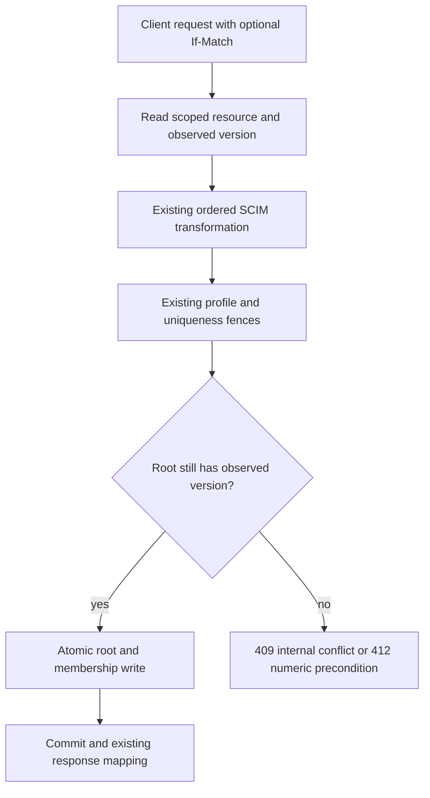
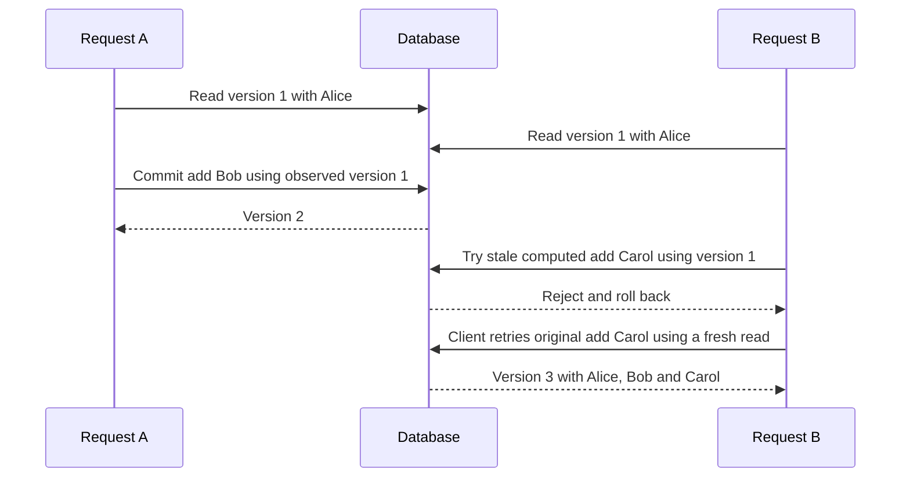
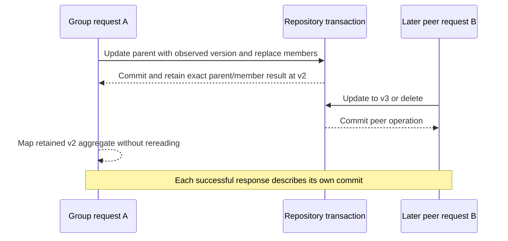
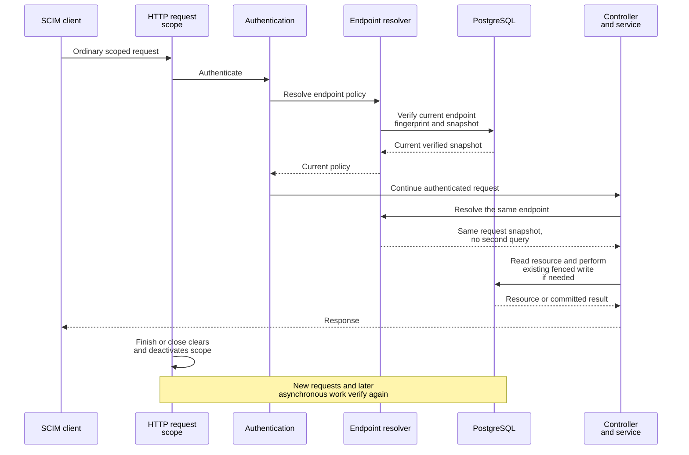
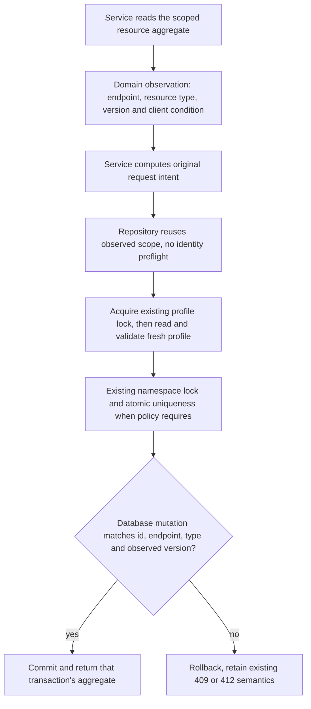
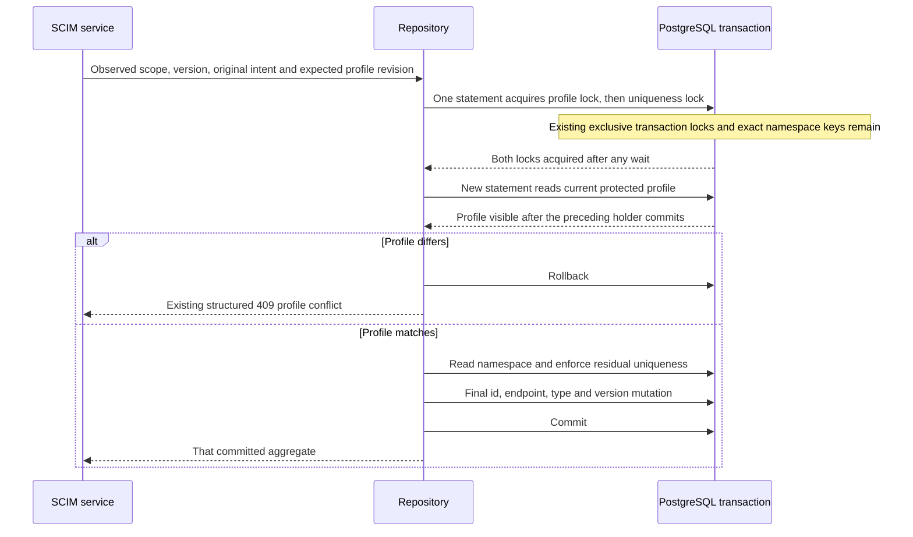
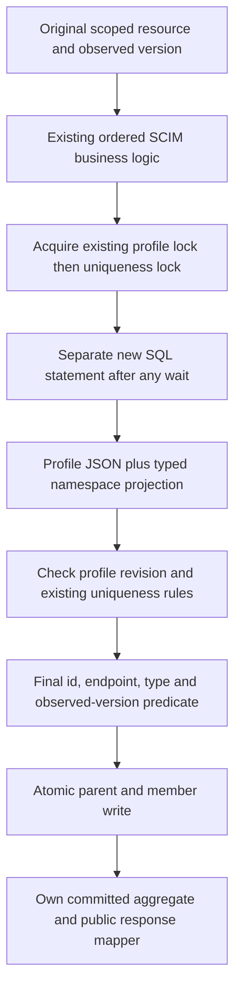
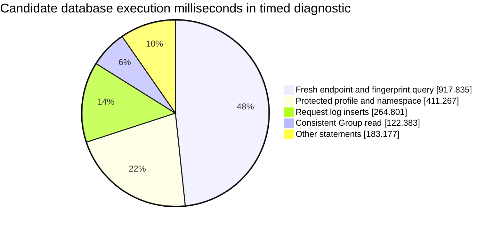

# Observed-version write safety: implementation and execution RCA

**Last verified:** 2026-10-20  
**Status:** Local implementation, not published or performance-admitted  
**Product context:** 0.55.56 plus existing unreleased performance prototypes.

## Executive summary

**Current integration, 2026-10-21:** the owned source is reconciled onto
merged token-lifetime master `5841f724`, targeting 0.55.58. Integrated
focused units pass 1,327 cases and PostgreSQL passes 303 cases, including
TTL issuance and observed-version safety. The subsequent private image
`fa482c1b` passed all twelve original half-CPU latency limits, but predates
this master integration and is not its performance receipt. See the
[current reconciliation and pending release gates](ENDPOINT_SNAPSHOT_REVISION.md#16-reconciliation-with-merged-token-lifetime-master-2026-10-21).
The dated checkpoints below remain historical.

**Subsequent explicit migration outcome:** the locally implemented
[compact endpoint snapshot revision](ENDPOINT_SNAPSHOT_REVISION.md)
replaces the repeated database full-row hash while preserving this
document's protected profile and resource checks. Its immutable image
`41f9ff4d`, full run `a6c3f7ff`, passes five latency limits and fails seven.
It is not performance-admitted, published or deployed. The separate report
records the migration, writer/restore contract, actual full latency table
and ER-01 through ER-15. Its subsequent protected-profile proof, image
`72d2eec3`, avoids repeated body work only after an exact post-lock scoped
token match and retains canonical fallback. Focused PostgreSQL 92 PASS,
combined related PostgreSQL 230 unique PASS, combined unit 746 unique PASS,
InMemory 65 PASS / 31 database-only exclusions; combined receipts are not
single final full-suite invocations. Build/static and module/storage image
hashes pass. Full unchanged-limit BAAB `6d80c293` retains one latency
failure, empty GET p99 +15.15%; DB calls +0.026228%, app CPU -3.834776%.
Values/logging/redaction/memory/cleanup PASS. Full SQL attribution rejects
a three-call capture mismatch; the corrected atomic collector and bounded
real diagnostic pass without replacing failed admission.
Actual-ID timing correlation and a separate two-CPU treatment then show
material quota/runtime sensitivity in both versions, not permission to
resize production or waive the half-CPU failure. All private runs are
complete and exact owned resources absent.
Earlier checkpoints below remain historical.

**Historical local checkpoints:** sections 14-24 cover scoped observations,
exact profile-key hashing and ordered write-lock batching. The current focused
unit neighborhood passes 577 tests; PostgreSQL HTTP passes 219 and InMemory
passes 197 with 22 PostgreSQL-only exclusions. The newest protected-snapshot
image `55a9f64f`, verified across 19 modules, passes eleven of twelve
unchanged latency limits at 2,000 pooled samples in candidate-first order.
Add p99 remains +12.84%, above the +10% limit. Database calls are +0.028%
and application CPU is +6.292%. Aggregate database execution time remains
materially higher. A short actual statement-timing diagnostic attributes
48.32% of candidate database execution time to the fresh endpoint/fingerprint
query and 21.65% to the protected profile/namespace read. These are statement
contributions, not proof of which computation causes add p99. The next
compact persisted-revision design would be a separate migration outcome,
not an unsafe removal of freshness checking.
The older ordered-lock image's first full pooled PASS and its subsequent
counterbalanced three-limit failure are both retained. Performance closure
remains blocked; no selected green run is treated as a stable-speedup claim.
The chronological sections below
preserve earlier results; none turns the current performance hold into a PASS.

The first bounded implementation from the
[concurrency/cache design](SCIM_CONCURRENCY_AND_CACHE_COHERENCE_DESIGN.md)
protects computed PUT/PATCH writes for Users, Groups and custom resources
even when a client sends no `If-Match`, sends `*`, or disables public ETags.
The internal observed resource version is independent of that optional
client condition.

The change does not introduce cache events, a broker, an ORM upgrade,
automatic retries or a release. Existing profile and namespace protections
remain. DELETE's existing client-condition contract is unchanged.

## 1. Reproduced defect and correction

Two concurrent requests could both read version 1, compute different final
objects and report success. The later write could overwrite the first
request's fields or Group membership. PostgreSQL RED confirmed 19 failing
HTTP cases, including all three resource families and the membership-intent
example. InMemory RED confirmed 18 selected HTTP cases. A separate unit
case showed membership-only append leaving the parent version at 1.

The corrected contract carries:

| Value | Meaning | Enforcement |
|---|---|---|
| `observedVersion` | Resource state used to compute this attempt | Root write predicate and repository preflight checks |
| Optional observed `scope` | Endpoint and resource type from that same read | Final scoped predicate; synchronous InMemory checks; legacy callers retain identity lookup |
| Optional `ifMatch` | Client numeric version or wildcard existence | Existing explicit precondition behavior |
| Existing profile revision | Configuration/schema used by the operation | Unchanged profile lock/current-profile fence |
| Existing uniqueness policy | Rules involving competing resources | Unchanged namespace protection and database constraints |



The final database predicate now includes the observed numeric version for
computed writes. The existing identity and namespace preflight checks are
retained in this safety patch; removing redundant reads is a separate
measured optimization. This is not a claim that the entire operation is
one SQL statement.

## 2. Observable behavior and compatibility

| Scenario | Behavior |
|---|---|
| Sequential write without a header | Continues to succeed |
| Explicit matching numeric ETag | Continues to succeed |
| Explicit stale numeric ETag | Existing HTTP 412 |
| Required header absent | Existing HTTP 428 |
| Wildcard and resource exists, but computed snapshot is stale | HTTP 409, not a false claim that wildcard existence failed |
| Wildcard and resource disappeared | HTTP 412 |
| ETags disabled | Client ETag remains ignored; internal observed-version safety stays active |
| Internal stale computation | HTTP 409, diagnostics `RESOURCE_VERSION_CHANGED`, no invented `scimType` |
| Membership-only append | Root version advances once if the append commits |
| Empty append or failed duplicate append | No version change or partial membership publication |

This deliberately changes the previous concurrent no-header/wildcard behavior
from two successes to one success plus an explicit conflict. Clients should
read the current resource and retry the **original operation**. The server
does not automatically recompute or blindly replay a stale final object.

No public ETag syntax, discovery capability, uniqueness rule or schema
characteristic is changed. The weak-ETag standards compatibility question
remains separate.

### Wildcard final-CAS failure

A zero-row CAS alone cannot distinguish disappearance from a changed existing
row. Only on the wildcard failure path, the Prisma helper rereads current
existence/version and maps the result to 412 or 409. Successful writes add
no such diagnostic read. All tentative Group changes stay in one transaction.



## 3. Implementation seams and limits

- [Write precondition contract](../api/src/domain/repositories/write-precondition.ts)
  carries scalar legacy conditions or an observed-version/client-condition pair.
- [SCIM services](../api/src/modules/scim/services) capture observed versions
  in all six User/Group/custom PUT/PATCH paths.
- [Prisma repositories](../api/src/infrastructure/repositories/prisma) use the
  shared numeric-predicate helper and typed miss classification.
- [InMemory repositories](../api/src/infrastructure/repositories/inmemory)
  check and mutate synchronously without an intervening `await`.
- Group membership-only append increments the parent in the same transaction
  as child insertion; duplicate insertion rolls both back.
- [Shared service error handling](../api/src/modules/scim/common/scim-service-helpers.ts)
  emits a structured debug event and explicit HTTP 409 diagnostic.

No general retry engine or generic unit-of-work framework is added.
Resource reads and Group post-commit response reads are not consolidated by
this patch. The design's response-from-commit improvement and query reduction
remain separate work; this patch does not claim to close them.

## 4. Validation ledger

Detailed logs remain in the session's `aggregate-version-20261020` evidence
directory. Results are updated as each check actually finishes.

| Check | Result |
|---|---|
| Unit RED, append version | Failed meaningfully: expected 2, received 1 |
| InMemory selected HTTP RED | 18 assertion failures: two stale writers returned 200 |
| PostgreSQL selected HTTP RED | 19 assertion failures, including membership original-intent scenario |
| API build | PASS |
| Expanded changed-file lint | PASS, 0 errors / 130 warnings on 19 paths versus 131 warnings using HEAD text on the same paths; no newly introduced diagnostics |
| Focused units | PASS, 12 suites / 687 tests after expectation/mock alignment |
| Test-layering follow-up | PASS, 32 tests in the two affected suites after moving infrastructure assertions out of the domain test |
| Changed/new test type-check | PASS, seven selected roots, zero errors |
| Initial PostgreSQL HTTP neighborhood | PASS, 183 tests in conditional writes, atomic uniqueness, profile coordination and endpoint deletion |
| Initial InMemory HTTP neighborhood | PASS, 175 tests plus eight genuine database-specific exclusions |
| Final expanded conditional HTTP suite | PostgreSQL 54 PASS; InMemory 48 PASS plus six genuine PostgreSQL-only exclusions |
| Live loopback PowerShell smoke | 45 assertions PASS inside each final conditional backend run |
| Documentation | Two new diagrams render in both strict themes; all four standalone reports contain 30 measured labeled SVGs with no error boxes; 65 literal JSON examples parse; coupled freshness passes for 27 documents; whitespace passes |
| Performance admission | Not rerun or established by these correctness tests |
| Publication/deployment/customer changes | Not performed |

## 5. Execution issues and root causes

| ID / type / severity | Symptom and root cause | Resolution and why it works | Detection / prevention |
|---|---|---|---|
| OV-01 / test discovery / Low | Editor test tool could not discover tests in the separately owned worktree | Used that worktree's existing npm/Jest commands, without installing anything | Stage 0; retain exact worktree and command |
| OV-02 / correctness / High | Optional client preconditions were reused as the only resource version token; absent/wildcard/disabled paths did not protect computed snapshots | Added an independent observed-version token, final numeric predicate and typed conflict; 687 focused units pass, HTTP proof separately tracked | New no-header/wildcard/disabled HTTP races across all resource families; earliest possible gate is a focused concurrent-write test |
| OV-03 / aggregate version coverage / High | Membership-only append did not advance the root version | Advance parent and append members atomically; no-op remains no-op | Unit RED then GREEN; real database rollback assertion included |
| OV-04 / test expectations / Low | Existing unit assertions required an undefined version argument and an append mock expected root-client calls | Updated exact observed-token assertions and made the append mock execute its transaction; did not loosen payload assertions | Focused unit run caught 14 failures, then 687 tests pass |
| OV-05 / test registration / Low | An insertion with insufficient closing-block context placed a new test inside another test | Repositioned at the suite boundary before GREEN execution; source location checks exposed the nesting | Use complete unique surrounding context; run the complete focused suite, not only name-filtered cases |
| OV-06 / patch context / Low | A multi-file patch's final hunk used an incorrect live-output assertion string and failed after earlier hunks applied | Read the exact assertion and retried only the remaining hunk; final backend suites prove the 45-assertion contract | Tool failure detected immediately; use complete exact strings and honor partial-application notices |
| OV-07 / bounded exploration / Low | A guessed line range exceeded the 90-line helper's length | Read the small helper at its actual bounds; no source change required | Tool caught the range error; use known file size for follow-up |
| OV-08 / evidence retention / Low | A mixed-purpose log filename was reused for GREEN after its initial 14 unit failures | Original full initial unit-failure log is not retained; its inspected diagnostics and counts remain in the available continuation. Meaningful initial RED logs and later uniquely named backend, lint and layering receipts remain | Earliest prevention is distinct RED/GREEN filenames before execution; do not claim the overwritten full log is preserved |

These entries describe a local uncommitted correction, not a shipped fix.
**Provenance/completeness:** the full available continuation event stream was
scanned through the implementation closeout checkpoint: 35,128 records,
13,109 in the approved window. Error/signal and causal-narration passes
include explicit observed-version, child-version, nested-registration,
partial-patch, bounded-view and failure-log categories. The receipt retains
record metadata/category labels only. Actual implementation issues map to
OV-01 through OV-08; search echoes, prior performance/research failures and
illustrative counterexamples are not counted as new incidents. The deleted
original transcript is not available and is not claimed to be reconciled.
The expanded lint warning count is not a regression: matching diagnostics
against HEAD source on identical paths found zero introduced messages.
Existing Jest force-exit configuration, genuine database-only exclusions,
Git's LF-to-CRLF notices and search-output offloading are not new runtime
defects. The latter was handled with bounded reads, not a full log dump.

### Reproduction commands and scope

Run from the owned worktree's `api` directory, with `PERSISTENCE_BACKEND` and
`DATABASE_URL` pointing only at the isolated synthetic database for PostgreSQL.
Do not target a shared or customer database. The existing global setup
applies migrations and teardown clears test data.

```powershell
npm run test:e2e -- --runInBand --runTestsByPath `
  test\e2e\conditional-writes.e2e-spec.ts `
  test\e2e\atomic-uniqueness.e2e-spec.ts `
  test\e2e\profile-revision-coordination.e2e-spec.ts `
  test\e2e\endpoint-deletion.e2e-spec.ts
```

Result: PostgreSQL 183 PASS and InMemory 175 PASS / eight backend exclusions
before the final disappearance case and live-smoke expansion. The final
changed-suite-only command was then:

```powershell
npm run test:e2e -- --runInBand --runTestsByPath `
  test\e2e\conditional-writes.e2e-spec.ts
```

Result: PostgreSQL 54 PASS and InMemory 48 PASS / six exclusions. Both invoke
the real loopback PowerShell smoke with 45 assertions. The six InMemory
exclusions are three independent-application-pool mode cases, two direct
final PostgreSQL CAS cases, and one final PostgreSQL wildcard-disappearance
case. The adjacent atomic-uniqueness suite has three further database-specific
cases; those eight earlier neighborhood exclusions became nine distinct
exclusions after adding the final disappearance test.

These are a focused correctness matrix, not full API, browser, live-estate,
deployment or performance validation. Browser use here renders documentation;
it is not application Playwright end-to-end validation.

## 6. Design and next-step disposition

**Design disposition: accepted.** Existing domain/repository/error seams
remain responsible for their existing concerns. The small shared token
helper avoids duplicating version/error decisions across six service paths
and two backends. No new platform or speculative abstraction is introduced.

**Self-improvement applied:** replace the old test that explicitly expected
two unconditional successes with assertions for the winning stored value,
one version increment and a structured loser conflict. Cover the final CAS
without namespace/profile probes as well as independent application pools.

After this correctness boundary is verified, measure and remove redundant
reads in a separate focused outcome. Do not release this candidate merely
because race tests pass. The performance, actual-data rehearsal, cleanup,
reviewer/credential and human final-target verification holds remain.

## 7. Committed Group response follow-up

**Local implementation, not released.** A second meaningful RED reproduced
the response race on real HTTP through both backends: Request A committed
version 2, Request B committed version 3 before A's service resumed, and A
incorrectly returned B's version. Two service assertions and one InMemory
repository assertion also failed before the correction; the Prisma return
contract separately failed because the method returned no aggregate.

The repository port now returns `GroupWithMembers` from the successful
transaction. Prisma reuses the parent update result and obtains inserted
membership rows from installed Prisma 7.8.0's `createManyAndReturn`, which
is present in the generated client and exercised against PostgreSQL 17.
There is no follow-up resource query or ORM upgrade. InMemory returns a
detached parent/member snapshot after synchronous publication.

PUT/PATCH map this returned aggregate through the existing response mapper.
They no longer query the resource after commit. Consequently a later peer
update cannot substitute its scalar, membership or ETag into the first
response, and a later deletion cannot turn an already successful commit into
a retrieval error.



### Follow-up proof and execution issues

| Check | Current evidence |
|---|---|
| Unit RED | Three failed assertions, then one separate Prisma return-contract failure |
| Real HTTP RED | Two failed assertions on each backend: expected response v2, received v3 |
| API build after implementation | PASS |
| Exact regression units | Four PASS |
| Complete affected Group unit suites | Four suites / 224 PASS |
| PostgreSQL HTTP neighborhood before final delete-case expansion | Four suites / 186 PASS |
| Final expanded conditional and Group aggregate/lifecycle/minimal-member/parity HTTP suites | PostgreSQL five suites / 144 PASS; InMemory 137 PASS / seven genuine database exclusions |
| Final live membership/header smoke | 50 loopback assertions PASS per backend |
| Changed follow-up test type-check | Four roots, zero errors |
| Follow-up lint | Zero errors / 48 warnings versus 49 on identical HEAD paths; zero introduced diagnostics |

Do not add these counts to the earlier phase's counts as if they were
independent coverage. The newer runs supersede overlapping tests.
Evidence lives in the separate session `committed-response-20261020`
directory; RED and GREEN filenames are distinct.

| ID / type / severity | Root cause | Correction and prevention | Detection stage |
|---|---|---|---|
| CR-01 / response consistency / High | A separate post-commit read could observe a newer update or disappearance instead of the request's own commit | Return the typed transaction result and map it directly; deterministic HTTP interleavings assert the scalar, members, body version, header ETag, final stored state and exact resource-read count | New focused unit and real two-backend HTTP RED; earliest possible gate is this response-interleaving test |
| CR-02 / fixture contract / Low | Thirty-five service fixtures still explicitly modeled a void repository result, and queued a second read that the corrected service must not perform | AST-scoped codemod replaces only those void-result mocks with a typed committed-result fixture; reset read queues per test; transaction fixtures return real parent/member shapes | Complete Group suites now pass 224 tests; no production fallback for invalid mocks |

**Design disposition: accepted.** The existing Group repository already owns
the atomic write; returning that operation's result adds no new responsibility.
The service becomes thinner. Returning written rows avoids an unnecessary
post-commit read rather than hiding it behind another abstraction.

**Self-improvement applied:** test a peer mutation between commit and response,
not only two competing writes before commit. Assert the complete response and
stored state independently. This correctness improvement is not yet a measured
customer performance admission.

### Corrected-candidate performance checkpoint

The immutable local-only overlay
`sha256:aca46c5acb76cd61ea178ad88cd8c6b4e357a078659bbdd0778dd195ba87635d`
was checked against 14 compiled module hashes, including retained prototypes
and both corrections. No image was published.

Unchanged ABBA run `68cb2d52ef9849cdb0094986cb1dbc24` at 0.5 CPU / 1 GiB,
100 warmups and 400 pooled measured samples per operation still fails
**seven of twelve** unchanged latency comparisons. All four medians fail.
Database calls are **49.57% higher** and application CPU **18.76% higher**
than the actual customer 0.55.20 image. This diagnostic has fewer samples
than the 2,000-sample admission runs; it is not a replacement admission pass
or a causal comparison against a different historical run.

Value/readback, logging/redaction and exact labeled-resource cleanup pass.
The result supports continuing query reduction; it does not support release.
The module-hash check was expanded before measurement so an omitted error,
CAS or service module cannot masquerade as a tested correction.

## 8. Delegate only common-id uniqueness to its existing database constraint

The next local optimization removes a redundant namespace lock and scan
only for a common, single-valued string `id`. PostgreSQL already enforces
`ScimResource` uniqueness on `(endpointId, scimId)` using a UUID column.
This constraint is stricter than a per-resource-type namespace: different
resource types in the same endpoint still cannot share the same SCIM id.
No constraint, migration or backend behavior is relaxed.

| Policy | Enforcement after the change |
|---|---|
| Common scalar string `id`, case-insensitive attribute name | Existing PostgreSQL UUID unique constraint |
| Extension attribute named `id` | Existing namespace lock, post-lock scan and software uniqueness |
| Nested, multi-valued or differently typed `id` | Existing software checks; incompatible data still fails |
| Common id plus unique `displayName` | Database enforces id; existing namespace protocol enforces displayName |
| InMemory policy | Unchanged software enforcement; it has no PostgreSQL constraint |
| Profile revision and observed resource version | Independent existing fences remain active |

For example, two concurrent Group creates with the same endpoint and SCIM
id but different member sets now reach the UUID constraint directly. Exactly
one succeeds; the other receives the existing repository conflict, and its
members are not published. Each attempt uses its actual transaction client.
The measured test observation is **two namespace scans before, zero after**,
not an application-latency speedup claim.

### Validation and execution issues

| Check | Result |
|---|---|
| Meaningful unit RED | Two failures: expected zero namespace scans, observed one per case |
| Actual PostgreSQL RED | Expected zero scans, observed two across the competing transactions |
| API build | PASS |
| Three complete Prisma repository unit suites | 107 PASS |
| Final typed Group repository suite | 50 PASS |
| Conditional/atomic uniqueness/profile coordination/Group aggregate HTTP | PostgreSQL 181 PASS; InMemory 172 PASS, nine genuine PostgreSQL-only exclusions |
| Live conditional smoke inside both backend runs | 50 assertions PASS per backend |
| Affected test type-check | Four roots, zero diagnostics |
| Focused lint baseline comparison | Zero errors / 48 warnings; identical HEAD paths have 49 warnings; zero introduced diagnostics |

The nine backend exclusions are seven PostgreSQL-specific conditional
cases, one independent-pool uniqueness case and one PostgreSQL aggregate
case. They are not skipped application behavior. These narrower runs do
not replace full release, browser or performance admission.

| ID / type / severity | Symptom and root cause | Fix, why it works and prevention | Detection / earliest gate |
|---|---|---|---|
| UQ-01 / redundant coordination / Medium | Common id was included in the generic namespace protocol even though a database constraint already arbitrates the exact persisted value | Remove only the precise database-backed policy term. Real transaction-delegate observations, competing inserts and member rollback assertions prevent a false-green root-client spy | New unit and real PostgreSQL RED / same |
| UQ-02 / fixture correctness / Low | Two newly added negative controls failed: a fixture factory was passed instead of its returned row; a deliberately incompatible multi-valued id was expected to succeed | Instantiate the existing factory; assert `INVALID_VALUE` for incompatible data rather than codifying success. Retain both initial failures and the corrected green run | Complete focused units / focused units |
| UQ-03 / type-check tooling and fixture / Low | Standalone compiler setup retained incremental mode without a build-info path; a typed Prisma method was accessed as if its type exposed Jest mock methods | Disable incremental only in the isolated no-emit check; use the existing typed `jest.spyOn` pattern. Production compilation and four test roots now pass independently | Explicit test type-check / explicit test type-check |

Evidence is retained separately in `query-reduction-20261020`. No previous
RED or failed first GREEN log was overwritten. No performance rerun has
measured this optimization yet; the seven-of-twelve failure above remains
the latest customer-matched diagnostic.

**Self-improvement applied:** observe database operations on the actual
transaction delegates and assert that both transactions were instrumented.
A root-client spy alone cannot prove absence of work inside a transaction.

**Design disposition: accepted.** The existing Prisma coordination helper
remains responsible for policy enforcement. Filtering one precisely
database-backed term adds no strategy framework, dependency edge or
speculative abstraction; every residual rule retains the existing protocol.

## 9. One verified endpoint observation within an ordinary request

The next real PostgreSQL RED returned the correct Group but observed **two**
endpoint snapshot queries before its resource read, where the target is
one. Instrumentation uses the existing request correlation context, so
another request's asynchronous logging cannot count as this request's
authorization work.

The local implementation now coalesces `EndpointService` resolver calls for
the same normalized endpoint identifier within an ordinary SCIM request.
Its first observation still validates the current PostgreSQL row. It is
not a process-wide authorization cache or a time-to-live exception.
The existing derived-profile cache remains usable only after that
authoritative observation.



### Semantics, safeguards and cost

| Boundary | Behavior and reason |
|---|---|
| Next external request | Always starts with a new authoritative endpoint observation; deactivation and global-secret policy changes are tested |
| One in-flight ordinary request | Authentication and controller use one consistent endpoint snapshot, rather than silently switching policy between those stages |
| Concurrent profile edit before a write commits | Existing independent profile fence still rejects the stale-profile write |
| Already admitted read | May complete using its initial request snapshot; this change does not promise immediate cancellation of an in-flight read |
| Admin and endpoint OAuth routes | Excluded; their existing per-lookup authority remains |
| Bulk | Excluded; a single outer request must not freeze endpoint policy across its multiple operations |
| Response finish or client connection close | Clear the map and mark it inactive; inherited asynchronous work must verify again |
| Failed first lookup | Propagate the error and remove only that failed pending entry; no stale-success fallback |
| Opaque credential checks and other database queries | Remain independent; this does not claim every authentication method or entire request uses one SQL statement |
| InMemory | Existing immediate in-process resolution remains; no new request snapshot cache |

For example, if a request first observes profile A, its controller also
uses A. A peer may commit profile B while this request is in flight. A
subsequent write still encounters the existing final profile fence and
cannot silently commit a computation based on A under B. The next request
observes B. No event bus, database notification, ORM upgrade or automatic
retry is introduced.

The small dedicated request-lifetime helper owns coalescing, failure cleanup
and expiration. The existing endpoint resolver owns database authority.
The existing SCIM module wires the scope only onto data-plane routes and
terminates it on both response events. There is no new dependency from the
endpoint module back into the SCIM module.

### Measured correctness evidence, not release certification

| Check | Result |
|---|---|
| Real PostgreSQL HTTP RED | Correct response, but two endpoint queries before the Group read instead of one |
| New real HTTP regression | One endpoint observation before each of two consecutive Group reads; correct resource values; a following deactivated request returns 403 |
| Exclusion regression on both backends | Real admin profile edit, endpoint OAuth issuance and two successful Bulk Group creates open no shared scope; an ordinary Group list opens one and returns both exact names |
| Request-lifetime unit tests | Six cases: concurrent reuse, next-scope freshness, outside-scope reads, propagated failure, inherited-work expiration, late fill and overlapping-request isolation across the cases |
| Three complete endpoint unit suites | 147 PASS |
| PostgreSQL eight-suite neighborhood | Seven suites passed; one existing authentication assertion still expected two queries. Corrected full authentication rerun: 12 PASS. All 246 distinct cases covered green across those receipts |
| InMemory eight-suite neighborhood | 236 PASS; ten genuine PostgreSQL-only exclusions |
| Conditional loopback live smoke | 50 assertions PASS on each backend |
| API build | PASS |
| Eight affected test roots | Zero TypeScript diagnostics |
| Expanded lint including existing authentication E2E tests | 11 errors / 73 warnings; identical HEAD paths have 11 errors / 74 warnings. All 11 errors pre-exist; zero introduced diagnostics |

The earlier narrower zero-error lint receipt remains valid for its stated
scope. Widening the scope does not make these existing E2E errors disappear.
No canonical lint gate or threshold was changed.

| ID / type / severity | Root cause | Fix, why it works and prevention | Detection / earliest gate |
|---|---|---|---|
| RS-01 / redundant endpoint observation / Medium | Authentication and controller each verified the same endpoint independently within one ordinary request | Request-bounded coalescing keeps a fresh first observation, final profile fences, explicit exclusions and completion cleanup; query-count tests also assert actual resource values | New PostgreSQL HTTP RED / same |
| RS-02 / prior-prototype assertion / Low | The previous authentication regression intentionally required two separate snapshots, which the new semantics replaces | Expect one within the request, then explicitly perform and verify a fresh outside-scope lookup returning the compact unchanged-row result; preserve independent authorization/controller call assertions | Broader PostgreSQL neighborhood / same |
| RS-03 / test type safety / Low | UUID template-literal inference narrowed a counter map more than correlation strings; a generic query spy inherited unsafe variadic arguments; a matcher introduced an unsafe assignment | Declare the map's string key, use Prisma's actual SQL input union with unknown values, and validate returned Group names with guards. Eight test roots compile and no new lint diagnostics remain | Expanded type/lint check / same |
| RS-04 / lint evidence scope / Low | Adding the older authentication file exposed 11 existing lint errors that were outside the earlier clean receipt | Compare identical HEAD paths, retain exact counts and zero-new-diagnostic proof rather than claiming a clean file or changing canonical gates | Expanded lint / same |
| RS-05 / evidence navigation / Low | A broad error search matched expected conflict stacks and overflowed the output; a speculative documentation README path did not exist | Use the structured Jest receipt to locate the sole failed suite, read only anchored causal assertions, and use the actual root README | Failure inspection / focused structured receipt and existing path discovery |

**Self-improvement applied:** combine query-count assertions with real result
values, correlation identity, next-request policy changes, exclusion flows,
late fills and inherited asynchronous work. Testing only a map hit would
not prove the intended request boundary.

**Design disposition: accepted.** A small concrete helper owns request
lifetime, while database verification and SCIM wiring keep their existing
owners. The large pre-existing endpoint service receives forwarding and
resolver wiring, not an embedded request/cache framework. No speculative
strategy, transport or circular module dependency is added.

## 10. Exact candidate diagnostic after both query optimizations

**Conclusion: improved diagnostic coverage, but still not admissible.**
Unchanged ABBA run `8f3f6649903c4a28a59dd3bb99a96796` compares actual
customer 0.55.20 with local candidate
`sha256:5d8e7411ac0e25756670a665525ed26de20a0b9c836fb8dd33b99d21be951dee`.
All 16 relevant compiled modules were verified inside that immutable image,
including the request middleware and lifetime helper. No image was published.

Both roles use 0.5 CPU / 1 GiB, 100 warmups per round and 400 pooled measured
samples per operation. Four rounds each completed 1,207 exact lifecycle
requests. The unchanged limit is no more than a 10% increase.

| Operation | Percentile | Customer ms | Candidate ms | Change | Result |
|---|---|---:|---:|---:|---|
| Add member | p50 | 20.211 | 22.518 | +11.41% | FAIL |
| Add member | p95 | 84.109 | 83.151 | -1.14% | PASS |
| Add member | p99 | 132.354 | 145.123 | +9.65% | PASS |
| Populated GET | p50 | 7.664 | 7.107 | -7.28% | PASS |
| Populated GET | p95 | 41.975 | 36.114 | -13.96% | PASS |
| Populated GET | p99 | 94.103 | 90.380 | -3.96% | PASS |
| Remove member | p50 | 16.127 | 19.497 | +20.90% | FAIL |
| Remove member | p95 | 79.103 | 83.815 | +5.96% | PASS |
| Remove member | p99 | 126.871 | 156.392 | +23.27% | FAIL |
| Empty GET | p50 | 7.635 | 7.107 | -6.92% | PASS |
| Empty GET | p95 | 35.539 | 39.735 | +11.81% | FAIL |
| Empty GET | p99 | 80.342 | 63.529 | -20.93% | PASS |

Database calls are **14,591 / 19,416**, or **+33.07%**. Application CPU is
**+6.56%**. Eight latency checks pass and four fail. Read medians pass in
this run; write medians and two tail comparisons remain failing.
Percentile 50 is the median; percentile 95/99 describe slower-tail requests.

This is a 400-sample diagnostic, not the required 2,000-sample admission
comparison, a customer-data rehearsal or an Azure performance guarantee.
Separate historical runs are not a controlled causal estimate of the
individual optimizations' speedup. Their exact query-count regression tests
prove removed work; this matched run proves only this candidate's result
against its own contemporaneous baseline.

Value/readback, request correlation, status/duration, credential redaction
and exact labeled-container/network cleanup all pass. The assessment command
returns exit 1 because the unchanged latency limit genuinely fails; that is
a retained performance hold, not an execution error or permission to relax it.

**Next:** inspect the remaining write-path statements and repeated metadata
work. Any further reduction must retain final scoped resource/version
predicates, profile serialization and real uniqueness enforcement, and must
first have a failing query-count or race test. Run full admission only when
the corrected candidate plausibly clears these unchanged limits.
No version bump, protected delivery, current-artifact browser certification,
deployment or customer promotion is claimed.

## 11. Evidence completeness and cleanup checkpoint

The full available recovered continuation was scanned through **36,709**
event records, including **14,690** in the approved implementation window.
The scanner performs both error/signal and causal-narration passes, with
explicit committed-response, fixture, database-constraint, request-lifetime,
type-check and lint-baseline categories. The retained receipt contains only
record metadata and category labels, not raw messages or credentials.

Matches include deliberate RED assertions, historical failed performance
runs, search echoes and expected conflict stacks in passing tests. These
are not counted as additional incidents. Actual follow-up issues map to
CR-01/02, UQ-01/02/03 and RS-01 through RS-05 above. The earlier first-phase
failure-log retention limit remains explicitly recorded as OV-08.
This is reconciliation of the available continuation, not recovery of the
deleted original conversation.

Final document checks render all **four** diagrams in both strict themes
using Mermaid 11.17.0, matching the installed built-in renderer.
The standalone HTML was opened in Chromium: all four diagrams have
nonzero measured bounds and labels, with no diagram error elements.
All **79** literal JSON blocks across **15** changed/new Markdown files
parse. The coupled freshness audit passes all **27** manifest documents;
whitespace checks pass.

The exact owner-labeled synthetic PostgreSQL container
`scim-committed-response-5106` and its anonymous volume were removed after
dependent checks. Container absence was verified. The benchmark's exact
run-labeled containers and network were independently confirmed absent.
No unrelated container, process, checkout, cloud estate or customer data
was changed.

**Still missing:** passing strict performance admission; coherent reviewed
delivery and exact-artifact full applicable API/backend/live/browser gates;
actual-data restore proof; the customer managed-Group cleanup permission
issue; reviewer/credential/log/rotation closure; and final-target human
visual acceptance. The implementation checkpoint is persistent, but the
overall customer upgrade remains unfinished.

## 12. Skip only the redundant unchanged-name preliminary lookup

**Local correctness result:** Group PUT and PATCH no longer perform the
preliminary display-name lookup when the final name exactly equals the
name originally read. The repository still receives the complete compiled
uniqueness policy, profile revision and observed resource version. Renames,
including changes only in letter case, retain the detailed conflict precheck.
This is not a relaxation of name uniqueness.

For example, adding a member to `Engineering` leaves its name unchanged.
Previously the service queried for another `Engineering` Group before
calling the repository, which independently coordinates and validates the
candidate under its atomic write protocol. The service now omits that first
query. If an administrator or legacy import has already introduced another
same-name Group, the repository still rejects this membership update with
HTTP 409 / `uniqueness`, leaving the original version and members untouched.

| Proof | Observed result |
|---|---|
| New unit RED, PUT and PATCH | Two failures: expected zero preliminary lookups, observed one each. |
| Real InMemory HTTP RED | Both operations fail the same query-count assertion before the production edit. |
| Complete Group service units | 127 PASS, including unchanged-name policy retention and existing rename diagnostics. |
| PostgreSQL HTTP neighborhood | Four suites, 185 PASS, including real duplicate-data rejection and rollback. |
| InMemory HTTP neighborhood | Four suites, 175 PASS, ten PostgreSQL-specific exclusions. |
| Production build and affected test types | Build PASS; eight test roots compile without diagnostics. |
| Same-path lint comparison | No introduced diagnostics; current 11 errors / 73 warnings, HEAD 11 / 74. Existing auth E2E errors remain explicit. |
| Isolated PostgreSQL cleanup | Exact owner-checked container removed; absence verified; database storage was temporary memory. |

The HTTP neighborhood includes conditional writes, atomic uniqueness,
profile-revision coordination and Group aggregates. The PostgreSQL-specific
exclusions are not evidence for those mechanisms on InMemory. The first
selected InMemory GREEN has two passes and 61 selector exclusions; the
subsequent complete four-suite run supersedes that narrow selection.

### Execution issues and root-cause analysis

| ID / type / severity | Symptom and root cause | Resolution and why it works | Detection / earliest detection / prevention |
|---|---|---|---|
| UN-01 / redundant work / Medium | Statement receipts showed 600 preliminary Group name probes per measured candidate round, even though membership-only writes keep the name. The service checked unconditionally; the repository already enforces the same compiled policy atomically. | Guard only the preliminary PUT/PATCH lookup with exact original/final name inequality. Keep all repository coordination, policy and version inputs. No release commit yet. | Statement inventory, then unit and HTTP RED / unit query-count test / retain zero-probe assertions plus real legacy-duplicate rejection, version and membership rollback on both backends. |
| UN-02 / tooling / Low | A bounded documentation read started beyond the current file length. The read used a stale position, not a source defect. | Read the actual current final sections at their valid bounds. No content or gate changed because of this read error. | Read tool / same read / use current file bounds for follow-up reads. |
| UN-03 / tooling / Low | Test-file glob discovery returned no matches in the separate owned worktree. That result did not mean the tests were absent. | Native PowerShell enumeration resolved the exact owned test directory and confirmed the existing suites before execution. | Discovery / discovery / verify an empty cross-worktree search before treating it as absence. |

**Self-improvement: applied.** The new tests prove both removed work and
retained authoritative enforcement. Resetting the name-probe mock before
each test prevents unused one-shot responses from leaking into later tests
when the optimized branch no longer consumes them.

**Design/architecture disposition: accepted.** Two exact-equality guards
preserve service/repository responsibilities without a speculative strategy,
cache or new dependency. Existing large-service structure is not enlarged
with another responsibility. Correctness GREEN does not imply admission.

## 13. Unchanged-name candidate measurement: six limits still fail

Local image `sha256:b19f39c5aec694f5baa5bb5c773d880079b69e44eefb7950730bb5b68496ef2f`
contains all 16 verified serving modules. Unchanged ABBA run
`dea371f814b24c4cb98872aed9e45df0` uses the actual customer 0.55.20 digest,
0.5 CPU / 1 GiB, 100 warmups per round and 400 pooled samples per operation.
Each round completed 1,207 exact lifecycle requests.

| Operation | Percentile | Customer ms | Candidate ms | Change | Result |
|---|---|---:|---:|---:|---|
| Add member | p50 | 12.049 | 14.647 | +21.56% | FAIL |
| Add member | p95 | 62.177 | 64.435 | +3.63% | PASS |
| Add member | p99 | 85.012 | 101.712 | +19.64% | FAIL |
| Populated GET | p50 | 4.607 | 4.955 | +7.54% | PASS |
| Populated GET | p95 | 26.595 | 25.953 | -2.41% | PASS |
| Populated GET | p99 | 51.359 | 60.296 | +17.40% | FAIL |
| Remove member | p50 | 9.925 | 12.326 | +24.20% | FAIL |
| Remove member | p95 | 51.844 | 56.385 | +8.76% | PASS |
| Remove member | p99 | 85.377 | 105.148 | +23.16% | FAIL |
| Empty GET | p50 | 4.438 | 4.783 | +7.76% | PASS |
| Empty GET | p95 | 28.541 | 24.422 | -14.43% | PASS |
| Empty GET | p99 | 53.469 | 60.336 | +12.84% | FAIL |

Database calls are **14,588 / 18,216 (+24.87%)**; application CPU is
**+12.61%**. Six latency checks pass and six fail the unchanged +10% limit.
Assessment exit 1 is a genuine failed comparison, not a harness failure.
All value/readback, correlation, status/duration, credential-redaction and
exact cleanup checks pass. Independent run-label readback confirms the
benchmark containers and network are absent.

The previous completed diagnostic failed four limits, while this one fails
six. Absolute times and the contemporaneous baseline also changed materially.
These separate runs cannot establish that this one-query optimization
caused either a latency improvement or a regression. The zero-probe tests
and statement inventory establish removed work; neither establishes release
performance. This remains a diagnostic, not full 2,000-sample admission.

The candidate statement receipt still contains 600 preliminary resource
identity/version reads, 602 namespace scans/profile checks and 1,204 advisory
locks per candidate round. The former separate name-lookup family is absent.
The next reduction must first prove query removal and final scope/version
binding, without weakening profile serialization or residual uniqueness.
No version bump, publication, deployment or current-artifact browser
certification is claimed.

## 14. Carry observed write scope and bind it at the final mutation

**Implemented locally, not released:** all six User/Group/custom PUT/PATCH
paths now carry the endpoint and resource type from the resource originally
read, alongside its observed version and independent client condition.
PostgreSQL reuses that scope for profile/uniqueness coordination instead of
querying the same resource's identity again. This is safe only because the
final mutation matches **internal id + endpoint id + resource type + observed
version**. A correct version alone cannot authorize a different scope.

The following flow shows the removed read and the protections retained
across the service, domain protocol, repository and database.



For example, Group row `G` was read in endpoint `E` at version 7. Adding a
member computes against that observation. Its final UPDATE requires `G`,
`E`, `Group` and version 7, then advances the version once. Supplying another
endpoint or type with the same numeric version cannot change the row or its
members. Removing the earlier identity read without these final scope
predicates would be unsafe; the tests deliberately disable earlier policy
probes to prove the final predicate independently.

Legacy repository callers without observed scope retain their existing
identity lookup. Scalar client conditions remain supported. InMemory checks
scope and version synchronously before mutation; User/Group repositories
supply their intrinsic resource type, while custom records carry it directly.
The observation copies caller scope fields rather than retaining a mutable
scope object. The rare wildcard-disappearance diagnostic is scoped too.
HTTP DELETE still supplies its existing scalar condition, not a new
observation; no client-facing DELETE semantic change is introduced.

| Layer | RED | GREEN |
|---|---|---|
| Domain | Two matching-version, wrong-scope cases did not throw. | Matching scope, both wrong-scope dimensions, independent conditions and scope copying pass. |
| Real InMemory HTTP | Six wrong-endpoint/type repository writes resolved and changed data. | All reject with `WRITE_CONFLICT`; original row, version and aggregate are unchanged. |
| Real PostgreSQL HTTP | Six wrong-scope writes resolved; six PUT/PATCH cases observed one redundant transactional identity query instead of zero. | Six-route/verb query tests observe zero and assert exact final scoped predicates; all wrong-scope mutations reject without earlier policy probes. |
| Complete focused units | Thirteen exact old call expectations needed the new scope field. | Eleven suites, 569 PASS across domain, all three services and both repository backends. |
| Complete focused HTTP | Meaningful PostgreSQL RED also ran the existing suite: 12 FAIL / 63 PASS. | Six suites: PostgreSQL 213 PASS; InMemory 197 PASS with 16 PostgreSQL-only exclusions. |
| Static | No type-safety weakening or gate edits. | Production build PASS; 16 test roots compile; no new lint diagnostics. Existing auth E2E errors remain 11 on both current and HEAD, warnings 148 versus 149 on this expanded scope. |
| Cleanup | Dedicated databases only. | Exact owner-checked RED/GREEN PostgreSQL containers removed and absence verified; data was temporary memory. |

The six-suite HTTP neighborhood covers conditional writes, atomic uniqueness,
profile revision, Group aggregates, authentication and endpoint freshness.
Its InMemory exclusions include six transaction-instrumentation cases; they
are not evidence for PostgreSQL behavior.

### Execution issues and root-cause analysis

| ID / type / severity | Symptom and root cause | Fix and why it works | Detection / earliest / prevention |
|---|---|---|---|
| OS-01 / redundant work and missing proposed invariant / Medium | Each write independently read identity/version already available to its service. Simply omitting that read would trust scope not bound by the old final UPDATE. Newly proposed scoped observations were ignored by old predicates and InMemory checks. | Carry copied observed scope, retain legacy fallback, and bind all final Prisma mutations and synchronous InMemory checks. Keep profile and uniqueness fences. No release commit yet. | Statement inventory plus unit/HTTP RED / query and wrong-scope tests / six route/verb exact-predicate checks plus real cross-scope negative controls without earlier probes. |
| OS-02 / tooling / Low | A one-element PowerShell selector result became a scalar string, so splatting expanded it into characters; positional `Select-String` also interpreted assertion text as a path. The Jest run itself still captured all 12 intended meaningful failures plus 63 passes. | Type selectors as `string[]` and name `-Path` / `-Pattern`. Do not repeat the unchanged RED merely to obtain a prettier selector receipt. GREEN executes the six exact intended paths. | Runner output / runner argument construction / typed argument arrays, named search parameters and exact runner-path receipt. |
| OS-03 / fixture contract / Medium | Thirteen service assertions compared the old observation object exactly and rejected the additional scope, despite otherwise correct calls. | Add exact observed endpoint/type expectations, rather than weakening to an unrestricted matcher or production fallback. All 569 focused units then pass. | First complete unit GREEN attempt / same unit run / retain all fields as part of the observed-write contract. |
| OS-04 / tooling / Low | An attempted extraction of 13 unit failures produced an oversized tool result. | Use the structured receipt and the bounded `observedVersion` expectation locations to correct only the 13 coupled assertions. The original failed log remains retained. | Output-size limit / extraction / request compact distinct failures or bounded structured fields, not all stacks. |
| OS-05 / tooling / Low | A compact SQL-summary command first had mismatched parentheses. The corrected command also rounded a nonexistent statement-time field to zero. The exported inventory contains only `QueryId`, `Calls` and `Query`, so those zero timings were not measurements. | Inspect the actual property names and explicitly classify statement-level execution time as unavailable. No SQL timing claim or optimization decision uses those zeros. | Shell parser, then field-shape inspection / field-shape inspection / require numeric field presence before conversion, rather than allowing null-to-zero coercion. |

**Self-improvement: applied.** A no-query test now also proves the transaction
instrumentation ran and every final predicate contains the full observed
scope. Independent wrong-scope tests cannot be accidentally satisfied by
profile or namespace prechecks.

**Design/architecture disposition: accepted.** The small observed-write
protocol is shared by three real resource implementations; it does not add a
cache, retry, new ORM, provider framework or responsibility to an orchestrator.
Existing large services gain only typed observation inputs. The protected
profile read still occurs after its existing lock. Performance is not yet
certified by this correctness evidence.

## 15. Scoped-write candidate measurement: performance remains blocked

Run `003391de2fec434b9c81d5911260cd9c` compares actual customer 0.55.20 with
local image `sha256:fcc3db9e8299c651b80f2e064d2df861c76f4654e7580a59a4bfb798d909e10c`.
All **17** serving modules were hash-verified, including the additional
InMemory User implementation. ABBA uses 0.5 CPU / 1 GiB, 100 warmups per
round and 400 pooled samples per operation; each round completes 1,207
exact lifecycle requests.

| Operation | Percentile | Customer ms | Candidate ms | Change | Result |
|---|---|---:|---:|---:|---|
| Add member | p50 | 11.651 | 13.597 | +16.70% | FAIL |
| Add member | p95 | 61.683 | 67.915 | +10.10% | FAIL |
| Add member | p99 | 96.026 | 101.910 | +6.13% | PASS |
| Populated GET | p50 | 4.460 | 4.901 | +9.89% | PASS |
| Populated GET | p95 | 19.558 | 29.217 | +49.39% | FAIL |
| Populated GET | p99 | 46.606 | 52.595 | +12.85% | FAIL |
| Remove member | p50 | 9.774 | 11.623 | +18.91% | FAIL |
| Remove member | p95 | 54.550 | 54.049 | -0.92% | PASS |
| Remove member | p99 | 92.727 | 109.979 | +18.60% | FAIL |
| Empty GET | p50 | 4.259 | 4.683 | +9.97% | PASS |
| Empty GET | p95 | 6.842 | 20.509 | +199.75% | FAIL |
| Empty GET | p99 | 44.613 | 83.118 | +86.31% | FAIL |

Database calls are **14,589 / 17,016 (+16.64%)**. Application CPU is
**16,993,800 / 19,191,945 microseconds (+12.93%)**. Four latency comparisons
pass and eight fail; assessment exit 1 is the real unchanged-limit failure.
Both read medians narrowly pass, but write medians and slower-tail requests
remain outside the requirement. The candidate-round statement inventory
no longer contains the former 600 identity/version-probe family. It retains
1,204 advisory-lock statements, 602 profile reads and 602 namespace scans.
That rank-limited inventory does not export statement-level execution times.

Exact values/readback, correlation, statuses/durations, credential redaction
and exact owned cleanup pass. Independent run-label queries confirm no
benchmark container or network remains. This is not full 2,000-sample
admission, customer-data rehearsal, Azure guarantee or proof of a speedup
against a different historical run.

The next investigation collects credential-scanned CPU profiles from both
exact images, rather than assuming database-call reduction explains the
remaining CPU and tail latency. A profiled run is attribution evidence, not
a substitute for an unprofiled acceptance run. Independent restore, managed
Group cleanup, reviewed delivery, credential/log/rotation and final-artifact
browser/human-visual requirements remain open. No version bump or deployment.

## 16. CPU attribution and exact profile-key canonicalization

**Observed evidence, not a causal speedup claim:** profiled run
`1050bbe49b6947da9815670b831623bd` uses the same exact customer and scoped-write
images with profiling enabled for both. Both private profiles were exported
only after scanning for generated credentials. Exact value/log/redaction
checks and exact owned cleanup pass.

| Whole-process profile | Customer | Scoped-write candidate |
|---|---:|---:|
| Non-idle samples | 13,483 | 15,097 |
| Candidate `canonicalize` self samples | Not used for this comparison | 277, 1.83% of candidate non-idle samples |
| Candidate `endpointProfileRevision` self samples | Not used for this comparison | 94 |

`canonicalize` is the largest application self-sample family in that
candidate record. Both profiles include startup, warmups and both rounds;
quota scheduling affects sampling. These figures identify a concrete
inspection target, not precise steady-state request costs, isolated
cross-version attribution or release admission. Logging and redaction remain
enabled; no safeguard is disabled to reduce CPU.

### Earlier algorithm, defect and replacement

The earlier implementation recursively created key/value entries, sorted them
using `String.localeCompare`, rebuilt an object and hashed its JSON. Locale
collation is useful for human-language sorting, but exact JSON property names
are not human-language equivalents. Two distinct keys can collate equally,
leaving their insertion order in the sorted result.

For example, one key uses the single Unicode character encoded as `\u00e9`;
the other uses `e` followed by `\u0301`. They look similar but are different
JSON keys. Reversing their insertion order while preserving both exact values
produced two different revisions in the RED test. No profile content changed.
That violates the helper's promised independence from object-key order.

The replacement sorts exact string keys by JavaScript's deterministic UTF-16
code-unit order, then recursively maps their values. It avoids locale
comparison and the initial key/value-pair allocation. `Object.fromEntries`
still preserves own keys such as `__proto__`; array order remains meaningful,
and runtime `_schemaCaches` fields remain excluded as before.

This changes internal revision bytes where the two sort orders differ.
The profile revision is a process-local comparison value computed from the
persisted profile, not a public resource ETag or a database schema version.
Expected and freshly protected actual revisions use the same helper.
No persisted profile, public ETag format, profile lock or fresh post-lock
comparison is removed. The correction does not memoize arbitrary mutable
profile objects or trust a stale database read.

| Proof | Result |
|---|---|
| Unicode insertion-order RED | Two different hashes for the same exact key/value set. |
| Locale-comparator RED | Expected zero calls; observed two on the small representative profile. |
| Focused domain/context/endpoint GREEN | Five suites, 183 PASS, including exact Unicode keys, changed content, array order, runtime-cache exclusion and prototype-shaped own keys. |
| Production build | PASS. |

### Execution issue and root-cause analysis

| ID / type / severity | Symptom and mechanism | Fix and why | Detection / earliest / prevention |
|---|---|---|---|
| PH-01 / canonicalization correctness and unnecessary work / Medium | A content revision could depend on insertion order for distinct keys that collate equally. Every fresh profile comparison also invoked locale sorting and created intermediate entry pairs. | Sort exact keys by code units before mapping values; retain recursive content comparison, array order and safe object construction. No release commit yet. | Real CPU samples, then two meaningful unit RED assertions / domain key-order test / retain Unicode negative controls, own-key coverage and exact zero locale-call assertion, rather than a machine-dependent timing threshold. |

**Self-improvement: applied.** Content identifiers use exact deterministic key
ordering, not display-oriented collation. The no-collation assertion proves
removed work, while the Unicode case proves the intended output invariant.

**Design/architecture disposition: accepted.** This is a local replacement
inside the existing pure helper, with no cache, new dependency or speculative
framework. Fresh profile enforcement remains authoritative. Subsequent
six-suite checks pass 213 PostgreSQL HTTP tests and 197 InMemory tests with
16 PostgreSQL-specific exclusions. Eighteen test roots compile; expanded
lint has no new diagnostics, with current 11 existing errors / 149 warnings
versus HEAD 11 / 150. The next section records the unprofiled measurement.

## 17. Exact-key hash candidate: nine latency passes, three failures

Unprofiled run `ba856afdb3214523af71ff65d64a8d4e` compares actual customer
0.55.20 with local image
`sha256:635f00ebb6513c4c63665567fde25c080383a3768565afa5ed109166bddfd7f7`.
All **18** serving modules were verified. ABBA retains 0.5 CPU / 1 GiB,
100 warmups per round, 400 pooled samples per operation and 1,207 exact
lifecycle requests per round.

| Operation | Percentile | Customer ms | Candidate ms | Change | Result |
|---|---|---:|---:|---:|---|
| Add member | p50 | 11.197 | 13.119 | +17.17% | FAIL |
| Add member | p95 | 58.766 | 63.936 | +8.80% | PASS |
| Add member | p99 | 97.105 | 106.076 | +9.24% | PASS |
| Populated GET | p50 | 4.326 | 4.682 | +8.21% | PASS |
| Populated GET | p95 | 23.850 | 24.504 | +2.74% | PASS |
| Populated GET | p99 | 43.888 | 55.067 | +25.47% | FAIL |
| Remove member | p50 | 9.312 | 11.171 | +19.96% | FAIL |
| Remove member | p95 | 54.223 | 56.477 | +4.16% | PASS |
| Remove member | p99 | 85.369 | 87.385 | +2.36% | PASS |
| Empty GET | p50 | 4.178 | 4.535 | +8.54% | PASS |
| Empty GET | p95 | 28.489 | 7.593 | -73.35% | PASS |
| Empty GET | p99 | 50.926 | 44.032 | -13.54% | PASS |

Database calls are **14,589 / 17,016 (+16.64%)**; application CPU is
**+8.85%**. Value/readback, correlation, statuses/durations, credential
redaction and exact cleanup pass. Independent run-label readback is empty.
Assessment exit 1 is the unchanged latency failure, not an execution error.

This is a new candidate against its contemporaneous baseline, not a causal
estimate of the hash change versus a historical run. The exact-key and
zero-locale-call tests prove that correction independently. The three failing
latency comparisons still block full admission and promotion.

## 18. Acquire the same write locks in one ordered statement

**Local correctness GREEN:** where both a profile revision and residual
uniqueness policy apply, PostgreSQL now acquires the existing profile lock
and then the existing uniqueness lock in one statement. A materialized
common table expression makes the second lock depend on the first. It does
not read the protected profile inside that statement.

The following sequence explains the important boundary: a database statement
that starts before waiting for a lock can retain an earlier snapshot.
The protected profile is therefore still read in a new statement after
the lock acquisition completes.



Profile-only writes keep their existing single lock statement. Legacy
namespace-only writes also retain theirs. No lock changes to shared mode,
no namespace lock is dropped, and no earlier statement snapshot is reused
for the protected profile. The caller still constructs its namespace key;
the profile-lock helper accepts an opaque additional write namespace without
knowing schema policy or resource semantics.

**Cost and timing tradeoff:** the namespace is now acquired before profile
validation, so it is held during the following profile read. A stale-profile
attempt can consequently wait behind a contended legacy namespace before
reporting its conflict. The existing transaction timeout still bounds that
wait. This ordering preserves profile-before-namespace acquisition, not a
new guarantee that all stale attempts fail immediately under contention.

| Proof | Observed result |
|---|---|
| PUT/PATCH PostgreSQL RED | Both exact namespace locks held, correct response, but two lock statements instead of one. |
| Real blocked-writer profile guard | A peer holds the profile lock; PostgreSQL reports the writer actually waiting. The uniqueness namespace remains available, proving it was not acquired first. |
| Post-wait freshness | Peer changes and commits the profile while holding that lock. The admitted writer rejects with 409 / `PROFILE_REVISION_CHANGED`; original Group aggregate remains identical. |
| Exact lock identity and removed work | Both expected namespace hashes are held by the same transaction and only one lock statement runs. Returned name/version are checked too. |
| Focused units | Twelve complete suites, 577 PASS. |
| Complete HTTP neighborhood | Six suites: PostgreSQL 216 PASS; InMemory 197 PASS and 19 PostgreSQL-only exclusions. The three new lock/snapshot cases are database-specific. |
| Build, types and lint | Production build PASS; 18 test roots compile; zero introduced diagnostics. Existing errors 11 on current and HEAD, warnings 149 versus 150. |
| Cleanup | Exact owner-checked RED/GREEN PostgreSQL containers removed; absence verified; data was temporary memory. |

### Execution issue and root-cause analysis

| ID / type / severity | Symptom and mechanism | Fix and why | Detection / earliest / prevention |
|---|---|---|---|
| CL-01 / redundant roundtrip / Medium | Correct writes acquired profile and uniqueness locks through separate SQL calls. Removing a lock or combining the protected read into a pre-wait snapshot would be unsafe. | Acquire the same keys in dependent order in one statement, then retain the separate fresh profile read and all later uniqueness/scoped-version predicates. No release commit yet. | Actual statement inventory, then two meaningful HTTP RED assertions / exact statement-count test / retain real lock-owner/key checks, observed advisory wait, order probe and changed-profile rollback guard. |

**Self-improvement: applied.** The performance assertion is paired with actual
held-lock identity and a real wait/commit/fresh-read test. Counting one query
alone could pass an unsafe removal of protection.

**Design/architecture disposition: accepted.** The existing small lock helper
coordinates one real optional additional namespace; schema-policy construction
stays in the uniqueness helper. No generic lock framework, new cache,
provider abstraction or orchestrator responsibility is introduced.
The exact new image was measured separately as recorded below; prior
candidates' performance receipts do not certify this source.

## 19. Ordered-lock diagnostic and full-sample comparison

Run `010cb74901b245b7a7e76b6fd9aad602` compares the actual customer 0.55.20
digest with the unprofiled local candidate
`sha256:fcdb74ca8e1f10d25bb81943752a42e95c5d50ae049e8553cf03710caa20f1be`.
Nineteen serving modules match the owned compiled source. Both applications
use 0.5 CPU and 1 GiB; the baseline/candidate/candidate/baseline order,
100 warmups per round and unchanged +10% latency limits are retained.
Each operation has 400 pooled measured samples per role.

| Operation | Percentile | Customer ms | Candidate ms | Change | Result |
|---|---|---:|---:|---:|---|
| Add | p50 | 12.525 | 13.053 | +4.21% | PASS |
| Add | p95 | 52.562 | 58.683 | +11.65% | FAIL |
| Add | p99 | 99.569 | 85.022 | -14.61% | PASS |
| Populated GET | p50 | 4.958 | 4.849 | -2.19% | PASS |
| Populated GET | p95 | 22.607 | 30.266 | +33.88% | FAIL |
| Populated GET | p99 | 51.635 | 77.692 | +50.47% | FAIL |
| Remove | p50 | 10.484 | 11.041 | +5.31% | PASS |
| Remove | p95 | 56.613 | 54.418 | -3.88% | PASS |
| Remove | p99 | 80.736 | 108.238 | +34.07% | FAIL |
| Empty GET | p50 | 4.906 | 4.671 | -4.79% | PASS |
| Empty GET | p95 | 30.121 | 26.094 | -13.37% | PASS |
| Empty GET | p99 | 62.934 | 61.245 | -2.68% | PASS |

Database calls total 14,589 for the baseline and 15,812 for the candidate
(+8.383%). Application CPU is +0.394%. The candidate statement inventory
records 602 executions of the dependent two-lock statement in a round.
This is one SQL call per coordinated write, not one lock: both actual lock
keys remain protected, as the independent HTTP assertions verify.
Statement execution-time attribution is not available from these exported
inventories.

Exact values/readback, changed-path correlation/status/duration, credential
redaction and runner cleanup pass. Independent run-label container and
network readback is empty. These checks do not turn four latency failures
into a PASS, and comparisons with earlier separate runs do not establish an
isolated causal speedup.

**Next measured step at this checkpoint:** the same immutable image underwent the full
2,000-pooled-sample, unprofiled comparison. All medians in the smaller run
are within the unchanged limit, and CPU/database totals are also within
10%, which justifies evaluating the full sample rather than making another
speculative production change. Tail failures remain real; no assumption
that they are merely noise is made. The full result must be assessed and
retained even if it fails. Its result and the subsequent order-sensitivity
question are recorded below. No version bump, release or deployment is implied.

## 20. Full pooled PASS, with a material round-order limitation

The unprofiled full run `eba12c39c70e407fa5670ded9422d727` has 2,000 pooled
samples per operation and role, 100 warmups per round, and 4,407 exact
lifecycle requests in each of four rounds. Both candidate rounds use the
same verified `fcdb74ca` image from section 19; both baseline rounds use the
actual customer `8b00fff0` image. CPU/memory limits and the +10% comparator
are unchanged.

| Operation | Percentile | Customer ms | Candidate ms | Change | Result |
|---|---|---:|---:|---:|---|
| Add | p50 | 14.504 | 13.150 | -9.34% | PASS |
| Add | p95 | 62.494 | 52.031 | -16.74% | PASS |
| Add | p99 | 150.881 | 95.845 | -36.48% | PASS |
| Populated GET | p50 | 5.207 | 4.942 | -5.09% | PASS |
| Populated GET | p95 | 27.496 | 14.290 | -48.03% | PASS |
| Populated GET | p99 | 75.765 | 41.432 | -45.32% | PASS |
| Remove | p50 | 11.689 | 11.158 | -4.54% | PASS |
| Remove | p95 | 62.297 | 48.780 | -21.70% | PASS |
| Remove | p99 | 130.703 | 82.667 | -36.75% | PASS |
| Empty GET | p50 | 5.172 | 4.739 | -8.36% | PASS |
| Empty GET | p95 | 29.176 | 12.353 | -57.66% | PASS |
| Empty GET | p99 | 66.375 | 42.179 | -36.45% | PASS |

Database calls are 53,381 / 57,796 (+8.271%). Application CPU totals are
67,918,467 / 56,838,149 microseconds (-16.314%). Values/readback,
correlation/status/duration, redaction and exact cleanup pass. Independent
run-label container/network readback is empty. The unchanged assessor exits
0 with zero failed latency checks.

### Why a pooled PASS is not the entire interpretation

| Round / role | Add p50 ms | Populated GET p50 ms | Remove p50 ms | Empty GET p50 ms | Application CPU seconds |
|---|---:|---:|---:|---:|---:|
| 1 / customer | 20.17 | 7.69 | 16.36 | 7.61 | 41.380 |
| 2 / candidate | 12.97 | 4.85 | 11.04 | 4.67 | 29.822 |
| 3 / candidate | 13.32 | 5.07 | 11.37 | 4.85 | 27.016 |
| 4 / customer | 11.60 | 4.55 | 9.74 | 4.45 | 26.538 |

The same customer image is substantially slower in round 1 than round 4.
Both CPU use and quota-throttling receipts vary by round. Those are
observations, not proof of whether application warm-up, host conditions,
runtime compilation or another mechanism caused the difference.
For example, candidate round 3's add median is higher than customer round
4's, even though the defined pooled comparison passes. These different
summaries answer different questions; neither should be silently substituted
for the other.

**Correction to the evidence, not to the threshold:** retain this passing
receipt unchanged and perform one independent full run in candidate,
customer, customer, candidate order. This is a counterbalanced check of a
specific observed limitation, not a repeated search for a green run.
The session runner records and validates the explicit order, defaults to
the original order, and changes no sample count, warmup, image, resource
limit or percentage threshold. The assessor accepts the reversed order only
when explicitly requested; three tests, including the two meaningful RED
cases, protect these boundaries.

### Execution issue and root-cause analysis

| ID / type / severity | Symptom and mechanism | Resolution and why | Detection / earliest / prevention |
|---|---|---|---|
| CL-02 / measurement interpretation / Medium | A passing pooled comparison combines materially different customer rounds. A mixture of states can obscure the warm-state comparison, so pooled green alone cannot establish a stable causal speedup. The physical cause of the variance is not yet attributed. | Retain the original PASS and every round; run the same candidate with explicitly reversed order. Assessor defaults remain strict, and an explicit reversed order must match recorded roles. Three harness controls pass after two meaningful REDs. | Per-round inspection immediately after the first full PASS / assessment of every matched receipt / report pooled and per-round results, investigate material order sensitivity before closing the performance hold. |

**Self-improvement: applied.** Per-round CPU/latency and explicit
counterbalanced provenance now accompany the pooled decision. Historical
receipts and failures are not overwritten or discarded.

**Design/architecture disposition: accepted.** Only the existing session
measurement tools gain one finite order option; no application behavior,
cache, dependency or generic benchmark framework changes.

## 21. Counterbalanced full comparison: three limits still fail

Run `c93f2a5fb91c4aa3b9514ac6cf2c57b1` uses candidate, customer, customer,
candidate order. Both image digests are unchanged, each operation/role has
2,000 pooled samples, and each round has 100 warmups and 4,407 lifecycle
requests. CPU/memory limits and the +10% comparison are unchanged.

| Operation | Percentile | Customer ms | Candidate ms | Change | Result |
|---|---|---:|---:|---:|---|
| Add | p50 | 11.392 | 12.755 | +11.96% | FAIL |
| Add | p95 | 54.270 | 52.156 | -3.90% | PASS |
| Add | p99 | 94.224 | 95.831 | +1.70% | PASS |
| Populated GET | p50 | 4.419 | 4.793 | +8.46% | PASS |
| Populated GET | p95 | 20.698 | 17.969 | -13.18% | PASS |
| Populated GET | p99 | 63.684 | 55.095 | -13.49% | PASS |
| Remove | p50 | 9.568 | 10.809 | +12.96% | FAIL |
| Remove | p95 | 49.941 | 50.113 | +0.34% | PASS |
| Remove | p99 | 85.008 | 92.344 | +8.63% | PASS |
| Empty GET | p50 | 4.329 | 4.650 | +7.41% | PASS |
| Empty GET | p95 | 17.048 | 20.182 | +18.38% | FAIL |
| Empty GET | p99 | 55.356 | 60.749 | +9.74% | PASS |

Database calls are 53,378 / 57,796 (+8.277%); application CPU is +6.979%.
Exact values/readback, logging/correlation/status/duration, credential
redaction and cleanup pass. Independent run-label container/network
readback is empty. The explicit reversed-order assessor exits 1 with three
failed latency checks. Neither this failure nor the earlier full PASS is
discarded.

**Decision:** do not close the performance hold or repeat the unchanged
candidate until a favorable run appears. Trace the remaining redundant
protected data work. The next bounded correction is to read the profile and
uniqueness namespace in one post-lock statement. It must still acquire both
locks first, retain the real blocked-writer freshness control, project all
values needed by existing uniqueness rules, and keep the independent final
resource-version predicate. It must not move protected data into the
lock-acquisition statement, drop legacy duplicate-data enforcement or
introduce a new cache. Meaningful database RED is required before that
production edit.

## 22. One protected data snapshot after both locks

The next correction keeps lock acquisition as its own statement and combines
the subsequent profile and uniqueness-namespace reads into a single new
PostgreSQL snapshot. The real PUT/PATCH tests first failed with two protected
data statements where one was required, while the correct lock keys, returned
values and blocked-writer profile guard remained intact.



This diagram separates the potentially waiting lock statement from the
protected read. A preceding writer can commit while this request waits.
The new statement then observes that commit instead of reusing a snapshot
taken before the wait.

The internal projection carries exactly the namespace inputs consumed by
existing uniqueness/version logic: internal id, endpoint, resource type,
version, SCIM id, external id, name columns, active state and full payload.
When a builtin Group member rule requires it, the same statement includes
member `value`, `type` and `display`. Other Group rules do not materialize
that relation. No timestamps are projected or rehydrated, because none is a
namespace comparison input. Public response construction is unchanged.

The profile-only and legacy namespace-only paths retain their existing
read behavior. No lock mode, revision assertion, duplicate-data check,
client precondition or final resource-version predicate is removed.

**Cost and limit:** this removes a roundtrip, not the existing full namespace
scan. PostgreSQL now constructs one JSON aggregate, shifting some shaping
work and memory into the database. The application CPU receipt is not a
measurement of total application-plus-database CPU. Large namespaces still
need their separate query-plan, database-memory and representative-data
checks; the existing 1,000-member correctness case is not a load-budget
certification. No claim that this solves unbounded uniqueness scanning is
made.

A stale-profile attempt now materializes the protected namespace before
the existing JavaScript revision comparison rejects it, rather than failing
after a profile-only read. That can add work before its 409 response.
The existing transaction timeout remains; representative large-namespace
and profile-change cases still require their separate release evidence.

| Evidence | Result at this checkpoint |
|---|---|
| Meaningful PostgreSQL RED | Two PUT/PATCH cases: expected one protected data statement, received two. Actual blocked-writer profile guard still PASS. |
| Focused units | Twelve complete suites, 577 PASS. |
| Complete PostgreSQL neighborhood | Initial six-suite 216 PASS; final six-suite 219 PASS after the three additional projection guards. Includes the corrected count, actual held locks/order/wait, changed-profile rollback, scoped writes and existing uniqueness races. |
| New member projection guards | All three `value`, `type`, `display` cases PASS. Duplicate create/update rejects without changing the losing aggregate; self update commits exact member values. |
| InMemory parity neighborhood | Six suites, 197 PASS / 22 database-only exclusions. The three new exclusions exercise the native protected SQL projection. |
| Production/static checks | Build PASS. Eighteen test roots compile; existing lint 11 errors / 149 warnings versus HEAD 11 / 150, no introduced diagnostics. |
| Current-image measurement | Image `sha256:55a9f64f05b63bce47179ee007ebf25d6f6e3dbe4f1928121d1782dc4343300e` verifies 19 compiled serving modules. Full 2,000-sample candidate-first measurement is recorded in section 23; earlier measurements do not certify it. |

### Execution issues and root-cause analysis

| ID / type / severity | Symptom and mechanism | Fix and why | Detection / earliest / prevention |
|---|---|---|---|
| PS-01 / redundant protected read / Medium | After both locks, separate profile and namespace queries add a roundtrip even though both require the same post-wait snapshot. | One typed SQL projection reads both after lock acquisition. It retains the profile comparison, all uniqueness input fields and the final independent resource-version predicate. No timestamps enter the JSON projection. No release commit yet. | Counterbalanced full performance failure and exact two-read RED / statement-count test / pair one-read assertion with real lock/wait/profile-change and duplicate-data guards. |
| PS-02 / typed test fixture / Low | New direct member-policy fixtures omitted required `SchemaAttributeDefinition` metadata; explicit test compilation rejected missing `required` and `multiValued` fields. | Declare both fields explicitly on the member/child definitions, without casts or relaxed types. Eighteen-root compilation returns to zero diagnostics. | Explicit test type check / same check before HTTP execution / retain test-source compilation because the production build does not compile these fixtures. |

**Self-improvement: applied.** Statement-count assertions retain real
lock identity/freshness proofs, and new guards explicitly exercise all three
projected builtin member fields with a profile fence.

**Design/architecture disposition: accepted.** One narrow typed data-read
helper remains beside its existing uniqueness coordinator. It does not grow
a service/controller, introduce a second policy engine or add a speculative
cache/framework. The existing domain functions still own comparisons.

## 23. Protected-snapshot full result: eleven passes, one remaining failure

Run `82a897e89e784905a6f4f75595dd4a68` compares the verified `55a9f64f`
candidate with the actual customer `8b00fff0` digest in candidate, customer,
customer, candidate order. It retains 2,000 pooled samples per operation
and role, 100 warmups per round, 0.5 CPU / 1 GiB and unchanged +10% limits.

| Operation | Percentile | Customer ms | Candidate ms | Change | Result |
|---|---|---:|---:|---:|---|
| Add | p50 | 11.309 | 12.186 | +7.76% | PASS |
| Add | p95 | 50.150 | 54.513 | +8.70% | PASS |
| Add | p99 | 87.083 | 98.262 | +12.84% | FAIL |
| Populated GET | p50 | 4.389 | 4.657 | +6.11% | PASS |
| Populated GET | p95 | 18.521 | 15.248 | -17.67% | PASS |
| Populated GET | p99 | 63.439 | 45.877 | -27.68% | PASS |
| Remove | p50 | 9.448 | 10.213 | +8.10% | PASS |
| Remove | p95 | 47.811 | 48.188 | +0.79% | PASS |
| Remove | p99 | 81.575 | 83.586 | +2.47% | PASS |
| Empty GET | p50 | 4.257 | 4.475 | +5.12% | PASS |
| Empty GET | p95 | 18.367 | 16.497 | -10.18% | PASS |
| Empty GET | p99 | 50.815 | 54.798 | +7.84% | PASS |

Database calls total 53,377 / 53,392 (+0.0281%). Application CPU totals
51,716,547 / 54,970,424 microseconds (+6.2918%). Both applications stay
within the existing measured Node-memory ceiling. Exact values/readback,
logging/correlation/status/duration, credential redaction and exact cleanup
pass; independent run-label container/network readback is empty.
The unchanged percentage comparator exits 1 for the remaining add p99.
These are local synthetic results, not real customer-data or Azure service
level certification.

### Remaining database cost needs attribution, not an assumed explanation

Aggregate PostgreSQL execution-time deltas are 1,596.822 ms for the customer
and 6,469.842 ms for the candidate. This is measured statement execution
time, not database CPU. The earlier ordered-lock candidate also had much
higher aggregate database execution time, so this observation does not
establish that the new JSON projection caused the difference.

The exported statement inventories previously preserved call counts and
SQL but discarded the already collected execution-time field. A short
400-sample diagnostic on the unchanged images now collects actual
per-statement time deltas, with the complete before/after inventory rather
than a top-50 subset. It is not another full admission attempt or a new
production change. Do not manufacture timing zeros for older inventories.

### Execution issue and root-cause analysis

| ID / type / severity | Symptom and mechanism | Fix and why | Detection / earliest / prevention |
|---|---|---|---|
| PS-03 / measurement export / Medium | Aggregate database time is available, but statement-level attribution is not: the export drops collected `execution_ms`, and a rank-limited before list can miss a previously executed query. | Preserve actual before/after execution deltas, read the complete inventory and explicitly reject missing, ambiguous or reset metadata. Four contract checks pass after meaningful RED shows correct call counts but missing 1.25/0.75 ms durations. Historical files are not backfilled with invented times. | Full-result database-cost inspection / statement-export contract when timings first became necessary / retain exact known/new deltas and invalid/reset controls. |

**Self-improvement: applied.** Timing attribution is now executable evidence,
not a duration inferred from absent fields. Both failed and passing full
receipts remain retained, and no threshold was changed.

**Design/architecture disposition: accepted.** A small pure session helper
owns statement-counter differences and its contract tests. The application
implementation is unchanged during attribution.

## 24. Actual statement attribution and the next design boundary

Timed diagnostic `02888a0e6be1416d8989e708e6937d15` uses the unchanged
`55a9f64f` candidate and actual customer digest, 400 pooled samples per
operation/role, candidate-first order and the same quota. It is an
attribution run, not full performance admission. Values/readback,
logging/correlation/status/duration, credential redaction and exact cleanup
pass. Independent run-label container/network readback is empty.

Every round's complete statement inventory sums to the independently
collected aggregate call count, and execution times agree to floating-point
precision. Candidate round counts are 7,301 / 7,304 and customer counts are
7,294 / 7,294. No duration is substituted from an absent field.

| Candidate statement family | Calls across two rounds | Execution ms | Share of candidate database execution |
|---|---:|---:|---:|
| Fresh endpoint lookup and full-row fingerprint query | 2,404 | 917.835 | 48.32% |
| Protected profile and uniqueness namespace snapshot | 1,204 | 411.267 | 21.65% |
| Request-log batch inserts | 48 | 264.801 | 13.94% |
| Consistent Group/member read | 2,402 | 122.383 | 6.44% |
| All other statements | Various | 183.177 | 9.64% |



The chart shows where measured database execution time went. It does not
measure database CPU or isolate SHA-256 cost from endpoint lookup,
serialization and the rest of that statement. It also does not prove that
the largest SQL family alone causes the remaining request-tail failure.
The customer and candidate have different correctness protections and
statement shapes, so an arbitrary historical subtraction is not an
isolated treatment effect.

### Recommended next step, not an unreviewed storage change

The evidence now points to the cost of verifying unchanged endpoint/profile
state, rather than another redundant resource identity lookup. Evaluate a
compact persisted revision that can be checked cheaply while retaining the
existing fresh-data guarantee. The
[approved design explicitly treats a persisted revision column as a separate migration outcome](SCIM_CONCURRENCY_AND_CACHE_COHERENCE_DESIGN.md).

That follow-up must specify all writers, legacy/direct SQL behavior,
profile-only versus unrelated metadata changes, revert-to-earlier-content
semantics, mixed-version rollout, restore/reseed, migration replay and
failure handling. It must also preserve independent resource-version and
uniqueness protections. A timestamp-only shortcut, PostgreSQL transaction
identifier used as an unqualified permanent version, or a disabled
freshness/logging guard is not an equivalent correction.

No such migration or new storage protocol is introduced in this patch.
Performance remains held on the actual 2,000-sample add p99 failure.
Reviewed/versioned integration, current-artifact full backend/live/browser
checks, restore/cleanup permissions and explicit human visual acceptance
remain independent release requirements.

**Self-improvement: applied.** Complete statement-time export now has both
contract controls and actual aggregate reconciliation. The measured hotspot
is distinguished from an unproven causal explanation.

**Design/architecture disposition: accepted.** The current patch stays a
cohesive correctness and measured roundtrip correction. A compact persisted
revision remains a proposed separate design decision, not a speculative
storage abstraction or second migration silently bundled into this patch.

## 25. Document readability and evidence closure

| ID / type / severity | Symptom and mechanism | Fix and why | Detection / earliest / prevention |
|---|---|---|---|
| PS-04 / diagram readability / Medium | Eight diagrams render without syntax/errors, but the new horizontal protected-read flow shrinks to a 6.19 px rendered font in the standalone report. Two earlier wide diagrams also measure below 12 px. Nonzero SVG bounds alone do not prove readable text. | Reflow both long flowcharts vertically and wrap the long request-scope sequence messages without removing nodes, edges or wording. All eight now measure at least 12 px in the actual 1,440 px Chromium viewport; the minimum is 12.20 px. | Actual browser geometry after rendering / first standalone-export check / assert scaled on-screen font size, labeled nonzero bounds and zero diagram errors for every report diagram. |

The readability assertion first fails against the valid-but-tiny export,
then passes after the layout correction. All eight diagrams also pass the
strict light/dark real-Chromium render gate with Mermaid 11.17.0, matching
the installed builtin renderer. This is documentation-browser evidence,
not current-application Playwright certification.

**Self-improvement: applied.** Report validation measures readable on-screen
text instead of stopping at SVG presence or a syntax PASS.

**Design/architecture disposition: accepted.** Only report layout and its
focused browser proof change; no generic renderer or application component
is modified.

### Final available-continuation reconciliation at this checkpoint

The full available continuation was scanned through **39,151** event
records, including **17,132** in the approved implementation window.
Error/signal and causal-narration passes include the new unchanged-name,
observed-scope, exact-key hashing, ordered-lock, protected-snapshot,
statement-duration and rendered-readability categories.
Confirmed issues map to UN-01/02/03, OS-01 through OS-05, PH-01,
CL-01/02 and PS-01 through PS-04, alongside the earlier ledger entries.

Deliberate REDs, expected conflict stacks in passing tests, earlier failed
measurements and search echoes are classified as non-incidents rather than
inflating the issue count. A console-only property-count display was also
dismissed: its enumeration did not change the saved reconciliation counts
or either record total. The retained scan stores record metadata/category
labels only, not raw messages or credentials. This reconciles the available
recovered continuation, not the explicitly deleted original transcript.

All **79** literal JSON examples across **15** changed/new Markdown files
parse. All **eight** report diagrams render in both strict themes and have
measured labels, nonzero bounds and at least 12 px actual text in the
standalone Chromium report. Coupled freshness passes all **27** manifest
documents. Existing 11 authentication E2E lint errors remain explicitly
pre-existing, not a clean full-lint claim.

The branch remains `fix/endpoint-credential-query-fast-path-20261017` at
`36724c4910ed538b6be1b6588fa1908a0348e014`. No version bump, commit, push,
publication, storage migration, live-estate mutation or deployment occurred.
All completed private benchmark resources and the owner-checked PostgreSQL
test container are absent; unrelated containers/worktrees were not touched.
Current-artifact application browser and independent release holds remain.
