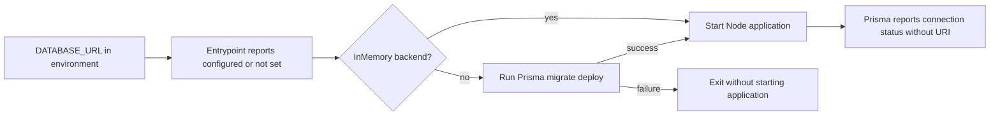

# Container startup database-configuration redaction

**Date:** 2026-10-17
**Status:** 0.55.56 published and on dev; customer-production evidence gates open.

## Executive summary

The published 0.55.54 shell entrypoint printed `DATABASE_URL` before the
application logger initialized. Follow-through inspection also found the
Prisma service interpolating that value into an application log message
and printing its default URI in a fallback warning. A password-bearing URI
could therefore appear in logs even when structured-data redaction and image
vulnerability scanning passed.

The narrow fix reports configuration presence and connection status only,
and removes the redundant credential-bearing Prisma info message. It does not change
database credentials, migrations, APIs, authentication or UI behavior.
Customer production remains on its previously deployed image until the
reviewed candidate and independent deployment gates pass.

## Startup flow and compatibility

This diagram shows the unchanged startup sequence and the single changed
output boundary. No new logging service or policy framework is introduced.



Configured nonempty values produce `DATABASE_URL: configured`. Unset and
empty values produce `DATABASE_URL: (not set)`. The connection URI, username,
password and hostname are not included in this message.

This is not a schema migration or a change to SCIM RFC 7643/7644 responses.
Existing application redaction remains independently required.

## Acceptance checks

| Layer | What it proves | Result |
|---|---|---|
| Permanent API unit guard | Known shell, Prisma message and fallback URI patterns cannot return | Initial shell GREEN: 7; expanded guard: 9 tests |
| Injected Prisma logger and fallback diagnostics | No URI components appear in any logger argument; connection/pool/lifecycle behavior is retained | Combined service/guard RED: 4 failed / 18 passed; GREEN: 22 passed |
| Expanded lifecycle preservation | Existing pool options, shutdown ordering and logging-shutdown race remain correct | Five focused suites: 41 PASS in 21.872 seconds |
| Integrated protected source | Normal hook validates actual combined source, without bypass | `58967716`: 28/28 PASS; API 6,072, HTTP 2,460 plus four retained skips, Web 1,624 |
| CI-only version lock metadata | No corporate-feed or dependency-graph contamination | Run `39036287752` succeeds on `58967716`; both 0.55.56 locks have identical graphs and public/sha512 provenance |
| Disposable Linux shell | Both backends preserve application startup and migrate-before-start or bypass ordering | Runtime contract includes explicit child markers and ordering |
| Configured, unset and empty values | Presence is accurate and no synthetic URI/user/password/host is disclosed | Old published-image RED: 20 PASS / 4 FAIL; fixed source-mounted GREEN: 24 PASS / 0 FAIL |
| Exact final image | The shipping entrypoint, not a mounted source replacement, is corrected | Published digest `07f08b85`: `-ImageEntrypoint`, 24 PASS / 0 FAIL |
| Real-image PostgreSQL | Actual migrations, application output and authenticated database-backed access work; migration authentication failure prevents startup | Synthetic isolated PostgreSQL: 29 migrations, inventory read and two shipping startup scenarios PASS; exact cleanup verified |
| Deployed HTTP/browser gates | Actual published dev deployment, not merely local source | Docker/dev live 1,797 each; full deployed Chromium 324 PASS without skips; native Entra 50 PASS |

The shell contract runs without network or exposed ports, removes each
container, and uses only synthetic fixture values. Node children are stubbed
so the test exercises real shell control flow without connecting to a database.

```powershell
pwsh -NoProfile -File scripts\test\docker-entrypoint.contract.ps1 `
    -Image '<exact published image digest>' `
    -ImageEntrypoint
```

Without `-ImageEntrypoint`, it mounts the current source entrypoint for focused
RED/GREEN development. Source-mounted results must not certify an old image.

## Merged-master dev checkpoint

PR #244 merged as `d43959e11e36c5607ef58323e2d520458f6cd14d`.
Canonical publish run `39043579816` succeeded on that exact master.
The shipping image is:

```text
ghcr.io/pranems/scimserver@sha256:07f08b855ebe178c6a9a5b60af80d4177c267b8878c959a09e5f1a64fdc03aa2
```

GHCR version 0.55.56, full-SHA and latest aliases, plus both ACR shipping
aliases, resolve to the same digest. Actual BuildKit provenance names the
source repository, exact commit and root Dockerfile. The publisher emits no
OCI revision labels; requiring a nonexistent label is not a valid source
check. No GitHub Release was created: a cosmetic `v*` tag would trigger the
alternate rebuilding workflow and risk replacing the verified image.

| Independent evidence | Observed result |
|---|---|
| Full merged-master dev pipeline | 5,855 seconds; 39 PASS / 0 FAIL / 1 SKIPPED / 9 reviewer PENDING, 49 rows |
| Sole pipeline skip | AutoCanary not requested; deliberate manual blue/green path, not a browser exclusion |
| Full persistence matrix | 6,072 API units in each mode; PostgreSQL HTTP 2,520; InMemory HTTP 2,516 plus four PostgreSQL-specific exclusions |
| Web units | 1,624 PASS, 123 files; coverage gate PASS |
| Docker and dev live | Each 1,797 PASS / 0 FAIL |
| Native Entra | 50 PASS in three modes; all 15 exact-ID cleanups succeeded; no secrets persisted |
| Deployed real Chromium | 324 PASS; zero skipped, unexpected or flaky; 356,956.424 ms |
| Additional headed Chromium | Six actual-data geometry sets at 1440/900 px widths and 540/1100 px heights; all four columns remain bounded |
| Geometry outcomes | Name column 39.01% wide / 38.33% narrow; zero horizontal overflow; dashboard rows at most 48 px |
| Inventory integrity | Dev 74 -> 74 original IDs; headed check attempts no mutations |
| Exact-image Trivy | Alpine 3.24.2 and Node packages; zero blocking HIGH/CRITICAL under existing ignore policy |
| Exact-image real application | Real tmpfs PostgreSQL; 29 migrations; authenticated database-backed inventory read; safe shell/application messages; migration authentication failure exits nonzero before application start |

The original reviewer rows remain PENDING records. Later finite author
self-review of the startup/OAuth delta is not independent approval, a new
whole-repository certification or a customer performance waiver.
Actual human observation of the named dev version/URL was requested but
unavailable; automated geometry does not manufacture that observation.

Customer still serves the independently checked 0.55.20 image `8b00fff0`.
No 0.55.56 canary or customer promotion has run. Running the actual old
compiled auth resolver verifies four migration-compatibility cases; it is
not a concurrent old/new HTTP workload certification.

### Protected-copy evidence and cleanup limits

A private restored copy passed Ready-state isolation verification after
supported owner-tag/public-network repair: public access Disabled, zero
firewall rules, approved private endpoint, exact private address/DNS
mapping, unpeered VNet and internal application environment. No credentials
or SQL were sent before this verification. The source database/application
were not upgraded.

The actual migration worker's replica exited zero, but CLI console collection
failed while discovering unrelated extension metadata. The structured
fingerprint/migration/lock receipt was lost, so **no measured-rehearsal PASS
is claimed**. The next attempt must first capture a credential-free live
transport marker and retain a final receipt drain window.

Every receipt-owned resource and its exact DNS VNet link is verified deleted.
Final provider-managed-group absence is unverified: the approved deployment
principal has Contributor only on the application RG and receives Forbidden
on the separate group. This is not proof that the group exists or is absent.
No account substitution, privilege elevation or manual managed-group deletion
was attempted. Authorized verification is required before cleanup can be
certified and the protected rehearsal repeated.

Customer performance disposition, actual target-specific visual observation,
measured actual-data receipt, normal canary/customer blue-green verification
and historical credential/log response remain open. Process liveness is not
database readiness: the health controller performs no database query. Actual
old/new direct-node bypass diagnostics both remain live with invalid database
credentials; only the old artifact discloses the synthetic password.
The supported shipping path independently rejects those credentials during
migration. Positive database access is proven by the authenticated inventory
request, not by liveness or adapter initialization.

Evidence receipts remain in the owning continuation's ignored artifacts:
`dev-deploy-2026-10-17-075244.md`,
`playwright-dev-2026-10-17-075244.json`,
`release-05556-headed-readonly-measurements-20261017.json`,
`startup-05556-real-app-synthetic-final.json` and the exact resource receipt.
These local files are not falsely represented as downloadable CI artifacts.

## Operational response

Restrict startup-log access and review retention for affected containers.
Coordinate rotation of a database credential if it was included in retained
logs, updating its consumers without losing database access. Do not export
connection strings into reports or command-line arguments. Deploying this
fix prevents new disclosure but does not sanitize retained logs or rotate a
credential automatically.

## Execution issues and root-cause analysis

Initial source fix: normal commit `c1fe8ab8`. Exact artifact and deployment
results must be appended after they actually run. The first protected push
stopped at C13 after 12 passing gates because the README version badge still
said 0.55.54; no subsequent unit/HTTP/Web gates are claimed from that attempt.
After the focused badge correction, the separate normal protected push passed
all 28 Validate gates in 1,129.5 seconds: 6,061 API units, 2,460 HTTP tests
with four retained InMemory-specific skips, and 1,624 Web tests. These are
source-consolidation results at `c907b05`, not final-image/deployment proof.

| ID | Type / severity | Symptom and root cause | Resolution and why it works | Detection / earliest useful gate |
|---|---|---|---|---|
| START-01 | Security / High | Shell startup printed a credential-bearing URI before logger redaction existed; image CVE scanning does not analyze shell output | Presence-only conditional, permanent source guard and real-shell contract remove the disclosure and exercise its actual output boundary | Found during customer-release preflight / first real entrypoint startup test before publication |
| START-02 | Cross-platform test fixture / Low | Initial contract failed before startup: Windows here-string CRLF reached Linux `sh` as part of `set -eu` | Normalize fixture newlines to LF before Docker execution; only the later child-success plus disclosure-assertion failures count as meaningful RED | First focused contract run / first focused contract run |
| START-03 | Tooling / Low | VS Code's test adapter found no tests in this separately owned worktree | Run the existing package's targeted Jest command from its actual directory; no new test tooling or dependency installation | Focused unit invocation / focused unit invocation |
| START-04 | Documentation version coupling / Low | Existing freshness autofix updated headers, not the separate README version badge; protected push failed C13 | Update the badge and run the existing content audit before retrying the normal hook. C13 already provides a permanent negative control; no gate weakening or new harness is needed | Protected Stage 1 content audit / focused content audit immediately after the version/header update |
| START-05 | Tooling / Low | A multi-file patch applied five edits before its last hunk failed because the expected phrase crossed a line break | Inspect only the failed anchor and retry only that hunk; prior successful edits stay applied, with no duplicated sections | Immediate patch result / immediate patch result |
| START-06 | Security coverage / High | Follow-through found a second runtime disclosure: Prisma put the URI directly into the message, bypassing structured-data sanitization. Existing lifecycle tests never injected the optional logger | Inject the logger through a real Nest test module, observe expected disclosure RED, remove the redundant info call and redact the fallback warning. Add two source guards and retain connection/status assertions | Cross-surface source inspection before final push / initial startup logging inventory and logger-injected lifecycle test |
| START-07 | Release coordination / Medium | Independently reviewed OAuth delivery and the tentative startup patch both used 0.55.55; another worktree began its dev pipeline | Reserve unused 0.55.56 for this correction, regenerate its lock metadata only in CI, serialize local heavy checks and recheck semantic-tag ownership before publication. No other worktree or process is changed | Prepublication coordination / candidate-version assignment |
| START-08 | Tooling / Low | Whole-file JSON parsing failed on oversized documentation output containing multiple JSON records | Parse the first complete record and read bounded excerpts; no source or deployment failed | Documentation retrieval / documentation retrieval |
| START-09 | Tooling / Low | A process probe returned nonzero because the old HTTP PID exited between checks | Use nullable CIM process results for the validation queue. An exited process releases ownership; it is not a failed quality gate | Process observation / process observation |
| START-10 | Artifact assumption / Medium | Host expected an OCI revision label that the actual canonical publisher does not emit | Verify the exact-digest BuildKit attestation's repository, revision and root Dockerfile. Positive and wrong-source controls pass; no label is fabricated | Rehearsal preflight / inspect publisher output before defining its proof contract |
| START-11 | CLI semantics / Low | Secret listing returned metadata, not the authorized value | Supported explicit value retrieval remains in memory, never arguments or files; empty-value guard prevents job creation | Host preflight / installed command signature inspection |
| START-12 | Sensitive diagnostics / High | .NET URI conversion rejected an unescaped userinfo delimiter accepted by Node and echoed its input | Replace the owned diagnostic with a safe explanation; use Node stdin/in-memory transformation and synthetic delimiter cases. Do not claim terminal/session retention globally purged; restrict records and coordinate rotation | Pre-job URI conversion / synthetic delimiter test before reading a real value |
| START-13 | Credential-output oracle / Medium | Whole-URI and decoded-password checks missed an encoded password after query rewriting | Expected negative control fails first; compare normalized/original URI and encoded/decoded password forms. Four detector cases plus URI/auth oracle cases total 14 PASS | Focused negative control / output detector authoring |
| START-14 | Console transport / High | Worker exited zero but all collectors failed on unrelated extension metadata; no structured receipt survived cleanup | Isolate the existing installed containerapp extension without permission/version changes. Require a credential-free live log preflight and a 90-second final drain window before the next actual migration. New transport controls still await protected-copy execution | Recorder failure / live transport smoke before migration |
| START-15 | Cleanup dependency / Medium | Generic private-DNS-zone deletion failed while its VNet link existed | Record the exact child ID, verify owner tag and delete child before parent. Recovery verifies child, zone and all remaining owned network roots absent | Final cleanup / dependency-order review before resource creation |
| START-16 | Cloud permission / Medium, blocked | Final infrastructure-group read returns Forbidden despite app-RG Contributor permission | Request authorized exact-scope verification; retain cleanup-required state. Do not infer absence, substitute accounts or grant oneself roles | Final cleanup certification / per-scope read-permission preflight |
| START-17 | Test assumptions / Medium | Two exploratory direct-node tests assumed fail-fast exit and deep readiness from a liveness endpoint | Source inspection and actual old/new comparison establish unchanged bypass behavior. Preserve failed receipts; prove supported-path database access with an authenticated inventory read, and migration failure with nonzero exit/no app start | Extra exact-image test / inspect startup and endpoint contracts before assertions |
| START-18 | Shell friction / Low | A statement-to-pipe probe and a native JMESPath quoting probe failed before useful execution | Assign iteration output before piping; retrieve bounded CLI metadata and filter in PowerShell. Neither failure is an application or deployment failure | Parser / argument-shape validation |
| START-19 | Restore lifecycle / Medium | Ready restore inherited source owner tags/public-network setting despite initial create inputs | Prove exact Create ownership before supported Ready-state tag/network repair; require complete isolation verification before secrets or SQL. Zero firewall rules were independently checked | Ready isolation verifier / final Ready-state inspection, not provisional metadata |
| REST-01 | Azure scope / Low | New resource-group availability probe returned Forbidden before creation; existing resource-group operations remained permitted | Use only the existing authorized customer resource group, with exact owned temporary server IDs and no role/account changes | Initial group probe / read-only permissions or group probe |
| REST-02 | Provisioning evidence / Medium | Provisional restore metadata reported public access Enabled; the later Dropping response reported Disabled | Abort and verify exact deletion. Final-setting disregard is not established. Future acceptance must check Ready-state network configuration and firewall rules, not provisional defaults | First restore metadata check / first restore metadata check |

The first temporary restored server was confirmed `ResourceNotFound`; its
existing customer resource group and source server were not deleted or modified.
A validated isolated production-copy migration rehearsal is still pending.

## Self-improvement and architecture disposition

**Test/gate improvement: applied.** Check both output before the application's
logger and interpolated application messages as separate boundaries. Inject
optional logger dependencies in lifecycle tests, capture all logging arguments,
and keep pool/connection assertions. Synthetic runtime failures must also prove startup
reached the intended child, rather than counting fixture failures as RED.
The permanent source guard runs in the existing unit gate. The runtime
contract is an explicit exact-image release check, not an implicit claim that
every existing pipeline already invokes it. For version-only documentation
coupling, run the existing content audit as well as freshness autofix;
header freshness alone does not certify a badge. The first protected C13
failure demonstrates the existing check is discriminating, not a gate gap.

**Design/architecture: accepted.** A small shell conditional owns one concern,
adds no dependency edge, and preserves the existing orchestrator. A logging
framework or provider abstraction would be speculative for two fixed messages.

**Provenance/completeness:** the complete available current-session event log
was scanned through 22,498 records, with the approved delivery window starting
2026-10-17 at 10:54:02 UTC containing 479 records at that checkpoint. The
error/signal and diagnostic-narration passes were reconciled to the five initial issues
above. Apparent TypeScript/module errors were verified search-command echoes,
not new compiler/runtime failures; HTTP-like digits in identifiers and test
source were not treated as HTTP failures. This is not a claim to restore the
deleted original conversation. Historical source, browser and migration
receipts retain their original artifact identities. START-04 was captured
when the later protected-push failure was diagnosed; START-05 and START-06
were appended after their confirmed fixes. The queued integrated-master push
was stopped before it started; remote remained `c907b05` while the second
runtime disclosure was corrected. The subsequent normal `58967716` Validate
push passes all 28 gates.

The refreshed two-pass reconciliation scans 23,764 available current-session
records, including 1,745 in the approved delivery window. Signal and narration
passes identify the entries above; two apparent module-error hits are verified
as an earlier frequency report and a workflow comment, not module failures.
Retained diagnostic baselines, expected RED runs, negative fixtures and
version-availability probes are not relabeled as new production defects.
This is evidence from the recovered continuation, not restoration of the
deleted original Project 3 transcript.

The delivery supplement additionally scans the full available continuation
snapshot through 26,336 records, 4,317 in the approved window, with separate
failure-signal and causal-narration categories. Its retained reconciliation
contains record metadata/category labels only, not diagnostic text or
credentials. Actual receipts and contemporaneous diagnoses map this phase to
START-10 through START-19. Frequency counts include documentation/search
echoes, expected negative controls and earlier START-01 through START-09;
they are not issue counts. Two failed synthetic assumptions are retained,
not counted as product regressions. Role-inspection denial and the missing
measurement receipt remain unresolved outcomes, not repaired successes.
This is a checkpoint reconciliation, not a claim that customer delivery or
the deleted original session is complete.
