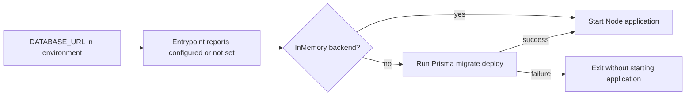

# Container startup database-configuration redaction

**Date:** 2026-10-17
**Status:** 0.55.55 candidate; publication and deployment gates pending.

## Executive summary

The published 0.55.54 shell entrypoint printed `DATABASE_URL` before the
application logger initialized. A password-bearing connection URI could
therefore appear in container console logs even when application-level
redaction and image vulnerability scanning passed.

The narrow fix reports configuration presence only. It does not change
database credentials, migrations, APIs, authentication or UI behavior.
Customer production remains on its previously deployed image until the
reviewed candidate and independent deployment gates pass.

## Startup flow and compatibility

This diagram shows the unchanged startup sequence and the single changed
output boundary. No new logging service or policy framework is introduced.



Configured nonempty values produce `DATABASE_URL: configured`. Unset and
empty values produce `DATABASE_URL: (not set)`. The connection URI, username,
password and hostname are not included in this message.

This is not a schema migration or a change to SCIM RFC 7643/7644 responses.
Existing application redaction remains independently required.

## Acceptance checks

| Layer | What it proves | Result |
|---|---|---|
| Permanent API unit guard | The known raw connection-string logging pattern cannot return | RED: 1 failed / 6 passed; GREEN: 7 passed |
| Disposable Linux shell | Both backends preserve application startup and migrate-before-start or bypass ordering | Runtime contract includes explicit child markers and ordering |
| Configured, unset and empty values | Presence is accurate and no synthetic URI/user/password/host is disclosed | Old published-image RED: 20 PASS / 4 FAIL; fixed source-mounted GREEN: 24 PASS / 0 FAIL |
| Exact final image | The shipping entrypoint, not a mounted source replacement, is corrected | Pending publication; run with `-ImageEntrypoint` |
| Actual database and HTTP/browser gates | Real migrations, connectivity and user behavior still work | Independent release gates, not replaced by this fixture |

The shell contract runs without network or exposed ports, removes each
container, and uses only synthetic fixture values. Node children are stubbed
so the test exercises real shell control flow without connecting to a database.

```powershell
pwsh -NoProfile -File scripts\test\docker-entrypoint.contract.ps1 `
    -Image '<exact published image digest>' `
    -ImageEntrypoint
```

Without `-ImageEntrypoint`, it mounts the current source entrypoint for focused
RED/GREEN development. Source-mounted results must not certify an old image.

## Operational response

Restrict startup-log access and review retention for affected containers.
Coordinate rotation of a database credential if it was included in retained
logs, updating its consumers without losing database access. Do not export
connection strings into reports or command-line arguments. Deploying this
fix prevents new disclosure but does not sanitize retained logs or rotate a
credential automatically.

## Execution issues and root-cause analysis

Initial source fix: normal commit `c1fe8ab8`. Exact artifact and deployment
results must be appended after they actually run. The first protected push
stopped at C13 after 12 passing gates because the README version badge still
said 0.55.54; no subsequent unit/HTTP/Web gates are claimed from that attempt.

| ID | Type / severity | Symptom and root cause | Resolution and why it works | Detection / earliest useful gate |
|---|---|---|---|---|
| START-01 | Security / High | Shell startup printed a credential-bearing URI before logger redaction existed; image CVE scanning does not analyze shell output | Presence-only conditional, permanent source guard and real-shell contract remove the disclosure and exercise its actual output boundary | Found during customer-release preflight / first real entrypoint startup test before publication |
| START-02 | Cross-platform test fixture / Low | Initial contract failed before startup: Windows here-string CRLF reached Linux `sh` as part of `set -eu` | Normalize fixture newlines to LF before Docker execution; only the later child-success plus disclosure-assertion failures count as meaningful RED | First focused contract run / first focused contract run |
| START-03 | Tooling / Low | VS Code's test adapter found no tests in this separately owned worktree | Run the existing package's targeted Jest command from its actual directory; no new test tooling or dependency installation | Focused unit invocation / focused unit invocation |
| START-04 | Documentation version coupling / Low | Existing freshness autofix updated headers, not the separate README version badge; protected push failed C13 | Update the badge and run the existing content audit before retrying the normal hook. C13 already provides a permanent negative control; no gate weakening or new harness is needed | Protected Stage 1 content audit / focused content audit immediately after the version/header update |
| REST-01 | Azure scope / Low | New resource-group availability probe returned Forbidden before creation; existing resource-group operations remained permitted | Use only the existing authorized customer resource group, with exact owned temporary server IDs and no role/account changes | Initial group probe / read-only permissions or group probe |
| REST-02 | Provisioning evidence / Medium | Provisional restore metadata reported public access Enabled; the later Dropping response reported Disabled | Abort and verify exact deletion. Final-setting disregard is not established. Future acceptance must check Ready-state network configuration and firewall rules, not provisional defaults | First restore metadata check / first restore metadata check |

The first temporary restored server was confirmed `ResourceNotFound`; its
existing customer resource group and source server were not deleted or modified.
A validated isolated production-copy migration rehearsal is still pending.

## Self-improvement and architecture disposition

**Test/gate improvement: applied.** Check output before the application's logger
as a separate boundary; synthetic runtime failures must also prove startup
reached the intended child, rather than counting fixture failures as RED.
The permanent source guard runs in the existing unit gate. The runtime
contract is an explicit exact-image release check, not an implicit claim that
every existing pipeline already invokes it. For version-only documentation
coupling, run the existing content audit as well as freshness autofix;
header freshness alone does not certify a badge. The first protected C13
failure demonstrates the existing check is discriminating, not a gate gap.

**Design/architecture: accepted.** A small shell conditional owns one concern,
adds no dependency edge, and preserves the existing orchestrator. A logging
framework or provider abstraction would be speculative for two fixed messages.

**Provenance/completeness:** the complete available current-session event log
was scanned through 22,498 records, with the approved delivery window starting
2026-10-17 at 10:54:02 UTC containing 479 records at that checkpoint. The
error/signal and diagnostic-narration passes were reconciled to the five initial issues
above. Apparent TypeScript/module errors were verified search-command echoes,
not new compiler/runtime failures; HTTP-like digits in identifiers and test
source were not treated as HTTP failures. This is not a claim to restore the
deleted original conversation. Historical source, browser and migration
receipts retain their original artifact identities. START-04 was captured
immediately when the later protected-push failure was diagnosed.
