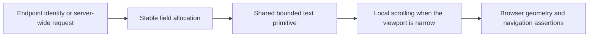

# Activity and endpoint identity readability

**Status:** v0.55.49 consolidation in progress, deployment pending
**Last verified:** 2026-10-14

## Executive summary

Dashboard Recent Activity now reserves the same six fields on every row.
Operations User and Group tables retain bounded endpoint labels and a readable
minimum width on mobile. These are the first two items in the
[operator review backlog](UI_VISUAL_REVIEW_BACKLOG_2026-10-12.md).
This document describes local source and browser evidence, not a change already
deployed to dev or approved for production.

## Root causes and correction

| Surface | Observed cause | Correction |
|---|---|---|
| Recent Activity | Rows without an endpoint omitted a field, and flexible long values shifted adjacent fields. | Six shared grid tracks, a `Server-wide` placeholder, and the existing `TruncatedText` primitive for paths and names. |
| Operations provenance | The inline endpoint link was not a bounded block; long badge text wrapped vertically. | Block-level bounded link, shrinkable badge, shared truncation, and retained full-identity title. |
| Mobile Operations | Percentage columns alone left only 28.44 px for an endpoint link at a 390 px viewport. | A 480 px minimum table width with horizontal scrolling owned by each table Card. Columns remain proportional. |

No endpoint API, authentication, resource data, URL-state ownership, or
repository behavior changes. Existing modifier-click and normal navigation
semantics remain on the endpoint link. Full names remain available on the link
title and the shared text tooltip.

## Measured validation

The regression spec is
[activity-endpoint-readability.spec.ts](../web/e2e/activity-endpoint-readability.spec.ts).
It runs against the actual React components in Chromium, using deterministic
display API fixtures after real server health/authentication preflight. It
does not claim live provisioning or mutate source endpoint resources.

| Check | Evidence |
|---|---|
| RED before the desktop correction | Six wide/narrow cases failed on unequal activity-field counts or unreadable Operations labels. |
| Mobile negative case | Both Operations cases failed the minimum readable link width; failure screenshots showed crowded headers and an almost empty endpoint label. |
| Responsive GREEN | Nine cases across Dashboard, Users, and Groups at 1440, 900, and 390 px passed. |
| Actual truncation | Endpoint text is 1,710 px wide before clipping; visible label widths are 193, 85, and 68 px respectively. Operations row height is 61 px at all three widths. |
| Navigation and identity | Full title/name values and the resulting endpoint-specific destinations are asserted, not merely link presence. |
| Mobile containment | Document width stays inside the viewport; activity and table panels own their horizontal overflow. |
| Component tests | 25 affected Dashboard/Operations tests passed before the final CSS-only mobile floor adjustment. |
| Type diagnostics | Raw web type checking still fails on the existing baseline. Compiler-host comparison measured 66 baseline and 66 current diagnostics, zero additions; editor diagnostics for changed files are empty. |
| Final-source build and size | The normal push hook built the final web source successfully. All final bundle budgets pass; Dashboard is 3.05 kB and Operations is 3.72 kB gzipped. |
| Normal push gate | Commit `e2758b04` passed the Fast hook and was pushed. API InMemory E2E: 116 suites, 2,429 passed, zero failed, four PostgreSQL-specific skips. Web type checking was baseline-tolerated, not error-free. |
| Actual documentation render | After restoring matching installed root tooling, four blocks across the changed documents rendered in Chromium under strict security in both light and dark themes. The hook's earlier zero-second PASS had actually skipped this check. |

Each browser case writes a numerical JSON receipt through
`testInfo.outputPath()` and attaches the resulting file. Receipts are ignored
artifacts under `test-results/playwright-output`, not committed screenshots.
The spec uses the configured `E2E_BASE_URL` and `E2E_TOKEN`, so it is portable
across local, container, and dev deployments.

## Execution issues and prevention

| ID | Type / severity | Symptom and root cause | Resolution and why it works | Detection / earliest detection |
|---|---|---|---|---|
| UR-01 | Environment / Low | Fresh worktree lacked installed Playwright dependencies. | After the missing-dependency failure, link matching installed dependencies; no npm manifest or lock regeneration. | Test discovery / test discovery |
| UR-02 | Generated client / Low | API build needed the ignored Prisma client; generation also required a database URL. | Run the existing generator with a generation-only URL, then the existing build. No database connection or schema change. | Build / build |
| UR-03 | Readiness / Low | Proxy returned 502 before the isolated API was ready. | Require a successful proxied health check before browser execution. Process existence alone does not establish readiness. | Health probe / health probe |
| UR-04 | CLI selector / Low | Windows backslashes in a Playwright regex selector produced no matching tests. | Select the distinctive filename pattern instead of a path with regex escapes. | Test discovery / test discovery |
| UR-05 | Baseline diagnostics / Medium | Raw web type checking failed on unrelated existing errors. | Compare exact diagnostics against HEAD without reverting files; retain failure status and report zero additions, not a clean type check. | Type check / baseline comparison before edits |
| UR-06 | Evidence retention / Medium | Body-only test attachments did not survive the line reporter as reusable receipts. | Write JSON to the test output path and attach the file; verify all nine physical receipts exist. | Receipt inspection / first test artifact inspection |
| UR-07 | Responsive layout / Medium | Desktop/narrow GREEN did not detect the mobile label collapsing to 28.44 px. | Add the 390 px lane before completion; retain the width assertion, add a table floor and local scroll ownership. | Mobile browser lane / mobile browser lane |
| UR-08 | Gate reporting / High | The hook labelled missing root Mermaid tooling PASS in 0.0 seconds although its action skipped rendering. | Confirm the missing module, restore a junction to the matching installed pin without npm/lockfile changes, and execute the real changed-document renderer. Separately harden skip-to-PASS reporting; a summary status alone is not evidence of execution. | Detailed push-receipt inspection / tooling preflight |
| UR-09 | Renderer discovery / Medium | The real renderer reports a built-in Mermaid version of `0.0.0`, producing an equivalence warning against the pinned `11.15.0`. | Do not install `mermaid@0.0.0` or claim renderer equivalence. Actual Chromium rendering passed; version-discovery diagnosis remains scheduled independently. | Actual render / renderer discovery preflight |

**Provenance / completeness:** Although `VSCODE_TARGET_SESSION_LOG` was unset,
the session's full `events.jsonl` was available. The reconciliation scanned all
45,085 raw events, selected the 220 entries containing this continuation's
identifiers, and ran both error-signal and causal-narration passes. The results
were reconciled with the continuation summary, failure artifacts, and current
command results. Signal counts include tool-request echoes and are not issue
recurrence counts. Missing test selection and startup readiness were verified
harness issues, not product regressions. Later push/render findings are recorded
as UR-08/UR-09 above.

**Test/gate improvement applied:** Add mobile geometry checks and retained
file-backed evidence, rather than weakening bounds or checking CSS properties
alone.

**Gate follow-up scheduled:** Release-assurance tooling owner, target
2026-10-14: distinguish an unavailable required Mermaid check from PASS and
finish renderer-version discovery in a separate gate-hardening
change. Root tooling has been restored for this worktree, so actual rendering
is no longer skipped here. The independent owner has since identified the
built-in version as 11.17.0 against root 11.15.0. Actual strict light/dark
rendering passed, but renderer equivalence remains unverified; no tooling
installation or gate edits are included in this release.

**Design/architecture disposition accepted:** Small presentation-only changes
reuse the existing truncation primitive and percentage columns. No new service,
dependency edge, endpoint identity model, or speculative abstraction is needed.

## Remaining release boundaries

Normal merge `c90602dd` incorporates runtime master `99cdeda3` and retains
both original UI commits. The only conflict was current session ownership
context; both runtime and UI handoffs were retained with their actual states.
CI-only API/web release locks and post-merge targeted checks are pending.
Runtime #215's pipeline and legacy-reference proof remain separately owned.
Shared dev/live/directory mutation requires explicit runtime handoff and
coordination with the parent's bounded gallery validation lease. No original
analysis checkout, other owned worktree, or shared database is modified.

Final-source normal hooks passed, with the explicit exceptions above.
Exact-tip CI, deployed browser validation, and
operator visual verification are still required. Discovery selectors, sticky
filters, Dashboard inventory density, and custom Entra mappings are separate
pending outcomes; this correction does not close them.
