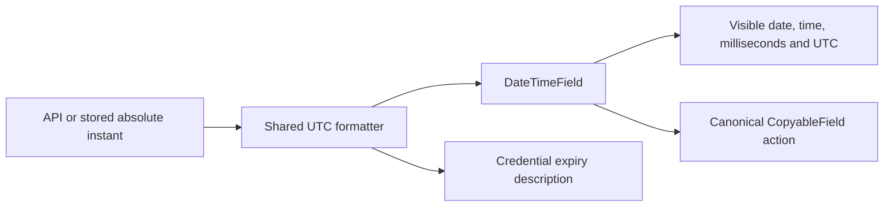

# UI Date-Time and Endpoint Identity Consistency

**Last verified:** 2026-10-15

**Status:** Implementation and focused validation complete; protected release consolidation in progress. Not deployed.

## Executive summary

The earlier Operations readability fix bounded long endpoint names but retained
the outlined badge. It did not implement the operator's requested plain name,
copy, and open presentation. Timestamp formatting was also inconsistent:
some surfaces displayed only a date, others only a clock, and others used a
browser-dependent full timestamp.

This change uses one UTC timestamp presentation and removes the persistent
Operations endpoint outline. All 33 focused browser cases now pass, including
responsive journeys at 1440, 900 and 390 px. Release metadata, reviewed delivery, dev validation, and operator
visual acceptance remain separate, unfinished claims.

## Display contract

| Value | Presentation |
|---|---|
| Absolute timestamp | `2026-10-15 04:05:06.789 UTC`, with both date and time visible |
| Offset-bearing timestamp | Display the same instant in UTC; copy the original timestamp |
| Numeric epoch or `Date` | Display UTC; copy its complete ISO timestamp |
| Missing timestamp | `-`, without a meaningless copy action |
| Unparseable or timezone-free timestamp | Explicit `Invalid timestamp` text, not a fabricated instant |
| Notification age | Keep the relative age alongside the absolute timestamp |
| Duration or remaining validity | Preserve its duration meaning; show a complete expiry timestamp where applicable |
| Raw JSON, SCIM date-only domain attributes, export contents, and filename timestamps | Preserve their existing representation |

UTC is explicit so a request can be correlated across browser, service, and
deployment logs without guessing the operator's machine timezone. This does
not introduce a timezone preference or change stored timestamps.

The formatter owns timestamp interpretation. The field owns semantic `time`
markup and wrapping. Clipboard behavior remains in the existing copy primitive.
Neither API contracts nor raw resource JSON are rewritten.

## Surface inventory

| Surface | Previously observed | New source behavior |
|---|---|---|
| Operations Users and Groups | Date-only creation column | Complete UTC timestamp |
| Endpoint header | Date-only creation | Complete UTC timestamp |
| Endpoint Users and Groups | Date-only creation columns | Complete UTC timestamp |
| Global and endpoint Logs | Mixed full-local and time-only | Complete UTC timestamp |
| Activity and endpoint Overview | Time-only | Complete UTC timestamp |
| Workbench history | Time-only | Complete UTC timestamp |
| Auth diagnostics list and request detail | Time-only | Complete UTC timestamp |
| Connection health | Browser-dependent full timestamp | Complete UTC timestamp |
| Credential creation, expiry, and trust verification | Mixed date-only and full-local | Complete UTC timestamps |
| Live log drawer | Clock and milliseconds only | Complete UTC timestamp |
| Notifications | Relative age only | Complete UTC timestamp plus relative age |

Operations endpoint identity uses a bounded plain-name navigation action, the
canonical copy button, and a separate new-tab open action. Native modifier and
middle-click handling for the name link remains intact. Keyboard focus
indicators are not removed.

## Validation checkpoint

| Evidence | Measured result | Limit |
|---|---|---|
| Original Operations regression units | Two expected assertion failures before implementation | Not live deployment proof |
| Initial formatter, field, and Operations units | 26 passed | Later coupled changes require consolidation |
| Related unit consolidation | Seven suites pass 148 cases; corrected policy replay passes three cases | Original combined receipt retains one policy-path failure, not a false all-green run |
| Exact HEAD TypeScript comparison | 66 baseline errors, 66 current errors, zero new diagnostics | Existing errors are not a clean type check |
| Initial desktop Operations browser checks | Six passed before action assertions were strengthened | Presence was not sufficient to prove usable actions |
| Earlier strengthened desktop browser checks | Seven passed at 1440 px, including actual copy, open, keyboard, and text bounds | Superseded by the final responsive receipt below |
| Final focused browser consolidation | 33 passed in 7.0 minutes: nine readability cases, 12 cross-surface responsive cases and 12 inline-auth regressions | Local fixture-backed UI evidence, not current dev or live provisioning proof |
| Final compiler checks | Exact HEAD comparison remains 66/66 with zero new diagnostics; all three changed browser specs compile cleanly | Main project is not zero-error; browser file-targeted TypeScript 6 invocation uses `--ignoreConfig` |
| Documentation and layout | Freshness passes all 26 documents; table-layout audit passes all 106 TSX files; new diagram renders in both strict themes | Mermaid gate uses 11.15.0 while current built-in editor uses 11.17.0; editor equivalence is not claimed |
| Second protected Validate attempt | 24 gates pass, including 6,043 API units and 2,432 selected InMemory E2E cases; four native-only cases skipped | Attempt remains failed: Prisma codegen required process-local DATABASE_URL before full web suite admission |
| Successful protected Validate push | All 27 gates pass in 823 seconds at 3032b5df; 6,043 API units, 2,432 selected InMemory E2E passes/four native-only exclusions, 1,624 web tests across 123 files | Independent current coverage/backend/deployment evidence still belongs to dev closure |
| Bundle budgets and source character policy | All budgets pass against hook-built output; Operations 3.83 kB gzipped; zero added-line em-dash characters | No second build or unrelated budget change |
| CI lock regeneration | Run 38817415869 succeeds at exact 3032b5df; both 0.55.50 locks differ only in root version fields and retain public-registry SHA512 provenance | Root tooling manifest/lock and dependency versions remain unchanged |
| Cross-surface browser suite | Initial interrupted failure retained as an artifact | Not a passing release receipt |

Browser fixtures pass real health/authentication preflight, then intercept
display data. They do not prove live gallery provisioning. Secret-reveal POSTs
are fulfilled locally with fixture-only values; unexpected non-GET requests
are rejected before they can be forwarded.

The final geometry receipts measure both Users and Groups endpoint-name links
at 152.61 px in a 1440 px viewport, and 60.17 px in both 900 and 390 px
viewports. Their tables are 1101/640/640 px respectively. Narrow tables scroll
locally; they do not widen the document. These are measured results, not
inferences from CSS properties.

## Execution issues and root causes

| ID | Type / severity | Symptom and mechanism | Resolution and why it works | Detection / earliest applicable gate |
|---|---|---|---|---|
| DT-I01 | Test completeness / High | Earlier checks proved bounded endpoint text, not removal of the outline or usable copy/open actions. | Assert absence of the badge, actual clipboard contents, new-tab URL, primary navigation, and real bounds. | Operator report / original UI acceptance tests |
| DT-I02 | Layout / High | The new open icon intercepted copy clicks even though both controls were visible. The button-only copy wrapper could shrink while its child button could not. | Make the button-only primitive wrapper nonshrinking. Seven strengthened desktop browser cases pass after the correction. | Browser action assertion / focused browser test |
| DT-I03 | Keyboard / High | Enter and Space from a copy button bubbled into a containing row's activation handler. Two unit assertions observed the parent being called. | Stop propagation of activation keys without preventing the native button action. Desktop browser checks prove copying leaves the current route unchanged. Non-activation keys remain unaffected. | Focused RED unit / focused unit |
| DT-I04 | Accessibility / High | A timestamp copy button initially nested inside an accordion header button. Browser assertion found one nested native button. | Render the timestamp action as the header's sibling. Overview request and copy actions are also independent native buttons. Desktop browser checks pass. | Focused RED browser / component composition review |
| DT-I05 | Fixture / Medium | A blanket GET-only fixture rejected automatic secret-reveal reads; a guessed connection-panel test ID and `/overview` path also targeted the wrong UI. | Locally fulfill reveal POSTs, reject forwarding of every other mutation, use the actual shared-secret panel, and visit the endpoint index for Overview. Desktop journey now passes. | Browser fixture smoke / route and fixture source inspection |
| DT-I06 | Tooling / Low | The editor test tool found no tests outside its current workspace; a backslash-containing Playwright selector matched no tests. Several guessed source paths or ranges were invalid. | Use the owned worktree's existing runner, use filename selectors where the CLI expects a regular expression, and discover source paths before reading them. | Command output / runner and path preflight |
| DT-I07 | Layout / High | The initial responsive run passed 12 and failed two mobile width assertions: adding copy/open actions left a 28 px endpoint label under the old 480 px table floor. | Keep the existing greater-than-40 px assertion and raise the locally scrolling table floor to 640 px. Both 390 px resource cases and all 33 final browser cases pass; click, Space copy and open navigation are exercised. | Responsive browser / first responsive run after adding actions |
| DT-I08 | Validation / High | JavaScript parsed date-only and timezone-free credential expiry strings even though the shared formatter rejected them, yielding success-shaped `Valid until Invalid timestamp` text. Two focused assertions failed. | Require the formatter's valid ISO result before computing validity. All three invalid/ambiguous expiry cases pass in focused consolidation. | Focused RED unit / focused unit |
| DT-I09 | Test tooling / Low | Vite transformed `new URL('..', import.meta.url)` as a browser asset URL. The source-policy test failed with `ERR_INVALID_URL_SCHEME` before scanning any source. | Follow the existing Node filesystem-test pattern: convert `import.meta.url` directly, then resolve its parent with Node path functions. All three policy cases pass, including both negative controls and the actual production scan. | Focused unit / first source-policy smoke |
| DT-I10 | Test fixture / Medium | The earlier complete coverage run timed out after mounting 5,000 live-log rows merely to check the buffer-cap banner. Rendering work was coupled to a buffer-policy assertion. | Retain actual 4,999/5,000-entry buffers but filter rendered rows to one and assert both boundary outcomes. Focused cases pass in 44/50 ms. This does not claim 5,000-row rendering performance. | Earlier complete coverage / focused cap-boundary unit |
| DT-I11 | Documentation / Low | The freshness coupling gate identified two missing consumer-document updates after the timestamp changes. Updating only the new feature doc and UI tour was insufficient. | Update authentication validity/diagnostic guidance and navigation/copy behavior in their existing user-facing guides. All 26 freshness checks pass; the existing coupling gate already catches this class. | Focused freshness gate / same gate |
| DT-I12 | Compiler tooling / Low | A standalone TypeScript 6 browser-spec command failed with TS5112 because explicit files and a nearby project config require a deliberate choice. | Use `--ignoreConfig` with explicit target/module/lib/types flags for that separate check. All three changed browser specs compile with exit zero; the normal project config still receives its own baseline comparison. | Standalone type check / same check |
| DT-I13 | Environment drift / Medium | Strict rendering passed, but the installed built-in Mermaid renderer is 11.17.0 while the pinned gate is 11.15.0. Content rendering cannot establish editor equivalence under that mismatch. | Scheduled, not silently resolved: repository maintainer to align tooling through a separate quarantined CI-lockfile change by 2026-10-16. No root dependency regeneration on the corporate host and no claim of editor-version parity. | Renderer warning / renderer-version audit |
| DT-I14 | Release metadata / Low | The first protected Validate push stopped after 11 passing static gates because the README version badge still said 0.55.49. The freshness fixer updates headers, not image badge URLs; the independent content gate caught the difference. | Update the badge to 0.55.50 and run the content check before retrying the unchanged normal hook. Version-bump preflight must include both freshness and content checks. Preserve the failed 223.9-second receipt; no full-unit claim belongs to that stopped run. | Protected content gate / focused content preflight |
| DT-I15 | Environment / Medium | The next protected attempt passed 24 gates but Prisma config evaluation failed because DATABASE_URL was absent. A prior shell's environment was not inherited; `env()` throws before its apparent fallback can apply. Full web tests were not admitted. | Explicitly set a non-live loopback port-1 codegen URL in each Validate process. Focused generation now succeeds with Prisma 7.8.0; it performs no connection, migration or live mutation. Retain the failed 454.2-second receipt. Validate preflight must establish codegen environment before costly test admission, not rely on a prior shell. | Protected codegen gate / focused codegen preflight |
| DT-I16 | Patch tooling / Low | A later documentation hunk used an assumed sentence instead of its exact current text. The multi-file patch reported partial application after changing the changelog. | Preserve that successful edit, inspect only the failed section and apply only failed/unattempted hunks. The corrected patch succeeds without duplicate entries or rollback. Treat a multi-file patch failure as potentially partial, not atomic. | Patch result / exact-context preflight |

The original coverage failure in the 5,000-row log-cap fixture is retained in
the gallery continuation evidence. This change keeps real 4,999/5,000-entry
buffers but filters visible rows to one. Both exact banner-boundary cases now
pass in 44/50 ms in the focused receipt, without mounting thousands of unrelated
Fluent controls. No timeout, buffer size or coverage floor has been relaxed.
This is buffer-policy evidence, not a 5,000-rendered-row performance claim.

### Provenance and completeness

The issue inventory was reconciled against the full available recovered
continuation event log, using both failure-signal and causal-narration passes.
The retained scan artifact records event indices and bounded excerpts.
Earlier gallery/pipeline issues belong to the linked gallery ledger; UI,
fixture, path, compiler and renderer issues are classified above. Repeated
printed logs, deliberate RED assertions, the 66 unchanged compiler
diagnostics, quoted source/regex matches and fixture HTTP 401 responses were
verified and dismissed as additional production issues. The original deleted
project3 transcript is unavailable; this is not a claim to have restored it
or its exact task list. Delivery-stage issues encountered after this
checkpoint must still be appended when their fixes are confirmed.

## Remaining delivery and backlog boundaries

1. Commit/push the verified CI locks and final measured documentation normally.
   The source Validate push already passed; do not manually repeat its unchanged
   complete web suite before another owner.
2. Obtain final exact-tip checks/review and merge draft PR #226 normally.
3. Complete dev-only pipeline and independent live, gallery, reference-profile,
   browser, performance, and integrity evidence against the exact deployed image.
4. Obtain explicit operator visual acceptance. No canary or customer-prod
   promotion is authorized.
5. Resolve the separately scheduled Mermaid/editor version alignment without
   mixing an unrelated dependency migration into this UI patch.

Earlier UI-01 through UI-10 have merged source dispositions, not a current dev
acceptance receipt. Operations and `/Me` are intentionally retained distinct
workflows. Historical delivery plans are not reopened merely because their old
headers say work was pending.

## Self-improvement and design disposition

**Test/gate improvement: applied.** New source-conformance controls reject
date-only/time-only native formatters in production views. Browser acceptance
checks values, actual actions, glyph bounds, and route stability rather than
presence alone.

**Design/architecture disposition: accepted.** One small pure formatter and one
field reuse the existing clipboard primitive. Pages do not gain parallel
formatters, a timezone settings system, or a speculative presentation framework.
The coupled copy-wrapper and keyboard corrections remain in the canonical
primitive instead of per-page workarounds.

**Direct changed-source review:** No additional blocking logic finding.
Existing large page modules receive presentation substitutions, not another
orchestration responsibility. Navigation, copy isolation and timestamp
meaning have outcome-level assertions. This is a direct self-audit, not an
independent reviewer approval.

## Related evidence

- [Earlier activity and endpoint readability work](UI_ACTIVITY_ENDPOINT_READABILITY.md)
- [Inventory implementation and source dispositions](UI_INVENTORY_SELECTION_IMPLEMENTATION.md)
- [Operator visual backlog](UI_VISUAL_REVIEW_BACKLOG_2026-10-12.md)
- [Gallery continuation and interrupted deployment RCA](ENTRA_GALLERY_SCIM_E2E_EXECUTION_RCA.md)
