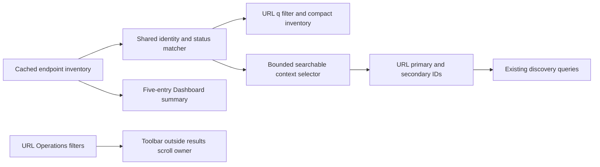

# Compact endpoint inventory and comparison selection

**Last verified:** 2026-10-14

## Executive summary

UI-03 through UI-10 have explicit, verified local dispositions on
`fix/ui-inventory-selection-20261014`, based on readability checkpoint
`a5c1c603`. The original analysis checkout, parent readability worktree,
runtime PR #215, deployments and shared directory configuration are untouched.
The first checkpoint is `892d0192`; the follow-up completes Operations filter
ownership and proves the distinct existing Operations and OAuth-subject `/Me`
workflows. This is not a release or an operator visual approval.

## Outcomes and boundaries

| Item | Local outcome | Evidence |
|---|---|---|
| UI-03 | Dashboard shows at most five endpoints in existing inventory order, resource counts and an explicit complete-inventory action. It does not invent recent/favorite ranking. | Zero, one and 80 endpoint fixtures at three widths; exact count, resource values and navigation. |
| UI-04 | Endpoint table exposes identity, copyable ID/base path/profile schema names and status. Search retains existing `q` URL ownership. | Name, ID, schema summary, inactive and zero-result filters; reset, Back/Forward, keyboard open and clipping measurements. |
| UI-05 | Endpoints and Operations Users/Groups reuse the accessible filter-toolbar/results panel. Filters sit outside the results scroll owner; existing URL state remains authoritative. | Results height is at most 420 px, scroll exceeds 500 px, toolbar movement is at most 1 px, and Back/Forward restores exact filtered rows. This is not a universal filter migration. |
| UI-06 | Discovery reuses the endpoint context combobox with searchable name/ID/profile/status options and a bounded 280 px popup. | Large-inventory narrowing and pointer/keyboard primary/secondary selection. |
| UI-07 | Selection has a branded border/background, checkmark, role text, full copyable identity and a pressed selected button. Inactive endpoints remain inspectable in Discovery, not action targets elsewhere. | Exact selected IDs, `aria-pressed=true`, inactive secondary selection and 208 px identity bounds. |
| UI-08 | Schemas, ResourceTypes, ServiceProviderConfig order; Schemas is the default. Explicit existing tab deep links still work. | Tab order, selected tab on Back/Forward, advertised schema/type values and exact Workbench GET prefill. |
| UI-09 | Retain Operations as current cross-endpoint Users/Groups/statistics, distinct from request history and endpoint-local management. Existing explanatory copy is sufficient. | Fifty User/Group rows with provenance, exact row 49 after search, history restoration and navigation to `/logs?page=1`. |
| UI-10 | Retain `/Me` as the OAuth token subject's self-service flow, not the administrator's profile. Existing inline explanation and OAuth setup action remain. | Shared-secret preflight explains the token requirement and navigates to the selected endpoint's OAuth setup. Browser action-target tests retain inactive-option rejection in Manual Provision. No new authentication behavior. |

Data flow remains: cached endpoint response -> shared identity matcher ->
URL-owned inventory filter or selected endpoint ID -> existing detail/discovery
queries. No API contract, persistence behavior, version or dependency changes
are part of this checkpoint.

The diagram separates cached identity presentation from existing data queries.
For example, an exact `Active` search excludes an inactive endpoint even though
the word `Inactive` contains the same substring. A `tenant-049` Operations
search narrows the current results, and Back restores all 50 fixture rows.

Profile search means the **published profile summary** schema names and
ResourceType names, not an invented preset label. A missing summary is
explicitly displayed as `No profile summary`.

## Finite measured matrix

The new `web/e2e/endpoint-inventory-selection.spec.ts` runs 33 Chromium cases:
11 finite scenarios at 1440, 900 and 390 px. Fixtures supply zero, one or 80
endpoints, a long name and inactive target, without changing a deployment.
The combined regression invocation passed 46 cases: 30 inventory/workflow
cases, nine parent readability cases and seven affected existing real-API
navigation cases. Three additional Manual Provision cases passed separately.
That is 49 distinct browser cases, not 49 cases in one invocation. The final
33-case fixture rerun passed after making geometry receipts durable.

| Width | Inventory table | Name column | Five-item Dashboard height | Selected identity height |
|---|---:|---:|---:|---:|
| 1440 | 1149 px | 448.38 px | 504 px | 208 px |
| 900 | 640 px | 245.33 px | 520 px | 208 px |
| 390 | 640 px, panel scrolling | 245.33 px | 536 px | 208 px |

Every page width equals its viewport width. Tests measure actual clipping,
column bounds, result counts and values rather than CSS property presence.
Operations results measure 420 px high at all three widths. Scrolling both
50-row tables leaves their filters within 1 px of the original position, and
the page remains viewport-bounded. Search and history assert row values.

JSON receipts are retained under gitignored `test-results/ui-inventory-evidence/`,
outside Playwright's cleaned output directory. A generated aggregate is
committed at [geometry evidence](evidence/UI_INVENTORY_SELECTION_20261014.json).
Screenshots and logs remain gitignored.
These are controlled UI-data tests, not proof of deployed API behavior.

Focused component/URL units passed 63 tests in five files; follow-up workflow
units passed 38 tests in five files. The selector's two tests overlap, so these
are separate runs, not 101 unique tests. Web production build and all existing
size budgets pass. Type checking reports 66 pre-existing diagnostics: 64 in
unchanged test files and two in unchanged `CreateEndpointWizard.tsx` at lines
93 and 114. No changed production file has a diagnostic. Full consolidation,
live deployment checks, canonical visual
baseline review and operator visual signoff are intentionally not performed
in this implementation lane.

## Execution issues and root causes

| ID | Type / severity | Symptom and mechanism | Resolution and why it works | Detection / earliest detection |
|---|---|---|---|---|
| IS-I01 | Environment / Low | Vite and tsc missing in a new worktree. Dependencies are not copied by Git. | After each missing-tool failure, junction matching release-worktree dependencies. Lockfile comparison differs only in root product version. No package install or lock rewrite. | First dev/build invocation / same |
| IS-I02 | Generated output / Low | API build reports missing Prisma members: generated client files are not in Git. Generation initially requires `DATABASE_URL` just to load config. | Generate into this worktree with a non-secret localhost URL, then build. Generation makes no DB connection and changes no shared generated output. | API build / generation before build |
| IS-I03 | Tooling / Low | Playwright finds no tests when given a Windows path as its regex selector. | Select the unique filename stem; filesystem commands still use Windows paths. | Browser launch / same |
| IS-I04 | Implementation / Medium | Initial truncation renders no text and tsc rejects `children`. Existing primitive requires `text`. | Use its actual typed contract; no new primitive or cast. Build and value assertions protect against empty labels. | Type/browser check / type check |
| IS-I05 | Test correctness / Low | Fluent SearchBox test ID belongs to the input itself, and Tab text includes a hidden sizing duplicate. | Address search by accessible role/name; assert ordered tab IDs and selected semantics rather than duplicated DOM text. | Browser check / same |
| IS-I06 | Interaction / Medium | Programmatic search changes the query but Fluent does not automatically open its popup. | Explicitly open on input and reset the transient query on popup close/selection; IDs remain URL-owned. Browser pointer and keyboard assertions now exercise this boundary. | Browser check / same |
| IS-I07 | Layout / Medium | Five-item summary measured 600/616 px and selected mobile identity measured 236 px, exceeding declared bounds. | Reduce card gaps and use a small, concise selected marker while keeping full accessible identity. Final geometry is 504/520/536 and 208 px. No threshold relaxation. | Browser geometry / same |
| IS-I08 | Coverage migration / Medium | Existing Discovery units target removed cards; live browser selectors and card-click smoke paths would become stale. | Migrate to combobox options and pressed selected summaries, explicit navigation buttons, and Schemas default. Preserve all existing tests and fixture ownership. | Targeted units plus source search / same |
| IS-I09 | Filter correctness / Medium | Exact `Active` query also matched `Inactive` through substring search. | Confirm unit RED, then handle exact normalized status keywords before general identity matching. Unit GREEN and browser exact counts protect both consumers. | Follow-up focused unit / matcher unit before first checkpoint |
| IS-I10 | Implementation / Low | First Operations JSX edit closed the toolbar at its inner rather than outer div. | Correct the wrapper boundary; require successful production build before retrying browser verification. No invalid build is represented as browser evidence. | Build / same |
| IS-I11 | Test correctness / Low | Six Operations browser assertions rejected Logs' valid default `page=1` URL. | Assert exact pathname and the documented default page query, not an artificially query-free URL. Final matrix passes. | Browser / same |
| IS-I12 | Runner / Low | Bounded-worker Vitest attempt stalled. The root cause was not established. | Stop only the owned invocation and run the existing default runner: 38 tests pass in 46.24 seconds. No speculative runner change. | Focused units / same |
| IS-I13 | Gate fidelity / High | Mermaid initially exits zero while reporting missing-tool SKIP. Discovery also reports built-in version `0.0.0`. | Restore exactly matching root dependencies after the missing-tool result and actually render strict/light/dark. Version equivalence remains unverified and belongs to parent gate hardening; never install `0.0.0`. | Explicit output inspection / same |
| IS-I14 | Evidence correctness / Medium | Initial doc classified all 66 tsc diagnostics as test-only; two were unchanged production diagnostics. | Classify actual file paths and verify diagnostic-bearing files are unchanged. Correct this doc to 64 test plus two production; do not fix unrelated baseline errors. | Consolidation of focused evidence / initial tsc result classification |
| IS-I15 | Tooling / Low | Raw-event scanner encountered a completion without a result; a subsequent JSON-check invocation omitted its file arguments. Read/search output also needed narrow ranges. | Guard event shapes, pass explicit document paths and inspect bounded output. Seven edited docs contain zero literal JSON fences. A zero count alone is not evidence that any file was inspected. | Evidence tooling / same |
| IS-I16 | Artifact retention / Medium | A later focused Playwright invocation cleaned earlier geometry receipts with its output directory. | Store receipts in a sibling evidence directory and aggregate 21 real receipts into a committed JSON artifact. Verify preservation with a subsequent focused run. | Final handoff inspection / first multi-invocation evidence run |

Fix SHAs are assigned by the containing logical commits, not fabricated before
commit creation. IS-I01 through IS-I08 were resolved in `892d0192`; subsequent
entries belong to this follow-up commit.

### Provenance and completeness

The full raw `events.jsonl` for session
`2e6e7d76-3fb6-499e-8b54-3c7f962e5577` was reconciled, not just the compacted
summary. The result pass scanned all 1,117 events through
`2026-10-14T06:05:47.952Z`; a separate narration pass scanned all 1,137 events
through `2026-10-14T06:06:20.836Z`. Both passes searched failure signals and
diagnostic phrases, mapped confirmed incidents to the table, and rejected
source/document reads, Git subjects mentioning earlier failures, expected
RED assertions, baseline diagnostics and scanner self-echoes as additional
incidents. Regex hit counts are not recurrence counts. Initial remote-session
discovery warned that the repository could not be resolved; this did not block
local isolation or implementation, and authenticated Git push is checked
separately.

## Self-improvement and design disposition

Test/gate improvement **applied**: finite large-inventory geometry, exact
filter counts, full selected IDs, keyboard navigation and URL-history checks
now make the operator's reported class executable. A green presence assertion
cannot substitute for any of these outcomes.
Exact status semantics and durable evidence ownership are added regression
checks, not just prose promises.

Design disposition **accepted**: reuse one context selector and extract a
small identity matcher plus a scroll-ownership panel. The matcher has two
real consumers; the panel is shared by inventory and the next Operations
application. The inherited Operations and Discovery files remain large-file
review candidates, but this change adds no responsibility or backend coupling
and removes repeated scroll-owner markup. A broad split is outside this
bounded outcome. No backend abstraction, policy language or global layout
rewrite is justified. Dashboard retains summary responsibility; Endpoints
retains management; Discovery retains contract comparison.

## Handoff

1. Parent owns reviewed PR/consolidation and exact-tip CI after dependent work
   merges. Preserve constituent commits; no version bump belongs here.
2. The later validation lane owns Docker/PostgreSQL parity, live HTTP,
   deployed Playwright and canonical visual-diff classification.
3. Request explicit operator visual approval on the actual dev deployment.
   Local geometry does not substitute for that approval.
4. Runtime PR #215 and shared Entra configuration remain separately owned.
