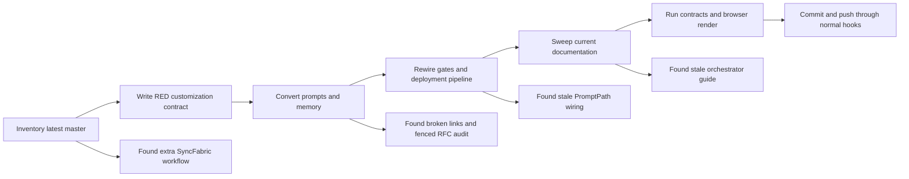

# Copilot Agent Skills Migration - Execution Issues and RCA

**Date:** 2026-10-14

**Scope:** Migration of repository Copilot prompt workflows to Agent Skills

**Status:** Implementation and focused validation complete

## Executive summary

The migration converted every active prompt workflow from latest master into a
project Agent Skill, moved durable memory beside its owning skill, and rewired
the gate and deployment automation to use skill paths and slash invocations.

The review found sixteen execution issues. Two were high severity because they
could have produced a false-successful migration: stale generated content from
another branch and an RFC audit whose instructions were trapped inside a code
fence. Both now have structural prevention in
[`copilot-customizations.contract.ps1`](../../scripts/test/copilot-customizations.contract.ps1).

## Delivery flow and detection points

This diagram shows where the migration issues became observable. The contract
is deliberately placed before conversion so it proves the old state is red and
the completed state is green.

## Master issue dashboard

| ID | Type | Severity | Symptom | Root cause | Resolution | Why the resolution works | Prevention | Caught / earliest |
|---|---|---|---|---|---|---|---|---|
| CSM-01 | Process / source selection | High | The initially generated skills in the original worktree did not contain the latest-master prompt bodies. | The editor migration ran on a long-lived dirty branch rather than the requested latest master. | Created a separate worktree at fetched `origin/master` and regenerated each skill from that ref. | Every migrated body now has the latest source as its input, while the original worktree remains untouched. | Always record the source ref and compare prompt-to-skill content sizes before deletion. | Review inventory / worktree creation |
| CSM-02 | Automation wiring | High | Gate automation still referenced files that the migration would delete. | File conversion and workflow registration were independent surfaces with no contract joining them. | Replaced `PromptPath` with `SkillPath`, printed slash invocations, updated deployment registrations, and retained aliases only at the parameter boundary. | The operational path now resolves committed `SKILL.md` files and existing callers still parse. | Contract rejects `PromptPath`, stale active references, and missing skill registrations. | RED contract / migration contract |
| CSM-03 | Inventory completeness | Medium | The SyncFabric authentication workflow remained outside `.github/prompts/`. | The first inventory assumed the conventional prompt directory was exhaustive. | Searched the full repository, migrated the workflow and memory, and removed the old copies. | Repository-wide discovery now covers customizations stored outside the conventional directory. | Contract recursively rejects every remaining `*.prompt.md` file. | Repository sweep / initial inventory |
| CSM-04 | Resource paths | Medium | Relative links and self-update targets broke after files moved deeper under `.github/skills/`. | Markdown paths are resolved from `SKILL.md`, not from the former prompt directory. A first-pass link detector also misread code fragments as links. | Rebased links, moved memory into `references/`, split large workflows, and narrowed link validation to real relative targets. | Every committed relative resource resolves from the file that contains the link. | Contract validates every relative Markdown resource in every skill. | Conversion review / migration tool |
| CSM-05 | Skill executability | High | `auditagainstrfc` rendered its full workflow as a `prompt` code block instead of instructions. | Its source file was itself a fenced prompt template, so a mechanical wrapper produced nested customization syntax. | Unwrapped the legacy fence, promoted its metadata to skill frontmatter, improved its description, and added a negative contract. | The harness now receives executable Markdown instructions rather than inert displayed code. | Contract rejects a legacy `prompt` fence in every skill body. | Description review / conversion validation |
| CSM-06 | Documentation | Medium | The active gate-orchestrator guide still described prompt kinds, prompt paths, and old parameter names. | Automation and its design document were not coupled during the first conversion pass. | Updated the architecture diagram, registry tables, usage examples, aliases, contract claims, and index entry. | Operators now see the same skill semantics that the script executes. | Documentation freshness plus migration-specific stale-reference sweep. | Final doc sweep / conversion review |
| CSM-07 | Shell / worktree context | Low | Early checks executed against the original worktree, and nested inline PowerShell here-strings failed to run the converter. | Reused shell identity did not change process working directory, and nested here-string quoting was fragile. | Set the worktree path explicitly in every command and used a session-only migration script. | Each command now has an unambiguous repository target and ordinary script parsing. | Use explicit `Set-Location` in independent shell calls and avoid nested inline here-strings. | First command run / first command run |
| CSM-08 | Clean-worktree dependencies | Low | Mermaid validation could not import `jsdom`, then browser rendering skipped because Playwright was absent. | A new worktree does not share ignored `node_modules` directories. | Restored root and web dependencies with `npm ci`, then reran grammar and browser rendering. | Lockfile-defined tools are present without changing dependency manifests or lockfiles. | Treat missing-tool failures in clean worktrees as a restore prerequisite, not a code failure. | Documentation gate / documentation gate |
| CSM-09 | Tooling diagnostics | Low | Mermaid rendering warned that the built-in renderer version was `0.0.0` even though all 755 diagrams rendered in both themes. | The renderer-discovery script reads a package version that no longer represents the bundled Mermaid library version in this VS Code build. | Accepted the warning for this migration because the authoritative browser render completed successfully. Scheduled a focused tooling correction. | The migration has direct render evidence; no unsupported dependency change is mixed into this commit. | Owner: repository maintainer. Target date: 2026-10-31. Add a fixture for built-in extension manifests that report `0.0.0`. | Browser render / renderer doctor |
| CSM-10 | Discovery metadata | Medium | `securitybestpracticesintake` had an unquoted `argument-hint` containing a colon followed by whitespace, which is invalid YAML. | The first contract found frontmatter delimiters and fields with regular expressions but did not parse scalar syntax. | Quoted the value and replaced field-only checks with a parser for the repository's supported flat skill-frontmatter schema. | Invalid plain scalars, duplicate keys, unterminated quotes, and unsupported YAML lines now fail before discovery. | The contract parses every skill frontmatter from the selected Git tree. | Final code review / initial migration contract |
| CSM-11 | Progressive loading | Medium | The two split workflows told future runs to self-update and stage their short launchers rather than the executable `references/workflow.md` resources. | Mechanical path replacement did not account for the later progressive-loading split. | Retargeted self-update, version, and staging instructions to each workflow resource. | Future learning changes now modify the file the launcher actually loads. | Contract checks both split workflows' self-update and staging targets. | Final code review / resource-split review |
| CSM-12 | Cross-repository workflow | Medium | The SyncFabric workflow still inventoried `.github\prompts\` and asked runs to increment a prompt version. | Its large binding resource retained active prompt-era instructions outside the launcher. | Changed the inventory to `.github\skills\`, aligned active terminology, and targeted `skillVersion`. | The binding workflow now reads the committed customization surface and evolves its actual metadata. | Contract rejects the deleted directory and prompt-version instruction in this workflow. | Final code review / active-body sweep |
| CSM-13 | Push-time evidence | Medium | The first contract validated the working tree, which could differ from the commit being pushed. | Filesystem enumeration cannot distinguish staged, untracked, unstaged, and committed customization state. | Added `-GitTree Index|Head`, read content through Git objects, made index the development default, and made pre-push validate `HEAD`. | Pre-commit review validates exactly what is staged; push-time review validates exactly what is being pushed. | Negative control proves `Head` rejects the pre-migration commit; pre-push wiring is itself contract-checked. | Final code review / contract design |
| CSM-14 | Operator guidance | Medium | Current tenant and agentic plans still instructed operators to maintain prompt files or prompt lifecycle rules. | The first stale-reference sweep emphasized paths and missed active prose without an explicit path. | Named the deployment skills in tenant cutover and migrated the current agentic lifecycle, diagrams, examples, and memory model to Agent Skills. | Operators no longer receive instructions that create an unloaded customization or skip a migrated skill. | Contract locks the two high-risk active statements; documentation gates validate the updated diagrams and links. | Final code review / documentation sweep |
| CSM-15 | Git / validation orchestration | Low | One final validation command saw a transient worktree `index.lock`. | Two parallel validation calls both ran `git add -A`; index writes are not independent and cannot safely run concurrently. | Let the successful writer exit, confirmed the lock was absent, then staged and reran the index contract sequentially. | The final evidence comes from one completed index write followed by one read-only contract run. | Never place two index-writing Git commands in the same parallel tool batch. Parallelize only read-only checks after staging once. | Final validation / final validation |
| CSM-16 | Clean-worktree code generation | Low | The first push was blocked because `tsc` was absent; after `npm ci`, the API build still lacked its generated Prisma client, and generation initially required `DATABASE_URL`. | A fresh worktree has neither ignored dependencies nor ignored generated Prisma output. `npm ci` restores packages but does not generate the client because the Prisma config resolves its environment first. | Ran `npm ci` in `api/`, supplied a local placeholder PostgreSQL URL only to `prisma:generate`, generated the client, and reran the API build green. | The hook now has both the compiler and generated types it expects, without changing tracked source, manifests, or lockfiles. | In a fresh worktree, restore root, web, and API dependencies, then run `prisma:generate` with a non-secret local placeholder URL before the first pre-push run. | First pre-push gate / first pre-push gate |

## Detection-stage escape analysis

| Issue | Earliest practical gate | Actual detection | Escape delta | Follow-up |
|---|---|---|---:|---|
| CSM-01 | Source-ref check before generation | Manual inventory review | 1 phase | Source comparison is now part of the migration procedure. |
| CSM-02 | RED customization contract | RED customization contract | 0 | Closed structurally. |
| CSM-03 | Repository-wide inventory | Repository-wide inventory | 0 | Closed structurally. |
| CSM-04 | Post-move link contract | First converted-skill review | 0 | Closed structurally. |
| CSM-05 | Skill-body shape contract | Final description review | 2 phases | New negative contract closes the escape. |
| CSM-06 | Documentation sweep with automation change | Final documentation sweep | 1 phase | Current guide and index updated in this change. |
| CSM-07 | First command smoke check | First command smoke check | 0 | Working convention recorded. |
| CSM-08 | First documentation command | First documentation command | 0 | Dependencies restored from lockfiles. |
| CSM-09 | Renderer doctor | Browser render | 1 phase | Scheduled as a tooling-only follow-up. |
| CSM-10 | Frontmatter parser | Final code review | 2 phases | Flat YAML parsing now replaces delimiter-only validation. |
| CSM-11 | Resource-split review | Final code review | 2 phases | Self-update targets are now contract assertions. |
| CSM-12 | Active-body sweep | Final code review | 2 phases | Cross-repository binding workflow is now directly asserted. |
| CSM-13 | Git-tree negative control | Final code review | 2 phases | Index and pushed-HEAD modes now produce distinct evidence. |
| CSM-14 | Active prose lifecycle sweep | Final code review | 1 phase | Current operator statements are now contract assertions. |
| CSM-15 | First index write in validation batch | First index write in validation batch | 0 | Final staging and index validation were rerun sequentially. |
| CSM-16 | First pre-push API build | First pre-push API build | 0 | Dependencies and generated types were restored before retry. |

## Provenance and completeness

This ledger was reconciled against the complete pre-compaction checkpoint
summary supplied to this session and every current-session tool result. The
runtime did not expose `VSCODE_TARGET_SESSION_LOG`, and the current session was
not yet present in the local or cloud session store, so no separate JSONL
transcript was available to scan.

The reconciliation used these signal groups:

- failures and errors: contract RED output, PowerShell parsing failures,
  missing `jsdom`, skipped Playwright rendering, renderer drift, and a
  transient Git index lock, missing `tsc`, missing Prisma types, and missing
  generation-time `DATABASE_URL`;
- diagnosis phrases: stale source, broken relative link, no-op edit, nested
  fence, compatibility alias, invalid YAML, wrong self-update target, selected
  Git tree, and missing workflow;
- migration surfaces: repository prompt inventory, skill inventory, automation
  registrations, durable memory, current docs, and historical reports.

Verified and dismissed as non-issues:

- The four old workflows with `mode: agent` require ordinary agent
  capabilities, not separate restricted custom agents.
- Historical changelog, session, security-intake, and innovation-report
  references to prompt files describe their original period and are not active
  customization wiring.
- `.understand-anything/knowledge-graph.json` is absent, so a diff overlay
  cannot be produced until `/understand` builds the graph.
- Prompt-specific `mode`, `agent`, `model`, and `tools` metadata is not retained
  because Agent Skills do not use those prompt-file fields.

## Self-improvement and architecture disposition

- **Test/gate disposition: applied.** The new pre-push customization contract
  was proven red on latest master and green after migration. It now detects
  missing skills, legacy prompt files, stale active references, broken
  resources, invalid discovery metadata, nested prompt fences, wrong
  progressive-resource update targets, selected-tree drift, and gate-walker
  regressions.
- **Design/architecture disposition: accepted.** One skill directory per
  workflow is cohesive and matches the platform structure. Only the two
  workflows over 500 lines use progressive reference loading. Creating custom
  agents for workflows that need no restricted capability would add
  speculative abstraction with no second implementation.
