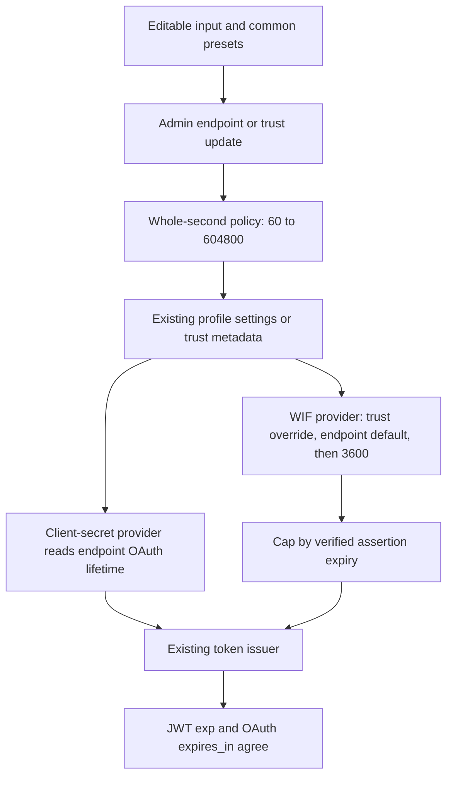

# Endpoint token lifetime - TDD rebuild and release handoff

> **Status:** Isolated 0.55.57 local validation complete; PR-controlled publication/merge and deployment are separate boundaries
>
> **Last verified:** 2026-10-21
>
> **Original integration base:** `36724c4910ed538b6be1b6588fa1908a0348e014`, version `0.55.56`
>
> **Runtime input checkpoint:** `abb90c9f04f11daa4fda9e44c97016d74d83711f`; manifests and public-CI lockfiles `0.55.57`
>
> **Integration branch:** `feat/endpoint-token-ttl-integration-20261021`

## Authorized release consolidation (2026-10-21)

The operator authorized all remaining tests, gates, versioning, commits, push,
pull request and reviewed merge after the preparation checkpoint below.
The preserved original stash remains untouched. All local services and
databases remain task-owned; no cloud deployment has occurred.

The prerequisite is merged PR #247, master
`d9feb62489967e2faa35acefe3b15bc746096134`. Its exact Vite 8.1.6 patch passes the full normal
Validate push, including 6072 API units, 2460 HTTP tests plus four exclusions,
and 1624 Web tests. The lifetime branch integrates that normally merged master
without rebasing or rewriting its four preparation commits.
Owned temporary stash `0faea613ca41c2b6835257804537ac229955c477` preserves the
pre-stack feature; the original preservation stash is untouched. The expected
changelog overlap was resolved by retaining both the security and feature entries.

GitHub Copilot's review request produced a billing-configuration error, not
substantive findings. With the operator unavailable, an independent automated
review accepted the prerequisite and requested three Medium lifetime interaction
fixes. Its prerequisite disposition was published before normal merge, explicitly
not as human approval. Clear-to-inherit, draft-only presets and preset history
each reproduce through real browser RED. Corrections pass 82 focused unit tests,
including two additional no-op/HTML-identity regressions. Two corrected browser
journeys pass together; the third passes its targeted rerun after preserving the
full Settings effective-default display. All 18 fixture IDs remain intact.
Follow-up source review accepts `577baf07`; independent artifact review accepts
`abb90c9f`. These are automated reviews, not human approval. A subsequent
test-only Operations loading guard and receipt updates do not change the
shipping image inputs. Normal publication, reviewed exact-tip CI and merge
are tracked by the PR rather than inferred from local passes.

Fresh consolidation evidence supplements, rather than replaces, the dated
preparation results:

| Check | Observed result |
|---|---|
| Empty PostgreSQL migration replay | PASS |
| Complete PostgreSQL HTTP suite | PASS: 119 suites / 2532 tests |
| Complete in-memory HTTP suite | PASS: 119 suites / 2528 tests, four PostgreSQL-only exclusions |
| API units, each backend | PASS: 211 suites / 6128 tests |
| Settings root identifiers | Two genuine RED assertions, then both GREEN after removing duplicate interactive roots; browser uniqueness assertions added |
| OAuth policy snapshot reuse | Genuine RED: two endpoint lookups instead of one; provider/controller suites GREEN, 27 tests, API build PASS |
| PostgreSQL mint performance | Extended counterbalanced local comparison: 2000 measured mints per side; baseline/candidate p50 9.148/9.063 ms, p95 16.358/13.190 ms, p99 29.455/25.215 ms |
| Endpoint SQL reads | Equal: 2403 per side, including fixture operations across 2400 warmup/measured mints |
| Resident memory after extended benchmark | Baseline/candidate 240.8/241.1 MiB; not a production capacity claim |
| Historical complete browser, seeded Node/PostgreSQL | PASS: 326 cases before the final toolchain/version and review corrections; not substituted for the final image receipt |
| Mandatory final six-mode runner | PASS: all six modes, no skip flags; two Web workers without the inherited artificial heap cap |
| Final Web units and coverage | PASS: 124 files / 1655 tests; lines 85.74%, branches 75.89%, functions 75.53%, statements 83.06%; unchanged floors 82/70/69/78 |
| Final complete local Node / Docker live | PASS: 1811 assertions each; both authenticated version routes report 0.55.57 |
| Final shipping-image startup contract | PASS: 24/24 using the actual image entrypoint, not a source bind mount |
| Final complete Docker browser | PASS: 327 cases in 511.877 seconds, zero skips/unexpected/flaky; unchanged pixel baselines and all 18 fixture IDs preserved |
| Final static gates and dependency audit | Size budgets pass; API 0 errors / 513 warnings and identical 66 existing Web type diagnostics; Web zero vulnerabilities, API 23 Moderate and zero High/Critical |
| Vite security prerequisite | Exact aged 8.1.6 patch; PR #247 independently reviewed and normally merged after green exact-tip CI |

The first benchmark found a real duplicate lookup and a greater-than-10-percent
regression. Its logs and the short post-fix noisy tail sample are retained.
Reusing the authoritative provider snapshot for the non-enforcing observation
restores the baseline query count without caching or weakening policy freshness.
The public token response is explicitly tested to exclude that internal profile.
The extended follow-up uses a predefined counterbalanced order and equal
warmups; no latency threshold was relaxed.

The first final-image browser run passed 326 cases but skipped Operations
bounds while its real feed had 18 users. A completeness assertion fails first;
the owning spec now waits for the successful user response instead of treating
loading as empty. The targeted case and the new full 327-case run execute
without skips. No runtime change, fixed sleep or baseline replacement is needed.
Local Node returns to its initial zero endpoints; Docker retains all 18 exact
fixture IDs. Driver/fatal stdout signals are zero on both targets.

Public-registry CI run `39644598993`, exact source `577baf07`, supplies both
versioned lockfiles. After excluding their two root version fields, independent
JSON comparison proves every dependency and other metadata unchanged.
All 684 API and 395 Web resolved entries retain public npm URLs and sha512.
The publish-age delta is empty because no package version changed; the
seven-day policy is unchanged. Artifact SHA-256 values are:

- API: `2741efc7fbf65fbcf4998fa4c95f3811dfc83cc8fe7a999a21558d5a15042a3e`.
- Web: `247343e594face97df73ace64727dc7050b28b1bf6563c83ad7ec8e5b8178d90`.

The isolated image `scimserver-ttl-release-20261021:0.55.57` is built from
runtime checkpoint `abb90c9f`, runs Node `v24.16.0`, and has local manifest-list
digest `sha256:2b4b1b8a224831ae7e2c1a099fddf4998afc2ad3ba8a7d5e8b4c56479089b408`.
It is not a published merged-master deployment artifact. Historical deployed
evidence below retains its original version and provenance. The legacy helpers
that regenerate locks locally or rewrite historical version receipts were not used.

### Required outcomes and their assertions

| Promised outcome | Specific proof |
|---|---|
| Inclusive 60-604800 whole-second range, 3600 default and exact JWT duration | [OAuth HTTP spec](../../api/test/e2e/endpoint-oauth-client.e2e-spec.ts) asserts boundary/default issuance, reset, invalid values and decoded `exp - iat`; [service tests](../../api/src/oauth/oauth.service.spec.ts) include custom 61 and clamp boundaries |
| Trust override, endpoint inheritance and assertion-expiry cap | [WIF HTTP spec](../../api/test/e2e/wif-assertion.e2e-spec.ts) asserts trust replacement/reset, exact 60/604800 issuance and a real 30-second assertion capped at 30 or less |
| Preset and editable custom values produce persisted behavior | [Endpoint browser spec](../../web/e2e/endpoint-token-lifetime.spec.ts) selects 604800, edits 61, reloads both surfaces and checks real minted tokens |
| Draft-only preset selection and shared Undo/Redo/Reset | The same endpoint browser journey asserts zero PATCH calls inside the composite and exactly one on exit, restored draft values and no history entry for an unchanged preset |
| Clear-to-inherit changes policy, not just the placeholder | Its clear/reset journey requires stored-key absence, a real 3600-second JWT, effective 3600 in full Settings and blank inheritance in contextual Connect |
| Trust edits remain explicit-save and can clear the override | [Trust browser spec](../../web/e2e/wif-trust-management.spec.ts) captures no PUT before Save, exact numeric override after Save and omitted override on reset; real persistence/issuance is covered separately by WIF HTTP on both backends |
| Correct control identity and responsive bounds | Endpoint browser assertions require distinct input/preset HTML IDs, one Settings root per lifetime, and actual field bounds within the viewport at widths 1440 and 900 |
| One authoritative read and no internal response leakage | [Controller tests](../../api/src/modules/scim/controllers/endpoint-oauth.controller.spec.ts) assert one endpoint lookup and the four-key public token envelope |

**Self-improvement: applied.** Persistent tests cover policy reset, edit-entry
history, request counts, control identity and loading-aware bounds coverage.
**Design disposition: accepted.** Existing provider/primitive seams remain
cohesive; no speculative cache, history implementation or gate framework is added.

Earlier preparation holds below are historical. No cloud deployment, native
Entra run, customer promotion or operator visual approval is implied by this
pre-merge local receipt.

## Current-master integration preparation (2026-10-21)

This subsection preserves the historical preparation checkpoint.

**The feature is ported into a separate current-master worktree, but is not
merge-ready or approved for deployment.** The original implementation and
stash remain untouched. The release worktrees, databases, ports and image tags
were not reused.

The source branch was 390 commits behind this captured master revision, with
29 changed tracked paths also modified upstream. The integration worktree is
`C:\Users\v-prasrane\source\repos\SCIMServer_worktrees\token-ttl-integration-20261021`.
Tests were applied before production changes: the fresh API negative control
failed 30 assertions, and the expanded-panel component control failed seven.
Missing dependencies were restored privately before interpreting these runs;
an unavailable runner was not counted as TDD RED.

The port preserves current-master authentication-method enablement,
effective JWKS policy, fixed secret-retention policy and collapsed settings
panels. Null endpoint numeric settings retain their newer meaning: clear the
stored override and inherit the 3600-second default. A failed authoritative
policy lookup prevents minting. Observation-only method evaluation remains
non-blocking and now reuses that snapshot rather than reading it again.
Trust override precedence and assertion-expiry caps are unchanged.

### Fresh integration evidence

These results are from this worktree, not the historical rebuild below.
Detailed commands and logs are in the ignored local report
`test-results/ttl-integration-validation-report.md`, not a published CI artifact.

| Check | Observed result |
|---|---|
| Full API unit, in-memory configuration | PASS: 211 suites / 6128 tests |
| Focused policy, providers, controller and registry conformance | PASS: 8 suites / 580 tests |
| OAuth and WIF HTTP, in-memory | PASS: 2 suites / 70 tests, including exact JWT expiry, runtime update and null reset |
| Affected UI components | PASS: 4 files / 152 tests |
| Current settings, trust and lifetime browser coverage | 29 unaffected cases passed in the initial 31-case run; both failed lifetime cases passed after adapting to the existing disclosure/menu hierarchy |
| Complete owning live runner, private in-memory API | PASS: 1811 assertions, including all 14 integrated lifetime checks; no leaked endpoints |
| Standalone live helper | PASS: 14 assertions |
| API build | PASS |
| API lint | PASS ratchet: 0 errors / 513 warnings, identical to exact current HEAD |
| Frontend TypeScript | Existing debt: 66 diagnostic lines, exactly identical to an isolated archive of this HEAD; not a clean type-check pass |
| Web production build and route-size budgets | PASS |
| Documentation content inventory | PASS: 39 settings = 20 boolean + 3 other typed + 16 numeric |
| Feature and navigation diagrams | PASS: 2 diagrams in both themes with strict security; Mermaid 11.17.0 matches the discovered built-in renderer |
| Full frontend tests and coverage | PASS: 124 files / 1643 tests; lines 85.73%, branches 75.82%, functions 75.45%, statements 83.02%; no threshold changes |
| Final documentation/static checks | See the gate report for completed results and remaining release checks |

The browser journey proves that a week preset survives reload and produces
both `expires_in = 604800` and `exp - iat = 604800`, that custom 61-second
issuance works after Undo/Redo, that Connect and Settings share persisted WIF
values, and that invalid values do not overwrite the stored 60-second value.
It measures input and preset bounds at 900px and 1440px. The trust test proves
override persistence, edit preservation, invalid-value blocking and inheritance
reset. Its More-menu entry and settings disclosures remain as shipped.

The initial full live run used an accidentally restrictive `LOG_LEVEL=ERROR`
fixture and failed two INFO-level bulk-log assertions. Restoring the standard
INFO fixture and rerunning the entire unchanged suite passed 1811/1811 in
84.6 seconds. The 1809-case failed run omitted two conditional checks because
their prerequisite log entries were absent. Both logs are retained; no product
code or threshold was changed.

### Release holds and boundaries

- The unchanged current-master web lockfile reports an existing **High Vite
  advisory**. The local audit artifact is retained. Approved dependency
  remediation is a release blocker; no audit-fix or lockfile regeneration is
  folded into this feature.
- There is no current-master Prisma/Docker matrix, full HTTP/backend matrix,
  complete browser matrix, deployed performance comparison or exact-tip CI
  receipt for this port. The older results below cannot substitute for them.
- Release-boundary confirmation is still required. No version bump, commit,
  push, pull request, merge, cloud operation or promotion was performed.
- Automated local browser results do not replace operator visual verification
  on dev. No screenshot baseline was regenerated.
- At consolidation, run the remaining applicable gates against the final
  integrated tip, use the repository PR template, and keep deployment and
  customer-production approval separate.

**Self-improvement: applied.** State-aware disclosure expansion and explicit
draft/focus assertions prevent a closing animation from masquerading as a
working editable control. Exact-HEAD comparisons replace stale type baselines.

**Design disposition: accepted.** Existing policy/provider seams and the small
shared lifetime control remain cohesive; speculative abstractions and unrelated
credential-controller refactors are unnecessary. See the
[integration RCA](EXECUTION_ISSUES_AND_RCA.md#current-master-lifetime-integration-preparation-2026-10-21).

## Historical rebuild evidence (2026-10-20)

Everything below this heading records the original `d29e92c3` / `0.55.23`
rebuild on `feat/endpoint-token-ttl-api-ui-20261020`, not the current-master port.

## Executive summary

The previous work is preserved in stash
`064483284a56ce5f135afb8b09ed63c06f3b368f`, named
`token-ttl-before-tdd-rebuild-20261020-60-to-week`. The rebuild starts from
clean HEAD, changes and runs tests first, then implements the requested policy.
It remains separate from the release cycle running elsewhere on this machine.
Do not pop the old stash onto this rebuild.

| Requirement | Result |
|---|---|
| Minimum configured lifetime | 60 seconds, inclusive |
| Default when not configured | 3600 seconds |
| Maximum configured lifetime | 604800 seconds, exactly one week |
| Custom input | Whole seconds, including non-preset values such as 61 |
| Convenience presets | 1, 5, 15, 30 minutes; 1, 2, 6, 12 hours; 1, 3 days; 1 week |
| Editable surfaces | Connect OAuth, Connect WIF, complete Settings inventory, WIF trust add/edit |
| Existing JWTs and global OAuth | Unchanged; settings apply only to future endpoint mints |
| WIF safety | Trust override wins; verified assertion expiry still caps the issued token |

An assertion with only 30 seconds remaining can legitimately produce a WIF
token shorter than the 60-second configuration minimum. The minimum is not
permission to extend the assertion's authorization.

## Architecture and request flow

The old design always used the issuer default for endpoint client-secret
tokens and used only the per-trust override for WIF. The first worktree change
added endpoint controls, but retained a 3600-21600 range. This rebuild changes
the final signing boundary as well as input validation, so the API does not
accept a value that the issuer silently changes.

The diagram shows the configuration path and the separate issuance path.
The final WIF cap remains at the signing boundary.

Backend bounds/defaults live in
[token-lifetime-policy.ts](../../api/src/oauth/token-lifetime-policy.ts).
The existing settings registry, trust validation and issuer consume them.
The shared
[TokenLifetimeField](../../web/src/pages/TokenLifetimeField.tsx)
combines presets with the existing editable-field primitive, preserving copy,
Undo, Redo and reset. Auto-save happens when focus leaves the whole control,
not while the operator is using its toolbar. A trust still saves as a complete
trust form; clearing its override restores endpoint inheritance.

See [operator/API examples](../AUTHENTICATION_GUIDE.md#55-configuring-endpoint-access-token-lifetime).
The token response remains the RFC 6749 section 5.1 shape:
`access_token`, `token_type`, `expires_in`, `scope`. This is local server
policy, not a new lifetime range mandated by OAuth or SCIM.

## TDD evidence

Logs are ignored local artifacts under `test-results/`, not release evidence
from another worktree.

| Layer | RED observation | GREEN check |
|---|---|---|
| Policy and issuer | 30 failures: missing settings and old issuer clamp; 604800 became 21600 | Focused API tests and exact boundary issuance |
| HTTP | 11 failures in the initial two-suite run, including ignored lifetime updates and accepted invalid values | Both backends exercise endpoint defaults, trust overrides, reset, runtime changes and assertion caps |
| Components | Seven failures because the lifetime input/presets did not exist | Existing settings/credentials tests plus lifetime control focus tests |
| Browser focus regression | Undo did not restore 604800 after entering 61 | Undo/Redo, real custom mint, and measured 900/1440px bounds |
| Integrated live helper | Standalone passed but the parent runner failed on a PowerShell script-scope counter | Full in-memory live runner passes 1499 assertions after the scoped integration fix |
| Existing numeric-control browser matrix | New settings had no explicit test values | Explicit 61 and 604800 values; exact 16-control inventory |

## Validation isolation

| Owner | Resource | Isolation |
|---|---|---|
| Current implementation | Node API 6081, production UI preview 4181 | In-memory data and worktree-local logs |
| Exact HEAD comparison | Node API 6082, preview 4182 | Ignored archive, separate processes and data |
| PostgreSQL E2E | Dedicated container port 5481, database `scimttl` | Only the TTL E2E runner can truncate this database |
| Initial Docker browser matrix | Port 8181, database `scimttl_live` | Task-specific image, no release tags |
| Full Docker live suite | Port 8182, database `scimttl_wire` | Separate cleanup owner from browser tests |
| Final Docker browser verification | Port 8183, database `scimttl_browser_final` | Final image and independent fixture data |

No default Compose project, existing container, release database, Azure estate,
shared deployment port or Git branch was switched. Installed dependencies are
reused read-only through the worktree's existing junctions. No package install,
lockfile regeneration, migration-source change or release version bump is
needed. Temporary services and containers are stopped/removed after validation.

## Gate results and outstanding checks

The detailed per-gate result is retained in
`test-results/ttl-validation-report.md`. A passed assertion suite is not a
claim that every release gate is green.

- API build passes. API lint is unchanged at 0 errors and 518 warnings, compared
  with exact HEAD after supplying its ignored generated Prisma client.
- Web build and all route-size budgets pass.
- Web TypeScript remains at 94 diagnostics; complete output is identical to
  exact HEAD. This is an unchanged ratchet, not a clean type-check pass.
- Full API unit runs pass 173 suites / 4976 tests in each backend mode. The
  in-memory runner retained open handles after finishing, so its owned process
  was stopped; the Prisma-mode run exits with the existing `--forceExit` option.
- Full HTTP passes 96 suites / 1533 tests in each backend mode.
- Final affected component checks pass 4 files / 136 tests.
- Full web coverage passes 106 files / 1320 tests and exits successfully:
  lines 84.50%, branches 73.45%, functions 72.43%, statements 81.27%.
  All four existing floors pass without changes.
- Final affected local browser checks pass 15 tests.
- Full in-memory and Docker live HTTP each pass 1499 assertions.
- Final Docker lifetime/trust/complete-settings browser checks pass 31 tests.

The first Docker live run through `localhost` passed 1498/1499, with an
unrelated 2057 ms rejection-latency measurement exceeding its unchanged
1500 ms limit. Identical root requests measured 2036-2091 ms through
`localhost` versus 5-8 ms through literal `127.0.0.1`. Re-running the complete
unchanged suite against the same container through IPv4 passed 1499/1499
in 67 seconds; the original latency assertion measured 10 ms. No assertion or
threshold was weakened. Use literal IPv4 for this local Docker gate and retain
both logs. Task-owned services, containers, image tags and scratch archive
have now been cleaned up without touching shared dependencies or release data.

The initial full browser matrix had 227 passes, 4 skips and 3 failures.
The numeric-control failure is tightly coupled and is fixed in this change.
The auth-diagnostics click was blocked by an onboarding dialog; the Endpoints
screenshot differs because its masked data region has a different height.
Both the actual and diff PNG were inspected. Classification at discovery:
**unintended regression - investigating**. Both unrelated failures were then
reproduced against an independently built exact-HEAD API/UI. They are confirmed
baseline blockers, not intentional lifetime UI changes. No screenshot baseline
was updated; final affected Docker suites pass 31/31.

## Performance and audit disposition

Local in-memory client-secret mint benchmark, 10 warmups plus 100 samples per
version, same machine while validation was running:

| Version | p50 | p95 | p99 |
|---|---|---|---|
| Exact HEAD | 5.62 ms | 6.81 ms | 8.49 ms |
| Rebuild | 5.40 ms | 6.47 ms | 7.75 ms |

This bounded measurement shows no regression in this local sample. It is not
a deployed load test or a Prisma query-count benchmark. Client-secret minting
adds one endpoint-policy read; it does not add a per-credential N+1 query.
WIF already read the endpoint. A policy-read error now propagates instead of
silently minting under a different policy.

The contract, error, logging, RFC and security checks are scoped to this
behavior: admin authorization is unchanged; invalid values return explicit
400 responses; token response fields are unchanged; token contents and secrets
are not added to log output; endpoint settings cannot extend WIF assertion
expiry. Longer bearer-token lifetimes deliberately increase exposure after
theft; this tradeoff is documented beside the controls.

**Design disposition: applied.** Shared constants and one UI control remove
real duplication across existing consumers. No speculative abstraction,
storage migration or unrelated credential-controller refactor was introduced.

**Self-improvement: applied.** Tests connect UI configuration to real JWT
expiry, cover composite focus/Undo and test the live helper through its owning
runner. See the [execution RCA](EXECUTION_ISSUES_AND_RCA.md#token-lifetime-tdd-rebuild-2026-10-20).

## Inclusion after the current release tasks

1. Finish the current release cycle without applying this work to its live
   worktree, database, image tag or deployment.
2. Consolidate this branch as one rollback unit after that cycle. Resolve any
   baseline failures in their owning release work; do not relabel them green.
3. At that release boundary, choose the version and update manifests/lockfile
   version fields through the repository-approved release workflow.
4. Run the applicable pre-push matrix on the exact integrated tip and obtain
   reviewed, exact-tip CI before merging. No PR or push has been performed here.
5. Build from merged master and promote one immutable digest through dev and
   canary. Cloud live tests, cloud Playwright, deployed integrity checks and
   operator visual verification are still required.
6. Promote customer production only with explicit approval. This handoff is
   neither dev validation nor production readiness.
