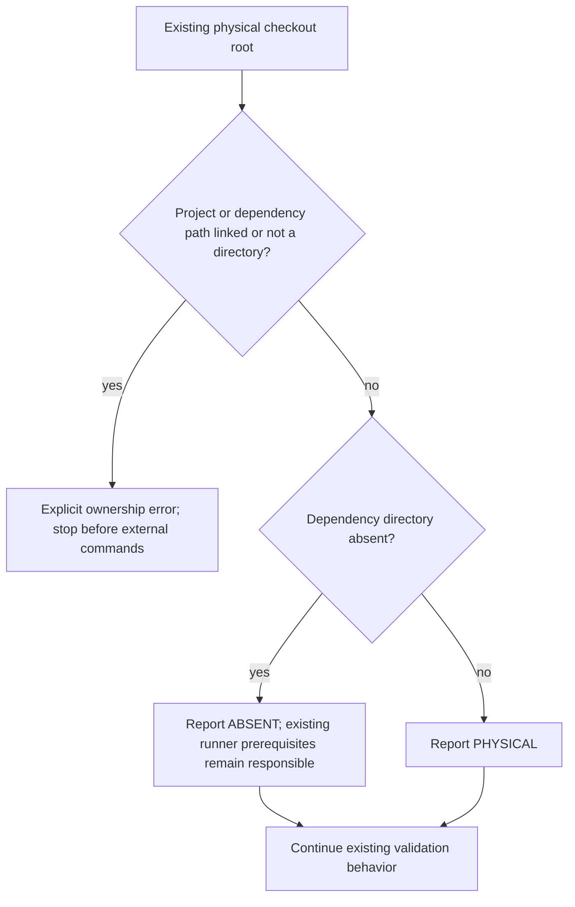

# Physical dependency ownership before validation

**Last verified:** 2026-10-16

## Executive summary

Validation must not regenerate a Prisma client, rebuild packages or restore
dependencies through another checkout's `node_modules` junction. The shared
[ownership guard](../../scripts/assert-dependency-ownership.ps1) now runs
before work in all five canonical validation entry points. It diagnoses
unsafe paths and stops; it never removes a link, modifies its target or
installs packages.

This is tooling-only. Product version remains 0.55.51, and neither runtime
behavior nor the deployed image changes. Operator UI acceptance and Mermaid
version alignment remain separate outcomes.

## Policy and flow

The checkout root, `api`, `web` and their three top-level `node_modules`
directories must be physical directories when present. Junctions, symbolic
links and other reparse points are refused, including dangling links.
The rule deliberately rejects even an apparently internal directory link:
its destination is not proof of exclusive dependency/generated-file ownership.
Normal package-internal links, such as npm executable links, are not scanned.



An absent dependency directory is not reported as physically verified.
This check is not a package-availability or integrity substitute. A missing
repository root is an error, not a successful set of absent dependencies.

| Entry point | Enforcement |
|---|---|
| [Protected push](../../scripts/pre-push-checks.ps1) | Before build/lint/test gates; new negative-control contract is the first gate |
| [Backend matrix](../../scripts/test-all-modes.ps1) | Before mode work or dependency restore; prerequisite failure exits 2 |
| [Dev deployment](../../scripts/dev-deployment-pipeline.ps1) | Before report creation, estate resolution and external commands; true `-DryRun` remains nonexecuting |
| [Local/Docker validation](../../scripts/full-validation-pipeline.ps1) | Before build, environment setup or container operations |
| [Quality-gate walker](../../scripts/run-all-gates.ps1) | Before report/prerequisite execution; true `-DryRun` remains nonexecuting |

Direct one-off npm commands are outside these entry points. Run the guard
first when doing equivalent manual mutation-capable validation:

```powershell
pwsh -NoProfile -File scripts\assert-dependency-ownership.ps1 `
  -RepositoryRoot (Get-Location).Path
pwsh -NoProfile -File scripts\test\dependency-ownership.contract.ps1
```

## RED/GREEN and coverage

Initial RED: 14 explicit ownership/early-wiring assertions failed before the
guard existed. An added adversarial missing-root case then reproduced one
real invalid-input acceptance failure before its correction.

GREEN: **31/31 ownership assertions** pass. They exercise real junctions on
Windows and symbolic links on other platforms, linked root/API/web dependency
directories, linked project parents, dangling links, files instead of
directories, missing roots, physical copies and explicitly absent dependencies.
Foreign fixture content remains unchanged.

For each actual runner, a copied sandbox invokes its real prelude against
linked dependencies. npm, npx, Node, Docker, Azure CLI and Git are replaced
with command sentinels. Every runner exits nonzero with the ownership
diagnostic before any sentinel starts. AST ordering is supplementary evidence,
not a substitute for these subprocess outcomes.

Related backend-matrix, dev-pipeline and quality-walker contracts pass.
The matrix contract copies the real default guard into its sandbox so it
continues testing the intended missing-database and explicit opt-out behavior.
No full product matrix or deployment is needed to prove this preflight.
The normal protected push owns its applicable existing product checks.

### Verified delivery and local dependency alignment

PR #231 merged normally at `8887584c`, preserving reviewed `b0c64705`.
All 25 protected Fast gates passed in 633.7 seconds, including 6,048 API
units and 2,432 selected InMemory E2E cases. Seven exact-tip checks across
four workflow runs passed; merged-master CodeQL `38863401990` also passed.
No runtime-affecting source differs from deployed 0.55.51 `c1a466ec`.

The separate Mermaid task was reconciled rather than blindly implemented:
source `f70a96a1` already aligned the manifest and CI lock to 11.17.0.
The private installed copy was still 11.15.0. `npm ls mermaid --depth=0`
failed with `ELSPROBLEMS`; the existing doctor independently failed with
editor/gate version drift. After all six physical-path checks passed,
`npm ci --ignore-scripts --no-audit --no-fund` restored only the existing
root lock through the existing corporate proxy. No fresh version was
selected, and no lock was generated locally. The manifest and all three
lock hashes remained identical.

The doctor then confirmed one built-in renderer and 11.17.0 parity.
All 763 diagrams rendered under strict light and dark Chromium themes.
The original protected push's older installed-renderer result is not
substituted for this separate authoritative-version proof.
See the [portable tooling closeout](../evidence/TOOLING_CLOSEOUT_20261016.json).

## Execution issues and root causes

| ID | Type / severity | Symptom and root cause | Fix and why it works | Detection / earliest detection |
|---|---|---|---|---|
| DO-I01 | Test tooling / Low | All five wiring assertions initially failed because the AST counted both the invocation and its nested `Join-Path` command. | Select the ampersand invocation node, then additionally exercise real runner subprocess refusals with command sentinels. This distinguishes an actual guard call from a nested path expression. | First GREEN attempt / same focused contract |
| DO-I02 | Invalid-input handling / Medium | A nonexistent repository root was accepted as six absent paths. Missing dependencies and a missing checkout were conflated. | Require the root to exist; only dependency/project absence retains the runner's existing availability checks. The adversarial root case changes RED to GREEN. | Added adversarial test / same focused contract |
| DO-I03 | Documentation / Low | A draft handoff introduced an unsupported independent-claim count and a duplicated empty heading. | Replace the count with the verified normal-push fact and remove the empty heading before committing. Evidence counts must come from receipts, not an incidental prose edit. | Focused pre-commit review / same documentation edit |
| DO-I04 | Test oracle / Medium | Parent-link non-mutation checks initially inspected a marker in the shared dependency directory rather than each linked project's actual target. That could miss a changed parent target. | Assert a marker in each exact target; both parent fixtures first fail RED, then initialize their own markers and pass. Unrelated surviving content is no longer accepted as target-preservation proof. | Focused assertion review / target-specific negative control before first GREEN |
| DO-I05 | Inspection tooling / Low | A read-only lock inspection used `ConvertFrom-Json` without `-AsHashtable`; npm's empty root-package key cannot be represented by the default object conversion. | Use `-AsHashtable` and inspect the empty root key explicitly. No dependency operation started before the corrected inspection. | First inspection / same command |
| DO-I06 | Invocation tooling / Low | The first manual restore command omitted the guard's mandatory `RepositoryRoot` argument and stopped immediately. | Supply the explicit owned checkout root before restoring. Mandatory binding prevented any dependency mutation, as intended. | Parameter binding / before the first mutation |
| DO-I07 | Environment drift / Medium | A private installed Mermaid copy was 11.15.0 even though the reviewed manifest/CI lock and built-in editor were already 11.17.0. Physical ownership alone does not establish version provenance. | Existing `npm ls` and doctor failures justified restoring the exact existing root lock; unchanged manifest/lock hashes, a clean doctor and 763 strict two-theme renders prove the correction without another source upgrade. | Follow-up environment reconciliation / dependency/doctor inspection before editor-equivalence claims |

The original shared-dependency incident is DT-I17 in the
[UI date/time ledger](../UI_DATE_TIME_IDENTITY_CONSISTENCY.md#validation-ownership-correction-dt-i17).
This guard makes its prevention executable rather than repeating a warning.
Source/payload integrity and corporate package quarantine remain independent
requirements; no dependency declaration, manifest or lockfile changed here.
The local installed root tree was restored from its existing reviewed lock.

### Provenance and completeness

The full available continuation log was reconciled through event 11,137,
retaining earlier reconciliations. Separate failure-signal and causal-narration
passes yielded 83 cumulative candidates, including 15 after event 10,866.
The initial 14 expected RED assertions are not a production incident;
the unexpected AST false failures and adversarial invalid-root failure map
to DO-I01/02. DO-I03 was corrected in the draft. The later exact-target RED
maps to DO-I04; inspection, mandatory-argument and stale-install failures map
to DO-I05/06/07. Historical failures, successful patch text, status updates,
an optional absent transcript environment variable and scanner echoes were
verified and dismissed as new incidents. Later successful CI and normal
merge events do not introduce an additional failure. This does not claim
access to the deleted original conversation.

Self-improvement disposition: **applied**, through actual link fixtures,
runner subprocess refusal and mutation sentinels.
Design disposition: **accepted**, one cohesive shared preflight reused by
five callers, no generic path framework or production abstraction.
