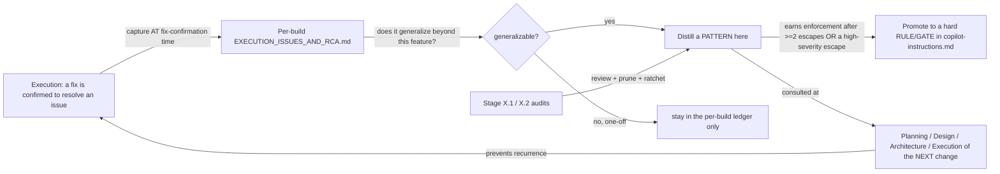
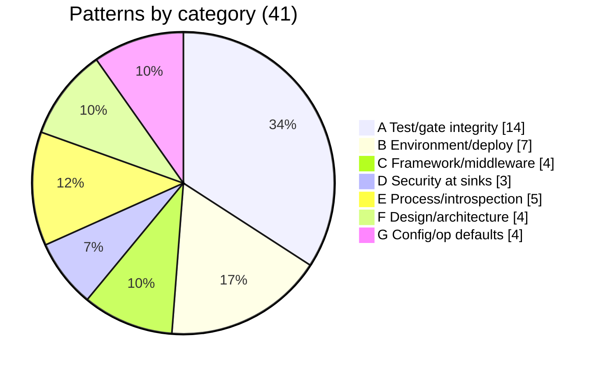

# Engineering lessons and patterns - the self-improving ledger

> **What this is.** The **central, continually-updated** knowledge base of cross-cutting engineering patterns learned from real issues on this codebase. It is a *living* doc: it is **appended to** every time a fix is confirmed to resolve an issue that generalizes, and it is **reviewed and re-pruned** on the Stage X audit cadence. It is the layer between raw per-build issue ledgers and hard standing rules:
>
> ```
> raw issue (per-build EXECUTION_ISSUES_AND_RCA.md)
>     -> distilled PATTERN (this doc)
>         -> hard RULE / GATE (.github/copilot-instructions.md) when it earns enforcement
> ```
>
> **When to consult it.** This doc MUST be read at the **start of planning, design, architecture, and execution** of any non-trivial change - that is the whole point of a central self-learning store. The anti-patterns below are the ones that did NOT show up in prior planning/design/architecture stages and only surfaced during execution from unforeseen combinations of circumstances. Reading them up front is how the next plan avoids re-learning them.
>
> **Norms.** Like every doc in this repo it carries the explanatory tools (Mermaid diagrams, dashboard tables, distribution charts). Keep it that way when you append.

---

## Real-parent evidence for transitive major overrides (2026-10-29)

**Applied in:** [Hono adapter qualification](../HONO_PRISMA_PARENT_QUALIFICATION.md).
A transitive dependency's unchanged exported function names do not prove
compatibility when its parent pins an older major and the implementation
rewrites request/response internals. Exercise the installed parent's real
initialization, requests, errors and public close contract in an owned,
network-isolated environment before changing the override.

Keep package-level exploit RED/GREEN distinct from parent compatibility.
Verify the complete installed graph before the comparison, not just the
named parent package. Measure port/data cleanup separately from natural
process exit, and record explicit owned-resource teardown rather than
hiding a retained process with `forceExit`. Here both adapters retained a
post-close process, so natural exit remains unqualified while the public
close, listener release and stateless-file assertions passed.

`npm install --no-package-lock --no-save <selected package>` is not a
bounded selected-package update: it can re-resolve other semver ranges.
An observed bootstrap moved Prisma 7.8.0 to 7.10.1 without touching the
source lock. Compare installed identities against the qualified lock after
every dependency operation; `npm ls --all` exiting 0 is not that comparison.
Use clean CI-generated source locks and `npm ci` for final assurance.

## 1. The self-improvement loop (how this doc is fed and used)

### Prove preservation independently of successful integration

An ordinary merge preserves history, but conflict-free runtime files alone
do not prove which runtime source survived. For preserved diagnostic branches,
record both exact parents, classify every conflict, compare runtime/security
and fixture paths against incoming master, and verify every constituent
commit remains an ancestor. Keep draft-only dependency patches outside that
comparison. This 29 October integration uses those explicit negative checks;
source correctness and green CI still do not admit a failed performance run.

### Verify captured evidence through the owned descriptor

Exclusive creation protects the initial open, not a later pathname lookup.
Keep the created descriptor open through child capture and verification,
then read that descriptor rather than reopening a name another process can
replace. Read with explicit offsets: a child sharing the descriptor can
leave its offset at EOF. Accumulate short reads and reject premature EOF.

The 28 October archive regression replaces the path, proves the old pathname
read sees different bytes, and verifies that the descriptor still yields the
captured bytes. It also exercises short reads and truncation. This closes
the gap between archive-format checks and captured-file identity without
repeating an experiment. A green CodeQL workflow can still publish a new
finding; inspect the actual alert/review state before declaring it clear.
See [CR-11](../MEMBERSHIP_HISTORY_DIAGNOSTIC.md#cr-11-captured-evidence-must-not-be-reopened-through-a-replaceable-name).

### Separate draft consolidation from expensive campaign admission

PR synchronization is not always an experiment request. When preserving
already measured source and evidence, an automatic frozen campaign can
silently become an unchanged retry. Use the native draft boundary for
expensive job allocation, retain ordinary correctness/contract CI, and add
the ready-for-review event so leaving draft restores automatic execution.
Explicit dispatch remains a deliberate allocation path.

Test the actual job conditions for draft, non-draft and dispatch inputs and
protect ordinary CI from inheriting the draft skip. Record skipped campaigns
as unexecuted, not qualified. This avoids a general scheduler or label-policy
abstraction while preserving the independent release-admission requirement.

Calendar-bound evidence can expire without any source change. Before a long
consolidation hook, run the existing cheap offline currency checks; when a
date expires, use the sanctioned live verifier rather than editing the date.
The 28 October RFC refresh verified all 19 mirror texts, graph metadata and
errata, changing only the manifest date and five errata-count records. Keep
dependent human tables synchronized and preserve the original failed hook.

### Recover shared tooling without resetting unrelated work

The Docker context-metadata sharing violation recurred on 2026-10-28 after
the earlier RC-I19 recovery. A reboot had released the earlier lock but had
not identified its initiating actor. Treat recovery and causal diagnosis as
separate claims: an ownerless handle scan does not establish a kernel or
security-product defect.

Before resetting a shared workstation, preserve idle tool storage and
configuration, then test process-scoped configuration isolation against the
same data. The recurrence recovered Docker without a Windows restart:
original metadata replacement access remained error 32, isolated metadata
access succeeded, the server responded, and a disposable read-only,
network-disabled workload passed with exact cleanup. Require actual server
readiness rather than pipe existence, retain a reusable isolated launcher,
and compare existing resource identities before and after the smoke test.
This is a continuity mitigation, not proof that the original lock is fixed.

### Complete-output evidence does not require complete-output retention

DS-02 executed the exact frozen DS-01 work wrapper against a real bounded
Node fixture above 8 MiB per pipe. Its native maxBuffer failure was proven;
the historical DS-01 inner code remains unknown. Increasing a buffer
would only move the failure boundary and allocate more private text.
Stream both pipes through fixed byte/frame/record/deadline gates, retain
only bounded scan tails and correlation state, and require both EOF events
plus successful native close before issuing a non-text proof.

All generated database and application credentials belong in the canary
set. Exercise actual chunk acknowledgements, normalized timestamp-frame
boundaries and both channel orders; do not assume multiple writes imply
multiple native chunks. Uncertain container/tool attribution must remain
explicitly ambiguous. Missing, incomplete, over-limit or nonzero-exit input
is INVALID, not a complete-success-shaped fallback.

OS-17 and DS-02 also show that safe cause retention must cover work
commands, not only cleanup. Preserve finite native codes and static roles
through every minimal serializer without retaining stderr, arguments or
nested exceptions. The executable guards are in
`scripts/test/membership-console.test.cjs`; the single affected aggregate
passes 84/84. See the [indexed RCA](../MEMBERSHIP_OBSERVER_AND_STATEMENT_DIAGNOSTIC.md)
for fixed budgets, causal RED/GREEN and the remaining runtime hold.

### A child startup timeout is not an operation failure

OS-18's four aggregate failures exposed a test-boundary defect: a request
timer armed immediately after spawn, or a whole-process timer including
module imports, could expire before the intended negative operation started.
An isolated pass does not replace a failed aggregate or identify the old
phase. Acknowledge bounded startup, then start the original operation clock;
require the intended failure cause and await child closure before continuing.
Record setup versus operation failure separately, without raw child errors.

The executable held-readiness control and bounded IPC fixture in
`scripts/test/membership-observer.test.cjs` demonstrate the false-negative
mechanism without sleeps, larger operation deadlines or host-noise claims.
The corrected aggregate passes 66/66 while retaining all old FAILED logs.
The [indexed RCA](../MEMBERSHIP_OBSERVER_AND_STATEMENT_DIAGNOSTIC.md)
distinguishes source proof, current observations and unretained old phases.

### Finalization must preserve safe causes and the actual budget phase

OS-17 / DF-12 demonstrated two different evidence losses: a native wrapper
discarded exit/signal metadata, then a finalizer discarded even the generic
failure behind booleans. A successful absence query cannot repair a failed
final capture or prove that a removal command succeeded. Keep those claims
separate and retain ordered, closed action causes through every fallback
serializer. Never retain raw native stderr, arguments or nested exceptions.

Budget selection and timeout size are also separate facts. Source inspection
proved that functional cleanup already used the correct outer deadline;
its shorter per-command timeout was a different defect. Real fake-CLI
subprocess tests must discriminate both. A validated inner `work` deadline
failure must not be relabeled `cleanup` merely because the finalizer caught
it there. Unavailable durations remain unavailable, not invented zeroes.
No post-incident observation reconstructs an unretained historical error.

Applied safeguards are in `scripts/test/membership-lifecycle.test.cjs`.
Consolidation review found that a caller could still pass its outer deadline
as both arguments while every presence-only wiring check passed. Execute the
actual caller with expired work and remaining cleanup: work must not dispatch,
but capture, removal and independent verification must still run. Also measure
the configured child's lifetime so a separate grace period cannot consume the
cleanup reservation. The history runner now reserves 90 seconds inside its
unchanged outer cap; historical experiment receipts are not rewritten.

Ignored evidence is a separate portability boundary. Keep portable negative
proof tests and committed nonsecret regression fixtures executable without
local artifacts. Explicitly skip only retained-evidence comparisons when their
complete inputs are absent; never turn that skip into runtime qualification.
Verify this with installed dependencies and no copied experiment evidence.

Check required configuration before expensive validation, including inputs
needed only to load a tool's configuration. Prisma generation can require
an explicit URL without needing a database connection. Fail early and
explain that distinction; do not silently substitute a live URL or
credential. Exercise the actual preflight block and preserve modes that
do not require that input.

Validation capacity belongs in the gate definition. A completed assertion
count does not prove that every discovered test file ran: the default web
pool lost 15 workers while reporting 1,301 passing assertions. Preserve that
failure and verify unique-file accounting under a declared worker bound.
The full two-worker run completed all 124 files / 1,655 tests. This supports
the chosen capacity policy, not an invented native exit cause. Anchor edits
to named gate blocks and assert neighboring commands remain unchanged when
multiple steps contain the same command text.

A source snapshot nested under an existing repository is not an isolated
Git checkout: Git can walk upward and find the parent's full history.
When tests enforce ancestry or inspect historical source, reproduce CI's
checkout depth in a clone with its own `.git`. Four new CI failures were
reproduced at depth one and disappeared after fetching history alone,
without changing or skipping their assertions. Declare history availability
as a validation input and guard the active checkout setting.

A positive cleanup fixture must model the reserved cleanup budget, not
silently impose a tighter per-child startup deadline. Keep the absolute
deadline unchanged, exercise a successful child that would exceed the old
independent cap, and retain sanitized lifecycle details on assertion failure.
This separates testing deadline enforcement from accidentally measuring
native process startup speed on a shared host.

The [indexed forensic report](../MEMBERSHIP_OBSERVER_AND_STATEMENT_DIAGNOSTIC.md)
records exact RED/GREEN results and the still-unqualified runtime outcome.
The correction reuses existing finalizer/privacy modules rather than adding
a lifecycle framework. Normal admission and frozen evidence remain separate.

### Performance admission needs a prospective environment control

Container readiness must identify the final service, not a bootstrap process.
The official PostgreSQL image's temporary initialization server accepts
Unix-socket connections before restarting. Probe its final TCP listener,
not the default socket, and keep an actual-loop control where the socket is
ready but TCP is not. See [ER-63](../ENDPOINT_SNAPSHOT_REVISION.md#linux-initialization-readiness-correction-er-63).

Identical application images can cross regression limits when their execution
environment is unstable. Keep the original failed receipt; do not choose a
favorable opposite-order denominator or pool later observations to rewrite it.
Before a new admission, freeze workload, image identities, limits, complete
sample counts, order and stop rules. Run same-image controls first on the
prospective environment and stop if they fail. Passing a small number of
controls does not quantify a false-failure rate. More rounds, new history
strata and confidence formulas are not free assurance: justify their decision
properties and runtime before adopting them. The narrow Linux qualification
reuses the original lifecycle instead of building a new measurement framework.
See [protocol and RCA](../ENDPOINT_SNAPSHOT_REVISION.md#prospective-linux-performance-qualification).

### Failure evidence needs its own completion budget and contract

A failed measurement is not the same thing as an absent receipt. Preserve
explicit partial failure data, exclude it from admission and test a failure
after samples have actually been collected. Retrieve the receipt before
destroying its owner. Likewise, `always()` cannot run after a job has already
exhausted its total deadline: reserve cleanup and upload time outside the work
budget. Test that work stops, not merely that timeout fields exist.
See [ER-64/ER-65](../ENDPOINT_SNAPSHOT_REVISION.md#hosted-qualification-review-failed-evidence-and-deadline-guards-er-64er-65).

Independence must extend to files within a capture, not only separate roles.
If a CPU profile is missing, still attempt its available bootstrap metadata
before deleting the container. Propagate the first error, keep capture failed
unless both copies succeed, and test both asymmetric failures plus both
failures. Assert retained file contents and failure stages, not just a receipt.
See ER-68m in the [native diagnostic ledger](../ENDPOINT_SNAPSHOT_REVISION.md).

Cover the whole authorized lifecycle, not only copying: signal/exit races,
polling inspection failures and shutdown timeout must still reach independent
file collection. Re-inspect once after a failed signal, keep unknown exit
status unknown, and preserve the original lifecycle error even if collection
or reinspection also fails. Never collect from an unauthorized owner.
ER-68o closes this second escape and promotes the contract to a standing
rule; tests discard their source store before checking retained contents.

Persistence readiness is not elapsed time. When logs are buffered, use the
existing explicit drain endpoint before a privacy snapshot outside the
measured window, rather than sleeping less than the configured flush interval.
Write a sanitized failure-first receipt for functional/privacy checks,
retaining counts and independent predicates, never raw log or credential
values. Both diagnostic consumers must reject failed/missing privacy proof.
Preserve a primary work error through secondary capture, cleanup and receipt
write failures; test combined failures and report when a receipt is not
durable. See ER-68q-v in the [ledger](../ENDPOINT_SNAPSHOT_REVISION.md).

Walk failure precedence through every layer once: client status/copy, round
observer/resource receipt, privacy, block capture/cleanup and campaign receipt.
An outer catch cannot preserve an error already replaced by an inner finally.
Attempt independent evidence operations before deleting their source, retain
the first ErrorRecord, and put environment restoration in an unconditional
finally. Test combined failures and originally absent environment values.
For correlation, match the selected ID and category in the same actual log
record, not independent substrings across a capture or nested payload fields.
Keep fixtures faithful to the real formatter and lexical catch semantics.
See ER-68x-ac in the [ledger](../ENDPOINT_SNAPSHOT_REVISION.md).

Derived audit reports need immutable-input identity too. Require explicit
artifact/run/output alignment before writing, retain the original producer
identity separately from the current replay-consumer hash, and include all
guard inputs in replay scratch. A replay is not a new measurement. Verify a
wrong-run negative control cannot overwrite an older report. See ER-68w.

The first-error walk includes leaf collectors' status writers. Protecting a
caller cannot recover an error its callee's finally already replaced.
Exercise ownership/capture plus writer failure and writer-only failure.
PowerShell restoration also needs a runtime-family check: .NET 9 distinguishes
empty values from deletion, while PowerShell can bind ordinary `$null` as
empty text. Use `[NullString]::Value` for originally absent values and preserve
real empty values separately. A Windows-only PASS does not prove Linux state
restoration. Actual container controls close ER-68ad/ae; both conventions are
promoted to the standing rules rather than left as advisory prose.

Formatter fidelity is not domain fidelity. A syntactically real log line can
still use the wrong category: Group PATCH operations emit `scim.patch`, not
the general `scim.group` category. Derive the expected operation/category
relationship from its producer and keep a source-to-fixture guard plus
wrong-domain negative controls. Before a costly benchmark, a bounded actual
contract probe can verify the selected failed request's sanitized category
counts without exporting raw logs or IDs. This closes ER-68ah; it does not
retroactively explain an older failure whose predicates were not retained.

Resource measurements need the same failure contract as request timings.
Persist every collected CPU, database, memory, RSS and OOM observation before
rejecting a ceiling or deleting its owner. A missing later probe must leave
earlier observations marked partial, not silently absent. Test the actual
failure and teardown paths, including exact-boundary failures, and verify
the values still exist after cleanup. Moving to a different host is not a
repeatability fix unless its same-image controls pass. See
[ER-66 and the failed Linux control](../ENDPOINT_SNAPSHOT_REVISION.md#linux-control-result-and-resource-failure-retention-er-66).

### Diagnostic observations must not become admission or causal claims

Retain request spans and independent counter read windows on the same
verified monotonic clock, including observer cost, gaps and explicit unknown
coverage. An app-wide counter increasing inside a request does not measure
that request's lost time. Two read windows must be wholly interior before
computing a difference; insufficient observations stay unknown, not zero.
Reject diagnostic-marked receipts from normal admission even when complete,
and execute the actual mode-selection branch to prove it cannot reach the
release evaluator or later comparison blocks.

Test real subprocess startup and shutdown, not only mocked lifecycle calls.
Clearing inherited secrets is desirable, but Windows Node cryptographic
startup still needs `SystemRoot`; allow that one OS value rather than
restoring the parent environment or skipping the test. Parameter splatting
also avoids raw PowerShell backticks colliding with JavaScript template
delimiters in cross-interpreter fixtures.
See [ER-67](../ENDPOINT_SNAPSHOT_REVISION.md#diagnostic-only-request-and-cpu-timeline-er-67).

Native profiler samples are observations, not measured CPU microseconds.
Wall-clock sample gaps can include scheduler suspension and must not be used
as function CPU weights. Retain full function/source identities and idle
samples; disclose whole-process lifetime, runtime-version and order effects.
Match every raw request span to the original timing arrays and native clock
range before publishing a comparative diagnostic.

A generic resource owner label does not authorize a profiler-specific exit
signal: require an explicit profiler marker as well. If the process already
exited, collect what it wrote before rejecting its exit code. Store output
where it survives stop, then collect all independent role receipts before
removal even when the first capture fails. Prove these lifecycle behaviors
with actual collector paths and frozen-image capability probes.
See [ER-68](../ENDPOINT_SNAPSHOT_REVISION.md#native-function-profile-capture-assurance-er-68).

GitHub's `cancel-in-progress: false` is not a queue-all guarantee: by default
only one pending workflow survives per concurrency group. When three or more
independent required lanes share a group, use the documented `queue: max`
on every participant and test the complete participant set. It preserves
single active execution while retaining up to 100 pending runs; saturation
still needs explicit failure reporting. Distinguish canceled-before-start
from a failed measurement, and never repair scheduling loss by admitting
unexecuted evidence.

Validate mode-specific provenance by executing each real mode's hash-emission
block and checking both keys and actual bytes. A hash branch nested under an
incompatible mode can be unreachable while parser and workload tests all pass.
When extracting PowerShell blocks for focused execution, preserve automatic
script-path bindings explicitly without replacing the production branching
or hash logic. See ER-68g in the same ledger.

Do not infer timestamp ordering from an interval field's name. Real native
profiles can contain signed steps; reconstruct and validate every cumulative
timestamp against the original profile window, retain every observation and
report reordering explicitly. Unweighted counts need no sorting or conversion
of gaps into CPU time. A final in-range sum cannot prove intermediate bounds.
Verify the official consumer's handling rather than trusting a search
synthesis. Keep producer commit/hashes distinct from a corrected replay
consumer's hash, and never relabel an original failed campaign as successful.
See ER-68h/i in the same ledger.

Observing IPC can change delivery semantics. Node buffers ordinary child
messages until a message listener exists; an early diagnostic listener can
drain the queue before the real consumer is installed. Test an observer
against delayed-consumer delivery before using its output to diagnose a
startup failure. Avoid installing competing IPC listeners, preserve call
and return behavior, and keep instrumented runs separate from gate admission.
See ER-68k in the same ledger.

A real-process timezone regression need not launch a second complete test
framework. Use a bounded fresh Node process with the established source loader,
the actual production entry point and mocked external I/O. Assert a complete
receipt proving the process timezone, production read count and returned values.
Retain ordinary dependency-injection coverage separately. Before accepting the
cheaper harness, reverse the relevant production behavior and confirm that the
new assertion fails for the original defect; restore it before any gate run.
Keep deadlines unchanged and distinguish isolated timings from full-load proof.
See ER-68l in the same ledger.

### A parent-compatible dependency patch needs actual consumer evidence

An engine range only answers whether Node can load a package, not whether an
exact-pinned parent remains correct. Likewise, a pre-existing forced major
does not make the next forced version semver-compatible. Enumerate locked
and installed owners, assess public API changes, and exercise the real
parent's parser/compiler/lifecycle. Preserve successful baseline behavior
alongside discriminating security RED/GREEN. A toy replacement fixture is
not proof for an actual parent's initialization and shutdown.
The [stacked API advisory patch](../API_ADVISORY_CONSUMER_COMPATIBILITY.md)
keeps the Prisma/Hono adapter blocked because those lifecycle claims cannot
be verified under the no-service-start constraint.

### PowerShell location is not every library's working directory

`Set-Location` changes PowerShell's provider location, but a .NET API resolving
a relative path can still use the process's original current directory.
Always construct and validate absolute source and destination paths before
archive extraction or other library-driven writes. Do not repair a misplaced
artifact with broad cleanup: verify its exact files against the trusted
source and move only the generated directory. The
[API integration ledger](../API_OVERRIDE_CONTEXT_VALIDITY.md) records the
three-file ignored-artifact incident and its bounded cleanup.

### Separate the required review claim from one provider's availability

An acknowledged request is not a completed review. Conversely, an unavailable
hosted reviewer must not become an extra policy requirement when the written
process permits independent technical review and does not mandate that
provider. Verify both the written requirement and actual branch protection;
retain exact-head review provenance, findings and limits. Never fabricate
approval or remove a genuine approval requirement. The
[API integration ledger](../API_OVERRIDE_CONTEXT_VALIDITY.md) records the
unnecessary hold and its correction through ordinary reviewed PR integration.

### Shared override repairs must reach complete-tree acceptance

An installed version can satisfy every owner range while Arborist rejects
its edges for incomparable override ancestry. Exact root pins at already
locked compatible versions can unify the context without changing packages.
Check every owner against installed metadata and actual resolution, not only
the owner that happened to be reported first. Then run the real
`npm ls --all --json` and require exit 0 without filtering problems.

The API correction initially removed three invalid records but exposed a
fourth shared descendant, hasown. A clean restore reproduced the remaining
defect, and the complete-tree regression blocked incomplete GREEN.
See [mechanism, regression and RCA](../API_OVERRIDE_CONTEXT_VALIDITY.md).
Keep advisory clearance, inventory validity and deployed artifact contents
as separate claims. Pin maintenance stays with the existing watcher.

### A worker warning must be attributed to an observed lifecycle phase

The same Jest warning accompanied real unit-fixture timer leaks and a
different parallel HTTP shutdown observation. In the latter, both workers
reached JavaScript exit with code 0 within 1.5 ms and the native Environment
end marker within 3.5 ms, yet the parent observed process exit 5.84-6.79
seconds later. Its timeout-triggered kill calls returned false. The warning
alone therefore proves neither a retained timer nor a successful kill.

Retain parent shutdown/kill/exit receipts alongside worker resources and
native lifecycle milestones before choosing a fix. Keep the existing
deadline and worker count while attributing the phase. Do not equate an
Environment trace marker with completion of every C++ destructor, and do
not generalize one observed phase to every historical warning.

For Windows diagnostics, record process exit status, process-object signaling
and parent callback separately. A follow-up captured status 0 while the same
owned process handle remained unsignaled. Retain the handle from a verified
live state to avoid PID reuse, and request only limited-query/synchronize
access. Polling gives observation times, not exact kernel transition times.
Without retained unchanged polls or maximum gaps, do not claim a precise
sampling bound or uninterrupted state throughout the interval. Source paths
can explain compatible behavior without proving which native branch executed.

Diagnostic observers must preserve the behavior they observe. In
particular, adding an IPC `message` listener changes channel liveness and
can consume queued messages before the real consumer attaches. The bounded
observer control checks delayed queued delivery, original event arguments
and return values, zero added message listeners, and natural child exit.
See [RC-I110](../SCIM_CORRECTNESS_EXECUTION_ISSUES_AND_RCA.md#rc-i110-a-worker-warning-is-not-proof-of-a-timer-leak).

### Dependency classification is not deployed package inventory

The #248 Hono remediation found an affected `devOptional` transitive package
inside the exact frozen 0.55.58 runtime image, alongside Prisma tooling.
Lockfile development/optional flags and an absent direct source import do
not prove production absence or unreachability. Inspect the actual immutable
artifact with a metadata-only, offline, read-only entrypoint; never start the
application or connect a database just to inventory packages.
Keep the resulting claim narrow: package presence is not exploitability,
and an old digest's receipt does not qualify a new candidate. Pair a minimal
exact override with a regression over every actual locked occurrence, then
check the restored installation after CI-only regeneration.

### A real-timezone regression should launch one real leaf, not another suite

A real child process is necessary to test Node's non-UTC date interpretation;
a second full Jest startup is not. The unchanged 30-second nested-run deadline
failed again when a separate branch started from master without the reviewed
fixture correction. Preserve the real subprocess and both existing deadlines,
but load the actual TypeScript path through a small leaf using existing tooling.
Require a runtime receipt for entrypoint, loader, timezone offset, read count
and timestamps. A successful exit or isolated PASS cannot prove that topology.
Reinstate the old launcher as a negative control and ensure it fails even when
its child succeeds. Keep production code byte-identical after mutation checks.

### Request variants and rolling windows need semantic assertions

A successful response cannot prove which request headers were sent. When a
helper inherits default headers, explicitly clear the variant under test and
assert the constructed map before dispatch. Likewise, equal array positions
in two rolling charts can denote different hours. Compare aligned time
buckets, force rollover, expire the real response cache, and require a known
request to increment its bucket. A frozen clock must not freeze the network
or database flush timers, and timestamp-derived fixture names need independent
uniqueness. See [ER-59](../ENDPOINT_SNAPSHOT_REVISION.md#follow-up-review-deliberate-conditional-request-headers-er-59)
and [ER-60](../ENDPOINT_SNAPSHOT_REVISION.md#ci-boundary-correction-compare-the-same-chart-hours-er-60).
When a helper returns an assertion-count receipt, trace its exact-output
consumers across script and API test directories before the full hook. Keep
the inherited-header scenario in the existing automatically executed wrapper,
not only a private smoke runner; [ER-61](../ENDPOINT_SNAPSHOT_REVISION.md#protected-hook-consumer-correction-er-61)
records this discovery gap and its permanent HTTP guard.

### Wider cache lifetime requires a complete input identity

Sharing a previously request-local derived cache can expose an existing key
collision across requests. A core schema identifier is not a ResourceType
binding: extension schemas and required flags also determine protection rules.
Include the complete binding, keep different consumers' key namespaces disjoint,
and test both warming orders with hidden/write-only/read-only fields through
HTTP. A single-resource fixture cannot detect this class of failure.
See [ER-55](../ENDPOINT_SNAPSHOT_REVISION.md#hosted-review-correction-resourcetype-cache-binding-er-55).

### A reviewer-provider outage is not automatically a review-policy blocker

Check the actual delivery policy, branch requirements and accepted repository
precedent before treating one hosted reviewer's billing error as a permanent
delivery hold. A genuine independent automated review can be recorded as such
when that path is accepted; it must never be relabelled human approval. Verify
its exact source coverage, intervening edits and dependency identities before
carrying it forward. New serving code or migrations invalidate that coverage.
See [ER-54](../ENDPOINT_SNAPSHOT_REVISION.md#substantive-review-disposition-and-er-54).

### Equal batch counts do not prove equal database work

Reconcile affected rows as well as statement calls, then inspect the actual
migrated index catalog before blaming a newly persisted field. The controlled
0.55.58 logging diagnostic preserves every row and batch while changing one
field or index at a time; the URL trigram index has a much larger measured
insert effect than endpoint name in that fixture. Retain WAL and buffer
counters, reverse case order, and keep synthetic write attribution separate
from original application causality and production capacity. Do not remove a
read access path based on write-only evidence. See the
[controlled comparison](../ENDPOINT_SNAPSHOT_REVISION.md#controlled-request-log-write-cost-follow-up).

### Integration must refresh the consumers of a changed test seam

A focused selector written before a master update can omit a newly inherited
test even when Git merges its production code cleanly. The first correction
push caught five conditional-endpoint tests whose double lacked the new
snapshot query. Reuse the shared double, preserve the original failure-path
assertions, and discover the complete directly affected service test directory
in focused compilation and neighborhood tests. A clean merge and an older
focused PASS do not prove compatibility with new consumers. Full pre-push
tests remain the independent publication boundary, not a reason to bypass
that gate after a focused repair.
See [ER-36](../ENDPOINT_SNAPSHOT_REVISION.md#integration-issues-and-prevention).

For `Validate`, preflight the Prisma configuration before the expensive
hook-owned suites. Client generation can require a datasource environment
variable without using a database connection. Supply an explicit,
nonconnecting loopback code-generation URL for that process rather than
inventing a production default, writing credentials to `.env`, dropping the
gate or repeating the same missing-input invocation. The generation-only
preflight passes with no server or password.
See [ER-37](../ENDPOINT_SNAPSHOT_REVISION.md#integration-issues-and-prevention).

### Composite edits must share history without sharing form-control identity

Sharing a controlled value does not mean a preset shares the input's Undo
history: EditableField correctly treats an edit that bypasses its dispatcher
as an external refresh. Route every user edit through the same dispatcher,
ignore unchanged selections, and preserve genuine refresh behavior.
Keep accessory controls outside Fluent Field's control context so they do not
inherit the input's generated HTML ID. Regression coverage must assert distinct
real control IDs, preset Undo/Redo/Reset, zero writes during internal focus
changes, and the persisted/minted outcome of a clear-to-inherit action.
An empty input with a default placeholder does not prove that a server override
was removed. The [lifetime review ledger](../auth/EXECUTION_ISSUES_AND_RCA.md#publishing-and-interaction-review-issues)
records the actual unit/browser RED controls and their fixes.

### Worker startup errors require first-cause classification

A worker-start timeout can be the final wrapper for an earlier fatal heap
allocation error. During lifetime consolidation, both integration web attempts
inherited a 512 MiB API-oriented heap limit; reducing concurrency alone did not
fix it. Inspect and record the first fatal or causal stack before a retry.
Budget worker concurrency independently from each worker's heap, and do not
carry a benchmark-specific memory cap into unrelated React gates. Removing
that cap while retaining two workers passes the two heavy component suites,
122 tests; complete-matrix success remains a separate claim.
See the [consolidation execution ledger](../auth/EXECUTION_ISSUES_AND_RCA.md#authorized-lifetime-release-consolidation-2026-10-21).

The later combined 0.55.58 run reaches the same startup wrapper without a
fatal heap signal or an inherited npm heap cap. Its first causal stack is the
60-second fork-worker handshake timeout; the lower-level cause is unproven.
The supported thread pool passes both affected files, then the entire
124-file / 1,655-test inventory. Preserve the failed original matrix and
reference a separate complete closure; a targeted pass alone does not repair
a full-suite claim. Do not transplant an earlier heap diagnosis or weaken a
timeout merely because the final wrapper looks similar. See
[ER-44](../ENDPOINT_SNAPSHOT_REVISION.md#integration-issues-and-prevention).

### Live statistics need a shared capture boundary

2026-10-20: the complete SQL inventory still differed from aggregate totals
by three calls / 0.349323 ms because both were sampled in separate calls,
with a CPU read between them. A two-second delay does not freeze background
statistics. Retain the reconciliation failure and original performance
result. A single materialized statistics read now produces both totals and
the complete inventory; call/time/scope negative controls and the real
four-round diagnostic pass. This proves a shared capture, not independently
sampled equality. Do not retroactively patch old receipts or use the short
diagnostic to replace failed full admission.
See [ER-13](../ENDPOINT_SNAPSHOT_REVISION.md#11-follow-up-reuse-the-verified-snapshot-at-the-protected-profile-boundary).

### A client tail needs matching server timing before attribution

2026-10-20: correlate actual response request ids with persisted duration
rows, rather than assuming a slow client observation is network delay.
Some slow requests also spend most of that time inside the server; others
do not. State both clocks' boundaries. Compare a CPU-quota treatment only
as a diagnostic: the same images' empty-read tails shrink substantially
at two CPU, while the original half-CPU full failure remains held.
Aggregate throttling counters do not identify an individual request's pause.
Collect no raw headers/credentials, keep the trace off for admission, join
native multiline JSON before parsing, and verify exact read-correlation
counts before interpreting the result.
See [the worked examples and limits](../ENDPOINT_SNAPSHOT_REVISION.md#12-remaining-tail-server-timing-and-cpu-quota-treatment).

### Instrumentation must prove its clock and resource scope

2026-10-20: a host-cgroup-namespace observer read host-root CPU counters,
producing an impossible seven-core cost despite a quarter-CPU limit.
Separately, cross-host clock calibration was too uncertain for request
overlap and a parser-only test missed the observer's first-sample crash.
Require actual lifecycle coverage, exact target and observer cgroup
identity, verified clock-domain offsets, monotonic interval deltas and a
budget-bound sanity check. Container namespace inode equality is not a
substitute for measured clock offsets. Preserve rejected receipts and
explicitly reject instrumented timing at the admission boundary.
Counter-update overlap is not exact stalled duration or CPU-consumer
attribution. See [ER-16 through ER-22](../ENDPOINT_SNAPSHOT_REVISION.md#14-request-specific-quota-investigation-bounded-private-instrumentation).

### A filtered test result needs registration and execution proof

2026-10-20: nested registration recurred after OV-05, as ER-08. A selector
skipped every case because the new test was inside another test callback.
An all-skipped run is neither RED nor GREEN. The isolated PostgreSQL runner
now checks registration before creating a database, using a TypeScript AST
guard with positive and negative controls, and requires an actual failed
case for its filtered RED receipt. Final GREEN records the exact discovered,
passed and excluded counts. The guard covers this fixture's direct
`it`/`test`/`pgOnly` registrations; it is not a universal Jest alias analyzer.
Use unique suite-boundary patch anchors rather than a generic closing brace.
See [ER-08 and the closure receipts](../ENDPOINT_SNAPSHOT_REVISION.md#11-follow-up-reuse-the-verified-snapshot-at-the-protected-profile-boundary).

ER-26 subsequently exposed a curried `it.each(...)` registration that the
direct-call guard missed. Unwrap call/property chains to their registration
root; exercise nested parameterized and hook controls before database
creation. Passing direct-call controls is not proof of parameterized coverage.

### Attribute I/O by caller and preserve real adapter error shapes

2026-10-20: current-image workload-bounded profiles identify PostgreSQL
query submission, console output and response writing behind similar native
I/O frames. Inspect the caller chain before choosing an optimization;
exclude startup and state the remaining background-work uncertainty.
A small ordered membership-write statement reduces a real boundary
without removing locks, profile checks, redaction or own-commit responses.

Synthetic Prisma raw-error metadata was insufficient: the real PostgreSQL
driver adapter nests SQLSTATE under `driverAdapterError.cause.originalCode`.
Retain a real adapter-shaped regression plus malformed/non-unique negatives
and an actual PostgreSQL rollback/error-contract case. Only the exact raw
uniqueness code maps to conflict; never classify by message contents.
See [ER-23 through ER-26 and the write-boundary design](../ENDPOINT_SNAPSHOT_REVISION.md#15-reducing-the-final-populated-membership-write-boundary).

### Image labels are not runtime versions, and one green is not all metrics

2026-10-20: a descriptive private-image suffix repeated an earlier
runtime-version mismatch. Probe both pinned images' package versions
before allocating benchmark networks/databases, retaining the actual
HTTP runtime-version check as a separate later assertion. A Docker-free
mock proves rejection precedes allocation and correct versions reach that
boundary; the actual image probe verifies the assumed package path.

The changed-image full latency gate passes all twelve unchanged limits,
but SQL execution time rises while client latency and application CPU
fall. Preserve the SQL inventories and expose the trade-off, its largest
measured family and unknown database CPU. Never turn a scoped latency PASS
into an all-resource or customer-production claim.
See [ER-28 through ER-32](../ENDPOINT_SNAPSHOT_REVISION.md#15-reducing-the-final-populated-membership-write-boundary).

### A verified row token can avoid repeated work, not replace the authority

2026-10-20: carry a frozen endpoint-scoped content/token observation through
the existing revision seam. After acquiring the established locks, compare
the current database token in a new statement. Only an exact scoped match
may omit the profile body and repeated canonicalization. On token mismatch,
compare actual profile content so metadata-only changes remain valid.
Test wrong endpoint, missing proof, changed profile and real lock waits;
retain legacy content-only and InMemory paths. Verify image schema/migration
hashes alongside serving modules. A successful optimization-specific test
does not admit an immutable image whose full performance comparison fails.
See [the protected boundary design](../ENDPOINT_SNAPSHOT_REVISION.md#11-follow-up-reuse-the-verified-snapshot-at-the-protected-profile-boundary).

### A persisted cache token is a database writer contract, not a cache shortcut

2026-10-20: replace repeated content hashing only when every relevant writer
changes the token atomically with the row. Database-owned insert/update
triggers cover legacy ORM and direct SQL without requiring all callers to
upgrade together. Test rollback, unchanged timestamps, explicit token
replacement, replica session mode, change-and-revert, delete/recreate,
populated migration backfill and lock-timeout rollback. Keep equality tokens,
profile-content revisions and resource write versions separate. A missing
migration must fail explicitly; restore requires quiescence and cache-owner
restart. Removing one measured SQL cost is not overall performance admission:
the first full token candidate still fails seven latency limits.
See [the implementation and execution ledger](../ENDPOINT_SNAPSHOT_REVISION.md).

### A rendered diagram can still be unreadable

2026-10-20: a long horizontal flow rendered cleanly with nonzero SVG bounds
but shrank to a 6.19 px actual font in the standalone report. Switch a long
linear flow to vertical layout and wrap long sequence messages, preserving
every node, edge and word. Measure font size after the SVG screen transform,
not only computed CSS or diagram presence. The report now checks every
diagram at a 1,440 px viewport against a 12 px minimum; all eight pass.
See [PS-04](../SCIM_OBSERVED_VERSION_IMPLEMENTATION.md#25-document-readability-and-evidence-closure).

### Combine protected reads only after the wait, with an explicit projection

2026-10-20: reading a profile and its uniqueness namespace in one statement
removes a roundtrip and gives both checks the same snapshot, but only if
the statement starts after both existing locks are held. Project the exact
domain comparison fields rather than serializing whole ORM records:
timestamps that are not comparison inputs need no JSON rehydration.
Pair statement-count assertions with real blocked-writer freshness and
lock-identity checks. Explicitly exercise every optional member field used
by uniqueness, including rejection rollback and unchanged self values.
Retain the independent final observed-version predicate.
See [PS-01/02 and the typed snapshot](../SCIM_OBSERVED_VERSION_IMPLEMENTATION.md#22-one-protected-data-snapshot-after-both-locks).

### A pooled performance PASS still needs per-round interpretation

2026-10-20: a full matched comparison passed every unchanged pooled
latency limit, but the same customer image had materially different first
and last rounds. Keep the PASS and all raw receipts; do not claim that its
aggregate CPU benefit is a stable causal speedup. Report per-round latency,
CPU and quota variation, then use an explicit counterbalanced order when
that observed limitation needs a separate check. Record and validate the
actual order without changing thresholds or silently relabeling roles.
The session assessor's default-order and explicit reversed-order positive
and negative controls prevent the evidence tool from accepting the wrong
experiment. See [CL-02 and the measured round table](../SCIM_OBSERVED_VERSION_IMPLEMENTATION.md#20-full-pooled-pass-with-a-material-round-order-limitation).

### Batch lock acquisition without carrying a pre-wait data snapshot forward

2026-10-20: acquire dependent write locks in the same established order and
prove both exact keys are held by the real transaction. A materialized
dependency can remove a SQL roundtrip, but it does not make a statement
snapshot fresh after waiting. Read protected profile data in a separate
statement after acquisition. Test an actual PostgreSQL advisory wait, prove
the second namespace is not acquired first, commit a peer profile change,
and assert the waiting request rejects without changing its aggregate.
Document the earlier namespace-acquisition timing and contention cost.
See [the ordered-lock implementation/RCA](../SCIM_OBSERVED_VERSION_IMPLEMENTATION.md#18-acquire-the-same-write-locks-in-one-ordered-statement).

### Content revision ordering must compare exact keys, not human-language equivalents

2026-10-20: a real CPU profile identified recursive profile canonicalization.
The existing locale comparator also treated distinct Unicode keys as equal,
so a revision could depend on insertion order. Sort exact keys by code units
and retain own-key, array-order and runtime-cache exclusion coverage. Test
the output invariant and zero locale comparisons, not a flaky unit timing
threshold. Do not replace the fresh protected database comparison with an
unchecked mutable-object cache. This changes internal hash bytes, not stored
profile data or public resource versions.

### Carry observed scope only when the final mutation binds it

2026-10-20: avoiding a redundant identity query is safe only if endpoint,
resource type, internal id and observed version all constrain the final
mutation. Preserve legacy callers without an observed scope and enforce the
same scope synchronously in InMemory. Test all six PUT/PATCH paths through
real transaction delegates, assert instrumentation ran and inspect exact
final predicates. Separately inject wrong scope with earlier profile and
namespace probes absent, then assert unchanged row/version/members.

### Skip a preliminary check only when authoritative enforcement still runs

2026-10-20: unchanged Group names need not trigger a separate service-level
lookup before an atomic repository uniqueness check. Compare the exact final
and original name; do not widen the shortcut with case folding. Keep rename
diagnostics and the complete repository policy. A zero-query assertion alone
would also pass if enforcement were accidentally removed, so pair it with
real invalid legacy data and assert conflict, unchanged version and unchanged
members on both backends. Reset queued mocks when a newly skipped branch
stops consuming them. See the
[implementation and execution RCA](../SCIM_OBSERVED_VERSION_IMPLEMENTATION.md).

### A request-scoped cache must end for inherited asynchronous work too

2026-10-20: a fresh first database observation can be shared by ordinary
authentication and controller resolution within one request, but an
AsyncLocalStorage context may survive in logging or event work after the
HTTP response. Clearing a map alone is not a lifetime contract: mark it
inactive on both response finish and connection close so inherited work
verifies again. Test expiration, late fills, failed loads, concurrent request
isolation, new-request deactivation and deliberate admin/OAuth/Bulk exclusions.
Correlate query instrumentation with the actual request identity rather than
counting unrelated asynchronous queries. Explain that an admitted read may
finish under its initial snapshot; final profile fences still protect writes.
See [the implementation and execution RCA](../SCIM_OBSERVED_VERSION_IMPLEMENTATION.md).

### Return the committed aggregate and prove database-backed enforcement

2026-10-20: a write can commit correctly while its response incorrectly
describes a later peer's update or fails after a peer deletion. Return the
parent and child rows from the successful repository transaction; test a
deterministic pause after commit and before response mapping. Check response
values, membership and header/body version separately from final stored state.
Do not add a post-commit read merely to construct a successful response.

When an existing database constraint already enforces a policy, remove only
the exactly equivalent software term. Check scope, representation, scalar
type and nested/extension homonyms. Preserve independent profile/version
fences. Instrument the actual transaction delegates and assert instrumentation
was reached; a root-client spy can miss all transactional queries.
The [local implementation/RCA](../SCIM_OBSERVED_VERSION_IMPLEMENTATION.md)
contains meaningful RED, negative controls and actual PostgreSQL races.

### Prove the final write predicate separately from earlier fences

2026-10-20 implementation: real PostgreSQL and InMemory races reproduced
stale writes when optional client conditions stood in for the internal
observed resource version. Test no-header, wildcard and ETag-disabled
computation separately from explicit numeric conditions. Verify the stored
winner and one version increment, not just response statuses. Child-only
append must advance the root atomically; failed insertion must not.

An HTTP race with namespace/profile checks can pass because an earlier
probe detects the conflict, leaving the final numeric database predicate
untested. Additional independent-pool repository races with empty uniqueness
policies and no profile revision prove that final boundary directly.
Exercise wildcard existence diagnostics after a real Prisma CAS miss,
including changed-existing and disappeared rows. A simulated P2025 alone
does not prove that a diagnostic query remains usable inside that actual
transaction. See the [implementation and execution RCA](../SCIM_OBSERVED_VERSION_IMPLEMENTATION.md).

### Separate client preconditions, internal versions and event freshness

2026-10-20 design research: optional client `If-Match`, internal aggregate
read-version CAS, cross-resource uniqueness, profile fencing and authorization
freshness protect different facts. One final resource check cannot replace
them all. Child-only writes must participate in the aggregate version.
Test the absent-header/wildcard/ETag-disabled paths explicitly, not just
numeric preconditions. Event tests must include stale in-flight fills,
eviction of version knowledge, disconnect/reconcile and fan-out to every
local cache. Increasing allocated outbox IDs are not commit order.
Fourteen isolated counterexample models support the explanation, not a
claim of actual database acceptance or a fixed runtime issue.
See the [proposal and acceptance matrix](../SCIM_CONCURRENCY_AND_CACHE_COHERENCE_DESIGN.md).

Verify the version of external documentation before copying its API: the
former Prisma transaction URL now redirects to ORM 8 while this repository
uses 7.8.0. Direct primary-source fetching also distinguishes a failed search
tool's discovery step from unavailable research sources.
Formatting checks must accept both LF and Windows CRLF without weakening
structure or indentation assertions; pair those positive controls with a
minified-example negative control. The research checker now does so.

### Causal performance claims require active treatments and matched runtimes

Communicate the result as an earlier/newer/proposed design comparison, not
just commit identifiers and percentages. Show the actual request and data
boundaries, explain why the safeguards were introduced, and distinguish
an implemented but failing prototype from an untested proposal. A diagram
must not imply that removing a safety check is an accepted optimization.
For a complete design comparison, keep the same logical layers in all three
component views and trace numbered request/data flows through them. Draw
telemetry and artifact-delivery paths separately from runtime operations.
State whether a diagram is a logical component map, a class graph or a
verified live topology; do not let a complete-looking picture imply evidence
that was never collected.

2026-10-18: exact old publisher provenance and a common-runtime control
separated application-bundle changes from Node/OpenSSL drift. A preloader
installed only through image ENTRYPOINT was bypassed by the existing runner;
identical SQL counts exposed that neither intended treatment had activated.
Verify the actual serving process's treatment hooks, image/run identity,
working directory and inherited runtime flags before accepting a result.
Preserve the heap cap when appending instrumentation. Then require the
expected database-work change, not merely a successful container exit.

Do not demand exact statement-inventory accounting without checking the
instrumentation: separately sampled, top-50 before/after inventories can
include old startup statements that enter the later ranking. Retain aggregate
counters, boundary differences and stable high-volume shapes separately.
Do not relabel startup DDL as measured workload or weaken an assertion just
to hide an unexplained difference. Unsafe diagnostic ablations identify cost
families, not deployable fixes. See PERF-27 through PERF-30 in the
[comparative performance RCA](../CUSTOMER_UPGRADE_PERFORMANCE_RCA.md).

### Internal derived state must not depend on public serialization

2026-10-17: reusing a privacy-safe public profile projection for internal
request context discarded schema indexes and repeated their construction.
Keep derived state owned by the verified immutable snapshot, not by the
persisted/public profile. Invalidate it at the shared cache-publication seam:
InMemory's spread-based update otherwise carries the old bag forward.
Test warm reuse, actual changed-profile rebuilding, both backends, public
non-disclosure and preservation of old in-flight maps. Count actual builds;
equal response values alone cannot expose repeated derived work.
The InMemory service negative control and real HTTP counters now enforce
this boundary. See PERF-23/24 in the
[performance ledger](../CUSTOMER_UPGRADE_PERFORMANCE.md).

### Native timestamp hydration needs a permanent non-UTC gate

2026-10-17: PostgreSQL JSON serialized UTC `timestamp` columns without a
timezone suffix. A mock that added `Z` masked native JavaScript interpreting
them as local time. Preserve the database client's UTC semantics, reject
invalid timestamps before cache publication, and compare real HTTP values
against stored Date values. Do not rely on a developer remembering to set
`TZ`: the unit gate runs one source-level case in a separate non-UTC Node
process, asserts that process's actual offset, and is negative-control proven
from an ordinary UTC parent. See PERF-06 in the
[performance ledger](../CUSTOMER_UPGRADE_PERFORMANCE.md).

### Applicability tests must cover every avoidable persistence boundary

2026-10-17: existing JWT/global-secret fast-path tests proved no credential
scan occurred while still allowing a full endpoint policy lookup. When
endpoint freshness became database-backed, those tests remained green but
the request acquired avoidable database and serialization work. Assert on
both endpoint and credential reads. Preserve fresh authorization in the
matching method and the controller's independent profile snapshot; do not
replace an unnecessary read with stale authorization caching. Distinguish
full-row reads from required profile-fence projections in SQL attribution.
The [customer-upgrade performance ledger](../CUSTOMER_UPGRADE_PERFORMANCE.md)
records the focused correction and the still-failing release admission.
### Startup redaction must cover shell output and application messages

A container entrypoint can disclose a connection URI even when application
redaction and an exact-image CVE scan pass. A Prisma startup message can
independently disclose the same URI by interpolating it before the logger
sanitizes structured data. Inventory both boundaries, inject optional loggers
in lifecycle tests, and assert on every captured logging argument.
Test shell startup independently
with synthetic credentials and observable application/migration child markers.
Require both absence of sensitive values and accurate configured/unset output.
Normalize Windows fixture newlines before Linux shell execution, so a fixture
syntax failure cannot masquerade as meaningful disclosure RED.
The [startup redaction ledger](../STARTUP_DATABASE_CONFIGURATION_REDACTION.md)
records the actual escape and the permanent source/runtime regressions.

### Migration execution and evidence transport are separate success claims

2026-10-17: a protected actual-data worker exited zero, but unrelated CLI
extension discovery prevented console capture. Exit status does not recover
missing migration timings, fingerprints or lock measurements. Smoke-test the
actual live transport without credentials before starting consequential work,
retain a bounded final receipt drain window and reject missing unique receipts.
Use actual publisher provenance rather than assuming optional OCI labels exist.
Restrict extension discovery to the already-installed component required by
the operation; do not change shared permissions or tooling to fix unrelated
metadata. These session controls still require live proof on the next copy.

### Cleanup dependencies and read permissions belong in creation preflight

2026-10-17: a private DNS zone could not be deleted before its VNet link.
Record exact child ownership, delete dependencies before parents and verify
absence, not just command success. Application-RG Contributor rights did not
grant read access to a separately created provider infrastructure group.
Verify each cleanup scope in advance. Forbidden is unknown, never absence;
retain the cleanup obligation and obtain authorized verification rather than
substituting accounts or deleting provider-managed infrastructure manually.

### Liveness cannot stand in for authenticated database readiness

2026-10-17: two exploratory exact-image checks assumed direct Node startup
would fail fast and that process health verified DB authentication. Actual
old/new artifacts and the health controller show these assumptions were
incorrect: the shipping migration guard is bypassed, and liveness performs
no database query. Preserve failed probes and inspect the contract before
changing an assertion. Prove positive database access with an authenticated
database-backed request; independently prove the real shipping failure guard.
This operationalizes PB-2 below and the existing outcome-not-presence rule,
not a new health contract or a weakened gate.
See [the delivery RCA](../STARTUP_DATABASE_CONFIGURATION_REDACTION.md#execution-issues-and-root-cause-analysis).

### Release assurance must name the actual promoted artifact

A green Trivy scan of a PR test image does not certify a separately built
release image. Bind the scan receipt to the exact promoted registry digest,
retain scanner/database/exception provenance, and distinguish an admission gate
that ran before promotion from supplemental evidence collected later. Apply the
same distinction to browser proof: a complete suite can combine live journeys
and controlled fixtures, while actual-data geometry is a separate claim.
Never rename pending review as PASS or rebuild an immutable release merely to
repair metadata. Inspect tag-triggered workflows before adding a Git release
tag: a metadata action can unexpectedly replace a container artifact.
The [0.55.54 follow-up](../RESPONSIVE_ENDPOINT_INVENTORY.md#supplemental-exact-artifact-and-headed-browser-verification)
records actual-digest scanning, headed actual-data measurements, preserved
historical limitations and the unsafe tag-publication path. Future gate changes
require their own authorized reviewed change; evidence work is not implicit
permission to redesign the harness.

### Validate before representation projection can erase supplied fields

A Group adapter discarded unknown member fields before strict validation.
A generic schema with all common fields hid this, while a minimal imported
value/$ref schema exposed both that escape and DTO-materialized undefined keys.
Treat only undefined as absent, consistently at root and nested boundaries.
Validate the complete candidate after readOnly policy but before lossy storage
projection. Prove rejection atomicity and exact readback with nonempty minimal
schema fixtures on both backends; empty Group smoke tests cannot prove it.
The permanent unit/HTTP regressions and local live section are recorded in
[the membership resolution ledger](../GOOGLE_MINIMAL_GROUP_MEMBERSHIP.md).

### Stabilization must be proved through the actual gate at a discriminating threshold

Two screenshot APIs accepted different stylesheet options. A raw screenshot
proxy passed while the authoritative matcher ignored the option and retained
live data. Even the first matcher-based control passed because the changed
text occupied fewer pixels than the scene's normal tolerance.

Exercise the actual matcher before and after an observable DOM change.
Require unstyled pixels to change and stabilized pixels to remain identical
at zero tolerance. Keep ordinary scene tolerances unchanged. Inspect the
resulting baseline images; an update command can leave a stale image intact
when its difference is already below tolerance. Explicitly refresh only
reviewed real scenes, never a control that deliberately mutates content.
This rule is enforced by the inventory-count browser control, not only by
documentation. See IS-I20 through IS-I22 in
[the inventory RCA](../UI_INVENTORY_SELECTION_IMPLEMENTATION.md#execution-issues-and-root-causes).

### Qualify memory comparisons and trace the real persistence boundary

A production memory peak rose 33.08% across windows serving 84 versus
29,405 requests. That is a useful headroom observation, not a controlled
implementation comparison. Retain the observation, quantify the workload
difference, and compare exact before/after source in fresh processes with
identical fixtures and request counts. Distinguish peak RSS, heap after
garbage collection and cloud working set; they are not interchangeable.

Likewise, one mocked repository call is not proof of one SQL query. Trace
the actual generated client and adapter against a READ ONLY transaction,
count cold and warm query events, and state whether HTTP authentication
and middleware are excluded. The release follow-up records both controls
and their limitations in the
[portable acceptance receipt](../evidence/DEV_05551_ACCEPTANCE_20261016.json).
See IS-I27/28 in
[the inventory RCA](../UI_INVENTORY_SELECTION_IMPLEMENTATION.md#execution-issues-and-root-causes).

### Validate physical dependency ownership before generated-file work

A worktree label does not isolate a junction-backed dependency tree.
Check physical checkout/project/dependency roots before npm, Prisma or build
commands. Refuse unsafe links without modifying their targets; distinguish
missing dependencies from a missing checkout. Test the actual runner's
nonzero exit and absence of mutation commands, not just a guard's presence
in its source. The
[shared preflight and negative controls](DEPENDENCY_OWNERSHIP_PREFLIGHT.md)
now enforce the DT-I17 ownership lesson in all five canonical runners.

### Cache admission must precede expensive derived work

An authoritative database read can remain mandatory while its hydrated
representation is reusable. Compare persisted content before deep cloning,
normalizing and computing a sorted canonical revision. A cache hit after
those operations does not save their cost. Seed the same fingerprint on
startup and writes; never substitute timestamps alone for content checks.
Test zero repeat conversion work alongside real repository calls, same-time
edits, raw revisions and old-snapshot isolation. Separate local CPU evidence
from deployed HTTP latency. See EC-I01 in
[the endpoint freshness ledger](../SCIM_ENDPOINT_FRESHNESS_IMPLEMENTATION.md#42-execution-issues-and-prevention).

### Replication tests must not manufacture target convergence from source state

A directory membership delete changed the mock target automatically, so the
scenario passed even when its native provisioning request selected no
affected member. The real target retained the member through seven skipped
responses and a 240-second wait. Keep source and target fixture state
separate; only a transport request selecting the affected reference may
advance the simulated target. Delete that selection in a negative control
and require both the target predicate and complete mode to fail.

Provider `links.members` is a selection of references to process, not a
documented complete desired-state replacement. Verify removal independently
instead of inferring it from successful addition. This is the third PA-6
test-double escape and is now enforced by R10.6 and an actual-orchestrator
negative control. See GM-I24 in
[the gallery ledger](../ENTRA_GALLERY_SCIM_E2E_EXECUTION_RCA.md).

### New inline actions invalidate the old text-width budget

A previously bounded endpoint name can collapse when copy/open actions are
added. Visibility alone also misses a shrinking wrapper whose child button
overlaps another action. Budget the whole identity group at every supported
viewport, keep canonical button-only wrappers nonshrinking, and assert actual
clipboard contents, new-tab destinations and minimum name width. Exercise
Enter/Space inside clickable rows to prove copy does not trigger navigation.
See DT-I01 through DT-I04 and DT-I07 in
[the date-time and endpoint-identity ledger](../UI_DATE_TIME_IDENTITY_CONSISTENCY.md).

### A final failure tally is not a mutation barrier

Recording FAIL and returning false does not stop deployment when callers
discard the return value. The shared gate runner must reject downstream
mutation commands before executing them, retain the original failure, and
record an explicit blocked result. Operations outside that runner, such as
revision pruning, need the same admission rule; an integrity failure must
also prevent pruning later in the same stage. Execute adversarial controls
against the actual function and stage blocks, with positive controls for
normal execution and independent diagnostic tests. A successful replay is a
separate receipt, never a rewrite of the failed run.
See GM-I09 in [the gallery execution ledger](../ENTRA_GALLERY_SCIM_E2E_EXECUTION_RCA.md).

### Evidence must outlive the runner that cleans its output

A later focused Playwright invocation deletes the previous output directory.
Geometry receipts stored there can disappear even though both test runs pass.
Keep reusable measurements in a sibling evidence directory, verify that a
subsequent focused invocation preserves them, and commit a generated aggregate
when the handoff must travel with the branch. Test screenshots can remain
scratch artifacts. This prevents a truthful measured result from becoming
an unsupported claim after another validation run.
See IS-I16 in [the inventory execution ledger](../UI_INVENTORY_SELECTION_IMPLEMENTATION.md).

### Status keywords are semantics, not arbitrary substrings

An inventory query for `Active` also finds `Inactive` under plain substring
matching. Normalize exact status keywords before generic identity search,
and assert the complete matching set in both helper units and browser filters.
Reuse the matcher across inventory and selector consumers so the meaning
does not drift. See IS-I09 in
[the inventory execution ledger](../UI_INVENTORY_SELECTION_IMPLEMENTATION.md).

### Missing required evidence must not become a passed diagnostic skip

A new worktree's missing Mermaid tooling was reported as PASS because both
the hook wrapper and render command returned zero without rendering. Required
commands must fail closed on missing prerequisites, while diagnostic commands
must label unknown evidence honestly. Execute negative controls through the
real registered action and summary, not a source-text assertion. Bundled
version discovery must identify the owning library: a profiling placeholder
or React version is not a Mermaid pin. See
[the gate hardening evidence and RCA](MERMAID_REQUIRED_GATE_HARDENING_2026-10-14.md).

The root documentation-tooling lock must participate in the same provenance
gate as API/web. CI-only cleanup must preserve version choices rather than
silently upgrading unrelated packages, and publication-age reports must include
same-version provenance rewrites. The accepted root correction uses npm with
a temporary version seed, restores the real manifest, and validates every
changed entry before artifact upload; no integrity hashes are synthesized.

### Lifecycle projections must aggregate where the data lives

A complete Prisma E2E run exposed an application-startup query shape that
focused suites could not reproduce. `StatsProjectionService` listed every
endpoint and materialized every User, every Group and every Group membership
solely to seed four counters. The E2E database retains fixtures until global
teardown, so every later application bootstrap repeated more work until six
hooks crossed the unchanged 30-second limit.

Counting now occurs at the repository boundary: one grouped User query and one
grouped Group query for PostgreSQL, and one map scan per type for InMemory.
The full retained-fixture run moved from 112/118 suites and 2,348/2,492 tests
passing in 42m 27.265s to 118/118 and 2,492/2,492 in 17m 49.315s. A permanent
query-shape test forbids full-list methods during projection seeding.

Sparse aggregate semantics matter. When a successful grouped query omits an
endpoint, zero is authoritative. Previous counters may be preserved only when
the aggregate itself rejects. Keep separate tests for those outcomes. For
lifecycle and reconciliation code, a focused fresh-database pass is not enough:
the acceptance check must retain realistic accumulated state across repeated
bootstraps. See RC-I102 and RC-I103 in the
[correctness execution ledger](../SCIM_CORRECTNESS_EXECUTION_ISSUES_AND_RCA.md).

### Revision identity belongs to persisted state, not a normalized view

When compatibility normalization renames or removes legacy settings,
hashing the runtime view and comparing it with raw storage creates a false
concurrency conflict. Capture the persisted revision before normalization,
clone rather than mutate storage JSON, and deliver revision and runtime
profile from one snapshot. Do not independently re-resolve them or ignore
legacy keys in the mutation guard. Tests must seed actual legacy storage,
not only normalized admin input, and must still reject genuine concurrent
edits. Three raw-legacy HTTP negative controls now catch this failure.
See [revision coordination evidence](../SCIM_PROFILE_REVISION_WRITE_COORDINATION.md)
and EG-I23 in [the gallery execution ledger](../ENTRA_GALLERY_SCIM_E2E_EXECUTION_RCA.md).

### Shared remote configuration requires a verified per-scenario boundary

The Entra gallery harness passed focused auth runs but its first combined
matrix failed because the template permits one job per service principal.
Global cleanup was too late: a failed scheduled job could remain active while
the next scenario rewrote principal-wide credentials. Remove and verify each
owned job in the scenario's finally before changing shared configuration.
Propagate failed teardown and retain its ownership for final cleanup retry.
Three executable controls now verify removal, unowned refusal, and failed
convergence. Read back the complete saved auth configuration before starting
fixtures, and allowlist assigned-only scope rather than copying reference
policy. See EG-I16 through EG-I21 in
[the gallery execution ledger](../ENTRA_GALLERY_SCIM_E2E_EXECUTION_RCA.md).

### Advisory lookup must use package identity, not an override selector

The 2026-10-09 dependency review reproduced a false-green: an npm override
such as `package@^3.0.0` matched no advisory whose package name was `package`.
Preserve selectors in manifests to protect installed major lines, but
normalize package identity for lookup and evaluation, retaining scoped names.
Watch every workspace that introduces overrides, not just the original API
workspace. Three RED/GREEN controls now assert these outcomes, including the
actual CLI request names and both manifest paths. This gate is applied in
the existing watcher rather than introducing a new framework.
See [the policy and issue ledger](NPM_SUPPLY_CHAIN_QUARANTINE_POLICY.md#2026-10-09-remediation-in-progress).

### A completed resource write must settle the read model before reopening

The October 8 Docker browser run saved an extension successfully but reopened
its drawer from a stale cached list. Both PATCH and subsequent GET bodies were
correct; mutation callbacks had discarded the list-refresh promises. Returning
the existing invalidation promises keeps the save lifecycle pending until the
read model is ready. Deferred-refresh units now cover User, Group and custom
resources; browser checks verify saved values and reopened values independently.
Do not fix this by resetting every editable draft on arbitrary background
refetches, which would overwrite unsaved work. See RC-I36 in the
[integration ledger](../SCIM_CORRECTNESS_EXECUTION_ISSUES_AND_RCA.md).

The same run exposed duplicate leaf-name selectors when Enterprise and HR
extensions both declare `employeeNumber`. Address extension fields through the
existing schema-qualified descriptor ID, not a newly invented namespace parser
or an arbitrary first/last matching input.

### Retained-array identity must survive restoration

The [PUT correction](../SCIM_PUT_ENTRY_PRESERVATION_RCA.md) found three incompatible
policies: first-value lookup, last-value map and greedy one-to-one matching.
Share one neutral matcher, reserve type capacity before fallback, and assign
equal-typed occurrences in stable order. Test the complete permutation and
then repeat comparison after restoring optional immutable discriminators.
An initially correct pairing is insufficient if restoration changes the next
pairing. Never invent persisted IDs for anonymous or indistinguishable values.

### PATCH projection needs stable schema context after a write

P7b's first returned:request fix parsed client paths against the final response's
schemas. Removing an optional namespace shrank that list, so a valid accepted
numeric-version target became invalid during projection. The repository had
already committed; the caller received 500. Snapshot the registered resource
type namespace bindings and compute client presence before invoking the write.
Do not reconstruct validation context from a filtered response. Twelve HTTP
negative controls now require successful response, correct body and persisted
version after namespace removal. A follow-up control also covers ignored keys:
response generation must not revalidate input that execution intentionally
discarded. The collector leaves indexed syntax errors to execution.
See the [P7 RCA](../SCIM_P7_EXECUTION_RCA.md).

### P9: configuration presence is not behavior or safe operator guidance

A registry count proved that 37 controls existed, but did not detect startup
advice to disable validation for every Entra client, or descriptions promising
retired secret-retention policies. P9 now asserts the **emitted** startup
message and current description claims. Its settings matrix separates actual
outcome tests from configuration roundtrips, and names missing wire evidence.
One shared corpus verifies persisted values through both HTTP-harness and
built-server adapters. Unsupported integration cases remain explicit failing
checks, never a green baseline of malformed storage.
See [P9 evidence](../SCIM_ENTRA_COMPATIBILITY.md).

**Integration recurrence, 2026-09-29:** P2's corrected runtime merged while
registry text still promised literal-key storage and a coercion bypass.
Conflict-free merging and generic advice checks did not catch the false
specific claims. Assert a changed control's actual ON/OFF semantics in its
published description as well as its execution. Two semantic REDs now lock
the corrected guidance; this repeated high-severity class is promoted to
R10.5. Separately, verified I02/I03 had to lose their optional dispatch:
discovery/count tests now require ordinary default execution, while frozen
source receipts remain historical. See C0-I33/I34 in the
[integration ledger](../SCIM_CORRECTNESS_EXECUTION_ISSUES_AND_RCA.md).

### P7a: semantic presence and ownership survive framework transformations

**Common-value recurrence, 2026-09-29:** preserving a DTO's original externalId
type was not enough for PATCH. A Group resource hook converted invalid values
to null before the completed candidate was inspected. Validate the assigned
common target before a lossy adapter, then validate the resulting common state
after normalization. Do not replace that narrow invariant with a complete
POST/PUT required-resource check on a PATCH partial view. The combined
[RED/GREEN and real-backend proof](../evidence/scim-common-patch-20260929/validation.json)
covers both boundaries and a control for unrelated required fields.

The [P7a review](../SCIM_P7_EXECUTION_RCA.md) reproduced two defects from the
same false premise: an optional DTO field with value `undefined` was treated
as client input. This discarded omitted immutable values and implicitly
requested request-only response attributes. At a JSON/DTO boundary, test
defined value presence, not only object-key presence; retain actual `false`,
`0`, and empty-string inputs. Permanent P7 tests exercise all four cases.

Also normalize only client-writable input before restoring server-owned
state. A profile changing an existing field to readOnly must not let an
unrelated PUT normalize or reject that stored value. The P7 combination
matrix checks both normalize and reject policies on every resource family.



The loop only works if three disciplines hold (Section 2). They exist because the **session that produces the fix may undergo context compaction**, and a pattern not written down at the moment of the fix is silently lost.

---

## 2. Maintenance protocol (the three disciplines)

### D1 - Capture at fix-confirmation time, NOT retroactively (compaction-resilience)

The agent's working context is compacted from time to time. Anything learned earlier in a long build - the exact symptom, the failing assertion text, the root-cause mechanism - can be summarized away before the build ends. Therefore:

> **The RCA entry for an issue MUST be written the moment the fix is confirmed to resolve it**, into the per-build `EXECUTION_ISSUES_AND_RCA.md`, while the symptom / RCA / fix / why are still in full fidelity. Do NOT defer all RCA writing to the end of the build - by then the early detail may be compacted and you will reconstruct it imperfectly (or miss it).

A confirmed fix = the gate that was RED is now GREEN *because of this change*. That is the trigger to record the entry.

### D2 - Reconcile against the full session transcript at build end

Even with D1, a long build crosses compaction boundaries. So at the end of a build (before declaring it complete) the agent MUST reconcile the per-build ledger against the **full session transcript** - not just in-context recollection:

- The transcript lives at `…/GitHub.copilot-chat/transcripts/<sessionId>.jsonl` (and a debug log alongside it). A `VSCODE_TARGET_SESSION_LOG` variable points at the session's debug log when present.
- Scan it for issue signals: `error TS`, HTTP error codes (`415`, `422`, `401`), `ECONNRESET`/`ENOENT`/`Cannot find module`, `RED`, `false positive`, `root cause`, `no-op`, `silently`, `drift`, `rebase`, lint-ceiling bumps, parity.
- Every diagnosed problem in the transcript MUST map to a ledger entry. If one does not, add it. Record the reconciliation (method + result) in the ledger's provenance note so a future reader knows the ledger is transcript-verified, not memory-only.

> **D2 applies to EVERY build-introspection doc, not just the RCA ledger.** The decisions-and-rationale doc, an onboarding write-up, a design retrospective - any doc that claims to summarize "what happened across the build" - is subject to the same memory-skew and MUST be transcript-reconciled before it is declared complete. The signal set differs by doc type: for a **decisions** doc, scan for fork signals (`instead of`, `rather than`, `chose`, `rejected`, `prefer`, `option`, `keep the`, `reuse`) **and** read the early-step source for forks the narration was terse about, because compaction drops the steps furthest from build-end first.

> The first application of D2 (2026-06-19, auth RCA ledger) found **no missing substantive issue** but corrected an **understated recurrence count** (a lint-ceiling churn the in-context view pegged at "3+" was actually ~50). The second (2026-06-22, auth **decisions** ledger) recovered **4 early Pre-Q.B/A1 decisions** a memory-only draft had dropped (33 -> 37). Both are exactly the fidelity loss D1+D2 exist to catch - and the second proved the discipline must cover decisions docs too, not only RCA.

### D3 - Promote, don't just record

When a pattern recurs (>= 2 escapes) or a single escape is high-severity (could have shipped a defect or produced a false-green gate), promote it from "pattern" here to a **hard rule/gate** in [.github/copilot-instructions.md](../../.github/copilot-instructions.md) in the SAME commit chain. A pattern that only ever lives in this doc is advisory; the loop is not closed until the high-value ones become enforced.

### Maintenance triggers

| Trigger | Action |
|---|---|
| A fix is confirmed (D1) | Append the issue to the per-build RCA ledger immediately |
| A build/feature completes (D2) | Reconcile the ledger vs the full transcript; harvest any generalizable pattern into Section 4 here |
| Stage X.1 self-audit (release / monthly / incident) | Review Section 4: prune stale patterns, ratchet baselines, confirm promoted rules still fire |
| Stage X.2 security intake | Feed security-class patterns (Category D) from external-landscape changes |
| An operator-surfaced bug escapes all gates | Add the pattern here AND a rule in copilot-instructions in the same commit ("why didn't a gate catch this?") |

---

## 3. Consult-at-stage matrix

Which pattern categories to actively review at each stage of the next change:

| Stage | Review these categories | Why |
|---|---|---|
| **Planning** | E (process/introspection), B (environment) | Scope the validation matrix + form-factor secrets up front; budget the RCA-capture + transcript-reconcile steps |
| **Design** | C (framework/middleware), A (test integrity) | Decide content-type/error-envelope policy before coding; design testability seams (override hooks, default providers) in |
| **Architecture** | D (security at sinks), C (framework) | Place prototype-pollution guards + alg-pinning at the architectural sink, not per-call; choose where global middleware applies |
| **Execution** | A (gate integrity), B (environment), E (capture timing) | Write structural-signal assertions; smoke-run before batching; capture each RCA at fix-confirmation time |

---

## 4. Pattern catalog

Patterns are grouped by category. Each carries: the **anti-pattern** (the symptom that bit), the **lesson**, what it **became** (the rule/gate, if promoted), and its **origin**.

### 4.1 Category distribution



### Category A - Test-harness and gate integrity (the false-green family)

**Repository-barrier fidelity, 2026-09-29:** an interrupted-create test
forwarded only the first repository argument, silently dropping P4 initial
members and P3b uniqueness policy. A barrier can pause a real operation while
still changing its semantics. Forward the complete typed tuple and add a
negative control proving the original callback receives every argument.
The [integrated exact-error proof](../evidence/scim-endpoint-errors-20260929/validation.json)
then exercises actual Group/uniqueness transactions, not a weaker substitute.

The most dangerous class: a gate that is GREEN but proves nothing. Every pattern here is a way a test can lie.

| ID | Pattern | Anti-pattern (what bit) | Lesson | Became | Origin |
|---|---|---|---|---|---|
| **PA-1** | Verify the mock is actually wired | `overrideProvider(JWKS_FETCH)` silently no-op'd because the optional token had no default provider; the test hit the live network while looking mocked | Any `@Optional() @Inject(TOKEN)` a test overrides MUST have a default provider registered in its module, or the override is a no-op | Rule: "Optional-DI-token default-provider rule" | auth I-01 |
| **PA-2** | Assert the structural signal, not a substring | A loose `token` regex matched the legitimate `issuedTokenTtlSec` field, failing a correct no-secret response (and would also miss a real nested secret) | Presence/absence-of-key assertions over a serialized payload MUST match the structural key form (`"<key>"`), never a bare substring | Rule: "Structural-key assertion rule" (live-test analog of R1) | auth I-05 |
| **PA-3** | Measure the outcome, not the property | (visual) asserting `getComputedStyle().textOverflow === 'ellipsis'` greenlit a bug where `display` prevented the ellipsis from ever rendering | Assert the achieved result (`scrollWidth > clientWidth`, bounded width), not that a CSS property was set | Rule R1 (visual-layout) | Finding-D 2026-05-29 |
| **PA-4** | A stale/failing gate is a signal to fix the test, not lower the bar | 121 Playwright fails were dismissed as noise; one was a real bug. A vitest layout assertion in JSDOM is a false-positive farm | Delete stale specs; move layout assertions to Playwright; a visual-regression FAIL is "investigate," never "regenerate baselines" | Rules R2, R3; Stage 5.2 hygiene | Finding-C/D |
| **PA-5** | When the artifact is provably fine but the human still cannot see it, the fault is in the VIEWER - and no artifact gate can ever catch that. **Enumerate EVERY component that can claim the viewer role, including ones the platform ships itself.** | "I cannot see the diagrams" recurred three times. Round 1 found 20 real mermaid syntax errors and concluded syntax WAS the cause. Round 2 had a green 596/596 render gate and provably healthy content, and found viewer-side defects (gitignored `.vscode/extensions.json`, workspace trust) that were real but still not the cause. Round 3 found the actual cause: VS Code 1.104+ ships a **built-in** mermaid renderer, and the separately-installed marketplace extension was a **second** renderer - two Mermaid builds injected into one preview webview, racing over the same DOM nodes, output blank with no error. The gate had pinned its version to the *marketplace* renderer because it only ever looked in `~/.vscode/extensions` | For any artifact a human VIEWS, (a) the gate set needs a **viewer-side doctor** beside the content gate, (b) triage runs **environment first, content second**, (c) the doctor must enumerate **all** providers of the viewer role and flag a **duplicate-provider conflict** - a redundant second provider presents as total silence, not as an error, and makes every other signal read healthy, and (d) the gate must pin to the provider the platform ships, not the optional one. Also: initialize the renderer with the VIEWER's real config (we used `securityLevel:'loose'` while both renderers use `'strict'`) and fail a **degenerate** render (renders, but 0x0 or no text) | [scripts/doctor-mermaid.mjs](../../scripts/doctor-mermaid.mjs) + [scripts/mermaid-renderers.mjs](../../scripts/mermaid-renderers.mjs); Mermaid Diagram Rule 2 + 9 (R0) + 10 | 2026-07-28 |
| **PA-6** | **The test double must fail the way the real dependency fails, or the RED is vacuous** | A spec written to lock a Postgres uuid-cast failure passed **18 of 19 against the UNFIXED service**, because the Prisma mock resolved `null` for every input. A mock that cannot reproduce the failure mode cannot prove the fix. The same shape recurred twice in one session (`findUnique` and `createMany`) | When a defect is caused by a dependency **rejecting** input, the double must reject it too - with the real error shape (`code: 'P2023'`, `name: 'PrismaClientKnownRequestError'`). Then add a **negative control asserting the double really does reject**, so the double itself cannot silently regress. This is PA-3 (measure the outcome) transplanted into the test-double layer: a green mock proves the mock is permissive, not that the code is correct | (convention; both specs carry the control) | 2026-07-30 log-uuid chain |
| **PA-7** | **The process's own stdout is an unasserted signal channel - read it during live runs** | Two defects (a dead code path and an audit-log destruction vector) were emitting `prisma:error ... invalid input syntax for type uuid` on almost every request, through a full 1,368-assertion live run, with **every gate green**. Neither was found by a gate; both were found by scrolling the server log | No gate in this repo asserts on server stdout, so any failure the application **catches and logs** is invisible by construction. During a live run, capture the server output (`... *>&1 \| Tee-Object -FilePath <log>`) and **count driver/framework error lines**; treat a non-zero count as a finding even when every assertion passes. Report the count before and after a fix (here: **5 -> 0**) - it is a measured outcome, not an impression | (convention; candidate for a live-gate check) | 2026-07-30 log-uuid chain |
| **PA-8** | **Prove a new live-test section is a real gate by running it against the unfixed build** | A section can be written, run once against the fixed code, and pass - which proves only that it does not crash. A section that would pass either way is decoration | Before trusting a new live section, run it against a deliberately reverted build and confirm (a) the intended assertions FAIL, and (b) the surrounding assertions still PASS, so it fails for the right reason and only that reason. Here 9z-CC failed exactly T3+T4 (`found 0 resolved of 2`) with T1/T2/T5 green | (convention; precedent 9z-CA, repeated for 9z-CC) | 2026-07-30 |
| **PA-9** | **Eventually durable writes need a shared force-flush poll** | A custom-resource E2E queried RequestLog immediately after DELETE. InMemory passed because writes are synchronous; Prisma returned an empty list because rows are buffered and enqueued after the response | Assertions over just-produced durable logs must use `waitForLogRow()`, which force-flushes and polls a structural predicate to a deadline. Immediate reads and fixed sleeps are both false-green/flake generators | Shared helper [log-wait.helper.ts](../../api/test/e2e/helpers/log-wait.helper.ts) | v0.55.29 CRO-21 |
| **PA-10** | Prove aggregate rollback and snapshot consistency | An error left a partial Group; an InMemory read mixed an old name/version with new members across an await | Compare complete stored state after native/injected late failure; test a deterministic read/write interleaving and failed-writer version preservation | Group aggregate integrity rule and permanent unit/HTTP tests | [P4 G1-G3](../SCIM_GROUP_TRANSACTIONS_EXECUTION_RCA.md) |
| **PA-11** | A locked invariant must compare the representation that commits | Case-aliased JSON keys changed interpretation after JSONB reordered them; a schema-URN substring selected the wrong namespace; retained append bypassed the new check | Force different owners to compete, reject ambiguous keys before storage, carry explicit schema identity, and enumerate every mutating repository port | Atomic invariant representation rule plus unit/HTTP/native PostgreSQL gates | [P3b U9-U11](../SCIM_UNIQUENESS_EXECUTION_RCA.md) |
| **PA-12** | A reduced matrix must require an explicit opt-out | `test-all-modes.ps1` converted a missing `DATABASE_URL` into `SkipPrisma=true`, ran four of six modes, and exited zero while the deployment receipt called it a six-mode pass | Infrastructure absence is a prerequisite failure, not permission to weaken an authoritative gate. Exit non-zero before tests unless the caller explicitly requests the reduced scope, and record that opt-out as such | Stage 2.6 rule plus a functional subprocess contract for both missing-database failure and explicit `-SkipPrisma` success | SCIM correctness RC-I16 |
| **PA-13** | Aggregate counts need item-level diagnostic evidence | The final dev browser rerun retained `247 passed / 5 skipped`, but `.last-run.json` stored no skipped tests or annotations, making the aggregate impossible to audit later | A pass count proves completion, not why exclusions were intentional. Keep a human reporter plus a structured reporter containing every test outcome and annotation | Dev deployment writes timestamped Playwright JSON beside its Markdown report; a pre-push contract locks the reporter and environment cleanup | SCIM correctness RC-I17 |
| **PA-14** | A disposable database must prove ownership, not availability | The deployment pipeline reused whichever container published host port 5432 and could remove a fixed-name container before starting its own prerequisite | A reachable port or familiar name proves only availability. Create a unique run-labeled container, bind it to a Docker-assigned loopback port, keep data in tmpfs, pass its exact URL to the gates, and verify labels before exact-ID cleanup | Dev deployment pipeline contract plus the Disposable Database Ownership Rule | SCIM correctness RC-I22 |

**PA-12 extension, 2026-10-14:** A matrix also needs a nonempty requested set
and exact evidence identity. An empty auth selection made a zero-iteration
custom-mapping predicate report PASS; six repeated SecretToken rows could
also impersonate three independent transports. Reject empty selections before
remote work, then require exactly one successful result for every requested
mode/outcome pair. Test empty, missing, duplicated, unsupported and failed
evidence against the actual report and acceptance functions. These controls
now run in the
[gallery contract](../../scripts/test/entra-gallery-scim-e2e.contract.ps1)
and [pipeline contract](../../scripts/test/dev-deployment-pipeline.contract.ps1);
the [execution ledger](../ENTRA_GALLERY_SCIM_E2E_EXECUTION_RCA.md) records the
confirmed RED/GREEN controls and their live-validation boundary.

**PA-13 extension, 2026-10-21:** A skipped data-view assertion needs proof that
the data is actually absent, not merely still loading. The complete private
Docker browser run skipped Operations bounds while its real feed held 18 users:
the toolbar was visible before the first row. Await the actual successful
response, validate its resource array, and use that completed result for an
empty-data decision before awaiting the rendered outcome. The
[Operations spec](../../web/e2e/operations-page.spec.ts) now applies that guard;
the [lifetime RCA](../auth/EXECUTION_ISSUES_AND_RCA.md) retains the one-skip
completeness RED and the focused zero-skip GREEN. No fixed sleep or weaker
coverage policy is needed.

### Category B - Cross-environment and deployment drift

**Token-lifetime validation lesson (2026-10-20):** when a configurable bound
changes, test both the configuration validator and the final serialized
outcome. The old issuer clamp would silently defeat a newly accepted range.
Use one backend policy for bounds and defaults, then assert `expires_in` and
JWT `exp - iat` at both limits. Composite editable controls must save when
focus leaves the complete control, not when it moves to an Undo button.
Finally, a PowerShell helper that inherits the caller's HTTP-recording
functions must be smoke-tested through that caller: a standalone pass cannot
detect script-scope counter corruption. These gaps are covered in-place by
the token-lifetime unit, HTTP, browser and full live tests.

**Loopback timing lesson (same execution):** a local latency failure can
measure hostname-dependent transport overhead rather than application work.
The same Docker root request took 2036-2091 ms via `localhost` and 5-8 ms
via `127.0.0.1`. The unchanged 1499-assertion suite passed on literal IPv4,
including its original 1500 ms credential-rejection budget at 10 ms.
Preflight a cheap route and authenticated API readiness on the intended
address before a local timing gate. Do not raise the budget or dismiss the
failure as noise; preserve the failed measurement and full recovered run.
The exact resolver/connection mechanism needs tracing before attributing this
specifically to IPv6 or a particular operating-system implementation.

Values that differ silently across local / Docker / Azure.

| ID | Pattern | Anti-pattern (what bit) | Lesson | Became | Origin |
|---|---|---|---|---|---|
| **PB-1** | Per-environment value table | The live-test runner's default OAuth secret (`changeme-oauth`) is wrong for Docker compose (`devscimclientsecret`); the unqualified run 401'd | Secrets / ports / base URLs differ by form factor; keep a documented table and pass the matching value per target; never assume the default fits all | Rule: "Per-environment auth-value table" | auth I-08 |
| **PB-2** | Probe readiness with a contract endpoint | `/health` 404'd on Docker (assumed path); guessing a health route wastes a cycle | Use a real contract call (token issuance, a discovery GET) as the readiness probe - it proves more than a health ping | (convention) | auth I-09 |
| **PB-3** | **Check WHICH ENDPOINT was contacted before concluding the network is blocked** | A failing `npm` call was diagnosed with `npm view <pkg> --registry https://registry.npmjs.org`, which **explicitly overrode the machine's configured registry**, hit a deliberately egress-blocked public endpoint, and produced the conclusion "the npm registry is BLOCKED on this machine, do not chase npm". npm actually worked fine through the corporate feed proxy the whole time. The wrong conclusion reached agent memory AND two committed docs, and cost a full session of working around a functioning tool (a CVE fix deferred, image builds routed to CI, a compose override written) | A blocked-network diagnosis MUST start from the **configured** endpoint (`npm config get registry`, `git config remote.origin.url`, the proxy env vars), not from a hand-specified one. Overriding the configuration and then blaming the network inverts cause and effect. Corollary: a corporate control that is WORKING often presents exactly like a broken machine - egress-blocked public endpoints, TLS alerts, mysterious timeouts - so establish intent before declaring breakage | Rule N2 in [NPM_SUPPLY_CHAIN_QUARANTINE_POLICY.md](NPM_SUPPLY_CHAIN_QUARANTINE_POLICY.md); memory corrected | 2026-07-30 |
| **PB-4** | **Normalize CLI transport noise at one adapter before parsing structured output** | `gh run list --json` emitted ANSI cursor-control bytes before JSON. The publish workflow succeeded, but local `ConvertFrom-Json` failed and cascaded into premature pull/import/deploy failures | Machine-readable CLI output is still terminal output. Strip ANSI CSI sequences and a leading BOM in one helper, then parse; keep exact-SHA/time selection separate from transport cleanup | `ConvertFrom-GithubCliJson()` + 10/10 selector contract | v0.55.29 CRO-22 |
| **PB-5** | One shipping tag means one digest, not one version string | GHCR and ACR `latest` were independently built from the same source version. The local ACR build used a stale cached Node/Alpine base, so sizes, configs and every layer differed while the tag names looked equivalent | Build once, replicate that manifest to every shipping registry, and compare digests. Keep local validation builds under visibly non-shipping tags. `--no-cache` does not refresh `FROM`; use `--pull` when current-base validation is the claim | Mutable Tag Registry Parity Rule plus the deployment pipeline digest contract | SCIM correctness RC-I24 |
| **PB-6** | A semantic version is not a live revision identity | A same-version dev redeploy passed its version readiness check against the old revision. A live token minted there failed after ingress switched to the new revision's independently generated ephemeral key | Require the exact expected revision to be latest, ready, healthy, replicated and at 100% traffic, then prove consecutive authenticated requests before starting live validation | Dev Deployment Pipeline Rule item 6 plus the exact-revision source contract | SCIM correctness RC-I26 |
| **PB-7** | A form-factor URL must be legal in every harness runtime | PowerShell validated the local node on port 6000 while nine Node Fetch corpora rejected the same URL as a forbidden port | Centralize non-browser live HTTP in one raw HTTP adapter, or choose a port accepted by every runtime. Do not assume a URL proven by one client is valid in another | Shared `live-test-http.cjs` plus 1,700-assertion local live gate | SCIM correctness RC-I32 |

### Category C - Framework and middleware behavior

Global middleware and framework defaults shape contracts in ways the design stage misses.

| ID | Pattern | Anti-pattern (what bit) | Lesson | Became | Origin |
|---|---|---|---|---|---|
| **PC-1** | Global filters/interceptors are contract-shaping | The SCIM exception filter rewrapped the OAuth `{error}` body into `{detail}`; the content-type middleware 415'd a form-urlencoded token POST | A new endpoint under an existing prefix inherits its middleware. Assert the ACTUAL serialized body; decide content-type/error policy explicitly per cross-protocol route | (convention; A3 carve-out) | auth I-03, I-04 |
| **PC-2** | Cross-backend parity is not optional | An InMemory endpoint-create was missing the duplicate-name guard that Prisma had; it escaped for months with no unit lock | Any file with an `isInMemoryBackend` branch MUST be walked through the parity matrix; run both backends | Stage 2.5 + 2.6; `crossBackendParityAudit` | Finding-B 2026-05 |
| **PC-3** | **A `try/catch` spanning a multi-step fallback can make later steps unreachable** | `resolveUserDisplayName` looked up by `scimId` then fell back to `userName`. The fallback ran only when the first lookup returned **null** - but for a userName-shaped input the first query **threw**, so control left the function entirely. The fallback was dead code, and the outer `catch` returned `null`, which is exactly what "not found" looks like | A catch that spans several steps converts "step 1 failed" into "the whole thing found nothing." When step N+1 exists **because** step N can miss, step N must be able to MISS rather than THROW - guard its precondition instead of relying on the catch. Review any `try` block containing a sequential fallback chain: ask whether an early throw silently skips the rest | (convention; guarded with the shared `isUuid` predicate) | 2026-07-30 |

Atomic writes need an explicit persistence-boundary check:

| ID | Pattern | Anti-pattern (what bit) | Lesson | Became | Origin |
|---|---|---|---|---|---|
| **PC-4** | A precondition is only effective if it still holds when the write commits | Resource and endpoint-admin requests compared versions before a later write; two requests could both pass and both save | Condition the actual database mutation on the old state, or use a transaction that protects the comparison through publication. InMemory needs the equivalent indivisible check and publish. Prove the race with controlled interleaving, and prove every response view's write token can authorize an unchanged edit | Stage 3a.4 conditional-write rule and permanent P3/P8c backend tests | SCIM correctness P3 and P8c, 2026-09-28 |

### Category D - Security at sinks

Place the guard where the dangerous operation happens, structurally.

| ID | Pattern | Anti-pattern (what bit) | Lesson | Became | Origin |
|---|---|---|---|---|---|
| **PD-1** | Defense-in-depth at the write sink | CodeQL flagged `obj[userKey] = value` sinks where `userKey` could be `__proto__` (CWE-1321), even behind an upstream path-guard | Guard the FINAL key at the sink with a single-source `isUnsafeObjectKey`, not only the path upstream; one helper used everywhere beats per-site ad-hoc | (security guard + tests) | auth I-10 |
| **PD-2** | **Fix the CLASS, not the instance: enumerate every column of a constrained type reachable from caller input** | v0.54.85 closed an audit-log destruction vector on `RequestLog.requestId` (`@db.Uuid`, fed from the client's `X-Request-Id`). It stopped there. `RequestLog.endpointId` is the **same column type, same table, same batch insert**, fed from a raw URL path segment (`originalUrl.match(/\/endpoints\/([^/]+)/)`) - so the identical vector stayed open for months. Because rows flush via one `createMany` and the buffer is drained **before** the insert, one poisoned row still destroyed up to 49 unrelated audit rows, reachable **unauthenticated** | When a defect is "untrusted input reaches a column/API with a narrower type than `string`", the unit of remediation is the **type**, not the call site. Enumerate every column of that type (`grep '@db.Uuid'`), trace each to its source, and guard them together behind **one** helper - two helpers are how the halves drift. Then name the class in the security gate map so the next column is caught at review. Same reasoning the repo already applies to `node-lts.ps1` (one LTS table, two consumers) | Security Gate Map row "Non-uuid input reaching a `@db.Uuid` column"; [storable-uuid.ts](../../api/src/modules/logging/storable-uuid.ts) | v0.54.85 + v0.54.89 |
| **PD-3** | Browser streaming credentials belong in headers, never URLs | Both realtime hooks appended the bearer secret to an EventSource query string. The server rejected it because guards authenticate headers, while browser/proxy/server logs retained the secret-bearing URL | Use one Fetch/ReadableStream SSE adapter that can send Authorization. Do not weaken the backend to accept URL credentials. Test network URL, header placement, split-frame parsing, error/reconnect and cleanup | Browser Streaming Authentication Rule plus authenticated SSE unit and real-browser checks | SCIM correctness RC-I29 |

### Category E - Process and introspection (the meta-patterns)

How the agent learns reliably across compaction boundaries.

| ID | Pattern | Anti-pattern (what bit) | Lesson | Became | Origin |
|---|---|---|---|---|---|
| **PE-1** | Capture RCA at fix-confirmation time | Writing all RCA at build-end after compaction lost fidelity (a ~50x recurrence was misremembered as "3+") | Record each issue's symptom/RCA/fix/why the moment the fix goes RED->GREEN, into the per-build ledger | Discipline D1 (this doc) + RCA-ledger rule | operator 2026-06-19 |
| **PE-2** | Reconcile against the full transcript at build end | In-context recollection alone cannot survive multiple compactions across a long build | Scan the session transcript jsonl for issue signals; map every diagnosed problem to a ledger entry; record provenance | Discipline D2 (this doc) + RCA-ledger rule | operator 2026-06-19 |
| **PE-3** | Smoke-run before batching | Q6 batched ALL live-tests to a checkpoint; a live-only test bug (PA-2) surfaced one stage later than a per-step local-node run would have | Author AND smoke-run each new live section against one live node in the same step, before deferring the rest of the matrix | Rule: "Author-and-smoke-run-before-batch" | auth I-05 escape |
| **PE-4** | A workflow boundary is a session boundary | The W3.5 session crossed research, implementation, full validation, live testing, release docs, roadmap analysis, and consolidation; its transcript reached about 54 MB / 71,866 lines while the persistent handoff already held the needed facts | Start a fresh session when moving research -> implementation, implementation -> consolidation/PR, consolidation -> deployment, or one feature -> another. Continue from Git plus a bounded handoff; never replay the whole transcript | AI-Efficient Change Delivery Rule + [operating process](AI_EFFICIENT_CHANGE_DELIVERY_PROCESS.md) | W3.5 / commit df843525 analysis |
| **PE-5** | One PR is one coherent rollback unit | W3.5 is large in file count because one cache/index outcome requires parity, migration, live, RCA, and docs; adding W4 RFC 8693 would mix a second protocol, risk model, and rollback story merely because the branch/session was already open | Split by behavioral outcome, coupling, and rollback, not raw line count. A migration plus its implementation/tests/docs stays together; an unrelated protocol or gate redesign moves to another PR | AI-Efficient Change Delivery Rule + [operating process](AI_EFFICIENT_CHANGE_DELIVERY_PROCESS.md) | W3.5 consolidation review |

### Category F - Design and architecture (structural drift)

**P2 ordered-mutation lesson (2026-09-28): preserve operation intent, not just
normalized values.** A schema-aware sanitizer returning a bare array loses
whether that array means append input or the surviving state of a
null-unassignment. A helper that runs correctly at a direct target can also
fail when invoked through an enclosing complex object. P2's independent
reviews found both repeatedly. Carry operation context through recursion and
consume any internal intent representation before persistence. Permanent
tests must cross operation (`add`/`replace`/remove/null), target form
(direct/no-path/selected/enclosing complex), and policy (strict/ignore).
Retained array identities must be paired one-to-one, including duplicate and
anonymous entries; never repeatedly select the first matching old entry.
Applied in [P2](../SCIM_P2_IMPLEMENTATION.md) with exact persisted-payload
and atomic-failure tests, not a new speculative policy framework.

**Cross-operation recurrence, 2026-09-29:** PATCH had that matcher while PUT
still used first-match lookup and its immutable check used last-value lookup.
Nine unit and 48 HTTP REDs confirmed state reassignment. The matcher now
lives in an operation-neutral domain module used by all three consumers.
Any change to retained complex-entry identity must run both PUT and PATCH
controls for duplicate value/type combinations, anonymous occurrences and
removed/added entries. Do not infer unique identity from a non-unique `value`.
[Focused dual-backend proof](../evidence/scim-retained-put-20260929/validation.json)
and actual stored/readback assertions enforce this rule without coupling the
validator to a PATCH implementation.

Structural decay that a correctness-only gate never sees; only an explicit design/architecture look finds it.

| ID | Pattern | Anti-pattern (what bit) | Lesson | Became | Origin |
|---|---|---|---|---|---|
| **PF-1** | Keep orchestrators thin; decouple by seam | `SharedSecretGuard` grew to 491 lines / ~7 responsibilities by inlining every resource-plane auth method (global secret + bearer + oauth_client + JWT + legacy + trace + flags); the mint plane's `client_secret` path is likewise inlined in the controller while WIF is a clean strategy - the asymmetry hid the drift | A guard/controller/service is an ORCHESTRATOR; each auth method (or per-case behavior) is a STRATEGY behind a seam (mirror the existing `IAssertionTokenProvider` + repository DI-token patterns). Adding the next method should EXTEND (a class + registration), not EDIT a god-file. Counter-check with YAGNI: a seam needs >=2 real impls or one concrete near-term one | Rule: "Design & Architecture Self-Improvement Gate" (copilot-instructions.md) | X12 2026-07-23 |
| **PF-2** | Render the authoritative effective state, not a writable shadow | Connect displayed and wrote flat auth flags while `profile.authentication.methods[]` could override them in the runtime resolver; a switch could persist successfully yet leave enforcement unchanged | A control for a layered setting must consume the same effective resolver as enforcement. If another source wins, show provenance and disable the local write path. Tests need conflicting values so the precedence assertion discriminates | Rule R11: authoritative effective control state | v0.55.24 UX-2 2026-09-17 |
| **PF-3** | Policy-sensitive shared state needs policy-sensitive identity | JWKS cache, single-flight, stale fallback, refresh, and unknown-kid state were keyed only by URI while 11 endpoint-specific controls changed whether that state was admissible. A lenient endpoint could seed two keys for 24 h and a stricter endpoint would reuse them despite `maxKeys:1` or a 60 s TTL | Every policy dimension that changes admissibility, lifetime, capacity, retry, or security posture must participate in shared-state identity. Test at least two tenants/endpoints with the same resource identity and conflicting policies; same-policy tests cannot expose cross-policy leakage | Rule R12: policy-sensitive shared-state identity | v0.55.32 EP-09 2026-09-24 |
| **PF-4** | Durable audit rows must snapshot the human identity they outlive | RequestLog intentionally survived endpoint deletion but stored only endpointId. The UI could resolve names only from the live endpoint list, so deleted-endpoint history degraded to raw UUIDs | If an audit row outlives its source entity, persist the human label needed to interpret the event at write time. Keep the stable ID too, use the snapshot before a live join, and mark legacy rows explicitly when no snapshot exists | RequestLog endpointName migration plus unit, E2E, live and Playwright contracts | SCIM correctness RC-I28 |

**P6b application of PF-3 and PD-1 (2026-09-28):** a field name is not a
complete policy identity. Flattening two schema-qualified `code` fields
applied one namespace's caseExact to the other. Similarly, response-shaped
data is not a valid substitute for authorized internal query operands.
Keep schema/parent identity through query evaluation, then enforce output
suppression at the final assembled-resource boundary. Tests must include
colliding namespaces and a hidden child with no hidden top-level sibling.
The [query implementation](../SCIM_QUERY_SEMANTICS_IMPLEMENTATION.md) supplies
the unit, HTTP and two-backend controls; the standing query regression rule
turns this lesson into a required assertion class.
The P6c/P3 coordination follow-up adds representation to that identity:
custom numeric or multi-valued attributes can reuse a promoted string-column
name. Query push-down must carry the resolved type/cardinality rather than
infer storage equivalence from that name. Residual evaluation cannot recover
matches already discarded by a lossy candidate query.
The subsequent P6d correction limits that generalization to customizable
attributes: RFC 7643 section 3.1 fixes common externalId to string/SV/caseExact
on every ResourceType. Only an extension-qualified homonym is independently
customizable. A test proving current acceptance is not proof that the
accepted input is standards-valid; read the common-attribute contract first.

### Category G - Configuration and operational defaults (a silent default is not a decision)

The class of defect where nothing is *wrong* in the code, but a number was never actually chosen - it was inherited, assumed, or left implicit. No correctness gate fires, because the code does exactly what it says.

| ID | Pattern | Anti-pattern (what bit) | Lesson | Became | Origin |
|---|---|---|---|---|---|
| **PG-1** | An environment-dependent value must be a clamped setting with a recorded per-environment recommendation | `pg.Pool({ max: 5 })`, body limits, log-flush interval, and the pagination caps were hardcoded literals with no recorded derivation. The correct value is a function of container CPU, DB tier, replica count, and network path - X11 proved it by measuring the SAME WIF mint at 2,161 ms and 92 ms | If a value moves with the runtime environment, it is a **setting**, not a literal: hardcoded default -> bounds constant shared with the write-time validator -> env resolver that falls through on invalid input -> optional per-endpoint override, clamped at both levels. Ship it with a recommended value **per deployment form factor** and an effective-value boot log. Counter-check with YAGNI: process-wide values (pool size, HTTP timeouts) get no per-endpoint tier | X15 finding + W1.7; reference impl [egress-policy.ts](../../api/src/oauth/egress-policy.ts) | X15 2026-07-28 |
| **PG-2** | Assert the library default you depend on; assert the override you pass | The Prisma v6 -> v7 driver-adapter migration moved pooling to a raw `pg.Pool`, silently replacing v6's 10 s `pool_timeout` with `pg`'s `connectionTimeoutMillis: 0` (wait forever). No test noticed, because no test asserted the bound existed | **Dependency default drift** is invisible to every correctness gate. When behaviour depends on a library default, write a test that asserts it. When you override a default, write a test that asserts the override is actually passed. This is the config-layer sibling of PA-2 (assert the structure, not a substring) | Unit lock: assert `pg.Pool` options are explicitly passed (lands with W1.7a) | X15-F3 2026-07-28 |
| **PG-3** | A knob's name must match what it actually bounds | `REQUEST_TIMEOUT_MS` is applied to `httpServer.setTimeout()` (socket **inactivity**) and to `keepAliveTimeout`, while `server.requestTimeout` and `server.headersTimeout` are never set - so the operator believes requests are bounded at 120 s when Node's implicit 300 s is what actually applies, and a fast-fail retune would silently create a keep-alive/LB race | A setting that does not bound what its name claims is worse than no setting, because it terminates the investigation. Name each knob for the exact mechanism it drives, set sibling mechanisms **explicitly** rather than leaving implicit framework defaults, and never couple two knobs that answer different questions ("how long may a request take" vs "how long may an idle socket live") | W1.7b splits the three HTTP timeouts, retaining the old name as a value-preserving alias | X15-F2 2026-07-28 |
| **PG-4** | Re-check integration partners' *operational* guidance, not just their security advisories | `JWKS_CACHE_MAX_AGE_MS` defaulted to 10 min while [Microsoft's published guidance](https://learn.microsoft.com/en-us/entra/identity-platform/signing-key-rollover) for its own signing keys is 24 h TTL + 1 h background refresh + per-`kid` caching + a 5-min rate limit on unknown-`kid` refetch. We were 144x more aggressive, on the hot path, and unrate-limited - for months, with every gate green | The IdPs and platforms we integrate with publish caching, throttling, retry, and rotation guidance that changes over time. Stage X.2 covers **security**-landscape drift; nothing covered **operational** guidance drift. Re-check partner operational guidance on the same cadence as a security advisory, and treat a contradiction as a finding | Proposed: an "integration-partner operational guidance" intake category on the Stage X.1 `gateStrategySelfAudit` prompt | X15-F1 2026-07-28 |

---

## 5. Escape-pattern tracker (promotion candidates)

A pattern earns a hard rule after >= 2 escapes OR one high-severity escape. This table tracks the count so promotion is evidence-based, not vibes.

| Pattern | Escapes so far | Promoted to a rule? |
|---|---|---|
| PA-1 (mock wiring) | 1 (high-sev: false-green) | YES - immediate (high severity) |
| PA-2 (structural assertion) | 1 (high-sev: false-green) | YES - immediate (high severity) |
| PA-3 / PA-4 (visual/stale gates) | 2+ (Finding-C, Finding-D) | YES (R1/R2/R3) |
| PA-5 (viewer-side blindness) | 3 (mermaid invisibility 2026-07-27, and twice on 2026-07-28) | YES - Mermaid Diagram Rule 2 + 9 (R0) + 10 + the doctor and shared renderer-discovery scripts |
| PA-6 (vacuous RED from a permissive test double) | 3 (`findUnique`/`createMany` in the 2026-07-30 log-uuid chain; source-derived target convergence in gallery GM-I24) | YES - R10.6 plus independent-state and omitted-selection negative controls |
| PA-7 (unasserted stdout / caught-and-logged failures) | 2 (dead fallback + audit-batch loss, both invisible to a 1,368-assertion green run) | convention; candidate live-gate check (count driver-error lines during a live run) |
| PA-8 (prove a live section against the unfixed build) | 2 (9z-CA 2026-07-30, 9z-CC 2026-07-30) | convention; promote if a decorative section ever ships |
| PA-10 (aggregate rollback and snapshot consistency) | 1 high-severity Group partial-create escape, plus a deterministic torn-read regression | YES - aggregate integrity rule and stored-state tests |
| PA-11 (checked versus committed representation) | Three pre-merge review gaps, including one high-severity JSONB ordering false-green | YES - atomic invariant representation rule |
| PA-12 (reduced matrix requires explicit opt-out) | 1 high-severity false-green deployment receipt | YES - Stage 2.6 and functional orchestrator contract |
| PA-13 (aggregate counts need item-level evidence) | 2 deployment reports with unrecoverable skip identities | YES - Stage 5.3 retained JSON reporter and pre-push contract |
| PB-1 (env value table) | 1 | YES (convention recorded) |
| PB-3 (diagnose the configured endpoint, not an overridden one) | 2 (same symptom misdiagnosed twice: 2026-07-29 "machine-wide block", 2026-07-30 "registry blocked") | YES - Rule N2 in the npm supply-chain policy doc; both memory and the two committed docs corrected |
| PC-1 (contract-shaping middleware) | 2 (I-03, I-04) | convention; revisit if a 3rd escape |
| PC-2 (cross-backend parity) | 1 (high-sev: Finding-B) | YES (Stage 2.5/2.6) |
| PC-3 (try/catch makes a fallback unreachable) | 1 (medium-sev: dead code path disguised as a clean degrade) | convention; promote on a 2nd sighting |
| PC-4 (check before commit is not atomic) | 2 (resource writes and endpoint-admin writes) | YES - Stage 3a.4, controlled races on both backends and summary-token contract test |
| PD-1 (sink guard) | 1 (high-sev: security) | YES (guard + tests) |
| PD-2 (fix the class, enumerate every column of the type) | 2 (high-sev, same vector: `requestId` v0.54.85, `endpointId` v0.54.89) | YES - Security Gate Map row + one shared guard module |
| PE-1 / PE-2 (capture timing + transcript) | 1 (operator-surfaced) | YES - this doc + RCA rule |
| PE-3 (smoke before batch) | 1 | convention; revisit if a 2nd escape |
| PE-4 (workflow boundary = session boundary) | 1 measured high-cost session plus exact 91:1 token sample | YES - AI-Efficient Change Delivery Rule and handoff template |
| PE-5 (coherent rollback unit) | 1 measured W3.5 release boundary | YES - AI-Efficient Change Delivery Rule; apply before every PR |
| PF-2 (authoritative effective control state) | 1 high-severity latent security-configuration defect | YES - immediate (R11) |
| PF-3 (policy-sensitive shared-state identity) | 2 policy-identity collisions: cross-endpoint JWKS policy and P6b schema namespace caseExact | YES - R12 plus schema-aware query regression rule |
| PG-1 (env-dependent value = clamped setting) | 1 (multi-site: pool, body limits, log buffer, pagination) | scheduled (W1.7); promote to a rule after the 2nd sighting |
| PG-2 (assert the library default you depend on) | 1 (medium-sev: Prisma v7 dropped the pool acquire timeout) | scheduled (unit lock with W1.7a) |
| PG-3 (knob name must match what it bounds) | 1 (medium-sev: `REQUEST_TIMEOUT_MS` does not bound requests) | scheduled (W1.7b) |
| PG-4 (partner operational-guidance drift) | 1 (high-sev: 144x off Microsoft's JWKS cache guidance, all gates green) | proposed X.1 intake category; promote to a rule with the prompt amendment |

---

## 6. How to append (checklist for the next contributor)

When a fix is confirmed and it generalizes:

1. **(D1)** It is already in the per-build `EXECUTION_ISSUES_AND_RCA.md` (you wrote it at fix-confirmation time).
2. Decide the **category** (A-E) and assign the next free ID in that category.
3. Add a row to the Section 4 table: anti-pattern / lesson / became / origin.
4. Update the Section 4.1 pie chart count and the Section 5 escape tracker.
5. If it crossed the promotion bar (D3), add the hard rule to [copilot-instructions.md](../../.github/copilot-instructions.md) in the same commit and set "Became" accordingly.
6. Keep the explanatory-tools norm: if you add a category, refresh the Mermaid charts.

---

## 7. References

- Per-build issue ledger (the raw source): [docs/auth/EXECUTION_ISSUES_AND_RCA.md](../auth/EXECUTION_ISSUES_AND_RCA.md)
- Hard rules + gates (where promoted patterns land): [.github/copilot-instructions.md](../../.github/copilot-instructions.md) - see "Execution Issue RCA Ledger", R1-R9, the Mandatory Quality Gates
- Stage X audits that review this doc: [docs/strategy/SELF_AUDIT_2026-05-16.md](SELF_AUDIT_2026-05-16.md), [docs/strategy/SECURITY_INTAKE_2026-05-17.md](SECURITY_INTAKE_2026-05-17.md)
- Doc index: [docs/INDEX.md](../INDEX.md)
# Exact accepted-value preservation at representation boundaries

2026-10-16: Google-shaped Group tests proved that HTTP success did not mean an
accepted `members.$ref` survived adapter projection or persistence. Guard both
input-to-record and record-to-response boundaries with exact value assertions,
including a reference-bearing member beside a legacy value-only member.
An additive nullable column preserves old records without inventing information.
Migration upgrade proof and fresh replay are distinct claims. See
[implementation and evidence](../GROUP_MEMBER_REFERENCE_PRESERVATION.md).
## Carry artifact identity across isolated child cleanup

2026-10-16: Isolation is incomplete when a child owns a unique Compose project
but its parent later queries the default project's containers. Environment
changes do not propagate from child processes, and containers can be correctly
removed while their image remains. Let the parent assign the unique project
identity, pass it explicitly, and inspect the surviving image's immutable ID.
Behavioral contracts must execute both sides of the handoff after simulated
container cleanup, with missing and malformed identity negative controls.
Do not weaken cleanup or the zero-skip canary policy to conceal the mismatch.
See [the infrastructure contract](../DEPLOYMENT_INFRASTRUCTURE_AND_FORM_FACTORS.md)
and [UI-H06](../RESPONSIVE_ENDPOINT_INVENTORY.md).

## Separate publication source from runtime-input identity

2026-10-16: An immutable semantic artifact can be correctly built from a
reviewed tooling-only merge after the last runtime-input merge. Requiring
those two commits to be identical rejects a legitimate fresh publication;
using only current HEAD would then reject later unchanged-runtime reuse.
Find a digest-matching source tag on reviewed first-parent history, prove
ancestry and identical declared runtime inputs, and carry that verified
source into every downstream pull. Reject missing proof and Git errors.
Do not repair provenance by fabricating an older source tag or rebuilding an
already published semantic version. Permanent behavioral controls must cover
both fresh publication and later reuse, plus source/runtime/digest drift.
The [infrastructure contract](../DEPLOYMENT_INFRASTRUCTURE_AND_FORM_FACTORS.md)
and [UI-H10](../RESPONSIVE_ENDPOINT_INVENTORY.md) retain the failed full-run
receipt separately from successful local and read-only artifact proof.

## Test the error oracle and the real transport representation

2026-10-16: Status-only negative assertions passed corrupted SCIM schemas,
media types, status types and diagnostics. Mutation controls exposed eleven
false acceptances in each test language. A string-only fake then missed that
PowerShell's real SCIM HTTP response carries UTF-8 bytes. The mandatory first
author smoke caught it before batching; a permanent valid-byte control locks
the established explicit decoder alongside valid-text and corrupted-body
controls. Keep live oracle checks inside the invoked section, not in an
unregistered test. This operationalizes the existing outcome-not-presence
rule for the assertion machinery itself. See
[GM-C01 and GM-C02](../GOOGLE_MINIMAL_GROUP_MEMBERSHIP.md#rejection-contract-evidence-closeout).

## Verify the complete height chain, independently of content masks

2026-10-16: A percentage-height page did not become bounded when its result
cap was removed, because auto-height route error/transition wrappers broke
height propagation. New browser diagnostics measured every ancestor and
exposed a 6,202-pixel result region. Propagating available height through both
wrappers restored exact short/tall viewport deltas and internal scrolling.
Keep dynamic-data visual masks for stable chrome, but never mistake their
green snapshots for row-layout evidence. Use unmasked values, left edges,
vertical centers, available-bottom equality and scroll/client bounds.
See [the regression evidence and RCA](../RESPONSIVE_ENDPOINT_INVENTORY.md).

The 0.55.58 small-inventory campaign exposes a related mask error: masking
the table follows row height and can paint over off-screen content outside
its scroll panel. Mask the visible scroll panel, inspect both differences
before changing the baseline, and separately assert real row values,
column bounds and viewport containment. A large live estate can hide this
defect, so include a small nonempty inventory in the pixel campaign.
See [ER-49](../ENDPOINT_SNAPSHOT_REVISION.md#integration-issues-and-prevention).

## Keep browser fixtures independent of wall-clock age and late refreshes

Stored notification fixtures can correctly disappear once their literal date
exceeds production retention. Fix the browser's Date clock while leaving
timers running; do not weaken retention or replace value checks with presence.
For stale-edit tests, install the captured endpoint response before navigation,
not after a real refresh may already be in flight. Assert the submitted
version and actual 412 response before the conflict dialog. These controls
distinguish a legitimate fresh write from a broken concurrency safeguard.
See [ER-46 and ER-47](../ENDPOINT_SNAPSHOT_REVISION.md#integration-issues-and-prevention).

## Verify native argument shape and effective runner configuration

PowerShell unwraps a one-element array returned from an `if` expression.
Splatting the resulting scalar into a native command expands its characters.
Declare selector and option collections as `string[]`, smoke-check exact
discovery before allocation, and record the runner's effective configuration.
A successful command launch does not prove that a requested mode arrived.
See [ER-50 and ER-52](../ENDPOINT_SNAPSHOT_REVISION.md#integration-issues-and-prevention).

## Keep deployment success separate from remaining acceptance claims

2026-10-16: The complete dev/canary run records 40 PASS, zero FAIL/SKIPPED
and nine reviewer PENDING. Preserve that exact distinction after a successful
exit. The authoritative dev receipt has 324 browser cases and zero skips;
the canary verification subset has 289 passes and 11 mutation-opt-in exclusions.
Never substitute one receipt for the other or infer operator acceptance.
Two small network-inclusive membership batches also produce inconsistent
over-10% changes. Keep both observations and the performance gate open rather
than selecting the better repeat or claiming server/query/memory proof.
The maintainer owns the larger matched-environment follow-up by 2026-10-19
in [UI-H17](../RESPONSIVE_ENDPOINT_INVENTORY.md#provenance-and-completeness).
This is an explicit evidence boundary, not a change to canary authorization
or a silent redesign of pipeline policy.
The later matched comparison below completes that follow-up with an explicit
quota-sensitive tail disposition; the original matrix remains unchanged.

## Normalize native output and checkpoint independent evidence

2026-10-16: A real PostgreSQL JSON aggregation crossed the native-process
boundary as multiple stdout lines. Parsing each line failed; calling Contains
on the resulting string array checked element equality, not embedded credential
absence. An actual-helper multiline-success control and an embedded-secret
negative control both fail before the fix. Join once to scalar text before
substring checks and whole-JSON parsing; both controls and the actual private
200-row/seven-error probes then pass. This extends the existing transport/oracle
lesson, not a claim that session-local diagnostic tests are repository gates.

Save each completed measurement before optional later probes. A subsequent
logging failure lost unsaved CPU/query/memory totals even though raw timing
files and all membership readbacks survived. Incremental checkpoints preserve
independent evidence without relabeling an overall failed orchestration.
Never reconstruct unavailable counters or collapse distinct outcomes into one
green run. See [UI-H23 and UI-H24](../RESPONSIVE_ENDPOINT_INVENTORY.md#provenance-and-completeness).

## Treat quotas as an explicit performance variable, not a favorable rerun

2026-10-16: Larger matched immutable-image comparisons preserve 0.5-CPU
tail increases despite stable query/CPU cost. A separate, quota-verified 2-CPU
diagnostic largely eliminates throttling and all candidate percentile increases.
Retain both results and their distinct limits. The sensitivity experiment
justifies a bounded dev/canary disposition; it neither makes the 0.5-CPU
thresholds green nor changes a deployed quota or production latency commitment.
Pool raw sample distributions, discard declared warmups, count actual lifecycle
requests and preserve baseline/candidate/candidate/baseline order.
Use official standards text for compatibility conclusions: a discovery summary
incorrectly forbade relative references, but direct RFC verification prevented
a false implementation rule. See [the complete measurements and limits](../RESPONSIVE_ENDPOINT_INVENTORY.md#matched-measurement-and-quota-sensitivity).

## Port behavior, not just conflict-free text

2026-10-21: A token-lifetime feature port crossed 390 master commits. Clean
merges still retained obsolete authentication flags and duplicated test mocks;
newer contracts also allowed null as an inheritance reset and moved Edit
behind More. Repeat real RED on the target revision and preserve its current
contracts. Compare static debt against that exact revision rather than copying
the source branch's baseline.

A disclosure may preserve its open state when its contextual contents change.
Blindly clicking its header can close it; an input can remain briefly fillable
during the closing animation. Browser helpers must check `aria-expanded`,
then assert the edited value and the persisted/minted outcome. Do not fix this
test error by making production panels always open or adding sleeps.

Include the server's effective log level in live-fixture preflight: suppressing
INFO output also suppresses ring-buffer evidence that an observability gate
is meant to verify. Require authenticated readiness after every restart.
See the [integration execution issues](../auth/EXECUTION_ISSUES_AND_RCA.md#current-master-lifetime-integration-preparation-2026-10-21).

## Preserve safe failure identity through privacy rejection and fallback output

2026-10-23: A privacy diagnostic first lost input provenance, then credential
role. A later real-child negative test showed that even its minimal fallback
receipt could copy private cleanup or inventory fields and fail a second time.
Rejecting private data is necessary, but a rejection that loses its safe
identity prevents the next bounded investigation from discriminating causes.

Use a closed failure schema with a static reason, static input source, static
credential role and applicable row index. Generate roles at the caller, never
from credential hashes, lengths, substrings or surrounding context. Test every
input, serialization, provenance and output-rejection branch. Scan console
origins separately; administrative database/tool output is not automatically
an application defect.

A privacy-safe fallback must project fixed schema fields rather than recycle
the rejected object, even for apparently harmless cleanup or inventory facts.
Prove this with a real bounded child that injects a canary into those fields
and requires a retained INVALID receipt with cause/source/kind and no canary.
This safeguard is applied in the functional diagnostic and its focused test;
the post-run correction is not attributed to earlier frozen execution.
See the [source evidence, OS-13 through OS-18 and explicit attribution limits](../MEMBERSHIP_OBSERVER_AND_STATEMENT_DIAGNOSTIC.md#attempt-2-closeout-credential-source-located-strict-result-invalid).

2026-10-23 follow-up: rendered tool output can replace credential-bearing
source literals with masking placeholders. A synthetic patch fixture can then
pass while the exact extracted artifact correctly rejects that displayed
literal. Treat pinned file bytes and independently pinned complete statement
source hashes as authority, never a copied rendering. Require a positive
test against the extracted artifact before a single authorized build; record
that test explicitly rather than counting a skipped artifact test as proof.
The [offline DERIVED reference preparation](../MEMBERSHIP_OBSERVER_AND_STATEMENT_DIAGNOSTIC.md#offline-derived-reference-preparation-not-baseline-adoption)
applies this safeguard without copying credential-bearing source literals into
new tracked code.

## Separate cleanup ownership from experiment qualification

**Observed:** 2026-10-24, disposable URL GIN diagnostic source preparation.
Real bounded Node fixtures found two lifecycle errors before database execution:
recovery ran before normal capture/removal, and an OOM qualification assertion
prevented removal of an otherwise exactly identified owned container.

**Pattern:** Run normal finalization first and independently verify absence
before deciding whether safety recovery is necessary. Authorize every removal
using fresh full resource ID, owner/run labels and expected image identity.
Do not make that removal authorization depend on the workload remaining healthy
or satisfying its CPU/memory policy. Failed qualification must remain INVALID
without making disposal impossible.

**Applied enforcement:** The actual-entry regression exercises healthy and OOM
fixtures with real bounded Node subprocesses and no Docker fallback. It requires
capture before removal when qualified, capture rejection when OOM-invalid,
successful exact owned removal in both cases, first-cause retention and no
unnecessary recovery. Existing native-operation and absolute-deadline caps are
not extended. See [the causal RED/GREEN evidence and disposition](../DISPOSABLE_URL_GIN_COUNTERFACTUAL.md#source-and-test-execution-issues-and-prevention).
