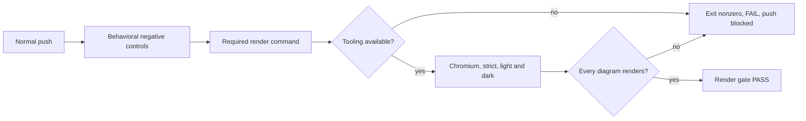

# Required Mermaid render gate hardening

**Last verified:** 2026-10-14

## Executive summary

Missing render tooling previously returned exit zero and appeared as a passed
pre-push gate without rendering anything. The required render command now
fails closed when Playwright or the Mermaid bundle is absent. Pre-push delegates
to that command without a success-shaped skip and runs behavioral negative
controls before the full render.

Renderer discovery previously selected an arbitrary bundled `version` literal.
It now reads Mermaid's identified info-diagram database and treats placeholders
or unattributed versions as unknown. No package or lockfile changes are part
of the original checkpoint. A separately authorized continuation now aligns
the root gate and identified editor bundle at **11.17.0**, using a CI-generated
root-only lockfile. Real strict/light/dark rendering and the installed info SVG
confirm 11.17.0. Version alignment is verified; the behavior of an already-open
editor preview remains a separate check.

## Required versus diagnostic behavior

| Surface | Required behavior |
|---|---|
| `scripts/render-mermaid.mjs` | Exit 1 for missing Playwright or Mermaid; browser launch and render failures remain nonzero. |
| `scripts/pre-push-checks.ps1` | Always invoke the render command; propagate failure into a FAIL summary and blocked push. |
| `scripts/doctor-mermaid.mjs` | Missing gate Mermaid is a blocker. Unknown editor version is an explicit warning, not a suggested npm pin. Identified drift remains a blocker. |
| `scripts/mermaid-renderers.mjs` | Use the identified Mermaid info-diagram version; return null for a placeholder or an unattributed library version. |



This diagram shows the required gate's failure boundary. Diagnostic renderer
discovery does not certify the active editor session or silently change pins.

## Behavioral contract evidence

Run the focused checks without adding a test framework:

```powershell
node scripts/test-mermaid-gates.mjs
pwsh -NoProfile -File scripts/test/mermaid-pre-push.contract.ps1
```

| Control | Observed RED before fix | GREEN acceptance |
|---|---|---|
| Missing Playwright | Required command exited 0 | Exits 1 and identifies missing Playwright. |
| Missing Mermaid with a resolvable Playwright stub | Required command exited 0 | Exits 1 and identifies missing Mermaid. |
| Missing root tooling in registered pre-push action | PASS and "All gates GREEN" | Renderer invoked, exit 1, FAIL summary, no green push permission. |
| Renderer exits 23 | Already failed correctly | Exit 1 and FAIL summary preserved. |
| Renderer exits 0 | Already passed correctly | Renderer invoked and PASS summary preserved. |
| Profiling placeholder before Mermaid info database | Discovery selected 0.0.0 | Selects identified 11.17.0. |
| Only placeholder or unrelated React version | Selected 0.0.0 or 19.2.3 | Unknown/null, never an actionable pin. |
| Compact info-database literal | Additional format control | Identifies 11.15.0; rejects 0.0.0. |
| Unknown renderer diagnostic | Output contract control | States unverified equivalence without recommending 0.0.0. |
| Identified renderer drift diagnostic | Output contract control | Retains blocker and identifies 11.17.0 as the observed version. |
| Render summary equivalence claim | Claimed matching the VS Code extension even after a drift warning | States actual configuration and requires separate editor verification. |

The PowerShell test executes the actual gate action and runner extracted from
the script's syntax tree. It stubs only the external renderer command; it does
not infer behavior from substring presence in source. Node controls execute the
real render CLI in owned temporary fixtures and clean them in `finally`.
The focused result is ten Node controls and three PowerShell controls passing.
The positive render remains real Chromium with `securityLevel: strict` in
both light/default and dark themes, including nonempty SVG and nondegenerate-size
checks. Hook-owned full validation is not duplicated manually before pushing.

## Renderer evidence and remaining boundary

Observed installation:
`C:\Program Files\Microsoft VS Code\645f29cc31\resources\app\extensions\mermaid-markdown-features`.
Its extension package version is `10.0.0`, not Mermaid's version. The preview
bundle contains `globalThis.injected` with profiling `version: "0.0.0"`,
Mermaid `DEFAULT_INFO_DB` with `version: "11.17.0"`, and React `19.2.3`.
Only the identified Mermaid database is usable for discovery. A minified or
different future bundle without that source is conservatively unknown.

The existing newest-directory heuristic is unchanged and is not proof of which
editor process or preview script is currently loaded. Neither matching a parsed
version nor a successful pinned-gate render proves editor equivalence. The
original 11.15.0 versus 11.17.0 gap was resolved in the separately authorized
root-tooling continuation below, respecting proxy/quarantine and CI lock policy.
Do not install or downgrade to `0.0.0`.

## Execution issues and root-cause analysis

| ID | Type / severity | Symptom and root cause | Fix and why it works | Detection / earliest possible | Prevention |
|---|---|---|---|---|---|
| MG-I1 | Gate correctness / High | Missing dependencies became PASS: pre-push set exit 0, and render CLI independently exited 0. | Remove wrapper skip and return 1 from CLI; both boundaries now propagate failure. | Parent's fresh-worktree push / missing-tool negative control | Always execute behavioral negative controls in normal pre-push. |
| MG-I2 | Tooling inference / High | Discovery recommended `mermaid@0.0.0`: first generic version belonged to profiling injection, not Mermaid. | Read the identified info database; null for placeholder/unattributed versions; unknown diagnostics explicitly disclaim equivalence. | Bundle inspection / fixture with multiple version identities | Test placeholder, real Mermaid, and unrelated library together and independently. |
| MG-I3 | Environment / Low | Fresh-worktree API/web builds lacked tsc/vite; render lacked Playwright. | After measured failures, restore existing installed dependencies with identical dependency entries. Root uses a junction; API/web use private copies so generation cannot mutate owned worktrees. | Focused prerequisite checks / same | Compare dependency entries before reuse; no registry fetch, package or lockfile edits. |
| MG-I4 | Test isolation / Low | Child doctor rediscovered the host instead of the scratch renderer; Windows restored ProgramFiles despite an explicit child environment override. | Feed the real scratch discovery result into the doctor's imported discovery seam in the scratch fixture; production discovery is unchanged. | Focused diagnostic control / same | Test output against identified fixture data; do not assume child environment overrides isolate system-known paths. |
| MG-I5 | Evidence wording / Medium | Successful focused render ended with "matches the VS Code extension" despite identified version drift. | Report strict/two-theme configuration separately from unverified editor equivalence. | Positive browser receipt / summary output contract | A behavioral negative control rejects the equivalence claim in the render summary. |
| MG-I6 | Fresh-worktree prerequisite / Low | First normal Validate push stopped at API build because the generated Prisma client was absent. Standalone generation then required DATABASE_URL while loading config. | Generate only the private worktree client with an unused loopback URL; generation succeeded without a database connection or shared mutation. | Normal hook build / prerequisite setup | Restore generated artifacts as well as dependencies before a fresh-worktree push. Gate-order redesign is outside this bounded change. |
| MG-I7 | Test worker startup / Medium | Second normal Validate push passed every preceding gate, but five Vitest forks timed out waiting for worker startup. | Existing VITEST_MAX_WORKERS=2 setting made the five failed files pass all 39 tests; no tests were excluded and no assertion timeout was raised. The complete hook retry uses the same limit. Shared-machine contention is a plausible contributor, not a proven OS-level cause. | Normal hook web suite / same | Use the native worker bound on this shared host, keep startup errors blocking, and distinguish passed files from complete suite evidence. |

The second normal hook rendered **754 diagrams in both themes** and passed
API unit **210 suites / 6,035 tests**, API E2E **116 suites / 2,432 tests**
(four pre-existing skips), and all static gates. Web Vitest passed 114 files /
1,552 tests but had five worker-start errors, so that push correctly remained
blocked. These partial results are not a complete Validate pass.

The retry preserves the normal hook and its full test selection:

```powershell
$env:PREPUSH_MODE = 'Validate'
$env:VITEST_MAX_WORKERS = '2'
git push -u origin fix/mermaid-required-gate-20261014
```

Dependency manifests matched the consolidation worktree. API/web lockfile
dependency entries matched exactly; only release-level lock metadata differed.
The npm registry remained the corporate proxy. No configuration or quarantine
settings were changed. No Azure, Entra, deployment, runtime, or UI changes are
included.

### Provenance and completeness

RED/GREEN receipts are actual subprocess outputs from this bounded session.
The available full `events.jsonl` session log was scanned at consolidation
using failure-signal and diagnosis-phrase passes, including tool outputs and
narration rather than compacted recollection. Diagnosed issues map to MG-I1
through MG-I7. The missing-tool failures are
intentional RED/prerequisite evidence, not unresolved runtime defects. The
first discovery fixture format control already passed before the fix; it is
not counted as a reproduced defect. Commit identities and final hook evidence
are recorded in the PR and parent handoff.
Source excerpts, patch/search echoes, and dependency-copy "still running"
notifications were dismissed as non-issues, not counted as execution failures.

## Self-improvement and design disposition

**Test/gate disposition: applied.** Negative controls now run in the normal
hook, proving exit status, actual invocation and summary rather than relying
on source text. Generalized lesson: missing required evidence is a failure,
not an optional diagnostic skip.

**Design/architecture disposition: accepted.** Discovery remains in its
existing shared helper; render remains responsible for tooling/render failures,
and pre-push remains a thin orchestrator. No new strategy, framework, or
dependency is justified for these bounded responsibilities.

Remaining release checks: review and exact-tip CI, parent sequencing, and
active-editor preview verification. No merge or deployment
is authorized by this change.

## Authorized root-tooling alignment continuation

The operator authorized this tightly coupled follow-up after the original
checkpoint `a9f376af`. Root Mermaid is now targeted exactly at 11.17.0.
API/web dependency manifests and lockfiles remain out of scope. Root lockfile
generation runs only in the existing CI workflow, extended with a `root`
selector. `both` preserves API/web semantics; artifacts contain only the
selected lockfiles and publication-age evidence.

The fresh behavioral controls were RED for missing root workspace support and
the absent root-aware validator. GREEN controls cover selected CLI paths,
public URLs, missing/weak/unknown integrity rejection, scoped/nested identities,
unchanged-package exclusion, missing-map failure and the exact seven-day
boundary. CI now fails on unknown/young changed packages rather than merely
printing a warning.

Read-only corporate-proxy metadata reports Mermaid 11.17.0 publication at
`2026-08-19T09:20:08Z`, already more than 55 days old. The operator's earlier
receipt used `2026-08-19T15:20:08Z`; both are beyond quarantine, but this
continuation retains the actual returned timestamp rather than silently
normalizing the six-hour discrepancy. `min-release-age=undefined` is not
evidence that proxy quarantine is absent. No npm settings are changed.

### MG-I8: root provenance was not covered by the existing checker

- **Type/severity:** supply-chain gate gap / High.
- **Symptom/root cause:** root verification rejects all 155 historical
  dependency entries because they carry internal feed URLs. The existing
  checker inspects only API/web, so prior gate-green did not cover root.
- **Resolution:** CI npm regeneration, not local lockfile edits or synthesized
  integrity hashes. Validate the complete selected root lock before upload.
- **Detection/earliest:** new focused root CLI verification / root-inclusive
  provenance check.
- **Prevention:** root CLI contamination controls and workflow-selected
  validation; no artifact is published if any entry fails.

Final CI artifact provenance, complete changed-package ages, measured
transitive diff and real aligned strict/two-theme rendering are pending.
Manifest alignment alone is not a render-equivalence claim.

The age-set control also reproduced an omission in version-only comparison:
same-version provenance rewrites were absent from the age report. Changed-entry
comparison now includes those entries. This is **MG-I9**, test correctness /
Medium, caught by focused RED before CI; prevention is the provenance-only
behavioral control. The workflow uses a seven-day `--before` resolution cutoff
and independently rejects young/unknown timestamps before publishing artifacts.

### CI receipt and transitive-minimization checkpoint

Run `38528990421` on `fa01a487` succeeded using the public registry and uploaded
only the root lock and publication-age report. All 157 output dependency
entries passed; minimum age was 9.079 days. Mermaid 11.17.0 was 55.925 days old.
The initial clean solve also advanced unrelated versions, including markdown-it.
That artifact is retained for evidence but is not accepted as the final lock.

To minimize unrelated churn without editing any lockfile URL/hash, root CI now
uses npm twice: an exact-version seed manifest retains the old top-level
dependency versions except intentionally changed direct requirements; the
original manifest is restored in `finally`, then npm prunes temporary direct
entries. New requirements resolve normally, under the same seven-day cutoff.
Only npm writes the lockfile. Explicit CI/Linux guards prevent executing this
generation path locally. Seventeen focused controls pass, including seed
preservation, nested-name exclusion and non-CI rejection.

This is **MG-I10**, dependency scope / Medium, caught by CI artifact diff
before installation/commit. The mechanism was deleting a contaminated lock
without retaining its version choices. The first artifact is not treated as
a minimal diff merely because provenance and age checks passed. Final
transitive-minimization receipt is recorded below.

### Accepted CI artifact and aligned rendering

Run `38530411570` on `7da126aa` passed the existing regeneration workflow.
The artifact contains only `package-lock.json` and `publish-ages.json`.
The root lock SHA256 is
`C876B343430DB45F525E8F6B966E04ACC1ADE6307228D78E46807F3C7976D60A`.
Every one of 157 changed entries has a public HTTPS registry URL, sha512
integrity and a publication timestamp at least seven days old; the youngest
was **55.934 days** at `2026-10-14T07:45:36.670Z`.

| Dependency identity | Before | After | Reason |
|---|---|---|---|
| mermaid | 11.15.0 | 11.17.0 | Match identified editor package version. |
| @mermaid-js/parser | 1.2.0 | 1.2.1 | Mermaid 11.17.0 requires ^1.2.1; npm places it under mermaid. |
| fastdom | Absent | 1.0.12 | New exact Mermaid dependency. |
| strictdom | Absent | 1.0.1 | fastdom requires ^1.0.1. |

All other existing dependency versions, including markdown-it 14.3.0 and
jsdom 26.1.0, are unchanged. The large URL/hash diff corrects historical
provenance, not additional version upgrades. No API/web manifest or lockfile
changed.

After importing the artifact, `npm ls mermaid` measured the old junction's
11.15.0 as invalid for the requested 11.17.0. Only this worktree's junction was
removed; the source dependencies were verified present. `npm ci` through the
unchanged corporate proxy restored a private root installation and left the
CI lock hash identical. No local lockfile generation or npm settings changes
occurred. Chromium's actual info-diagram SVG reports 11.17.0; the changed
diagram renders under strict configuration in both themes. The doctor exits
zero and identifies gate/editor Mermaid 11.17.0 without version drift.

During this continuation a newer user-local VS Code installation appeared at
`C:\Users\v-prasrane\AppData\Local\Programs\Microsoft VS Code\8c19d9191d`.
It splits/minifies Mermaid's info database into `infoDiagram-*.js`, rather than
the original monolithic constant. Discovery initially conservatively returned
unknown. A RED/GREEN control now covers the actual format: only the named info
module's version object referenced by its `getVersion` getter is accepted.
Arbitrary version literals and placeholders remain rejected.

**MG-I11**, environment/format drift / Medium: new installation layout caused
unknown discovery during real aligned rendering; the focused actual-format
control was the earliest discriminating check. The fix reads the identified
split module, not an arbitrary minified variable from another library.

**MG-I12**, tooling friction / Low: the editor Problems tool timed out during
the continuation. Node syntax checks, YAML parsing and behavioral contracts
provided explicit fallback validation; the timed-out tool was not counted as
a clean diagnostics receipt. One patch context mismatch was corrected by
reading the exact target lines before retrying; it caused no source changes.

Root npm audit reports **zero High/Critical**, two Moderate and two Low
findings. The underlying dompurify 3.4.12, markdown-it 14.3.0 and katex 0.16.47
versions are unchanged from the baseline; Mermaid's Low finding is inherited
from katex. These are not represented as a clean audit or fixed here. Follow-up:
the parent should schedule a separately scoped root dependency remediation
under the same quarantine/CI-lock policy. Receipts and advisory URLs are in
`test-results/root-aligned-audit.json`.

**MG-I8 closure:** the normal provenance checker now uses the same strict
validator for root/API/web. Four subprocess controls prove clean root passes
and internal URL, weak integrity and missing integrity fail. Together with
17 regeneration controls, 11 Mermaid controls and three registered-action
controls, these checks run in the normal push hook.

**Test/gate disposition: applied.** Root provenance is no longer outside the
normal gate's scope; split-module discovery and minimal dependency retention
have direct negative/positive controls.

**Design/architecture disposition: accepted.** The workflow remains an
orchestrator; selection, validation and CI-only generation share one cohesive
dependency helper. The transient manifest is restored even on failure, and
npm alone owns the lockfile. No generalized dependency resolver or new testing
framework was introduced.

Final normal-hook complete rendering and exact-tip CI remain to be recorded in
the PR handoff. No editor UI, shared estate, deployment or promotion is claimed.
